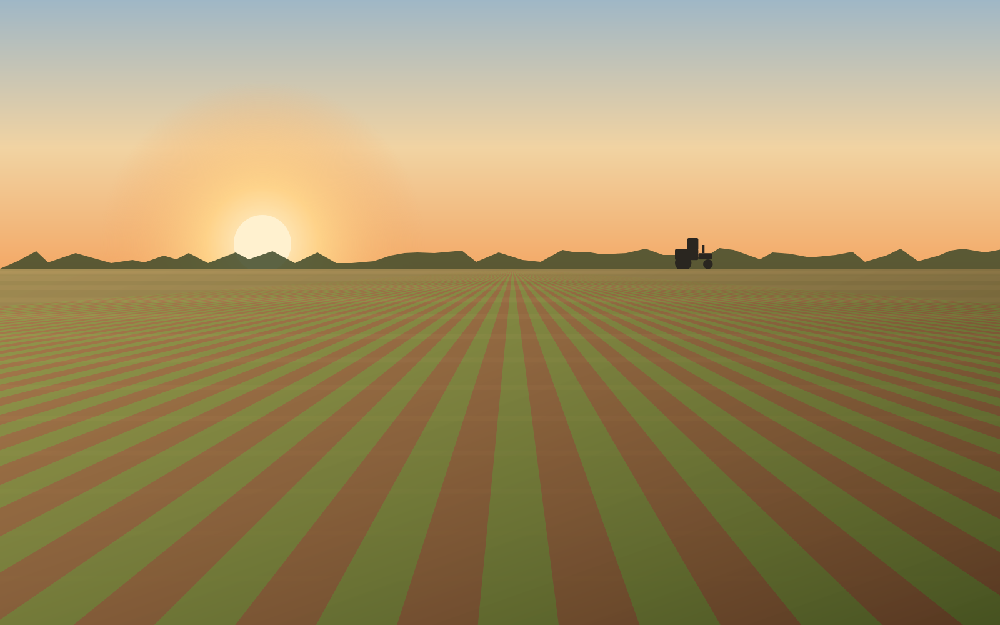
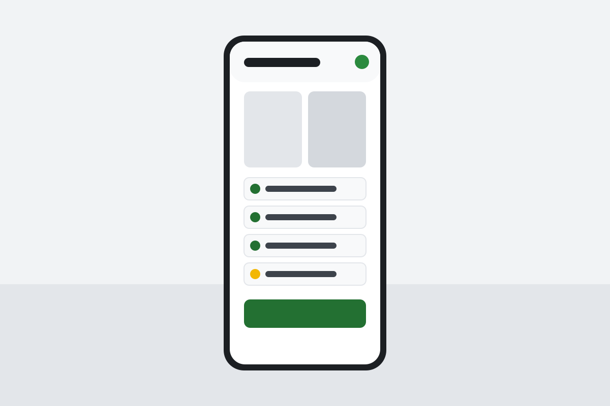
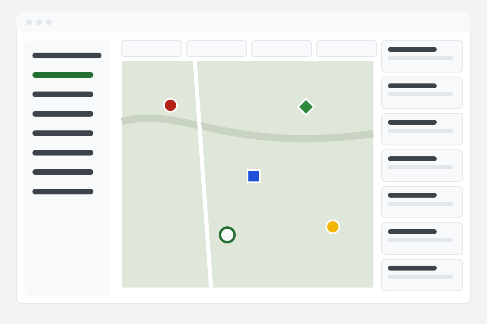

  

<strong>Controle das máquinas no campo. Cada hora rende mais.</strong>

# AgroRende

A AgroRende mostra quanto cada máquina realmente custa e rende, porque a equipe no campo registra
cada vistoria, reparo e locação no celular, mesmo sem sinal.

  

## Para quem é

Para empresas que mantêm máquinas agrícolas trabalhando no campo:

- **Concessionárias** com mecânicos que atendem na fazenda;
- **Locadoras** de máquinas e implementos;
- **Prestadores de serviço** que operam máquinas para terceiros;
- **Grandes fazendas e cooperativas** com frota própria.

Quem usa o app é o técnico; quem decide pela compra é o dono ou o gerente de operações. A
AgroRende não foi pensada para o produtor com um único trator: esse público é atendido pelas
cooperativas e prestadores que já trabalham com ele.

## O problema

Hoje a informação se perde no caminho entre o campo e o escritório. Papel, grupos de WhatsApp e
planilhas perdem fotos e horas:

| Hoje | Com a AgroRende |
|---|---|
| O defeito chega por áudio, sem foto e sem saber onde a máquina está. | Relato com fotos, localização e a máquina certa. |
| Reparo e locação terminam sem prova do que foi feito. | Fotos de antes e depois e a assinatura do cliente. |
| Ninguém sabe quanto cada máquina custa de verdade. | Custo por hora de cada máquina, sempre em dia. |

Máquina parada é dinheiro perdido. A AgroRende existe para que quem cuida das máquinas no campo
trabalhe com informação, e não com papel e memória.

## Os três trabalhos

Um cliente contrata a AgroRende para três trabalhos. Todo o resto é secundário.

1. **Saber o que está acontecendo no campo hoje.** Relatos, fotos e o andamento dos serviços
   chegam ao escritório assim que o celular encontra sinal.
2. **Parar de discutir o que aconteceu.** Fotos de antes e depois, checklists e a assinatura do
   cliente encerram as discussões sobre reparos e locações.
3. **Saber o custo real por hora de máquina.** Peças, mão de obra, combustível e tempo parado são
   somados por máquina, para o dono cobrar locações e serviços com segurança.

## Como funciona

**Campo → escritório → custo.**

1. **A equipe relata do campo.** No app, o técnico registra o problema, faz o checklist, tira
   fotos e marca a localização. Sem sinal, tudo fica salvo no celular e é enviado sozinho quando o
   sinal voltar.
2. **O escritório acompanha e decide.** No painel web, o escritório vê os relatos com fotos, a
   equipe no mapa e as pendências do dia, e transforma um relato em ordem de serviço.
3. **O serviço termina com prova.** Vistorias na entrega e na devolução das locações, fotos de
   antes e depois, peças usadas e a assinatura do cliente.
4. **O custo de cada máquina se fecha sozinho.** Peças, mão de obra, combustível e tempo parado
   viram custo por máquina, por fazenda e por safra.

  
  

_As imagens acima são ilustrações do site; ainda não há capturas de tela do produto no repositório._

## Principais benefícios

- **Funciona sem sinal.** O app foi feito para a lavoura e o pátio, não para o escritório.
- **Prova do que foi feito.** Fotos, checklist e assinatura em cada serviço e em cada locação.
- **Visão geral em tempo real.** O escritório vê relatos, serviços e a equipe em serviço no mapa.
- **Custo por hora de máquina.** Uma base sólida para precificar locações e serviços.
- **Português claro.** Telas simples, pensadas para uso ao ar livre, com botões grandes e alto
  contraste. O app e o painel também estão disponíveis em inglês.
- **Os dados são da sua empresa.** Cada empresa tem seus dados separados das demais.
- **Teste por 30 dias.** A empresa se cadastra, convida a equipe e usa o produto durante o
  período de teste.

## Situação e próximos passos

A AgroRende está em desenvolvimento ativo. O app de campo (Android e iOS), o painel do escritório e
o site público já funcionam com dados de demonstração. As próximas etapas, em alto nível:

| Fase | O que entra |
|---|---|
| **Agora** | Animações leves no site, no painel e no app; textos mais simples no site; guia de primeiro uso no painel; telas vazias que explicam o próximo passo; vídeo de demonstração. |
| **Em seguida** | Ligar e desligar recursos em *Configurações → Recursos*, com módulos avançados escondidos por padrão; cadastro rápido de máquina; reinício da organização de demonstração; convite da equipe por QR code no celular. |
| **Depois** | Pagamento por Pix e boleto; notas fiscais; avisos por WhatsApp para os clientes; assistente para trazer sua planilha; programa de indicação; depoimentos e casos de clientes. |

O roteiro pode mudar conforme o que aprendermos com os clientes.

## Para desenvolvedores

Toda a informação técnica — como instalar, rodar, testar e publicar, a stack, a arquitetura, os
usuários de demonstração e as convenções do projeto — está no wiki:

- **Wiki no GitHub:** <https://github.com/pedroafsouza/agrorende/wiki>
- **Fonte do wiki neste repositório:** [`docs/wiki/Home.md`](docs/wiki/Home.md)

A especificação completa do produto e da arquitetura fica em [`docs/`](docs/).
