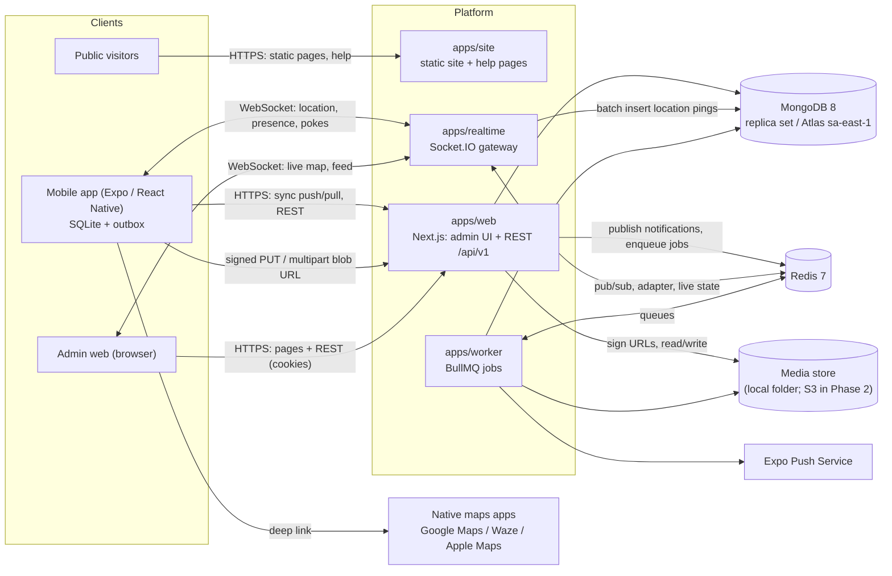
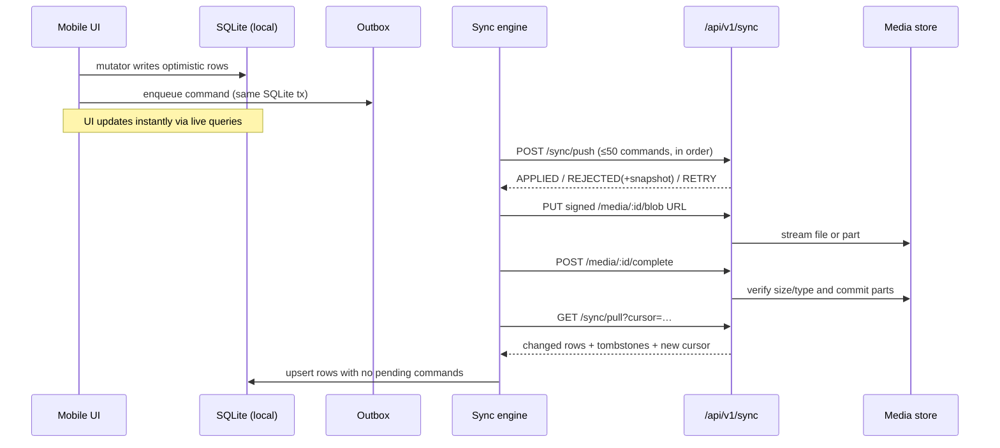

# AgroRende: Architecture and Technical Design

> Written by the architecture team (backend and frontend). It turns `docs/PRD.md` into a buildable design.

| | |
|---|---|
| Status | v1.6, ready for build |
| Date | 2026-10-08 |
| Doc set | Round 5 (2026-10) |
| Changelog | Round 5: MongoDB 8 replaces PostgreSQL/Prisma for the MVP; pnpm workspaces replace Turborepo; visual direction and single palette; review fixes (round 5). v1.6: caveman is the default chat voice of every agent and subagent report, `caveman-review` added, skill sources pinned (§4.3). |
| Inputs | `docs/PRD.md` (requirement IDs such as FR-03, WO-04, OFF-02 are cited throughout) |
| Build plan | `docs/DELIVERY-PLAN.md` |
| **Normative** | All names in this document are **normative**: packages, files, models, enums, mutation names, events, routes and env vars. Parallel agents depend on them. Change a name only through a change request (see the delivery plan). |

---

## 1. Overview

### 1.1 The two questions from the brief

**"Should we use WebSockets to communicate?"** Yes, but **only for things that need to be live**: operator locations on the ops map, presence, the activity feed, and "something changed, pull now" pokes to devices. **WebSockets are never the source of truth.** All business data moves through an **HTTP sync protocol** (push mutations, pull changes) that tolerates offline use. A dropped socket can therefore never lose data; at worst the live map is a few seconds behind.

**"Perhaps the backend in Next.js?"** Yes, for the **admin web UI and the REST/sync API** (`/api/v1/*` route handlers on the Node.js runtime). We add two small Node services:

- **`apps/realtime`**, a Socket.IO gateway. Next.js route handlers are request/response and can't hold long-lived WebSocket connections reliably, especially on serverless.
- **`apps/worker`**, a BullMQ worker for push notifications, SLA and overdue scans, and clean-up jobs.

All business logic lives in a framework-agnostic package, **`packages/core`**, so the API can later move out of Next.js without a rewrite.

### 1.2 System context



**Data stores at a glance**

| Store | Technology | Role | Source of truth? |
|---|---|---|---|
| System of record | **MongoDB 8** replica set via the official `mongodb` driver in `packages/db`; production on Atlas AWS `sa-east-1` | All business documents, sync versions, event outbox, activity log, location history (30 days) | Yes, for the organization |
| Ephemeral state | **Redis 7** | Socket.IO adapter, event pub/sub, BullMQ queues, live operator positions, rate limits | No; can be rebuilt. Queues are persistent but re-creatable; the transactional event outbox lives in MongoDB (§7.3). |
| Files | **Media store** (`MEDIA_DRIVER=local`, local folder in the MVP; S3 in Phase 2) | Photos, videos, audio, signatures, PDFs | Yes, for binaries; metadata documents live in MongoDB |
| On the device | **SQLite** (`expo-sqlite` + drizzle) | Local copy of the user's scope + the outbox | Yes, for that device's UI until synced |

Redis and the device databases can be rebuilt; MongoDB and the media store are the stores that need backups (§18.3).


### 1.3 Design principles

1. **Each device's local database is that device's source of truth** for the UI. The server is the source of truth for the organization.
2. **Commands, not document diffs.** Devices send intent (`workOrder.transition {action: "startWork"}`), and the server enforces the rules. This makes conflicts rare and easy to explain.
3. **Idempotency everywhere.** Every mutation and media item has a client-generated UUID v7.
4. **One rulebook.** State machines, guards, charge calculation and validation live in `@agrorende/contracts` and run identically on the device (offline) and the server (authoritative).
5. **Boring, proven technology** in Node and TypeScript across the whole stack, so one team can own it all.

---

## 2. Architecture decisions (ADRs)

| # | Decision | Rationale |
|---|---|---|
| ADR-01 | **pnpm 11 workspaces monorepo (no task runner)**, TypeScript `strict` everywhere, Node 24 LTS, shared versions in the pnpm `catalog:` | Shared types between mobile, web and server. One CI. pnpm filters (`--filter`, `...[origin/main]`) give affected-only runs; a task runner can be added later if CI time demands it. |
| ADR-02 | **Next.js 16 App Router** hosts the admin UI **and** `/api/v1` route handlers (`runtime = "nodejs"`) | One deployable for UI and API, server components for the admin, a strong ecosystem. Route handlers stay thin and call `@agrorende/core`. |
| ADR-03 | **A separate Socket.IO gateway** (`apps/realtime`) with the Redis adapter | WebSockets need long-lived processes. Socket.IO adds rooms, acks, reconnection and fallbacks. The Redis adapter makes it scale horizontally. |
| ADR-04 | **Offline-first mobile app.** SQLite (expo-sqlite + drizzle-orm) is the local store; an **outbox** of commands is pushed over HTTP | Meets OFF-01..13. SQLite is durable, queryable and survives app kills. Drizzle gives typed queries and live queries. |
| ADR-05 | **Server change tracking with a per-org monotonic `syncVersion`**, assigned by `$inc` on the org counter document inside the same MongoDB transaction | The `$inc` on `sync_counters._id = orgId` is the first transactional operation. Every synced write for the org contends on that document, so commit order equals version order and guards cannot race inside `withSyncTx`. |
| ADR-06 | **MongoDB 8 + official `mongodb` driver 7.x + Zod document schemas**; no ODM | The prototype and MVP need fast iteration, transactions, simple document mapping to device SQLite and future portability. All driver access is isolated in `packages/db`; Zod remains the schema system. |
| ADR-07 | **Media go through a `MediaStore` driver**. MVP: `local` (signed API URLs stream to a local folder; single and multipart); Phase 2: `s3` (presigned, direct to the bucket) | No object store in the MVP. The device protocol is the same for both drivers, so switching is server-only plus a one-off copy of the same keys. |
| ADR-08 | **Expo latest stable SDK when T01 runs, never a beta**, with development builds (`expo-dev-client`), EAS Build and EAS Update | Background location, camera and video need native modules. Expo Go is **not** supported. OTA updates ship fixes quickly. |
| ADR-09 | **Navigation is handed off to native maps apps** through deep links | The PRD asks for it. Turn-by-turn and offline maps come for free, at zero cost. |
| ADR-10 | **MapLibre GL on the web** with OpenFreeMap styles (no API key). **react-native-maps** on mobile | Free and open vector maps for the ops centre. Native maps on the phone. |
| ADR-11 | **Auth: 15-minute JWT access token plus a rotating opaque refresh token** (30 days, reuse detection with a 30 s same-family grace). httpOnly cookies on the web, SecureStore on mobile | Works offline for 30 days, revocable, and has no third-party dependency. The grace avoids logging out concurrent tabs after a legitimate refresh race. |
| ADR-12 | **`@agrorende/contracts` with Zod 4**: enums, DTOs, mutation schemas, state machines, the charges formula | A single source of truth for validation and rules on every runtime. |
| ADR-13 | **BullMQ worker** for scheduled and async work | Built on Redis, which we already run. Reliable retries and cron-style schedules. |
| ADR-14 | **UUID v7 IDs, integer cents for money (BRL), BSON `Date` in UTC**, with the org time zone applied only for display | IDs can be created offline and sort by time. Money has no rounding drift. Time handling is unambiguous. |
| ADR-15 | **GitHub is the platform** for code, PRs, Actions, Environments, GHCR, Dependabot, CodeQL, secret scanning, CODEOWNERS and rulesets | One platform for review, CI/CD and governance. Phase 1 deploys over SSH with GitHub Environment secrets; Phase 2 cloud credentials use OIDC federation, not long-lived keys. |
| ADR-16 | **Public npm only**; workspace packages are private, resolved with `workspace:*`, and never published | The team uses public npm directly. pnpm 11 supply-chain defaults, Dependabot and CI audit cover the risk without extra infrastructure. |
| ADR-17 | **One container image per service, promoted across environments** | `web`, `realtime` and `worker` use the same digest from staging to production. Phase 1 runs them on one VM per environment with Docker Compose + Caddy; Phase 2 uses a container platform (ECS Fargate reference). |
| ADR-18 | **Mobile builds use EAS cloud builds by default**; EAS Update delivers OTA fixes | GitHub workflows call EAS with `EXPO_TOKEN`; Android, iOS and store credentials stay in Expo/EAS instead of local runners. |
| ADR-19 | **Environment ladder:** `local` → `ci` → `staging` → `production`; `APP_ENV` tells code which one it is | The ladder separates seed data from customer data and makes ribbons, Sentry environments and seed guards deterministic. |
| ADR-20 | **MongoDB 8 (replica set) is the only system of record for the prototype and MVP** | Multi-document transactions cover each sync batch; the per-org counter document gives a gap-free sequence; unique `_id` values support idempotency; flexible documents fit checklists and forms; there is no ORM (official driver + Zod only); and the flat one-collection-per-entity model keeps a later PostgreSQL port cheap. Revisit when reporting needs SQL/BI tools, cross-entity analytics dominate, or Atlas cost exceeds an equivalent managed PostgreSQL. |
| ADR-21 | **Own sign-in with Google/Apple OIDC + invites, keeping our device token model** | Google and Apple prove identity while our 15-minute access JWT, rotating per-device refresh families, disabled-user drain token and offline behaviour stay unchanged. Clerk/Auth0/WorkOS add per-MAU cost and a second session model; Auth.js is web-cookie centric; Better Auth is closest but duplicates users/sessions with sync-scoped `User` (revisit P2); Firebase Auth adds another vendor; native Google Sign-In SDK creates per-variant SHA-1 overhead; SMS OTP is P1 via WhatsApp because of message cost. |
| ADR-22 | **Multi-tenant SaaS on a shared MongoDB database and shared app** | Many organizations share one deployment, isolated by `organizationId` on every document and query. Isolation is the `scoped(ctx)` wrapper plus lint/CI bans on raw driver access; optional P2 defense in depth is Atlas least-privilege database users. Database per tenant adds operations and migration cost; per-tenant subdomains complicate TLS, cookies and deep links. |

**Rejected alternatives**

| Alternative | Why not |
|---|---|
| NestJS API | It would be a second framework next to Next.js. `packages/core` plus thin route handlers give the same separation with fewer moving parts. |
| tRPC | The mobile sync protocol and the public REST API (P2) are better served by explicit REST plus Zod contracts, and offline command replay doesn't fit an RPC style. |
| Firebase / Supabase realtime as the backbone | Vendor lock-in. Weak support for command-based offline sync with server-enforced state machines. LGPD data-residency questions. |
| PowerSync / ElectricSQL / Replicache | Strong products, but they add a paid or complex dependency, and our domain needs command semantics (guards, late evidence) more than row replication. They could be re-evaluated later. |
| WatermelonDB / Realm | Realm Sync is deprecated. WatermelonDB's sync model is row-diff based and it is less actively maintained. expo-sqlite + drizzle is first-party and simpler. |
| WebSockets for all data | Data would be lost on disconnect and every client would need complex replay. HTTP sync is easier to make correct. |
| In-app turn-by-turn navigation (Mapbox Navigation SDK) | Costly and duplicates Waze and Google Maps, which field users already trust. |
| Private npm feed / registry mirror | The team uses public npm; pnpm 11 supply-chain defaults + Dependabot + audit cover the risk without extra infrastructure. |
| Vercel for web + API | It adds a second artifact type and runtime, and region/data locality become harder to keep aligned. Containers keep web, realtime and worker identical. |
| GitHub-runner local mobile builds as the default | macOS capacity, signing and native dependency drift make local builds brittle. EAS cloud builds keep credentials and platform build images in one place. |
| **PostgreSQL for the MVP** | Possible later, but the prototype needs fast document iteration now. Revisit when reporting needs SQL/BI tools, cross-entity analytics dominate, or Atlas cost exceeds an equivalent managed service. |
| **Prisma 6 Mongo connector** | Prisma 7 has no MongoDB support and Prisma 6 would freeze the project on a dead-end connector. The official driver plus Zod keeps the boundary explicit. |
| **Mongoose** | It adds a second schema and middleware system next to Zod contracts. We keep validation in Zod and access in `packages/db`. |
| **Turborepo** | It works with Expo (and Expo's own examples use it), but with about 10 packages its caching adds little and the project prefers fewer tools. pnpm filters cover affected runs. |
| **Nx** | More powerful than needed and heavier to teach agents for this repo size. |
| **Vite SPA + separate API (Hono/Fastify)** | Possible later: Vite gives a faster dev server for a pure SPA, but we would need a second server app for the API, cookies and SSR-free auth redirects. Next.js keeps UI and API in one deployable. Vitest already uses Vite under the hood. |
| S3 from day one | It adds a managed service plus IAM and CORS setup before there are users; the `MediaStore` driver keeps the door open. |
| Kubernetes | MVP load (≤ 100 live operators per org, a few pilot orgs) fits one VM; Compose on one VM is simpler. |
| Clerk/Auth0/WorkOS | Per-MAU cost, a second session model next to our per-device refresh families and disabled-user drain token, vendor dependency and data-residency concerns. |
| Auth.js / Better Auth / Firebase Auth | Auth.js is web-cookie centric and mobile is not first-class; Better Auth duplicates users/sessions with our sync-scoped `User` (revisit P2); Firebase Auth adds a heavy vendor SDK. |
| Native Google Sign-In SDK / SMS OTP for P0 | Native Google Sign-In adds per-variant SHA-1 and legacy Play Services complexity; SMS/WhatsApp OTP has per-message cost and stays P1. |
| Database per tenant | Higher operations and migration cost; `organizationId` isolation is enough for the MVP. Optional Phase 2 defense in depth is per-environment Atlas users with least privilege. |
| Per-tenant subdomains | TLS, cookies and deep links become harder; the organization comes from the token. |
| Row-level security as the isolation model | It belongs to relational engines and would not protect driver calls. The MVP defense is `scoped(ctx)`, lint bans and cross-tenant tests. |
| Bun as the server runtime / package manager | Node.js 24 LTS stays: Vitest is not supported on Bun, Expo/Metro still needs Node, `better-sqlite3` sync tests do not load under Bun, Next.js 16 is not first-party on Bun, Sentry/OpenTelemetry Node SDKs are mature, and pnpm 11 supply-chain defaults are stricter. Revisit Bun for the worker in Phase 2 if CPU or memory justify it. |
| Lead-form backend on the public site | P1. The MVP site stays static with WhatsApp and email CTAs, avoiding a new backend or vendor before launch. |

---

## 3. Technology stack

Use the **latest stable** versions available when T01 runs, and pin them in the lockfile. The table gives the reference majors as of Oct 2026.

### 3.1 Mobile: `apps/mobile`

| Concern | Choice |
|---|---|
| Runtime | Expo latest stable SDK when T01 runs (never a beta), React Native New Architecture, `expo-dev-client`, EAS Build/Update, `expo-updates` with `runtimeVersion: { policy: "fingerprint" }` |
| Navigation | `expo-router` (typed routes) |
| Local DB | `expo-sqlite` + `drizzle-orm` (sqlite-core, `useLiveQuery`), `openDatabaseSync("agrorende.db", { enableChangeListener: true })`, bundled migrations with `useMigrations` from generated `drizzle/migrations.js`; `drizzle-kit` is dev-only |
| State | `zustand` for UI and session state only; all domain data is read from SQLite |
| Forms | `react-hook-form` + `@hookform/resolvers/zod` |
| Camera and scanning | `expo-camera` (photo, video, barcode scanning: `qr`, `code128`, `ean13`) |
| Media processing | `expo-image-manipulator` (resize and compress), `expo-video` `generateThumbnailsAsync` (posters), `expo-image` (display), `expo-video` (playback), `expo-audio` (voice notes) |
| Files and uploads | Modern `expo-file-system` (`Paths`, `File`, `Directory`) for durable storage; `expo-file-system/legacy` `createUploadTask` with `sessionType: BACKGROUND` and absolute API URLs for resumable uploads; `expo-sharing` (PDF share) |
| Signatures | `react-native-signature-canvas` |
| Annotation | `@shopify/react-native-skia` (photo annotation FR-04, P1; installed by T01) |
| Location | `expo-location` + `expo-task-manager` (background updates, Android foreground service) |
| Maps | `react-native-maps` (Google provider on Android needs an API key; Apple Maps on iOS) |
| Connectivity | `@react-native-community/netinfo` |
| Realtime | `socket.io-client` |
| Push | `expo-notifications` |
| Background sync | `expo-background-task` (P1) |
| Secure storage | `expo-secure-store` (refresh token) |
| Device info | `expo-device`, `expo-application`, `expo-battery`, `expo-constants` |
| i18n | `i18next` + `react-i18next` + `i18next-icu` + `expo-localization`; shared namespaces from `@agrorende/i18n` |
| UI | Our own UI kit (`src/ui`) built on `StyleSheet` and `@agrorende/design-tokens`, `react-native-reanimated`, `react-native-gesture-handler`, `@gorhom/bottom-sheet`, `lucide-react-native`, `expo-haptics`, `react-native-safe-area-context` |
| IDs | `uuidv7` |
| Errors | `@sentry/react-native` |
| Tests | `jest-expo` + `@testing-library/react-native`. The sync engine is tested in Node with `better-sqlite3` (drizzle driver) and `msw`. Maestro E2E is P1. |

### 3.2 Web: `apps/web` (admin UI)

| Concern | Choice |
|---|---|
| Framework | Next.js 16 App Router, React 19, server components for data-heavy pages. In Next.js 16 the edge interceptor file is **`src/proxy.ts`** (formerly `middleware.ts`). |
| Styling | Tailwind CSS v4, **shadcn/ui** (Radix-based), `next-themes` (dark and light), Geist font, `lucide-react` |
| Data | TanStack Query v5 (client cache, invalidated by realtime events), TanStack Table v8 |
| Maps | `maplibre-gl` + `react-map-gl/maplibre`. Styles come from env vars (defaults: OpenFreeMap `liberty` for light and `dark` for dark). `terra-draw` for plot polygons (P1). Satellite raster layer from env (P1). |
| Board and dnd | `@dnd-kit/core` (Kanban) |
| Charts | Recharts (P1 analytics) |
| UX | `cmdk` (⌘K, P1), `sonner` (toasts), `date-fns` + `date-fns-tz` |
| i18n | `next-intl` with ICU messages; admin routes are not locale-prefixed |
| Forms | `react-hook-form` + Zod resolvers (schemas from contracts) |
| Realtime | `socket.io-client` |
| Tests | Vitest + Testing Library. **Playwright** for E2E, with `@axe-core/playwright` for accessibility checks. |

### 3.3 Backend (API in `apps/web`, plus `packages/core`)

| Concern | Choice |
|---|---|
| Data | Official `mongodb` driver 7.x + Zod 4 document schemas in `packages/db`, MongoDB 8 replica set |
| Validation | Zod 4 schemas from `@agrorende/contracts` plus document schemas in `@agrorende/db` |
| Auth | `jose` (JWT HS256 and OIDC ID-token verification), `arctic` (Google/Apple OAuth with PKCE), `@node-rs/argon2` (password hashing), opaque refresh tokens (SHA-256 hashed at rest), mobile `expo-web-browser`, `expo-crypto`, `expo-apple-authentication`; dev/E2E navikt `mock-oauth2-server` |
| Cache, pub/sub, rate limits | `ioredis` |
| Object storage | Media: local driver in `core/storage` (Phase 2: `@aws-sdk/client-s3` + presigner) |
| PDF | `@react-pdf/renderer` (server-side) |
| CSV | `csv-stringify` |
| Logging | `pino` (JSON) |
| Errors | `@sentry/nextjs` (optional, enabled by DSN) |

### 3.4 Realtime and worker

| Service | Choice |
|---|---|
| `apps/realtime` | Node 24, `socket.io` v4, `@socket.io/redis-adapter`, `ioredis`, `jose`, `pino`, `@agrorende/db` (location ping inserts) |
| `apps/worker` | Node 24, `bullmq`, `expo-server-sdk` (push), `@agrorende/core`, `pino`. Also hosts `pnpm simulate` (fake moving assignees for demos), which uses `socket.io-client` and `@agrorende/api-client`. |

### 3.5 Tooling

ESLint (flat config) and Prettier live in `packages/config`. pnpm 11 is the only workspace runner and uses the workspace catalog, filters and explicit `allowBuilds` policy (§4.2); no repo-level task runner is part of the MVP. `scripts/check-only.ts` implements filtered lint/typecheck/test gates. `tsx` runs TypeScript services and scripts in dev; `tsup` bundles services and shared packages. Vitest covers packages and server code; `jest-expo` covers mobile; `test:ci` writes JUnit and coverage artifacts. Node.js 24 remains the runtime and pnpm 11 the package manager; Bun is a rejected alternative for now and may be revisited for the worker in Phase 2. GitHub Actions (§18.2) is the CI runner, Docker Compose provides local infrastructure, `pnpm devloop` (§16.1) wraps setup and daily checks, and `patches/` stores reviewed `pnpm patch` files. Dev-only: `@faker-js/faker` (seed, `packages/db`) and `sharp` (placeholder media for `pnpm storage:seed`, `packages/core`). Husky is **not** used (it slows agents down); CI enforces the checks instead. OIDC tests use `ghcr.io/navikt/mock-oauth2-server:2.1.10` with `/google` and `/apple` issuers.


### 3.6 Public site

| Concern | Choice |
|---|---|
| App | `apps/site`, Next.js 16 App Router with `output: "export"`, no API routes and no server runtime |
| Content | Locale-prefixed routes (`/pt-br`, `/en`) with `next-intl`, MDX or typed content files, and help pages generated from `ERROR_META` + the `errors` namespace |
| Quality | Playwright smoke, axe checks, `@lhci/cli` Lighthouse CI budgets, same-origin request checks, sharp-generated responsive images via `apps/site/scripts/images.ts` |

### 3.7 Visual direction

**Framework summary.** Field app: Expo latest stable SDK + React Native New Architecture, `expo-router`, `src/ui` on `StyleSheet` + `@agrorende/design-tokens`, Reanimated, Gesture Handler, `@gorhom/bottom-sheet`, `lucide-react-native`, `react-native-maps`; no NativeWind or Tamagui. Admin web: Next.js 16 + React 19, Tailwind CSS v4, shadcn/ui (Radix), TanStack Query + Table, MapLibre (`react-map-gl`), `@dnd-kit`, `sonner`, `cmdk`, Recharts. Site: Next.js 16 static export + Tailwind v4 + the same tokens.

Design direction: **Campo claro** — calm graphite surfaces, one green for action, Terra orange only for brand moments, status colours that always carry an icon and a word, and big type outdoors.

**Inspiration (quality bar and interaction patterns only; never copy layouts, assets, icons, copy or trade dress):**

- Field app: Brazilian driver and courier apps (Uber Driver, 99 Motorista, iFood para Entregadores) for today's job card, one big contextual action and navigation hand-off; WhatsApp camera and hold-to-record voice; Google Maps/Waze hand-off; Material 3 and Apple HIG conventions.
- Admin web: Linear for calm dense lists and keyboard-first work; Vercel dashboard + Geist for typography and graphite neutrals; Samsara-like fleet consoles for map-first Ops, live markers, right rail and KPI strip; Stripe Dashboard for tables, detail pages and event timelines; shadcn/ui dashboard blocks as starting code.
- Domain vocabulary only: John Deere Operations Center and Climate FieldView (machines, fields, seasons), without borrowing their green/yellow identity.
- Site: real machinery in Brazilian fields (soy, cane, coffee, pasture), warm earth light and large pt-BR headlines. No gradient blobs, glassmorphism or generic 3D SaaS illustrations.

**Rules.** Field needs beat aesthetics in the app (sun, dust, gloves): primary button 56 dp with an 18 sp semibold label, targets ≥ 48 dp, body 17 sp on mobile, no light-grey field-app text, icon + text always, status = colour + icon + word, motion ≤ 200 ms and off when the OS asks for reduced motion, haptics on submit. Web may use 14 px in dense tables and 16 px elsewhere. Borders over shadows; one shadow level for overlays. Radii: 8 controls, 12 cards, 16 sheets. Map markers differ by **shape** (report circle, WO square, asset diamond, operator avatar with a status ring), never colour alone.

**One palette.** Contrast checked; Terra orange is never a status colour and never the app's primary action. Outdoor theme uses `graphite-950` on white, `mata-800` actions and 2 px borders (AAA).

| Token | Hex | Use | Contrast |
|---|---|---|---|
| `mata-600` | `#2B8A3E` | Logo, icons, large text (brand "Mata" green) | 4.4:1 on white (large text/icons only) |
| `mata-700` | `#237032` | Primary action fill (white label), links | 6.1:1 |
| `mata-800` | `#1B5E2A` | Pressed; outdoor-theme primary | 7.8:1 (AAA) |
| `mata-400` | `#51CF66` | Primary/links in dark theme | 9.3:1 on `graphite-950` |
| `terra-600` | `#E8590C` | Brand accent: logo, site highlights, illustrations; text on it is `graphite-900` | 4.6:1 with graphite-900 |
| `terra-700` | `#C2410C` | Orange text on white (site only) | 5.2:1 |
| `graphite-950` | `#111315` | Dark-theme background | — |
| `graphite-900` | `#1C1F23` | Body text (light) | 16.5:1 |
| `graphite-700` | `#3D434B` | Secondary text | 10.0:1 |
| `graphite-500` | `#6B7280` | Web placeholders/disabled only; never field-app text | 4.8:1 |
| `graphite-200/100/50` | `#E3E6EA` / `#F1F3F5` / `#F8F9FA` | Borders / surfaces | — |
| `success` | `mata-700` | OK, operational, synced | 6.1:1 |
| `warning` | `#A15C07` text; `#F2B705` fill with graphite-900 text | Needs repair, pending | 5.2:1; 9.1:1 |
| `danger` | `#B42318` (light), `#F97066` (dark) | Out of service, failed, rejected | 6.6:1; 6.7:1 |
| `info` | `#1D4ED8` (light), `#60A5FA` (dark) | In repair, in progress | 6.7:1; 7.3:1 |
| `neutral` | `graphite-700` | Retired, cancelled, draft | 10.0:1 |

Typography: web and site use self-hosted **Geist Sans** + **Geist Mono** (IDs like `OS-0042`, readings and money with tabular numbers). Mobile uses the platform font (SF Pro / Roboto) and must survive OS font scale 1.3× without truncating primary actions. Icons: Lucide on all three apps (24 px with a label on mobile, 16–18 px on web).

**Style-guide pages (dev only, P0, for agents and Playwright):** `apps/web/src/app/(dev)/style-guide/page.tsx` (T04; returns 404 when `APP_ENV=production`) and `apps/mobile/app/(dev)/style-guide.tsx` (T03; hidden in production builds) render every token, theme and UI-kit component with all states. `ui-reviewer` and the frontend-design skill use this section as the brief and these pages as the baseline.

---

## 4. Repository layout and module boundaries

```text
agrorende/
├─ apps/
│  ├─ mobile/                         # Expo app
│  │  ├─ app/                         # expo-router routes (see §13)
│  │  ├─ src/
│  │  │  ├─ db/                       # drizzle schema.ts, migrations/, client.ts
│  │  │  ├─ sync/                     # engine.ts, outbox.ts, push.ts, pull.ts, apply.ts, triggers.ts
│  │  │  │  └─ mutators/              # <feature>.ts: optimistic write + enqueue
│  │  │  ├─ media/                    # capture helpers, processing, upload queue
│  │  │  ├─ location/                 # tracker, background task, buffer flush
│  │  │  ├─ realtime/                 # socket client
│  │  │  ├─ auth/                     # session, OAuth browser flow, token refresh, secure store
│  │  │  ├─ ui/                       # UI kit and recovery components
│  │  │  ├─ components/               # shared composites: Wizard, MediaCapture, ChecklistRunner, SignaturePad, AssetPicker, MapPreview
│  │  │  ├─ features/<feature>/       # feature screens' building blocks (reports, jobs, rentals, assets, …)
│  │  │  ├─ i18n/{pt-BR,en}/<ns>.json # app namespaces in ICU syntax
│  │  │  └─ lib/                      # navigation deep links, formatting, permissions
│  │  ├─ locales/                     # native app strings for app.config.ts
│  │  ├─ test/
│  │  └─ AGENTS.md
│  ├─ web/                            # Next.js admin + API
│  │  ├─ src/app/(auth)/…             # login, signup, invite, reset, change password
│  │  ├─ src/app/(admin)/…            # admin pages (see §14)
│  │  ├─ src/app/(dev)/style-guide/   # dev-only token/component gallery (404 in production)
│  │  ├─ src/app/(platform)/…         # staff platform console (see §14)
│  │  ├─ src/app/api/v1/<resource>/…  # route handlers (see §8)
│  │  ├─ src/components/              # shell, recovery, DataTable, StatusBadge, MediaGallery, MapView, …
│  │  ├─ src/features/<feature>/      # page-level components per feature
│  │  ├─ src/server/                  # handler wrapper, auth/session, error mapping
│  │  ├─ src/proxy.ts                 # auth redirect for admin pages
│  │  ├─ messages/{pt-BR,en}/<ns>.json
│  │  ├─ e2e/                         # Playwright
│  │  ├─ Dockerfile
│  │  └─ AGENTS.md
│  ├─ site/                           # static public website (§22)
│  │  ├─ src/app/[locale]/…           # landing, help, legal pages
│  │  ├─ content/<locale>/            # MDX or typed content files
│  │  ├─ scripts/images.ts
│  │  ├─ scripts/screenshots.ts
│  │  └─ AGENTS.md
│  ├─ realtime/
│  │  ├─ src/                         # index.ts, auth.ts, rooms.ts, relay.ts, locations.ts
│  │  ├─ Dockerfile
│  │  └─ AGENTS.md
│  └─ worker/
│     ├─ src/                         # index.ts, jobs/<job>.ts, simulate.ts
│     ├─ Dockerfile
│     └─ AGENTS.md
├─ packages/
│  ├─ contracts/src/                  # enums, dto/, mutations/, sync.ts, machines/, realtime.ts, errors.ts, settings.ts, checklist.ts, charges.ts, geo.ts
│  ├─ i18n/                           # @agrorende/i18n shared locales, ICU namespaces, format helpers
│  ├─ db/
│  │  ├─ src/client.ts                # MongoClient lifecycle, getDb(), getClient()
│  │  ├─ src/types.ts                 # typed collection map and document helpers
│  │  ├─ src/schemas/                 # Zod document schemas per collection
│  │  ├─ src/indexes.ts               # idempotent createIndexes for every collection
│  │  ├─ src/scoped.ts                # scoped(ctx), platform(ctx), assertRefs, with session helpers
│  │  ├─ src/testing/                 # setupTestDb(name), factories
│  │  ├─ migrations/                  # ordered data migrations, recorded in _migrations
│  │  └─ seed/
│  ├─ core/
│  │  ├─ src/
│  │  │  ├─ context.ts               # Ctx type, requireRole
│  │  │  ├─ sync/                    # withSyncTx, push.ts, pull.ts, registry.ts, scopes.ts, touch.ts
│  │  │  ├─ auth/  tenancy/  storage/  events/  numbering/  activity/  pdf/  notify/  jobs/ (BullMQ queue definitions)
│  │  │  └─ modules/<module>/        # service.ts, mutations.ts, queries.ts, *.test.ts
│  │  └─ AGENTS.md
│  ├─ api-client/src/                 # typed fetch client used by mobile and web
│  ├─ design-tokens/src/              # colors, spacing, typography, status colours
│  └─ config/                         # eslint, tsconfig, prettier presets
├─ scripts/                           # devloop.ts, check-only.ts, vendor-skills.sh, devloop/, i18n-check.ts, smoke.ts
├─ patches/                           # pnpm patch files (empty at start, reviewed like code)
├─ infra/                             # compose/app.yml, compose/vm.yml, caddy/Caddyfile, backup/, vm/README.md, aws/README.md (Phase 2)
├─ docs/                              # PRD.md, ARCHITECTURE.md, DELIVERY-PLAN.md, TASKS.md, LANDSCAPE.md, ERRORS.md, SITE.md, SUPPORT.md, TRANSLATING.md, RELEASING.md, RUNBOOK.md, DEMO.md, change-requests/, progress/, reviews/
├─ AGENTS.md
├─ THIRD_PARTY.md
├─ .mcp.json
├─ .node-version
├─ .npmrc
├─ .dockerignore
├─ .data/                              # git-ignored local media, reviews and dev data
├─ docker-compose.yml
├─ pnpm-workspace.yaml
├─ .env.example
└─ .github/
   ├─ copilot-instructions.md
   ├─ CODEOWNERS
   ├─ dependabot.yml
   ├─ pull_request_template.md
   ├─ agents/                         # wave-orchestrator, seam-auditor, release-captain, ui-reviewer (.agent.md)
   ├─ skills/                         # project skills + vendored skills, THIRD_PARTY.md
   └─ workflows/                      # ci, codeql, copilot-setup-steps; release, deploy, mobile
```

**`packages/core/src/modules`:** `users`, `devices`, `tenancy`, `assets`, `sites` (sites and plots), `seasons`, `customers`, `checklists`, `media`, `notifications`, `fieldReports`, `workOrders`, `rentals` (rentals, inspections, damages, charges), `ops`, `costs`, `exports`, `locations`, `comments` (P1), `parts` (P1, parts and stock), `maintenance` (P1), `fuel` (P1), `billing` (P1).

**Dependency rules (enforced by ESLint `no-restricted-imports` and custom checks):**

- `contracts` → depends on nothing except zod (no Node or RN APIs).
- `db` → owns all persistence access through the official `mongodb` driver and Zod document schemas. **Only `packages/db` may import `mongodb` or call `.collection(`.**
- `core` → contracts, db, ioredis, jose. **Never** Next.js or React.
- Path-scoped core exceptions: `packages/core/src/jobs/**` may import `bullmq`; `packages/core/src/modules/exports/**` may import `csv-stringify`; `packages/core/src/pdf/**` may import `@react-pdf/renderer`. Lint enforces the paths.
- `apps/*` → any package. Apps never import each other.
- One core module may call another module's **exported service functions**, but must never touch the other module's collections directly.
- **Exceptions:** the read-only reporting modules `ops`, `costs` and `exports`, and the pull scopes (`core/sync/scopes.ts`), may **read** (never write) any tenant collection directly through `@agrorende/db`, always filtered by `organizationId`. The reporting modules may also import each other's `queries.ts` (for example `ops` analytics reuses `costs` roll-up queries). The cross-module service signatures ("seams") are listed in the Delivery plan §4; T01 creates them as stubs.

**Mutation registry:** each module exports `mutations.ts` with a map `{ "<name>": MutationHandler }`. `packages/core/src/sync/registry.ts` (created by T01) imports every module's `mutations.ts` statically, so parallel tasks never edit the same registry file.

```ts
// packages/core/src/sync/types.ts
export type MutationHandler<P> = {
  schema: z.ZodType<P>;                     // from @agrorende/contracts
  role: Role[] | "ANY";                    // sync handlers are registered for every role; ownership/state/org-status gates do the real filtering
  /** Runs inside withSyncTx. Throw DomainError(code) to reject. */
  apply: (tx: SyncTx, ctx: Ctx, payload: P, meta: MutationMeta) => Promise<MutationOutcome>;
};
export type MutationMeta = { mutationId: string; deviceId: string; occurredAt: Date; receivedAt: Date; lat?: number; lng?: number; clockSkewed: boolean };
export type MutationOutcome = { assigned?: Record<string, string>; events?: DomainEvent[] };
```


### 4.1 Conventions borrowed from the team's React Native monorepo

The repository keeps the `apps/` + `packages/` workspace shape and borrows proven conventions from the team's existing React Native monorepo, without copying its private infrastructure.

| Borrowed | In AgroRende |
|---|---|
| One package per concern under one folder, `workspace:*` links, scoped names | `packages/*` with `@agrorende/*` (`contracts`, `db`, `core`, `api-client`, `design-tokens`, `config`) |
| Shared lint config package with custom rules | `packages/config` (`eslint/` with the §4 import rules, `tsconfig/`, `prettier/`) |
| `pnpm-workspace.yaml` with `catalog:`, `overrides`, `patchedDependencies` | Same; `patches/` holds reviewed `pnpm patch` files |
| A devloop CLI (`scripts/devloop.*` + `scripts/devloop/` modules, menu + `--check`) | `pnpm devloop` (§16.1) |
| `ARCHITECTURE.md` + per-app conventions / `AGENTS.md` | `docs/ARCHITECTURE.md` + scoped `AGENTS.md` in the root, `apps/mobile`, `apps/web`, `apps/realtime`, `apps/worker`, `packages/core` |
| `.github/copilot-instructions.md`, `.github/agents/`, `.github/skills/` | Same (lists below) |
| `.github/workflows/copilot-setup-steps.yml` | Same, for the Copilot cloud agent (public npm, Docker services) |
| `owners.txt` | `.github/CODEOWNERS` |
| Generated `android/` / `ios/` (not committed) and a prebuild step | Same (CNG): `npx expo prebuild`, wrapped by `pnpm devloop --mobile` |
| Split test configs per project, JUnit + coverage outputs for CI | Vitest/Jest per package; `test:ci` writes `coverage/` and `junit.xml`, uploaded as CI artifacts |

Not borrowed: private feed + auth helpers, non-GitHub enterprise pipelines, desktop shell, corporate signing, work-item automation, Husky hooks (CI enforces checks instead).

Agents (`.github/agents/*.agent.md`, T01):

- `wave-orchestrator`: runs a wave from `docs/DELIVERY-PLAN.md` + `docs/TASKS.md` (briefs subagents, wave gate, commits).
- `seam-auditor`: read-only; lists `notImplemented(` calls and §4 seam signature drift; writes a report.
- `release-captain`: walks the release checklist in `docs/RELEASING.md` (T18 writes it; the agent file points to it).
- `ui-reviewer`: read-only UI reviewer; drives Playwright CLI for web/site and Expo MCP for mobile when available; uses §3.7 plus the style-guide pages as its visual baseline; writes `docs/reviews/<TASK>-ui.md`.

Skills (`.github/skills/<name>/SKILL.md`, T01):

- `run-stack`: starts and stops local infra and servers with devloop flags; documents ports and cleanup.
- `add-mutation`: recipe for contract schema → core handler (`withSyncTx`) → mobile mutator → tests (§7.2–§7.3).
- `add-screen`: where a mobile screen or web page goes, the four states and i18n keys (§13–§14, §19).
- `deps-update`: Expo SDK and catalog alignment (`npx expo install --fix`), overrides and `pnpm patch`; dependency changes after W1 need a change request.
- `pr-review`: reviews a diff against R1–R14, §19 conventions and ownership (§3); findings use the `caveman-review` line format.
- `release`: cuts a release (tags, images, migrations, OTA vs store build by fingerprint).
- Vendored skills: `frontend-design` for site, admin web and mobile visual work from §3.7; Expo skills for mobile; `playwright-cli` for screenshot-driven review; `caveman` as the chat voice of every agent and subagent report; `caveman-review` for one-line review findings.

### 4.2 Workspace and npm policy

AgroRende uses pnpm 11 workspaces only. The repo has no workspace task runner and no generated task-cache directory. Commands use root scripts plus pnpm `--filter` and `...[origin/main]` selectors.

AgroRende uses the public npm registry only. No registry mirror, private feed, scope registry or auth token is allowed in `.npmrc` or any package-manager config.

`.npmrc`:

```ini
registry=https://registry.npmjs.org/
```

`pnpm-workspace.yaml` (shape; T01 fills real versions):

```yaml
packages:
  - apps/*
  - packages/*
catalog:            # one version for libraries used by several packages
  typescript: ^5.9.0
  zod: ^4.1.0
  react: 19.x
  vitest: ^3.2.0
  "@types/node": ^24.0.0
overrides: {}       # only for security fixes or incompatibilities, each with a comment
patchedDependencies: {}
allowBuilds:        # pnpm 11: only these may run install scripts; T01 keeps the list minimal
  better-sqlite3: true
  esbuild: true
  sharp: true
minimumReleaseAge: 1440   # pnpm 11 default, kept explicit
nodeLinker: hoisted       # Expo/Metro works best with a flat node_modules
```

T01 checks every key against the installed pnpm 11 documentation and removes any key that pnpm rejects; it never guesses a setting. Root `package.json` sets `"packageManager": "pnpm@11.x.y"` and `"engines": { "node": ">=24 <25" }`; `.node-version` contains `24`. Workspace packages use the `@agrorende` scope, are `"private": true`, depend on each other with `workspace:*`, and are never published. Claim the empty `@agrorende` scope on npmjs.com to reduce dependency-confusion risk. CI runs `pnpm audit --prod --audit-level high`. Overrides and patches are allowed only for security fixes or incompatibilities; each override or patch must carry a comment with the reason and a link to the upstream issue.


### 4.3 Agent toolkit

W0 · T00 bootstraps the agent toolkit before W1. It creates `.mcp.json`, vendored skills, the `ui-reviewer` agent, `.github/copilot-instructions.md` with the toolkit block, `.gitignore` for `.data/`, and `scripts/vendor-skills.sh`. Human steps after W0: trust the repo folder in Copilot CLI, then run `/mcp` and authenticate Expo.

| Tool | Decision |
|---|---|
| MCP config | `.mcp.json` at the repo root contains only Expo MCP. Folder trust is required, and each developer authenticates once with Expo through `/mcp`. |
| Expo MCP local | `expo-mcp` is a dev dependency of `apps/mobile`; `pnpm devloop --mobile --mcp` starts Metro with `EXPO_UNSTABLE_MCP_SERVER=1` for local screenshots, taps and view hierarchy. |
| Playwright | `@playwright/cli` is a root dev dependency plus the vendored `playwright-cli` skill. Local agents use it for web and site screenshots; `@playwright/test` stays the E2E runner. |
| Vendored skills | `.github/skills/` pins 10 skills, each copied whole from the source default branch at a recorded SHA: `caveman` and `caveman-review` (Apache-2.0, `JuliusBrussee/caveman` → `skills/<name>`); `frontend-design` (Apache-2.0, `anthropics/skills` → `skills/frontend-design`, keeps `LICENSE.txt`); `playwright-cli` (Apache-2.0, `microsoft/playwright-cli` → `skills/playwright-cli`); Expo skills (MIT, `expo/skills` → `plugins/expo/skills/<name>`: `expo-router`, `expo-native-ui`, `expo-design-system`, `expo-animation`, `expo-data-fetching`, `expo-project-structure`; copy `plugins/expo/LICENSE` into each folder without its own). Keep licenses and list source repo, SHA, license and update steps in `.github/skills/THIRD_PARTY.md` and root `THIRD_PARTY.md`. |
| Skill scope | `frontend-design` guides site, admin web and mobile visual choices from §3.7; Expo skills guide mobile implementation. The Campo claro palette, 48 dp targets, outdoor contrast and icons-with-text override any aesthetic suggestion in the field app. |
| caveman | Default voice of every agent's chat: orchestrator replies, wave summaries and each subagent's final report to the orchestrator (status, gaps, change requests, failing commands verbatim, progress-file path). It keeps subagent reports from filling the orchestrator's context. Code, commands, paths, errors and tables stay verbatim. Review findings (`ui-reviewer`, `pr-review`, wave gates) use the `caveman-review` line format `<path or screen>:<line or state>: <severity> <problem>. <fix>.` Caveman never applies to other file content: code, comments, docs, progress files, change requests, commit messages, PR text and user-facing copy stay full prose. |
| `ui-reviewer` | `.github/agents/ui-reviewer.agent.md` is read-only on source. For each changed screen/page it reviews pt-BR, en and `en-XA`; light, dark and outdoor themes; 390×844, 820×1180 and 1440×900; loading, empty, error and offline states; recovery actions; overflow; touch targets; contrast; console errors. It uses §3.7 as the brief and the dev-only style-guide pages as the baseline. Findings go to `docs/reviews/<TASK>-ui.md`, one line per finding in `caveman-review` format, with screenshots under `.data/reviews/`. |
| Review timing | The orchestrator runs UI review in W2–W7 wave gates after subagents finish, sends blocking findings back like failing tests, then stops the stack. W4/W5/W7 single agents may run it themselves. |
| Cloud agent | GitHub-hosted Copilot uses repo settings for MCP; keep GitHub + Playwright defaults. Expo MCP is not used in cloud because OAuth is per developer. Skills and agents in `.github/` are still read. |

`.mcp.json`:

```json
{
  "servers": {
    "expo": {
      "type": "http",
      "url": "https://mcp.expo.dev/mcp",
      "tools": ["*"]
    }
  }
}
```

Updating vendored skills: re-run `scripts/vendor-skills.sh` with the new SHA, review the diff, keep license files, update `.github/skills/THIRD_PARTY.md` and root `THIRD_PARTY.md`, then run the skill smoke checks.

---

## 5. Data model

### 5.1 Conventions

- **Database:** MongoDB 8 (replica set, so multi-document transactions work), accessed only through `packages/db` with the official `mongodb` Node driver. No ODM: the TypeScript document types below plus Zod schemas are the whole data layer (ADR-06).
- **IDs:** UUID v7 strings (canonical lowercase, from `uuidv7`) stored in `_id`. Entities created offline get their ID from the client, and the server accepts it. DTOs and the device mirror expose the same value as `id`.
- **Tenancy:** every tenant collection has `organizationId`, and **every** query filters on it (see §11).
- **Synced entities** (pulled by mobile) extend `SyncDoc`:
  ```ts
  // packages/db/src/types.ts
  export type Uuid = string;                     // UUID v7, canonical lowercase
  export type Json = Record<string, unknown>;    // free-form object validated by the Zod schema named in the comment
  export interface SyncDoc {
    _id: Uuid;
    organizationId: Uuid;
    syncVersion: number;                         // assigned by withSyncTx (§7.3); integer < 2^53
    createdAt: Date;
    updatedAt: Date;                             // set by the repository on every write
    deletedAt?: Date | null;                     // tombstone
  }
  // every synced collection also gets the index { organizationId: 1, syncVersion: 1 }
  ```
- **Soft delete only** for synced entities, so tombstones can be pulled. Tombstones are hard-deleted after 90 days (the reset horizon, §7.5).
- **Money:** integer cents (BRL) in a `number` that is always an integer. **Quantities and readings:** `number`. **Timestamps:** BSON `Date` (UTC, millisecond precision). **Date-only values:** `YYYY-MM-DD` strings.
- **References:** fields with a `// -> Model` comment hold the referenced `_id`. MongoDB has no foreign keys, so core services check that every referenced id exists in the same organization before writing (helper `assertRefs(tx, ctx, { assetId: "assets", … })` in `packages/db`). There are no cascading deletes; where the old relational design used "set null on delete", the owning service clears the reference in the same transaction.
- **Naming:** collections are snake_case plural and named in each `/** collection: … */` comment (for example `WorkOrder` → `work_orders`); fields are camelCase exactly as written. One collection per entity and no deep embedding, so documents mirror the device SQLite tables and pull stays per collection.
- **Validation and defaults:** there are no `$jsonSchema` validators in the MVP. Every insert and update goes through the Zod document schema in `packages/db/src/schemas/<collection>.ts` (written by T01 from these types), which also applies the `default …` values in the comments.
- **Indexes:** the `// indexes(…)`, `// unique(…)` and `// ttl(…)` comments are the source for `packages/db/src/indexes.ts`. A unique index on an optional field is partial (`partialFilterExpression: { <field>: { $type: "string" } }`), so many documents may omit it.
- **Nested data** (settings, checklists, responses, flags, filters) is embedded as subdocuments or arrays. A type such as `OrgSettings` or `ChecklistItem[]` is `z.infer` of the matching `<Name>Schema` in contracts (§5.4); `Json` means a free-form object validated by the schema named in the comment.

### 5.2 Enums

```ts
// packages/contracts/src/enums.ts — documents store the string value
export const RoleEnum = z.enum(["ADMIN", "MANAGER", "FIELD"]);
export const OrgStatusEnum = z.enum(["TRIAL", "ACTIVE", "PAST_DUE", "SUSPENDED", "CANCELLED"]);
export const AuthProviderEnum = z.enum(["GOOGLE", "APPLE"]);
export const AuthMethodEnum = z.enum(["GOOGLE", "APPLE", "PASSWORD"]);
export const AuthLinkKindEnum = z.enum(["INVITE", "PASSWORD_RESET"]);
export const DutyStatusEnum = z.enum(["OFF_DUTY", "ON_DUTY"]);
export const PlatformEnum = z.enum(["IOS", "ANDROID", "WEB"]);
export const SiteTypeEnum = z.enum(["FARM", "YARD", "WORKSHOP", "DEALER", "CONSTRUCTION", "OTHER"]);
export const AssetCategoryEnum = z.enum(["TRACTOR", "HARVESTER", "SPRAYER", "PLANTER", "TRUCK", "PICKUP", "LOADER", "EXCAVATOR", "GENERATOR", "IRRIGATION", "IMPLEMENT", "OTHER"]);
export const AssetOwnerTypeEnum = z.enum(["ORGANIZATION", "CUSTOMER", "PARTNER"]);
export const AssetConditionEnum = z.enum(["OPERATIONAL", "NEEDS_REPAIR", "IN_REPAIR", "OUT_OF_SERVICE", "RETIRED"]);
export const IssueCategoryEnum = z.enum(["ENGINE", "HYDRAULIC", "ELECTRICAL", "TRANSMISSION", "TIRES_TRACKS", "BRAKES", "STRUCTURE", "CAB", "IMPLEMENT", "LEAK", "SAFETY", "OTHER"]);
export const PriorityEnum = z.enum(["LOW", "MEDIUM", "HIGH", "CRITICAL"]);
export const SuggestedActionEnum = z.enum(["REPAIR_NOW", "REPAIR_SOON", "MONITOR", "INFO_ONLY"]);
export const FieldReportStatusEnum = z.enum(["SUBMITTED", "IN_REVIEW", "MARKED_FOR_REPAIR", "MONITORING", "DISMISSED"]);
export const WorkOrderTypeEnum = z.enum(["CORRECTIVE", "PREVENTIVE", "INSPECTION"]);
export const WorkOrderStatusEnum = z.enum(["OPEN", "ASSIGNED", "ACCEPTED", "EN_ROUTE", "ON_SITE", "IN_PROGRESS", "ON_HOLD", "COMPLETED", "VERIFIED", "CANCELLED"]);
export const HoldReasonEnum = z.enum(["WAITING_PARTS", "WAITING_CUSTOMER", "WEATHER", "SAFETY", "NEEDS_SPECIALIST", "OTHER"]);
export const RentalDirectionEnum = z.enum(["OUTBOUND", "INBOUND"]);
export const RentalStatusEnum = z.enum(["DRAFT", "RESERVED", "ACTIVE", "RETURNED", "CLOSED", "CANCELLED"]);
export const RateUnitEnum = z.enum(["HOUR", "DAY", "WEEK", "MONTH"]);
export const FuelPolicyEnum = z.enum(["FULL_TO_FULL", "CHARGE_DIFFERENCE", "INCLUDED"]);
export const DeliveryModeEnum = z.enum(["PICKUP", "DELIVERY"]);
export const ChargeTypeEnum = z.enum(["BASE", "EXTRA_TIME", "EXTRA_HOURS", "FUEL", "DAMAGE", "CLEANING", "DELIVERY", "DISCOUNT", "ACCESSORY", "OTHER"]);
export const InspectionTypeEnum = z.enum(["CHECK_OUT", "CHECK_IN"]);
export const ChecklistKindEnum = z.enum(["RENTAL", "WORK_ORDER"]);
export const DamageZoneEnum = z.enum(["FRONT", "REAR", "LEFT", "RIGHT", "TOP", "CAB", "ENGINE", "UNDERCARRIAGE", "TIRES_TRACKS", "IMPLEMENT", "OTHER"]);
export const DamageSeverityEnum = z.enum(["MINOR", "MODERATE", "SEVERE"]);
export const DamageDisputeStatusEnum = z.enum(["NONE", "DISPUTED", "ACCEPTED", "WAIVED"]);
export const DamageMatchStatusEnum = z.enum(["MATCHED", "NEW", "UNCLEAR"]);
export const SignerRoleEnum = z.enum(["CUSTOMER", "REPRESENTATIVE"]);
export const SignatureStatusEnum = z.enum(["SIGNED", "REFUSED", "ABSENT"]);
export const PushStatusEnum = z.enum(["OK", "DENIED", "TOKEN_INVALID"]);
export const ExportJobStatusEnum = z.enum(["QUEUED", "RUNNING", "READY", "FAILED", "EXPIRED"]);
export const MediaKindEnum = z.enum(["PHOTO", "VIDEO", "AUDIO", "SIGNATURE", "DOCUMENT"]);
export const MediaStatusEnum = z.enum(["PENDING", "UPLOADED", "FAILED"]);
export const MediaVariantStatusEnum = z.enum(["PENDING", "UPLOADED", "FAILED"]);
export const MediaTagEnum = z.enum(["GENERAL", "BEFORE", "AFTER", "WALKAROUND_FRONT", "WALKAROUND_REAR", "WALKAROUND_LEFT", "WALKAROUND_RIGHT", "WALKAROUND_CAB", "HOUR_METER", "FUEL_GAUGE", "DAMAGE", "PLATE", "CHECKLIST_ITEM", "SIGNATURE_CUSTOMER", "SIGNATURE_AGENT", "SIGNATURE_TECHNICIAN", "FUEL_PUMP"]);
export const EntityTypeEnum = z.enum(["ORGANIZATION", "USER", "ASSET", "SITE", "PLOT", "SEASON", "CUSTOMER", "FIELD_REPORT", "WORK_ORDER", "RENTAL", "INSPECTION", "DAMAGE", "MEDIA", "COMMENT", "CHECKLIST_TEMPLATE", "FUEL_LOG", "PART", "STOCK_MOVEMENT", "MAINTENANCE_PLAN", "BILLING_DOCUMENT", "DEVICE", "EXPORT_JOB"]);
export const NotificationTypeEnum = z.enum(["WO_ASSIGNED", "WO_UPDATED", "WO_CANCELLED", "WO_REASSIGNED_AWAY", "REPORT_CRITICAL", "REPORT_MARKED_FOR_REPAIR", "RENTAL_DUE_SOON", "RENTAL_OVERDUE", "SLA_AT_RISK", "DEVICE_STALE_SYNC", "LATE_EVIDENCE", "JOINED_WITH_OTHER_EMAIL", "COMMENT_ADDED", "EXPORT_READY", "MAINTENANCE_DUE", "LOW_STOCK"]);
export const MutationResultStatusEnum = z.enum(["APPLIED", "REJECTED"]);
// P1
export const StockLocationTypeEnum = z.enum(["WAREHOUSE", "VAN"]);
export const StockMovementTypeEnum = z.enum(["IN", "OUT_TO_WORK_ORDER", "TRANSFER", "ADJUSTMENT"]);
export const MaintenanceTriggerEnum = z.enum(["HOURS", "CALENDAR", "HOURS_OR_CALENDAR"]);
export const BillingSourceEnum = z.enum(["WORK_ORDER", "RENTAL", "MANUAL"]);
export const BillingStatusEnum = z.enum(["DRAFT", "ISSUED", "PAID", "CANCELLED"]);
// for every enum: export type <Name> = z.infer<typeof <Name>Enum>;
```

Role mapping from pre-v1.4 names: `ADMIN → ADMIN`; `MANAGER, DISPATCHER → MANAGER`; `INSPECTOR, TECHNICIAN, RENTAL_AGENT → FIELD`.

`SIGNATURE_TECHNICIAN` and `SIGNATURE_AGENT` are document signer roles (WO completion vs rental hand-over), not user roles.

Every enum lives in `@agrorende/contracts/enums.ts` exactly as above (Zod enum `<Name>Enum`, TS type `<Name>`), and documents store the string value. The server, the device mirror and the API all use the same strings.

### 5.3 Models

```ts
// packages/db/src/types.ts — document shapes, one interface per collection. Enums come from @agrorende/contracts.
// ───────── Platform ─────────
/** collection: `organizations` */
export interface Organization {
  _id: Uuid;                          // UUID v7
  name: string;
  legalName?: string | null;
  taxId?: string | null;              // CNPJ
  timezone: string;                   // default America/Sao_Paulo
  locale: string;                     // default pt-BR
  supportedLocales: string[];         // default ["pt-BR", "en"]
  currency: string;                   // default BRL
  status: OrgStatus;                  // default TRIAL
  plan: string;                       // default trial
  trialEndsAt?: Date | null;
  pastDueAt?: Date | null;
  suspendedAt?: Date | null;
  cancelledAt?: Date | null;
  purgeAfter?: Date | null;
  termsVersion?: string | null;
  termsAcceptedAt?: Date | null;
  termsAcceptedById?: Uuid | null;    // -> User
  signupSource?: string | null;       // web | app | staff | seed
  expectedFieldUsers?: string | null;  // bucket: 1–5, 6–20, 21–50+
  createdById?: Uuid | null;          // -> User
  settings: OrgSettings;              // OrgSettingsSchema (§5.4)
  syncVersion: number;                // default 0
  createdAt: Date;                    // default now
  updatedAt: Date;                    // set on every write
}

/** collection: `sync_counters` */
export interface SyncCounter {  // one document per org; the `$inc` in withSyncTx serialises sync commits per org
  _id: Uuid;                          // = organizationId
  value: number;                      // default 0
  horizonVersion: number;             // default 0; cursors below this are too old (tombstones pruned) → resetRequired
}

/** collection: `number_sequences` */
export interface NumberSequence {  // keys: FR, WO, RN, BD, AGR
  _id: string;  // `${organizationId}:${key}` (natural key)
  organizationId: Uuid;
  key: string;
  value: number;                      // default 0
}

/** collection: `users` */
export interface User extends SyncDoc {
  email?: string | null;              // normalized lowercase; null for no-email invites and after deletion
  name: string;
  phone?: string | null;
  passwordHash?: string | null;       // null for Google/Apple-only users and after deletion
  role: Role;                         // default FIELD
  skills: IssueCategory[];
  locale: string;                     // default pt-BR
  hourlyCostCents?: number | null;    // never pulled to devices; hidden from MANAGER unless setting allows
  avatarMediaId?: Uuid | null;        // -> Media
  isActive: boolean;                  // default true
  joinedAt?: Date | null;
  disabledAt?: Date | null;           // disabled users may drain server-allowed evidence for 72 h (§7.3)
  archivedAt?: Date | null;           // hidden from pickers; restorable by ADMIN
  deletedAt?: Date | null;            // anonymized account deletion
  invitedById?: Uuid | null;          // -> User
  mustChangePassword: boolean;        // default false
  dutyStatus: DutyStatus;             // default OFF_DUTY
  dutyChangedAt?: Date | null;
  locationConsentAt?: Date | null;
  scopeEpoch: number;                 // default 0; ++ when role changes → devices get resetRequired
  homeSiteId?: Uuid | null;           // -> Site
  vanStockLocationId?: Uuid | null;   // -> StockLocation (P1)
  lastSeenAt?: Date | null;
}
// indexes(users): { organizationId: 1, syncVersion: 1 }
// unique(users): { email: 1 } (partial: string values only)

/** collection: `refresh_tokens` */
export interface RefreshToken {
  _id: Uuid;                          // UUID v7
  organizationId: Uuid;               // -> Organization; indexed for tenant revocation and audits
  userId: Uuid;                       // -> User
  familyId: Uuid;                     // rotation family; reuse ⇒ revoke whole family after the 30 s grace (§11)
  tokenHash: string;                  // sha256(token)
  deviceId?: Uuid | null;             // -> Device
  expiresAt: Date;
  revokedAt?: Date | null;
  replacedById?: Uuid | null;
  userAgent?: string | null;
  ip?: string | null;
  createdAt: Date;                    // default now
}
// indexes(refresh_tokens): { organizationId: 1 }, { userId: 1 }, { familyId: 1 }
// unique(refresh_tokens): { tokenHash: 1 }

/** collection: `user_identities` */
export interface UserIdentity {  // server-only, never synced
  _id: Uuid;                          // UUID v7
  organizationId: Uuid;
  userId: Uuid;                       // -> User
  provider: AuthProvider;
  subject: string;                    // provider `sub`
  email?: string | null;
  emailVerified: boolean;             // default false
  isPrivateRelay: boolean;            // default false
  providerRefreshTokenEnc?: string | null;  // Apple only; AES-256-GCM (AUTH_ENCRYPTION_KEY)
  lastUsedAt?: Date | null;
  createdAt: Date;                    // default now
}
// indexes(user_identities): { userId: 1 }
// unique(user_identities): { provider: 1, subject: 1 }

/** collection: `auth_links` */
export interface AuthLink {  // invites and password-reset links; server-only
  _id: Uuid;                          // UUID v7
  organizationId: Uuid;
  userId: Uuid;                       // -> User
  kind: AuthLinkKind;
  codeHash: string;                   // sha256(normalized code)
  role?: Role | null;                 // INVITE: role snapshot
  email?: string | null;              // INVITE: email typed by the admin
  createdById?: Uuid | null;          // -> User; null for platform staff resets with audit
  expiresAt: Date;                    // INVITE 7 d, PASSWORD_RESET 24 h
  redeemedAt?: Date | null;
  redeemedVia?: AuthMethod | null;
  revokedAt?: Date | null;
  createdAt: Date;                    // default now
}
// indexes(auth_links): { userId: 1, kind: 1 }
// unique(auth_links): { codeHash: 1 }

/** collection: `org_usage` */
export interface OrgUsage {
  _id: string;  // `${organizationId}:${month}` (natural key)
  organizationId: Uuid;
  month: string;                      // YYYY-MM-DD; first day of month
  activeFieldUsers: number;           // default 0
  officeUsers: number;                // default 0
  storageBytes: number;               // default 0
  assetCount: number;                 // default 0
  updatedAt: Date;                    // set on every write
}

/** collection: `platform_audit_events` */
export interface PlatformAuditEvent {  // not tenant-scoped; staff actions only
  _id: Uuid;                          // UUID v7
  actorEmail: string;
  action: string;                     // org.status.change, org.trial.extend, org.plan.change, org.adminResetLink, org.purge
  organizationId?: Uuid | null;
  reason?: string | null;
  details?: Json | null;
  createdAt: Date;                    // default now
}
// indexes(platform_audit_events): { organizationId: 1, createdAt: 1 }


/** collection: `devices` */
export interface Device {
  _id: Uuid;                          // UUID v7
  organizationId: Uuid;
  userId: Uuid;                       // -> User
  installationId: string;             // expo-application installation id (or generated & stored)
  platform: Platform;
  model?: string | null;
  osVersion?: string | null;
  appVersion?: string | null;
  runtimeVersion?: string | null;
  pushToken?: string | null;
  pushStatus: PushStatus;             // default OK
  scopeEpoch: number;                 // default 0
  lastSeenAt?: Date | null;
  lastSyncAt?: Date | null;
  lastPullVersion: number;            // default 0
  pendingMutations: number;           // default 0
  pendingUploads: number;             // default 0
  pendingBytes: number;               // default 0
  oldestPendingAt?: Date | null;
  batteryLevel?: number | null;
  freeStorageBytes?: number | null;
  clockOffsetMs?: number | null;
  createdAt: Date;                    // default now
  updatedAt: Date;                    // set on every write
}
// indexes(devices): { organizationId: 1, lastSyncAt: 1 }
// unique(devices): { installationId: 1, userId: 1 }

/** collection: `device_diagnostics` */
export interface DeviceDiagnostic {
  _id: Uuid;                          // UUID v7
  organizationId: Uuid;
  deviceId: Uuid;                     // -> Device
  userId: Uuid;                       // -> User
  createdAt: Date;                    // default now
  appVersion?: string | null;
  payload: Json;                      // ≤ 256 KB, no PII
}
// indexes(device_diagnostics): { organizationId: 1, createdAt: 1 }

// `ACCOUNT` attention kind includes `JOINED_WITH_OTHER_EMAIL`. Activity events include `user.invited`, `user.joined`, `user.roleChanged`, `user.deleted` and `org.statusChanged`.

// ───────── ERP backbone ─────────
/** collection: `sites` */
export interface Site extends SyncDoc {
  name: string;
  type: SiteType;
  customerId?: Uuid | null;           // -> Customer (farm belongs to a customer)
  address?: string | null;
  city?: string | null;
  state?: string | null;              // UF
  lat?: number | null;
  lng?: number | null;
  radiusM: number;                    // default 200; geofence for arrival prompt
  notes?: string | null;              // "after the 2nd silo, left at the eucalyptus"
  isActive: boolean;                  // default true
  archivedAt?: Date | null;
}
// indexes(sites): { organizationId: 1, syncVersion: 1 }

/** collection: `plots` */
export interface Plot extends SyncDoc {  // talhão
  siteId: Uuid;                       // -> Site
  name: string;
  code?: string | null;
  areaHa?: number | null;
  crop?: string | null;
  boundary?: GeoJsonPolygon | null;   // GeoJSON Polygon (GeoJsonPolygonSchema)
  centroidLat?: number | null;
  centroidLng?: number | null;
  archivedAt?: Date | null;
}
// indexes(plots): { organizationId: 1, syncVersion: 1 }

/** collection: `seasons` */
export interface Season extends SyncDoc {  // safra
  name: string;                       // "Safra 2026/27"
  crop?: string | null;               // null = whole-farm season
  startsOn: string;                   // YYYY-MM-DD
  endsOn: string;                     // YYYY-MM-DD
  isCurrent: boolean;                 // default false; exactly one per org (enforced in service)
  criticalWindows: CriticalWindow[];  // default []; CriticalWindowSchema[] {name, startsOn, endsOn, assetCategories[]}
}
// indexes(seasons): { organizationId: 1, syncVersion: 1 }

/** collection: `customers` */
export interface Customer extends SyncDoc {
  name: string;
  tradeName?: string | null;
  taxIdType?: "CPF" | "CNPJ" | null;
  taxId?: string | null;              // normalized digits; DTOs mask it for FIELD except rental-scoped snapshots
  phone?: string | null;
  whatsapp?: string | null;
  email?: string | null;
  address?: string | null;
  city?: string | null;
  state?: string | null;
  isSupplier: boolean;                // default false; partner we rent in from (P1)
  notes?: string | null;
  archivedAt?: Date | null;
}
// indexes(customers): { organizationId: 1, syncVersion: 1 }

/** collection: `assets` */
export interface Asset extends SyncDoc {
  code: string;                       // AGR-000123 (QR payload: "agrorende://a/<code>")
  name: string;                       // "Trator JD 6110J #12"
  category: AssetCategory;
  make?: string | null;
  model?: string | null;
  year?: number | null;
  serialNumber?: string | null;
  plate?: string | null;
  ownerType: AssetOwnerType;          // default ORGANIZATION
  ownerCustomerId?: Uuid | null;      // -> Customer
  condition: AssetCondition;          // default OPERATIONAL
  conditionChangedAt?: Date | null;
  homeSiteId?: Uuid | null;           // -> Site
  currentSiteId?: Uuid | null;        // -> Site
  currentPlotId?: Uuid | null;        // -> Plot
  lastLat?: number | null;
  lastLng?: number | null;
  lastLocatedAt?: Date | null;
  hourMeter?: number | null;
  odometerKm?: number | null;
  tankCapacityL?: number | null;
  isRentable: boolean;                // default false
  defaultRateCents?: number | null;
  defaultRateUnit?: RateUnit | null;
  currentRentalId?: Uuid | null;      // -> Rental (custody derived from this)
  coverMediaId?: Uuid | null;         // -> Media
  specs: Json;                        // default {}
  notes?: string | null;
}
// indexes(assets): { organizationId: 1, syncVersion: 1 }
// unique(assets): { organizationId: 1, code: 1 }

// ───────── F1 ─────────
/** collection: `field_reports` */
export interface FieldReport extends SyncDoc {
  number?: string | null;             // FR-000482, assigned on server receipt
  reporterId: Uuid;                   // -> User
  assetId?: Uuid | null;              // -> Asset
  unregisteredAssetDesc?: string | null;
  siteId?: Uuid | null;               // -> Site
  plotId?: Uuid | null;               // -> Plot
  seasonId?: Uuid | null;             // -> Season (current at receipt)
  rentalId?: Uuid | null;             // -> Rental (asset was rented / check-in damage)
  damageId?: Uuid | null;             // -> Damage (auto-created from a new check-in damage, RN-09)
  category: IssueCategory;
  priority: Priority;
  machineOperable: boolean;
  suggestedAction: SuggestedAction;
  title: string;
  description?: string | null;
  status: FieldReportStatus;          // default SUBMITTED
  statusReason?: string | null;
  lat?: number | null;
  lng?: number | null;
  accuracyM?: number | null;
  occurredAt: Date;                   // device capture time
  receivedAt: Date;                   // server receipt
  reviewedById?: Uuid | null;         // -> User
  reviewedAt?: Date | null;
  workOrderId?: Uuid | null;          // -> WorkOrder (when marked for repair)
  flags: Json;                        // default {}; {clockSkewed?, unknownAssetId?, locationAdjusted? (P1 pin drag)}
}
// indexes(field_reports): { organizationId: 1, syncVersion: 1 }

// ───────── F2 ─────────
/** collection: `work_orders` */
export interface WorkOrder extends SyncDoc {
  number: string;                     // WO-000210
  type: WorkOrderType;                // default CORRECTIVE
  status: WorkOrderStatus;            // default OPEN
  priority: Priority;
  title: string;
  description?: string | null;        // canonical body for routes and DTOs
  scheduledFor: string | null;          // YYYY-MM-DD, office scheduling date
  assetId?: Uuid | null;              // -> Asset
  siteId?: Uuid | null;               // -> Site
  plotId?: Uuid | null;               // -> Plot
  customerId?: Uuid | null;           // -> Customer
  seasonId?: Uuid | null;             // -> Season
  fieldReportId?: Uuid | null;        // -> FieldReport (origin)
  rentalId?: Uuid | null;             // -> Rental
  maintenancePlanId?: Uuid | null;    // -> MaintenancePlan (P1)
  damageIds: Uuid[];                  // -> Damage (damages this WO repairs; set by createFromSource)
  assigneeId?: Uuid | null;           // -> User
  previousAssigneeIds: Uuid[];        // keeps WO in former assignees' pull scope (late evidence)
  createdById: Uuid | null;             // -> User; null = system (for example maintenance.dueScan)
  dueAt?: Date | null;
  slaAtRiskNotifiedAt?: Date | null;
  slaBreachedAt?: Date | null;
  destLat?: number | null;
  destLng?: number | null;
  locationNote?: string | null;
  holdReason?: HoldReason | null;
  holdNote?: string | null;
  checklistTemplateId?: Uuid | null;  // -> ChecklistTemplate
  checklistTemplateVersion?: number | null;
  checklistSnapshot?: ChecklistItem[] | null;  // ChecklistItemSchema[] frozen at assignment
  checklistResponses: ChecklistResponse[];  // default []; ChecklistResponseSchema[]
  resolution?: string | null;
  documentLocale: string;             // default pt-BR; PLT-16 report language
  rootCause?: string | null;
  hourMeterReading?: number | null;
  customerSignerName?: string | null;
  signatureStatus?: SignatureStatus | null;
  signatureReason?: string | null;
  signatureWitnessName?: string | null;
  signatureMediaId?: Uuid | null;     // -> Media
  clockOffsetMs?: number | null;      // measured at push; orders offline events
  assignedAt?: Date | null;
  acceptedAt?: Date | null;
  enRouteAt?: Date | null;
  arrivedAt?: Date | null;
  startedAt?: Date | null;
  completedAt?: Date | null;
  verifiedAt?: Date | null;
  verifiedById?: Uuid | null;         // -> User
  cancelledAt?: Date | null;
  cancelReason?: string | null;
  travelMinutes?: number | null;      // derived (§6.4)
  workMinutes?: number | null;
  laborCostCents?: number | null;
  partsCostCents?: number | null;
  externalCostCents?: number | null;  // third-party services, office-entered (P1, ERP-03)
  externalCostNote?: string | null;
  hasLateEvidence: boolean;           // default false
}
// indexes(work_orders): { organizationId: 1, syncVersion: 1 }, { organizationId: 1, status: 1 }, { organizationId: 1, assigneeId: 1 }

/** collection: `work_order_parts` */
export interface WorkOrderPart extends SyncDoc {
  workOrderId: Uuid;                  // -> WorkOrder
  name: string;
  partNumber?: string | null;
  quantity: number;
  unit: string;                       // default un
  unitCostCents?: number | null;
  partId?: Uuid | null;               // -> Part (P1)
  stockLocationId?: Uuid | null;      // -> StockLocation (P1)
  addedById: Uuid;                    // -> User
}
// indexes(work_order_parts): { organizationId: 1, syncVersion: 1 }

/** collection: `comments` */
export interface Comment extends SyncDoc {  // P1 feature, P0 schema
  entityType: EntityType;
  entityId: Uuid;
  authorId: Uuid;                     // -> User
  body: string;
}
// indexes(comments): { organizationId: 1, syncVersion: 1 }, { entityType: 1, entityId: 1 }

// ───────── F3 ─────────
/** collection: `rentals` */
export interface Rental extends SyncDoc {
  number: string;                     // RN-000031
  direction: RentalDirection;         // default OUTBOUND
  status: RentalStatus;               // default DRAFT
  assetId: Uuid;                      // -> Asset
  customerId: Uuid;                   // -> Customer (renter, or partner when INBOUND)
  siteId?: Uuid | null;               // -> Site (where the machine will work)
  seasonId?: Uuid | null;             // -> Season
  agentId?: Uuid | null;              // -> User (responsible field user)
  createdById: Uuid;                  // -> User
  plannedStart: Date;
  plannedEnd: Date;
  actualStart?: Date | null;
  actualEnd?: Date | null;
  rateCents: number;
  rateUnit: RateUnit;
  depositCents: number;               // default 0
  includedHoursPerDay?: number | null;
  extraHourRateCents?: number | null;
  lateFeePerDayCents?: number | null;
  fuelPolicy: FuelPolicy;             // default CHARGE_DIFFERENCE
  fuelPriceCents?: number | null;     // per litre
  deliveryMode: DeliveryMode;         // default PICKUP
  deliveryAddress?: string | null;
  deliverySiteId?: Uuid | null;       // -> Site (delivery can differ from rental site)
  deliveryLat?: number | null;
  deliveryLng?: number | null;
  documentLocale: string;             // default pt-BR; PLT-16 PDF language
  termsVersion?: number | null;
  notes?: string | null;
  checkOutInspectionId?: Uuid | null;  // -> Inspection
  checkInInspectionId?: Uuid | null;  // -> Inspection
  chargesTotalCents?: number | null;
  chargesVersion: number;             // default 1
  balanceDueCents?: number | null;
  dueSoonNotifiedAt?: Date | null;
  overdueNotifiedAt?: Date | null;
  settlementRef?: string | null;
  closedAt?: Date | null;
  closedById?: Uuid | null;           // -> User
  cancelledAt?: Date | null;
  cancelReason?: string | null;
}
// indexes(rentals): { organizationId: 1, syncVersion: 1 }, { organizationId: 1, status: 1 }, { assetId: 1, plannedStart: 1 }

/** collection: `rental_charges` */
export interface RentalCharge extends SyncDoc {
  rentalId: Uuid;                     // -> Rental
  type: ChargeType;
  description: string;
  quantity: number;                   // default 1
  unitAmountCents: number;
  amountCents: number;                // negative for DISCOUNT
  isAuto: boolean;                    // default true; computed by computeRentalCharges vs manual
  damageId?: Uuid | null;             // -> Damage
  accessoryKey?: string | null;       // -> AccessoryDef.accessoryKey for missing accessories
}
// indexes(rental_charges): { organizationId: 1, syncVersion: 1 }

/** collection: `inspections` */
export interface Inspection extends SyncDoc {
  type: InspectionType;
  rentalId: Uuid;                     // -> Rental
  assetId: Uuid;                      // -> Asset
  performedById: Uuid;                // -> User
  performedAt: Date;
  templateId?: Uuid | null;           // -> ChecklistTemplate
  templateVersion?: number | null;
  templateSnapshot: ChecklistItem[];  // ChecklistItemSchema[]
  responses: ChecklistResponse[];     // ChecklistResponseSchema[]
  hourMeter?: number | null;
  odometerKm?: number | null;
  fuelPercent?: number | null;        // 0..100
  accessories: AccessoryLine[];       // default []; AccessoryLineSchema[] {accessoryKey,expected,present,missingReason?,replacementCostCents?}
  safetyBriefingGiven: boolean;       // default false
  operatorName?: string | null;
  operatorDocument?: string | null;
  termsAccepted: boolean;             // default false
  termsVersion?: number | null;
  documentLocale: string;             // default pt-BR; PLT-16 PDF language
  signerName?: string | null;
  signerDocument?: string | null;
  signerRole?: SignerRole | null;
  signatureStatus: SignatureStatus;   // default SIGNED
  signatureReason?: string | null;
  customerSignatureMediaId?: Uuid | null;  // -> Media
  agentSignatureMediaId?: Uuid | null;  // -> Media
  lat?: number | null;
  lng?: number | null;
  notes?: string | null;
}
// indexes(inspections): { organizationId: 1, syncVersion: 1 }

/** collection: `damages` */
export interface Damage extends SyncDoc {  // asset damage register
  assetId: Uuid;                      // -> Asset
  zone: DamageZone;
  severity: DamageSeverity;
  description?: string | null;
  isPreExisting: boolean;             // default false; recorded at check-out as already present
  detectedInspectionId?: Uuid | null;  // -> Inspection
  detectedRentalId?: Uuid | null;     // -> Rental (responsible rental for NEW damage)
  matchedDamageId?: Uuid | null;      // -> Damage (check-in "same as before")
  matchStatus: DamageMatchStatus;     // default NEW
  disputeStatus: DamageDisputeStatus;  // default NONE
  customerStatement?: string | null;
  fieldReportId?: Uuid | null;        // -> FieldReport (auto-created, RN-09)
  estimatedCostCents?: number | null;
  reportedById: Uuid;                 // -> User
  repairedAt?: Date | null;
  repairedWorkOrderId?: Uuid | null;  // -> WorkOrder
}
// indexes(damages): { organizationId: 1, syncVersion: 1 }, { assetId: 1, repairedAt: 1 }

/** collection: `checklist_templates` */
export interface ChecklistTemplate extends SyncDoc {
  name: string;
  appliesTo: ChecklistKind[];
  assetCategories: AssetCategory[];   // empty = all
  templateVersion: number;            // default 1; ++ on every edit
  items: ChecklistItem[];             // ChecklistItemSchema[]
  accessories: AccessoryDef[];        // default []; AccessoryDefSchema[] (rental)
  isActive: boolean;                  // default true
  archivedAt?: Date | null;
}
// indexes(checklist_templates): { organizationId: 1, syncVersion: 1 }

// ───────── Media, location, activity ─────────
/** collection: `media` */
export interface Media extends SyncDoc {
  kind: MediaKind;
  status: MediaStatus;                // default PENDING; becomes UPLOADED only after variants.original is UPLOADED
  tag: MediaTag;                      // default GENERAL
  mimeType: string;
  sizeBytes?: number | null;
  durationMs?: number | null;
  width?: number | null;
  height?: number | null;
  storageKey: string;                 // original key: org/<orgId>/media/<yyyy>/<mm>/<id>.<ext>
  thumbnailKey?: string | null;       // thumb key: org/<orgId>/media/<yyyy>/<mm>/<id>_thumb.jpg
  variants: MediaVariants;            // MediaVariantsSchema; thumb/poster/original each has status/key/sizeBytes/uploadedAt
  caption?: string | null;
  capturedAt: Date;
  capturedById: Uuid;                 // -> User
  lat?: number | null;
  lng?: number | null;
  uploadedAt?: Date | null;
  parent: MediaParent;                // MediaParentSchema { type, id }, exactly one primary parent
  damageId?: Uuid | null;             // allowed only with parent.type = INSPECTION
  checklistItemKey?: string | null;
  isLateEvidence: boolean;            // default false
}
// indexes(media): { organizationId: 1, syncVersion: 1 }, { "parent.type": 1, "parent.id": 1 }, { damageId: 1 }

/** collection: `location_pings` */
export interface LocationPing {
  _id: Uuid;                          // UUID v7 generated by the server
  organizationId: Uuid;
  userId: Uuid;                       // -> User
  deviceId?: Uuid | null;
  recordedAt: Date;
  receivedAt: Date;                   // default now
  lat: number;
  lng: number;
  accuracyM?: number | null;
  speedMps?: number | null;
  heading?: number | null;
  batteryLevel?: number | null;
  workOrderId?: Uuid | null;
}
// indexes(location_pings): { organizationId: 1, recordedAt: 1 }
// unique(location_pings): { userId: 1, recordedAt: 1 } /* idempotent re-sends */
// ttl(location_pings): { recordedAt: 1 } expireAfterSeconds 2592000 (30-day retention, §11)

/** collection: `activity_events` */
export interface ActivityEvent extends SyncDoc {  // audit + timelines + ops feed (PLT-13)
  actorId?: Uuid | null;              // -> User (null = system)
  deviceId?: Uuid | null;
  entityType: EntityType;
  entityId: Uuid;
  action: string;                     // e.g. "workOrder.startWork", "fieldReport.create"
  fromStatus?: string | null;
  toStatus?: string | null;
  meta: Json;                         // default {}
  lat?: number | null;
  lng?: number | null;
  occurredAt: Date;
  receivedAt: Date;
  clockOffsetMs?: number | null;
  mutationId?: Uuid | null;
}
// indexes(activity_events): { organizationId: 1, syncVersion: 1 }, { organizationId: 1, occurredAt: 1 }, { entityType: 1, entityId: 1 }

/** collection: `notifications` */
export interface Notification extends SyncDoc {
  userId: Uuid;                       // -> User
  type: NotificationType;
  title: string;                      // already localised to user's locale
  body: string;
  entityType?: EntityType | null;
  entityId?: Uuid | null;
  readAt?: Date | null;
  pushedAt?: Date | null;
}
// indexes(notifications): { organizationId: 1, syncVersion: 1 }, { userId: 1, readAt: 1 }

/** collection: `export_jobs` */
export interface ExportJob {
  _id: Uuid;                          // UUID v7
  organizationId: Uuid;
  requestedById: Uuid;                // -> User
  entity: string;
  filters: Json;
  status: ExportJobStatus;            // default QUEUED
  rowCount?: number | null;
  mediaId?: Uuid | null;              // -> Media (DOCUMENT through MediaStore)
  errorCode?: string | null;
  createdAt: Date;                    // default now
  startedAt?: Date | null;
  finishedAt?: Date | null;
  expiresAt?: Date | null;            // download link expires after 7 days
}
// indexes(export_jobs): { organizationId: 1, status: 1, createdAt: 1 }

/** collection: `event_outbox` */
export interface EventOutbox {
  _id: Uuid;                          // UUID v7; used as BullMQ jobId and consumer idempotency key
  organizationId: Uuid;
  type: string;                       // DomainEvent type
  payload: Json;                      // DomainEvent payload, no PII beyond the target DTO ids
  createdAt: Date;                    // default now
  dispatchedAt?: Date | null;         // set after Redis publish + job enqueue succeeds
  lastError?: string | null;
  attempts: number;                   // default 0
}
// indexes(event_outbox): { dispatchedAt: 1, createdAt: 1 }
// ttl(event_outbox): { dispatchedAt: 1 } expireAfterSeconds 604800 (7 days after dispatch)

/** collection: `processed_mutations` */
export interface ProcessedMutation {  // idempotency ledger retained for 400 days
  _id: string;                        // `${organizationId}:${mutationId}`
  organizationId: Uuid;
  mutationId: Uuid;
  userId: Uuid;
  deviceId?: Uuid | null;
  name: string;
  requestHash: string;                // SHA-256 of canonical mutation name + args
  result: MutationResult;             // full APPLIED or REJECTED result: status/code/details/ref/snapshot/assigned
  resolvedAt?: Date | null;           // set when an office conflict resolution is synced back (A9)
  resolvedById?: Uuid | null;
  resolutionNote?: string | null;
  syncVersion?: number | null;        // set inside withSyncTx when the resolution itself is pulled
  processedAt: Date;                  // default now
}
// indexes(processed_mutations): { organizationId: 1, mutationId: 1 }, { organizationId: 1, "result.status": 1, resolvedAt: 1 }
// ttl(processed_mutations): { processedAt: 1 } expireAfterSeconds 34560000 (400 days)

// ───────── P1 collections (collections and indexes created by the first `db:migrate`; features built in Wave 6) ─────────
/** collection: `maintenance_plans` */
export interface MaintenancePlan extends SyncDoc {
  name: string;                       // "Revisão 250 h"
  assetId?: Uuid | null;              // -> Asset (or by category)
  assetCategory?: AssetCategory | null;
  trigger: MaintenanceTrigger;
  intervalHours?: number | null;
  intervalDays?: number | null;
  lastDoneHourMeter?: number | null;
  lastDoneAt?: Date | null;
  nextDueHourMeter?: number | null;
  nextDueAt?: Date | null;
  leadHours: number;                  // default 25; create WO this many hours before due
  leadDays: number;                   // default 7
  checklistTemplateId?: Uuid | null;  // -> ChecklistTemplate
  isActive: boolean;                  // default true
}
// indexes(maintenance_plans): { organizationId: 1, syncVersion: 1 }

/** collection: `fuel_logs` */
export interface FuelLog extends SyncDoc {
  assetId: Uuid;                      // -> Asset
  liters: number;
  pricePerLiterCents?: number | null;
  totalCents?: number | null;
  hourMeter?: number | null;
  odometerKm?: number | null;
  siteId?: Uuid | null;               // -> Site
  plotId?: Uuid | null;               // -> Plot
  seasonId?: Uuid | null;             // -> Season
  operatorId: Uuid;                   // -> User
  filledAt: Date;
  lat?: number | null;
  lng?: number | null;
  notes?: string | null;
}
// indexes(fuel_logs): { organizationId: 1, syncVersion: 1 }

/** collection: `parts` */
export interface Part extends SyncDoc {
  sku: string;
  name: string;
  unit: string;                       // default un
  unitCostCents?: number | null;
  compatibleCategories: AssetCategory[];
  minStock?: number | null;
  isActive: boolean;                  // default true
  archivedAt?: Date | null;
}
// indexes(parts): { organizationId: 1, syncVersion: 1 }
// unique(parts): { organizationId: 1, sku: 1 }

/** collection: `stock_locations` */
export interface StockLocation extends SyncDoc {
  name: string;
  type: StockLocationType;
  userId?: Uuid | null;               // -> User (VAN owner)
  siteId?: Uuid | null;               // -> Site (WAREHOUSE)
}
// indexes(stock_locations): { organizationId: 1, syncVersion: 1 }

/** collection: `stock_levels` */
export interface StockLevel extends SyncDoc {
  partId: Uuid;                       // -> Part
  stockLocationId: Uuid;              // -> StockLocation
  quantity: number;                   // default 0; may go negative (offline consumption); flagged in UI
}
// indexes(stock_levels): { organizationId: 1, syncVersion: 1 }
// unique(stock_levels): { partId: 1, stockLocationId: 1 }

/** collection: `stock_movements` */
export interface StockMovement extends SyncDoc {
  partId: Uuid;                       // -> Part
  type: StockMovementType;
  quantity: number;
  fromLocationId?: Uuid | null;       // -> StockLocation
  toLocationId?: Uuid | null;         // -> StockLocation
  unitCostCents?: number | null;
  workOrderId?: Uuid | null;          // -> WorkOrder
  workOrderPartId?: Uuid | null;      // -> WorkOrderPart
  createdById: Uuid;                  // -> User
  note?: string | null;
}
// indexes(stock_movements): { organizationId: 1, syncVersion: 1 }

/** collection: `billing_documents` */
export interface BillingDocument extends SyncDoc {
  number: string;                     // BD-000012
  source: BillingSource;
  workOrderId?: Uuid | null;          // -> WorkOrder
  rentalId?: Uuid | null;             // -> Rental
  customerId: Uuid;                   // -> Customer
  status: BillingStatus;              // default DRAFT
  lines: BillingLine[];               // BillingLineSchema[] {description, quantity, unitAmountCents, amountCents}
  subtotalCents: number;
  discountCents: number;              // default 0
  totalCents: number;
  issuedAt?: Date | null;
  dueAt?: Date | null;
  paidAt?: Date | null;
  nfeNumber?: string | null;
  nfeKey?: string | null;
  notes?: string | null;
}
// indexes(billing_documents): { organizationId: 1, syncVersion: 1 }
```

### 5.4 Embedded document schemas (in `@agrorende/contracts`)

```ts
// settings.ts
export const LocalizedTextSchema = z.record(LocaleSchema, z.string().min(1)).superRefine(requiredLocalesPresent);
export const E164Schema = z.string().regex(/^\+[1-9]\d{1,14}$/);

export const OrgSettingsSchema = z.object({
  slaHours: z.object({ CRITICAL: z.number().default(4), HIGH: z.number().default(24), MEDIUM: z.number().default(72), LOW: z.number().default(168) }),
  slaAtRiskRatio: z.number().default(0.25),             // at risk when < 25 % of SLA window remains
  requireWoSignature: z.boolean().default(true),
  rentalGraceHours: z.number().default(2),
  rentalDueSoonHours: z.number().default(24),
  rentalTerms: z.object({ version: z.number().int(), text: LocalizedTextSchema }),
  officePhone: E164Schema,                                // used by Ask the office
  officeWhatsApp: E164Schema.optional(),
  defaultSiteRadiusM: z.number().default(200),
  media: z.object({ videoMaxSeconds: z.number().default(60), maxVideosPerReport: z.number().default(5), audioMaxSeconds: z.number().default(120), photoMaxPx: z.number().default(2048), photoQuality: z.number().default(0.8) }),
  location: z.object({ intervalSec: z.number().default(15), distanceM: z.number().default(25) }),
  staleSyncAlertHours: z.number().default(24),
  showLaborCostToManager: z.boolean().default(true),
  onboarding: z.object({ dismissedAt: z.string().datetime().optional(), steps: z.object({ assets: z.boolean().default(false), team: z.boolean().default(false), qr: z.boolean().default(false), app: z.boolean().default(false) }) }).default({ steps: { assets: false, team: false, qr: false, app: false } }),
});

// checklist.ts
export const ChecklistItemSchema = z.object({
  key: z.string(),                                       // stable across versions
  section: z.string().optional(),
  label: LocalizedTextSchema,
  type: z.enum(["PASS_FAIL_NA", "NUMBER", "TEXT", "SELECT", "PHOTO"]),
  required: z.boolean(),
  isSafetyCritical: z.boolean().default(false),
  photo: z.enum(["NEVER", "ALWAYS", "ON_FAIL"]).default("NEVER"),
  unit: z.string().optional(), min: z.number().optional(), max: z.number().optional(),
  options: z.array(z.object({ value: z.string(), label: LocalizedTextSchema })).optional(),
});
export const ChecklistResponseSchema = z.object({
  key: z.string(),
  value: z.union([z.enum(["PASS", "FAIL", "NA"]), z.number(), z.string(), z.null()]),
  note: z.string().optional(),
  mediaIds: z.array(z.string().uuid()).default([]),
  answeredAt: z.string().datetime(),
});
export const AccessoryDefSchema  = z.object({ accessoryKey: z.string(), label: LocalizedTextSchema, defaultQty: z.number().int().default(1), replacementCostCents: z.number().int().optional() });
export const AccessoryLineSchema = z.object({ accessoryKey: z.string(), expected: z.number().int(), present: z.number().int(), missingReason: z.string().optional(), replacementCostCents: z.number().int().optional() });
export const CriticalWindowSchema = z.object({ name: z.string(), startsOn: z.string().date(), endsOn: z.string().date(), assetCategories: z.array(AssetCategoryEnum) });

export const MediaParentSchema = z.discriminatedUnion("type", [
  z.object({ type: z.literal("FIELD_REPORT"), id: z.string().uuid() }),
  z.object({ type: z.literal("WORK_ORDER"), id: z.string().uuid() }),
  z.object({ type: z.literal("INSPECTION"), id: z.string().uuid() }),
  z.object({ type: z.literal("ASSET"), id: z.string().uuid() }),
  z.object({ type: z.literal("COMMENT"), id: z.string().uuid() }),
  z.object({ type: z.literal("FUEL_LOG"), id: z.string().uuid() }),
]);
export const MediaVariantSchema = z.object({ status: MediaVariantStatusEnum.default("PENDING"), key: z.string().optional(), sizeBytes: z.number().int().optional(), uploadedAt: z.string().datetime().optional() });
export const MediaVariantsSchema = z.object({ thumb: MediaVariantSchema.optional(), poster: MediaVariantSchema.optional(), original: MediaVariantSchema });

// dto/workOrders.ts: input of the workOrders.createFromSource seam (used by REST "new WO", reports, damages, maintenance)
export const WorkOrderSourceEnum = z.enum(["FIELD_REPORT", "DAMAGE", "MANUAL", "MAINTENANCE"]);
const WorkOrderCreateBaseSchema = z.object({
  priority: PriorityEnum,
  title: z.string().min(1),
  description: z.string().optional(),
  scheduledFor: z.string().date().nullable().optional(),
  assetId: z.string().uuid().optional(),
  siteId: z.string().uuid().optional(),
  plotId: z.string().uuid().optional(),
  customerId: z.string().uuid().optional(),
  assigneeId: z.string().uuid().optional(),              // assign in the same transaction
  dueAt: z.string().datetime().optional(),               // override; default from SLA (§6.4)
  destination: z.object({ lat: z.number(), lng: z.number(), note: z.string().optional() }).optional(),
  checklistTemplateId: z.string().uuid().optional(),     // default: published template for the asset category
});
export const CreateWorkOrderInputSchema = z.discriminatedUnion("source", [
  WorkOrderCreateBaseSchema.extend({ source: z.literal("FIELD_REPORT"), type: WorkOrderTypeEnum.default("CORRECTIVE"), fieldReportId: z.string().uuid(), damageIds: z.array(z.string().uuid()).default([]) }),
  WorkOrderCreateBaseSchema.extend({ source: z.literal("DAMAGE"), type: WorkOrderTypeEnum.default("CORRECTIVE"), rentalId: z.string().uuid(), damageIds: z.array(z.string().uuid()).min(1) }),
  WorkOrderCreateBaseSchema.extend({ source: z.literal("MANUAL"), type: WorkOrderTypeEnum.default("CORRECTIVE"), damageIds: z.array(z.string().uuid()).default([]) }),
  WorkOrderCreateBaseSchema.extend({ source: z.literal("MAINTENANCE"), type: z.literal("PREVENTIVE"), maintenancePlanId: z.string().uuid(), damageIds: z.array(z.string().uuid()).default([]) }),
]);
export type CreateWorkOrderInput = z.infer<typeof CreateWorkOrderInputSchema>;
```

`validateChecklistResponse(item, value)` (in contracts) validates values by item type: PASS/FAIL/NA for `PASS_FAIL_NA`, finite numbers within `min`/`max`, option values from `SELECT`, trimmed text for `TEXT`, and media ids for `PHOTO`. `isChecklistComplete(snapshot, responses, validMediaIds)` returns `true` when every required item has a valid non-null response and every `photo = ALWAYS`, or `photo = ON_FAIL` with value `FAIL`, references at least one id in `validMediaIds`. `validMediaIds` is built from non-deleted Media metadata with the same parent; upload state is not required. The server applies the same guard. A failed item with `isSafetyCritical` triggers the safety hold rule (§6.2).

`resolveDestination(input)` (in contracts) returns the navigation target in this order: asset point, site point, site address as a query-only destination, then field-report location. Route handlers and mobile navigation use this single resolver.

---

## 6. State machines and domain rules

The state machines live in `packages/contracts/src/machines/{fieldReport,workOrder,rental}.ts`. Each exports:

```ts
export function canTransition<S, A>(from: S, action: A, guard?: GuardInput): { ok: true; to: S } | { ok: false; code: ErrorCode };
```

The device uses them to enable buttons and apply optimistic changes. The server uses them to enforce the rules. **"Channel"** says how an action reaches the server: **M** = sync mutation (works offline), **R** = REST (online only, office actions).

### 6.1 Field report

| Action | From | To | Actor | Ch. | Notes |
|---|---|---|---|---|---|
| create | — | SUBMITTED | any role | M `fieldReport.create` | number assigned; BR-F1-1 |
| startReview | SUBMITTED | IN_REVIEW | ADMIN, MANAGER | R | sets `reviewedById` |
| markForRepair | SUBMITTED, IN_REVIEW, MONITORING | MARKED_FOR_REPAIR | ADMIN, MANAGER | R | creates a WO via `workOrders.createFromSource` (source FIELD_REPORT; OPEN, or ASSIGNED if `assigneeId` is given) with `fieldReportId`, and `damageIds = [report.damageId]` when set; BR-F1-3 |
| monitor | SUBMITTED, IN_REVIEW | MONITORING | ADMIN, MANAGER | R | note required |
| dismiss | SUBMITTED, IN_REVIEW, MONITORING | DISMISSED | ADMIN, MANAGER | R | reason required |
| withdraw | SUBMITTED | DISMISSED | reporter | M `fieldReport.withdraw` | `statusReason = "WITHDRAWN: <reason>"` |

### 6.2 Work order

| Action | From | To | Actor | Ch. | Guards / effects |
|---|---|---|---|---|---|
| assign | OPEN | ASSIGNED | ADMIN, MANAGER | R | assignee is active and joined; snapshot the checklist; `touchDependents` (§7.5); notify WO_ASSIGNED |
| reassign | ASSIGNED…ON_HOLD | ASSIGNED | ADMIN, MANAGER | R | old assignee is appended to `previousAssigneeIds`; notify both |
| accept | ASSIGNED | ACCEPTED | assignee | M | — |
| decline | ASSIGNED | OPEN | assignee | M | reason required; assignee is moved to `previousAssigneeIds` and `assigneeId = null` |
| startRoute | ACCEPTED, ON_HOLD | EN_ROUTE | assignee | M | — |
| arrive | ACCEPTED, EN_ROUTE | ON_SITE | assignee | M | — |
| abortRoute | EN_ROUTE | ACCEPTED | assignee | M | — |
| startWork | ON_SITE | IN_PROGRESS | assignee | M | asset → IN_REPAIR; warn (not block) if the assignee already has a WO IN_PROGRESS (BR-F2-5) |
| hold | IN_PROGRESS | ON_HOLD | assignee | M | `holdReason` required |
| resume | ON_HOLD | IN_PROGRESS | assignee, or MANAGER/ADMIN for SAFETY | M/R | SAFETY holds require office release |
| complete | IN_PROGRESS | COMPLETED | assignee | M `workOrder.complete` | `resolution` non-empty; ≥ 1 non-deleted Media with `tag=AFTER`; `isChecklistComplete`; signed customer signature, or `signatureStatus` ABSENT/REFUSED with `signatureReason` when `requireWoSignature`; stores `documentLocale`. Computes times and costs (§6.4), updates readings, marks `damageIds` repaired (`rentals.markDamagesRepaired`), recomputes the asset condition |
| verify | COMPLETED | VERIFIED | ADMIN, MANAGER | R | — |
| reopen | COMPLETED | IN_PROGRESS | ADMIN, MANAGER | R | reason required; notify the assignee |
| cancel | OPEN…ON_HOLD | CANCELLED | ADMIN, MANAGER | R | reason required; recompute the asset condition; notify the assignee |

**Late evidence (BR-F2-4):** `media.register`, `workOrder.saveChecklist`, `workOrder.addPart`, `workOrder.removePart` and `comment.create` are **never rejected for state reasons**. They are APPLIED when the actor is the assignee **or** in `previousAssigneeIds`, regardless of status. When the WO is CANCELLED, COMPLETED or VERIFIED, or the actor is no longer the assignee, the server:
- sets `Media.isLateEvidence = true` and `WorkOrder.hasLateEvidence = true`
- notifies the office with `LATE_EVIDENCE`

State-changing actions (`workOrder.transition`, `workOrder.complete`) from a non-assignee are rejected with `WO_REASSIGNED`. On a cancelled WO they are rejected with `WO_CANCELLED`. `CANCELLED` is terminal; reopening requires creating a new WO with a link to the cancelled one in the activity timeline.

**Safety holds and no-signature completion:** failing a checklist item marked `isSafetyCritical` shows a stop-work screen, transitions to **On hold · safety** (`holdReason = SAFETY`) and notifies the office; only MANAGER/ADMIN can release it. If the customer is absent or refuses, the WO may complete as **Completed · no signature** with a finished-work photo, `signatureReason` and optional witness name; the PDF prints `Not signed: <reason>` and an attention item is created.

### 6.3 Rental

| Action | From | To | Actor | Ch. | Guards / effects |
|---|---|---|---|---|---|
| create | — | DRAFT | ADMIN, MANAGER | R | number assigned; defaults from the asset rate and org settings |
| reserve | DRAFT | RESERVED | ADMIN, MANAGER | R | eligibility (below) |
| extend (P1) | RESERVED, ACTIVE | same | ADMIN, MANAGER | R | new `plannedEnd`; no overlap |
| checkOut | RESERVED | ACTIVE | any role | M `rental.checkout` | `validateCheckOut` (below); `actualStart`; asset `currentRentalId`, readings, `currentSiteId = rental.siteId` |
| checkIn | ACTIVE | RETURNED | any role | M `rental.checkin` | `validateCheckIn`; `actualEnd`; server computes the auto charges (§7.4); new damages → field reports (RN-09); a SEVERE new damage sets the asset to NEEDS_REPAIR; clears `currentRentalId` |
| updateCharges | RETURNED | RETURNED | ADMIN, MANAGER | R | edit or add manual lines; recompute totals |
| close | RETURNED | CLOSED | ADMIN, MANAGER | R | no open damage disputes; `settlementRef` optional; P1: creates a BillingDocument |
| cancel | DRAFT, RESERVED | CANCELLED | ADMIN, MANAGER | R | reason required |

**Eligibility** (`checkRentalEligibility` in contracts; it is pure, and the server loads the inputs). Each failure returns a code:
- `ASSET_NOT_RENTABLE` (OUTBOUND only)
- `ASSET_NOT_OPERATIONAL`
- `ASSET_HAS_CRITICAL_REPORT`: an open report that is CRITICAL or not operable
- `ASSET_DOUBLE_BOOKED`: an overlapping RESERVED or ACTIVE rental
- `CUSTOMER_INCOMPLETE`: missing doc or phone

**`validateCheckOut(inspection, media, rental, asset)`** requires:
- Media tags WALKAROUND_FRONT, WALKAROUND_REAR, WALKAROUND_LEFT, WALKAROUND_RIGHT, WALKAROUND_CAB, HOUR_METER and FUEL_GAUGE. FUEL_GAUGE is skipped when `asset.tankCapacityL` is null.
- `hourMeter` set, unless the asset category is IMPLEMENT.
- `fuelPercent` set when the asset has a tank.
- A complete checklist.
- Every damage in the asset's open register confirmed.
- `safetyBriefingGiven` and `operatorName` (OUTBOUND).
- `termsAccepted`.
- Check-out signature `signatureStatus = SIGNED` from the customer or a representative, plus agent signature media; refused or absent check-out stays a draft and offers **Ask the office**.

**`validateCheckIn`** requires the same evidence minus terms and briefing. Every damage that was open at check-out must be answered as matched (`matchedDamageId`) or not present. Check-in may complete with `signatureStatus` ABSENT or REFUSED; new damages are marked not acknowledged and open a 48 h dispute window.

**Rental dispute and charges rules:**
- `Damage.disputeStatus = DISPUTED` or `matchStatus = UNCLEAR` holds damage charges and blocks rental close until the office accepts, waives or resolves it.
- Check-in damages, their Media, charge proposals and auto-created field reports are committed in one `withSyncTx` transaction.
- If terms changed while the device was offline, the signed `termsVersion` remains legal and the server creates an attention item instead of rejecting.
- Device totals are labelled **Estimate**. Server recomputation wins; any difference or office edit increments `chargesVersion` and reissues the return PDF.
- `deliveryAddress` and `deliverySiteId` may differ from the asset's current site. Reservation shows a warning for site mismatch, never a block.

**Custody** (`deriveCustody`):
- `RENTED_OUT` or `RENTED_IN`: `currentRentalId` is set, depending on the rental's direction.
- else `RESERVED`: there is a RESERVED rental.
- else `AVAILABLE`.

### 6.4 Derived values and rules (pure functions in contracts unless noted)

- **Times** (`computeWorkOrderTimes(events)`): uses the WO's status-change ActivityEvents ordered by `occurredAt`.
  - `travelMinutes` = Σ time spent in EN_ROUTE.
  - `workMinutes` = Σ time spent in IN_PROGRESS.
  - ON_HOLD is excluded.
  - Values are rounded to whole minutes.
- **Costs:**
  - `laborCostCents = round(workMinutes / 60 × assignee.hourlyCostCents)`
  - `partsCostCents = Σ round(quantity × unitCostCents)`
  - Both are computed on the server at completion and stored on the WO.
  - P1: `externalCostCents` (third-party services) is entered by the office after completion and is included in the roll-up as *external*.
- **SLA:**
  - `dueAt = createdAt + slaHours[priority]`; the manager can override it.
  - P1: halved when `createdAt` falls inside a current-season critical window that lists the asset's category.
  - **At risk** when `now ≥ dueAt − slaAtRiskRatio × slaHours[priority]` and the status is not terminal.
  - **Breached** when `now > dueAt`.
- **Asset condition** (`core/modules/assets.recomputeCondition(tx, assetId)`, called by every WO, report or rental effect):
  1. If the current condition is `OUT_OF_SERVICE` or `RETIRED`, leave it unchanged (manual states).
  2. Else, if any WO for the asset is `IN_PROGRESS` or `ON_HOLD` → `IN_REPAIR`.
  3. Else, if any of the following exists → `NEEDS_REPAIR`:
     - an open WO (OPEN…ON_SITE)
     - a report in SUBMITTED or IN_REVIEW with `machineOperable=false` or `priority=CRITICAL`
     - an unrepaired SEVERE damage
  4. Otherwise → `OPERATIONAL`.

  When the result differs from the stored value, the function also records an ActivityEvent `asset.conditionChanged` (entityType ASSET, `fromStatus`, `toStatus`). Downtime analytics read these events.
- **Suggested field users** (`core/modules/workOrders.suggestTechnicians`): score active FIELD users first, plus any active joined user with at least one skill.
  - `onDuty ? 40 : 0`
  - skill match: 30 if the WO category (from its report) is in `skills`
  - distance: `20 × max(0, 1 − km/100)`, from the last live fix, falling back to the home site
  - load: `max(0, 10 − 3 × openWorkOrders)`

  Return the top 5 with their reasons.
- **Operator state** (for the map), `OperatorState = "IDLE" | "EN_ROUTE" | "ON_SITE" | "WORKING" | "ON_HOLD" | "OFFLINE"` in `contracts/realtime.ts`, computed by `deriveOperatorState(lastFixAt, socketOnline, activeWoStatus, now)`:
  - `OFFLINE`: last fix and last presence both more than 5 min ago.
  - Otherwise, from the active WO status: `EN_ROUTE` → `EN_ROUTE`, `ON_SITE` → `ON_SITE`, `IN_PROGRESS` → `WORKING`, `ON_HOLD` → `ON_HOLD`.
  - Otherwise `IDLE`.
- **Analytics definitions (P1, `core/modules/ops/analytics.ts`, OPS-06).** Every metric takes `from`/`to` (org timezone) and an optional `seasonId`.
  - `mttr`: median hours from `createdAt` to `completedAt` of WOs completed in the range, per week.
  - `first_time_fix`: share of WOs completed in the range that have no `workOrder.reopen` event and were never held with `holdReason = WAITING_PARTS`.
  - `reports_by_category`: field reports received in the range, by `IssueCategory`.
  - `wos_by_field_user`: completed WOs per assignee, with median `workMinutes`.
  - `downtime`: hours per asset with condition ≠ OPERATIONAL, from `asset.conditionChanged` events clipped to the range; RETIRED assets are excluded.
  - `top_failing`: the 10 assets with the most reports plus corrective WOs in the range.
  - `rental_utilization`: per rentable asset, days in ACTIVE rentals (`actualStart`…`actualEnd` or now) overlapping the range ÷ days in the range.
  - `rental_revenue`: totals of OUTBOUND rentals closed in the range, per month; INBOUND totals are shown as cost.
  - `cost`: the roll-up from `costs/queries.ts` for the range.
- **Numbering** (`core/numbering.next(tx, orgId, key)`): `findOneAndUpdate({ _id: "<orgId>:<key>" }, { $inc: { value: 1 } }, { upsert: true, returnDocument: "after", session: tx.session })`, formatted `${key}-${String(n).padStart(6,"0")}`. Asset codes use the key `AGR`.
- **WO destination** (`resolveDestination`): asset point → site point → site address as a navigation query → origin report location. The resolver writes `destLat`/`destLng` when coordinates exist and `locationNote` when only an address/query exists.
- **Current season:** the season with `isCurrent = true`. It is stamped on reports, WOs, rentals and fuel logs at server receipt.
- **Geo** (`contracts/geo.ts`): `haversineKm(a, b)`, `withinRadius(point, center, m)`, `bboxOf(points)`.
- **Readings:** a lower hour meter or odometer opens **Meter was replaced** (requires a meter photo, resets the baseline and notifies the office) or **Fix the number**. A jump larger than `elapsedHours × 24` asks for confirmation. The server stores `clockOffsetMs` from the push so offline readings and events can be ordered.

### 6.5 Domain events and notifications

Core services emit `DomainEvent`s by inserting `EventOutbox` rows inside the same `withSyncTx` transaction as the domain write. After commit, the request process attempts fast dispatch; the `events.dispatch` worker (§10) retries anything undispatched. Dispatch publishes to Redis and enqueues notification jobs with `jobId = event._id`. Consumers are idempotent by event id, so aborted transactions leave no event and retried dispatch is safe.

| Trigger | Notification (type → recipients) | Realtime |
|---|---|---|
| Report received with CRITICAL priority or not operable | REPORT_CRITICAL → managers and admins | `activity:new`, `entity:changed` → ops |
| Report marked for repair | REPORT_MARKED_FOR_REPAIR → reporter | `sync:poke` → reporter |
| WO assigned | WO_ASSIGNED → assignee | `sync:poke` → assignee |
| WO reassigned | WO_REASSIGNED_AWAY → old assignee; WO_ASSIGNED → new | pokes to both |
| WO cancelled / updated by office | WO_CANCELLED / WO_UPDATED → assignee | poke |
| Late evidence applied | LATE_EVIDENCE → managers | `activity:new` |
| WO status change (mutation) | — | `activity:new`, `operator:location` state refresh, `entity:changed` |
| SLA at risk (worker) | SLA_AT_RISK → managers and the assignee | alerts |
| Rental due soon / overdue (worker) | RENTAL_DUE_SOON / RENTAL_OVERDUE → responsible agent plus every ADMIN and MANAGER | alerts |
| Device unsynced > 24 h (worker) | DEVICE_STALE_SYNC → admins and managers | alerts |
| Comment added (P1) | COMMENT_ADDED → participants: the record's creator, its current assignee (WO) and earlier commenters, never the author | poke |
| Maintenance due / low stock (P1) | MAINTENANCE_DUE / LOW_STOCK → managers and admins | alerts |

Notification titles and bodies are rendered **on the server** with `@agrorende/i18n` shared ICU namespaces, using the recipient's locale and fallback chain (§20).

---

## 7. Offline-first design and sync



### 7.1 Local database (mobile)

- **One SQLite file per user:** `agrorende-<userId>.db`. This keeps shared devices isolated (PLT-12 P0): refresh tokens and outboxes are per device, sign-out with pending items warns and keeps them, and the next user never sees them. Fast user switching UI is P1. Logging out closes the DB but **never deletes it while it has pending outbox rows or media**.
- **Mirror tables** (drizzle, `apps/mobile/src/db/schema.ts`) for every pulled entity:
  - `organization`, `users`, `sites`, `plots`, `seasons`, `customers`, `assets`, `checklist_templates`, `damages`
  - `field_reports`, `work_orders`, `work_order_parts`, `rentals`, `rental_charges`, `inspections`
  - `media`, `activity_events`, `notifications`, `comments`
  - P1: `parts`, `stock_locations`, `stock_levels`, `maintenance_plans`, `fuel_logs`

  Column names equal the API field names (camelCase). JSON and opaque cursors are stored as TEXT. MongoDB `syncVersion` values are safe integers stored as INTEGER, and money is integer cents (no Decimal mirror type). Each mirror row has the local-only column `_dirty INTEGER` (1 while an optimistic change is unconfirmed).
- **Local-only tables:**

| Table | Columns (key ones) | Purpose |
|---|---|---|
| `outbox` | `seq` INTEGER PK AUTOINCREMENT, `id` (mutationId, UUID v7, unique), `name`, `entityType`, `entityId`, `payload` JSON, `occurredAt`, `lat`, `lng`, `status` (PENDING · IN_FLIGHT · REJECTED), `attempts`, `lastError`, `nextAttemptAt`, `inFlightAt`, `pushAttemptId`, `createdAt` | Ordered command queue. Rows are deleted once APPLIED. IN_FLIGHT rows return to PENDING at app start and after any network failure. |
| `media_files` | `mediaId` PK, `localUri`, `thumbUri`, `mimeType`, `sizeBytes`, `kind`, `priority`, `state` (WAITING_PARENT · QUEUED · UPLOADING · UPLOADED · DONE · FAILED), `uploadId`, `partSize`, `partsDone` JSON [{n, etag}], `bytesSent`, `attempts`, `nextAttemptAt`, `wifiOnly`, `doneAt`, `deleteAfter` | Durable upload queue. |
| `location_buffer` | `id` PK AUTOINCREMENT, `recordedAt`, `lat`, `lng`, `accuracyM`, `speedMps`, `heading`, `batteryLevel`, `workOrderId`, `sentAt` | Location fixes awaiting upload. |
| `drafts` | `id` PK, `kind` (FIELD_REPORT · CHECK_OUT · CHECK_IN · WO_COMPLETE), `refId`, `step`, `payload` JSON, `updatedAt` | Wizard autosave (FR-07). Deleted on submit. |
| `conflicts` | `id` PK, `mutationId`, `name`, `entityType`, `entityId`, `code`, `payload` JSON, `createdAt`, `acknowledgedAt` | Rejected commands shown in the Sync Center (OFF-05). |
| `sync_state` | `key` PK, `value` | `cursor`, `scopeEpoch`, `lastPushAt`, `lastPullAt`, `lastFullSyncAt`, `serverOffsetMs`, `deviceId`, `navApp`, `wifiOnlyVideo` |
| `diagnostics_queue` | `id` PK, `createdAt`, `payload` JSON, `attempts`, `nextAttemptAt` | Redacted diagnostics awaiting upload. Cap 500 rows or 7 days; deleted only after `POST /api/v1/telemetry/diagnostics` returns 2xx. |

- **DB safety:** on launch the app runs `PRAGMA quick_check`; before each local migration it copies the DB file and keeps the last copy. Migration or check failure shows **We need to repair the app data** with Try again, Send diagnostics and Save my pending work, which exports outbox JSON plus media into a zip through the share sheet. It never drops tables automatically; disk-full writes show `DEVICE_STORAGE_FULL`.
- **SQLite open and migrations:** production opens with `openDatabaseSync("agrorende.db", { enableChangeListener: true })` so live queries receive change notifications. Drizzle migrations are bundled from generated `drizzle/migrations.js` and run through `useMigrations`; `drizzle-kit` is dev-only. They run on start, before any UI, and are **forward-only and additive**. A CI test opens a fixture DB from the previous schema containing outbox rows, migrates it, and asserts the outbox is intact (OFF-12).
- **The sync engine is platform-agnostic.** It depends on `SqlDb` (drizzle sqlite instance), `Transport` (fetch wrapper), `FileStore` and `Clock` interfaces. Production uses the expo-sqlite driver; tests use better-sqlite3 + msw in Node.

### 7.2 Writes: mutators and the outbox

All local writes go through **mutators** (`apps/mobile/src/sync/mutators/<feature>.ts`). A mutator does three things in **one SQLite transaction**:
1. Validates the payload with the contracts schema and checks `canTransition` or guards locally.
2. Writes the optimistic rows (`_dirty = 1`), for example `work_orders.status = "IN_PROGRESS"` plus a local ActivityEvent.
3. Inserts the outbox row and, when there is media, the `media_files` rows (`state = WAITING_PARENT`).

After commit it calls `syncEngine.kick()`. The UI never awaits the network.

```ts
// apps/mobile/src/sync/mutators/jobs.ts (illustrative)
export async function startWork(woId: string) {
  const fix = await location.lastKnown();
  await db.transaction(async (tx) => {
    const wo = await getWo(tx, woId);
    const r = canTransition(wo.status, "startWork");
    if (!r.ok) throw new LocalRuleError(r.code);
    await tx.update(workOrders).set({ status: r.to, startedAt: nowIso(), _dirty: 1 }).where(eq(workOrders.id, woId));
    await enqueue(tx, { name: "workOrder.transition", entityType: "WORK_ORDER", entityId: woId,
      payload: { id: woId, action: "startWork" }, lat: fix?.lat, lng: fix?.lng });
  });
  syncEngine.kick();
}
```

### 7.3 Push protocol

`POST /api/v1/sync/push` (Bearer access token)

```ts
// contracts/sync.ts
PushRequest  = { deviceId: uuid, clientTime: iso, deviceStatus: DeviceStatus, mutations: MutationEnvelope[] /* 1..50, ascending seq */, telemetry?: TelemetryEvent[] /* ≤50, no PII */ }
MutationEnvelope = { id: uuid /* mutationId */, name: MutationName, payload: unknown, occurredAt: iso, lat?: number, lng?: number }
DeviceStatus = { appVersion, runtimeVersion, pendingMutations, pendingUploads, pendingBytes, oldestPendingAt?, batteryLevel?, freeStorageBytes?, scopeEpoch, clockOffsetMs?, pushStatus? }
PushResponse = { results: MutationResult[], serverTime: iso }
MutationResult =
  | { id, status: "APPLIED", assigned?: Record<string,string> }                 // e.g. { number: "FR-000482" }
  | { id, status: "REJECTED", code: ErrorCode, details?: object, ref?: string, message: string, snapshot?: { table: string, row: object } | null }
  | { id, status: "RETRY", retryAfterMs?: number }
```

**Server algorithm** (`core/sync/push.ts`):

1. Authenticate. Upsert the Device's `deviceStatus`, `pushStatus`, `clockOffsetMs` and `lastSeenAt`. Compute `skewMs = serverNow − clientTime`. If `User.disabledAt` is set, normal access and refresh tokens are revoked; the device may use one drain token (`scope=sync:drain`, 72 h, refreshable only inside that window). Drain push accepts only server-checked evidence mutations for reports, media, notes and completion evidence on WOs or rentals assigned to the user at `disabledAt`; anything else returns `USER_DISABLED` and stays on the device with **Salvar cópia** / **Pedir ao escritório**.
2. For each envelope **in order**:
   1. Compute `requestHash = sha256(canonical(name,args))` and look up `ProcessedMutation` by `_id = "<organizationId>:<mutationId>"`. Same user + same hash returns the stored full result. Same id with a different user or hash returns REJECTED `VALIDATION_FAILED` with context `mutationIdReuse` and applies nothing. Duplicate key 11000 during insert aborts, reads the row and returns it.
   2. Look up the handler in the registry. If unknown → REJECTED `UNKNOWN_MUTATION`.
   3. Validate the payload with the handler schema. If invalid → REJECTED `VALIDATION_FAILED`.
   4. Check the handler allowed-role list (all sync handlers allow every role) plus ownership/state guards. If ownership fails → REJECTED `FORBIDDEN`.
   5. Normalize time. If `occurredAt > receivedAt + 5 min`, set `occurredAt = receivedAt` and `clockSkewed = true` (stored in event meta). Otherwise keep the device time, so offline history stays accurate (OFF-04).
   6. `withSyncTx(ctx, tx => handler.apply(tx, ctx, payload, meta))`, then insert `ProcessedMutation(APPLIED, fullResult)` and ActivityEvent/EventOutbox rows **in the same transaction**.
   7. If a `DomainError` is thrown: roll back, then in a new small `withSyncTx` insert `ProcessedMutation(REJECTED, fullResult)`. Load a `snapshot` of the entity if it is still in the user's pull scope (else `null`). Return REJECTED.
   8. On any other error (DB down, bug): log it, return `RETRY` for this envelope, and **stop processing the batch**. Later envelopes are omitted, and the client treats them as not attempted. Order is preserved.
3. After each commit, the request process attempts fast EventOutbox dispatch; `events.dispatch` retries missed rows.

**Client handling:**
- APPLIED → delete the outbox row and apply `assigned` (for example `number`). Media rows with that parent move to `QUEUED`.
- REJECTED → move the row to `conflicts`. If `snapshot` is present and there is no other pending command for that entity, overwrite the local row. If `snapshot === null`, evict the local row (unless other commands are pending). Mark media of a rejected *create* as FAILED, and keep the files until the user dismisses the conflict.
- RETRY or network error → back off exponentially: 2 s, 4 s … up to 5 min, ±20 % jitter.

Before any credentialed push or pull, the engine calls `GET /api/v1/health` and expects JSON `{ ok: true, app: "agrorende" }`. HTML, redirects or a wrong body become `CAPTIVE_PORTAL` with Open Wi-Fi login and Use mobile data actions; repeated probe timeouts become `NETWORK_RESTRICTED` with a settings deep link. If measured throughput falls below 50 kB/s, the engine sends mutations and thumbnails first; full photos and videos wait unless the user taps **Send everything now**. Wi-Fi-only video remains the default, with a one-time **Use mobile data for this video** override.

Before `sync/push`, the server checks org status. `TRIAL`, `ACTIVE` and `PAST_DUE` accept writes. `SUSPENDED` and `CANCELLED` accept push for 7 days after `suspendedAt` / `cancelledAt` so field work is not lost; after that, push returns retryable `ORG_SUSPENDED` with a 1 h backoff and the outbox stays on the device until reactivation. Reads and pull are allowed until purge.

**`withSyncTx`** (`core/sync/withSyncTx.ts`):

```ts
export async function withSyncTx<T>(ctx: Ctx, fn: (tx: SyncTx) => Promise<T>): Promise<T> {
  const session = client.startSession();
  try {
    return await session.withTransaction(async () => {
      const counter = await db.collection<SyncCounter>("sync_counters").findOneAndUpdate(
        { _id: ctx.orgId }, { $inc: { value: 1 } }, { session, returnDocument: "after" });
      if (!counter) throw new DomainError("NOT_FOUND");
      // A second transaction for the same org hits a write conflict on this document and is retried
      // by withTransaction until this one commits ⇒ commit order == version order (per org).
      return fn({ session, syncVersion: counter.value, orgId: ctx.orgId, db: scoped(ctx, session) });
    }, { readConcern: { level: "snapshot" }, writeConcern: { w: "majority" }, readPreference: "primary", maxCommitTimeMS: 15_000 });
  } finally {
    await session.endSession();
  }
}
```

Rules:
- Every write to a synced collection (including REST office actions and the worker) goes through `withSyncTx` and sets `syncVersion: tx.syncVersion`. The seed (§17) is the only exception.
- The `$inc` on the org's `sync_counters` document is the **first** operation of the transaction. Because every synced write in an org updates that one document, synced transactions in an org are serialised; a guard that reads then writes (rental reserve, numbering, eligibility) cannot race inside `withSyncTx`.
- `withTransaction` retries `TransientTransactionError` and `UnknownTransactionCommitResult` automatically, so the callback may run more than once. It must be **pure database work**: no network I/O, no storage calls, no Redis publishes.
- `events.emit(tx, event)` inserts into `event_outbox` in the same transaction. After commit, the request process attempts Redis publish + BullMQ enqueue with `jobId = event._id`, then sets `dispatchedAt`; worker job `events.dispatch` retries undispatched rows older than 10 s every 5 s and at startup.
- At most 500 synced documents per transaction; bulk jobs chunk. Keep transactions under 1 s typical; MongoDB aborts transactions older than 60 s.
- Metric `sync.tx.retries` (count of conflict retries) is logged with the push metrics.
- `sync_counters` documents are created with the organization (signup, seed); `number_sequences` documents for FR, WO, RN, BD and AGR are created at the same time.

**Mutation catalog** (schemas in `contracts/mutations/*.ts`, handlers in `core/modules/*/mutations.ts`):

| Name | Payload (summary) | Allowed | Server effect | Rejection codes |
|---|---|---|---|---|
| `fieldReport.create` | `id, assetId? \| unregisteredAssetDesc, siteId?, plotId?, category, priority, machineOperable, suggestedAction, title, description?, lat?, lng?, accuracyM?, locationAdjusted? (P1), media: MediaMeta[]` | any | Creates the report (number, season, `rentalId` if the asset is rented), Media rows (PENDING), flags for retired/rented/in-repair assets, and attaches info to an open WO when one exists; BR-F1-1; recomputes the condition; events | `VALIDATION_FAILED` only. Asset state never rejects; unknown or other-org asset is stored as unregistered with `flags.unknownAssetId` |
| `fieldReport.update` (P1) | `id, patch{title?, description?, category?, priority?, machineOperable?, suggestedAction?}` | reporter | Patches while SUBMITTED | `REPORT_LOCKED` |
| `fieldReport.withdraw` | `id, reason` | reporter | → DISMISSED | `REPORT_LOCKED` |
| `media.register` | `MediaMeta` + one parent id | anyone with access to the parent | Creates a Media row (PENDING); late evidence rules (§6.2) | `NOT_FOUND`, `FORBIDDEN` |
| `media.update` | `id, tag?, caption?` | capturer | Patch | `NOT_FOUND` |
| `media.delete` | `id` | capturer | Soft delete (not allowed for signatures) | `MEDIA_LOCKED` |
| `workOrder.transition` | `id, action ∈ {accept, decline, startRoute, arrive, abortRoute, startWork, hold, resume}, reason?, holdReason?, note?` | assignee | §6.2 | `INVALID_TRANSITION`, `WO_CANCELLED`, `WO_REASSIGNED`, `VALIDATION_FAILED` |
| `workOrder.complete` | `id, resolution, rootCause?, hourMeterReading?, meterReplaced?, meterPhotoMediaId?, customerSignerName?, signatureStatus?, signatureReason?, signatureWitnessName?, signatureMediaId?, documentLocale` | assignee | §6.2 complete; meter replacement resets the reading baseline with office attention | `GUARD_RESOLUTION_REQUIRED`, `GUARD_AFTER_PHOTO_REQUIRED`, `GUARD_CHECKLIST_INCOMPLETE`, `GUARD_SIGNATURE_REQUIRED`, `WO_CANCELLED`, `WO_REASSIGNED`, `INVALID_TRANSITION` |
| `workOrder.saveChecklist` | `id, templateVersion, responses: ChecklistResponse[]` | assignee or previous | Merge by item `key`; the newer `answeredAt` wins | never state-rejected |
| `workOrder.addPart` | `id (part row), workOrderId, name, partNumber?, quantity, unit, unitCostCents?, partId?, stockLocationId?` | assignee or previous | Creates WorkOrderPart; P1: StockMovement OUT_TO_WORK_ORDER and StockLevel decrement | never state-rejected |
| `workOrder.removePart` | `id` | assignee or previous | Soft delete; P1: reverse the movement | `NOT_FOUND` |
| `comment.create` (P1) | `id, entityType, entityId, body` | anyone with access | Create + notify | `NOT_FOUND` |
| `inspection.submit` | Standalone inspection payload (same shape as the inspection part of the rental mutations) | any role | Creates an Inspection, Damages and Media without changing rental state; rental check-out/check-in do not use this mutation | `RENTAL_NOT_FOUND`, `VALIDATION_FAILED` |
| `rental.checkout` | `rentalId, inspection: {id, assetId, templateId, templateVersion, templateSnapshot, responses, hourMeter?, odometerKm?, meterReplaced?, meterPhotoMediaId?, fuelPercent?, accessories, safetyBriefingGiven, operatorName?, operatorDocument?, termsAccepted, termsVersion?, documentLocale, signerName?, signerDocument?, signerRole?, signatureStatus, signatureReason?, customerSignatureMediaId?, agentSignatureMediaId, damages: DamageInput[], media: MediaMeta[], notes?}` | any role | Composite transaction: validates check-out, creates Inspection/Damages/Media, activates rental, updates asset custody/readings/site and emits events | `RENTAL_NOT_RESERVED`, `RENTAL_ASSET_MISMATCH`, `GUARD_CHECKOUT_INCOMPLETE` |
| `rental.checkin` | `rentalId, inspection: {id, assetId, templateId, templateVersion, templateSnapshot, responses, hourMeter?, odometerKm?, meterReplaced?, meterPhotoMediaId?, fuelPercent?, accessories, documentLocale, signerName?, signerDocument?, signerRole?, signatureStatus, signatureReason?, customerSignatureMediaId?, agentSignatureMediaId, damages: DamageInput[], media: MediaMeta[], notes?}, damageCosts: {damageId, estimatedCostCents}[]` | any role | Composite transaction: validates check-in, creates Inspection/Damages/Media, returns rental, recomputes charges, creates field reports for new damages and updates asset custody/condition | `RENTAL_NOT_ACTIVE`, `GUARD_CHECKIN_INCOMPLETE` |
| `asset.updateReadings` | `assetId, hourMeter?, odometerKm?, meterReplaced?, meterPhotoMediaId?` | any role | Monotonic update; meter replacement resets baseline with evidence | never rejected when valid; lower values without replacement are kept local for correction |
| `user.setDuty` | `status, consent?: true` | self | Sets duty; consent timestamp; presence event | `LOCATION_CONSENT_REQUIRED` |
| `notification.markRead` | `ids[]` | self | Sets `readAt` | — |
| `fuelLog.create` (P1) | `id, assetId, liters, pricePerLiterCents?, hourMeter?, odometerKm?, siteId?, plotId?, media: MediaMeta[], notes?` | any role | Create; monotonic readings; season | `VALIDATION_FAILED` |

`MediaMeta = { id, kind, tag, mimeType, sizeBytes?, durationMs?, width?, height?, capturedAt, lat?, lng?, parent: {type,id}, checklistItemKey?, damageId? }`. The server validates the parent/damage pair, builds variant storage keys and returns `MEDIA_NOT_IN_STORAGE` when a requested variant is missing.

**Error codes** (`contracts/errors.ts`): handlers return `ErrorCode` values from §21.5; every code has `ERROR_META` plus `errors.<CODE>.title|body|action` i18n keys.

### 7.4 Rental charges formula (runs on the device and the server)

`computeRentalCharges(input): ChargeLine[]` in `packages/contracts/src/charges.ts` is **pure**. The device runs it at check-in for the offline preview (RN-08). The server runs it on `rental.checkin` and on every `updateCharges`, and stores the auto lines (`isAuto = true`). Manual lines (`isAuto = false`) are kept across recomputation.

```ts
type ChargesInput = {
  rateCents: number; rateUnit: "HOUR" | "DAY" | "WEEK" | "MONTH";
  plannedStart: Date; plannedEnd: Date; actualStart: Date; actualEnd: Date;
  graceHours: number;                        // org setting rentalGraceHours
  lateFeePerDayCents?: number | null;
  includedHoursPerDay?: number | null; extraHourRateCents?: number | null;
  checkOutHourMeter?: number | null; checkInHourMeter?: number | null;
  fuelPolicy: "FULL_TO_FULL" | "CHARGE_DIFFERENCE" | "INCLUDED";
  checkOutFuelPct?: number | null; checkInFuelPct?: number | null;
  tankCapacityL?: number | null; fuelPriceCents?: number | null;
  newDamages: { damageId: string; estimatedCostCents: number | null }[];
  missingAccessories: { accessoryKey: string; label: string; missingQty: number; replacementCostCents: number }[];
  depositCents: number;
};

const UNIT_MS = { HOUR: 3_600_000, DAY: 86_400_000, WEEK: 7 * 86_400_000, MONTH: 30 * 86_400_000 };
const units = (ms: number, unit) => Math.max(1, Math.ceil(ms / UNIT_MS[unit]));

plannedUnits = units(plannedEnd − plannedStart, rateUnit)
BASE         = plannedUnits × rateCents

isLate       = actualEnd > plannedEnd + graceHours
lateMs       = isLate ? actualEnd − plannedEnd : 0          // grace only decides IF late; once late, count from plannedEnd
EXTRA_TIME   = !isLate ? 0
             : lateFeePerDayCents != null ? Math.ceil(lateMs / DAY) × lateFeePerDayCents
             : Math.ceil(lateMs / UNIT_MS[rateUnit]) × rateCents

rentalDays   = units(plannedEnd − plannedStart, "DAY") + (isLate ? Math.ceil(lateMs / DAY) : 0)
usedHours    = max(0, checkInHourMeter − checkOutHourMeter)            // 0 if either missing
EXTRA_HOURS  = includedHoursPerDay != null && extraHourRateCents != null
             ? Math.round(max(0, usedHours − includedHoursPerDay × rentalDays) × extraHourRateCents) : 0

FUEL         = fuelPolicy === "INCLUDED" || any fuel input missing ? 0
             : Math.round(max(0, checkOutFuelPct − checkInFuelPct) / 100 × tankCapacityL × fuelPriceCents)

DAMAGE       = one line per new damage with estimatedCostCents ?? 0
ACCESSORY    = one line per missing accessory at missingQty × replacementCostCents, keyed by accessoryKey

total        = BASE + EXTRA_TIME + EXTRA_HOURS + FUEL + Σ DAMAGE + Σ ACCESSORY + Σ manual lines (DISCOUNT lines are negative)
balanceDue   = total − depositCents
```

Lines with amount 0 are omitted, except BASE. `Math.round` is half-up on non-negative values. All outputs are integer cents.

**Test vectors** (they must be unit tests in contracts):

| # | Input | Expected (cents) |
|---|---|---|
| V1 (golden path) | DAY rate 85 000; planned 2026-11-01 08:00 → 2026-11-11 08:00; actual end 2026-11-11 09:30 (inside the 2 h grace); included 8 h/day, extra hour 12 000; hour meter 4 312 → 4 398 (86 h); CHARGE_DIFFERENCE 100 % → 85 %, tank 300 L, 620/L; one new damage 120 000; deposit 200 000 | BASE 850 000 · EXTRA_TIME 0 · EXTRA_HOURS 72 000 (86 − 80 = 6 h) · FUEL 27 900 (45 L) · DAMAGE 120 000 · **total 1 069 900** · **balance 869 900** |
| V2 (late, with fee) | Same rate and plan; actual end 2026-11-12 11:00 (27 h late); `lateFeePerDayCents` 100 000; included 8 h/day, used 90 h; INCLUDED fuel; no damages; deposit 0 | BASE 850 000 · EXTRA_TIME 200 000 (2 days) · EXTRA_HOURS 0 (90 ≤ 8 × 12) · **total 1 050 000** · balance 1 050 000 |
| V3 (late, no fee) | As V2 but `lateFeePerDayCents` null | EXTRA_TIME 170 000 (2 × 85 000) · total 1 020 000 |
| V4 (hourly) | HOUR rate 15 000; planned 08:00 → 13:30; actual end 13:00; no extras | BASE 90 000 (6 units) · total 90 000 |
| V5 (discount) | V4 plus a manual DISCOUNT −10 000 | total 80 000 |
| V6 (missing accessory) | DAY rate 85 000 for 1 day; missing hitch `accessoryKey=hitch`, qty 1, replacementCostCents 35 000; deposit 0 | BASE 85 000 · ACCESSORY 35 000 · **total 120 000** |

### 7.5 Pull protocol and scopes

`GET /api/v1/sync/pull?cursor=<opaque base64url token>&deviceId=<uuid>&scopeEpoch=<int>`

```ts
PullResponse = {
  cursor: string;                 // opaque base64url token {v, phase, snap, after}
  hasMore: boolean;               // client loops immediately while true
  resetRequired: boolean;         // client must keep dirty rows, reset clean mirrors and rebase
  scopeEpoch: number;
  changes: Partial<Record<TableName, object[]>>;   // full rows (DTO shape), upsert
  deleted: Partial<Record<TableName, string[]>>;   // tombstoned ids (deletedAt != null)
  resolvedMutations: MutationResult[];             // caller's own ProcessedMutation resolutions since the cursor
  serverTime: string;
}
```

**Server algorithm** (`core/sync/pull.ts`):
1. Decode and validate the opaque cursor token. Cursor numbers are parsed with `Number()` and must be safe non-negative integers. **`resetRequired = true`** (with no changes) when the token is invalid, older than `SyncCounter.horizonVersion`, or `scopeEpoch ≠ user.scopeEpoch`.
2. Open `client.startSession({ snapshot: true })`. Read `snapshot = sync_counters.value` first, then every page reads majority-committed data from the same point in time.
3. For each collection in the fixed order below, build a MongoDB filter `{ organizationId, syncVersion: { $gt: after, $lte: snapshot }, ...scopeFilter }`, sort by `syncVersion`, limit 1000 and map documents to DTOs. Money is integer cents; `syncVersion` is a number in documents and a string on the wire.
4. **Paging:** if any collection returns 1000 rows, `hasMore = true` and `nextCursor = { v:1, phase, snap: snapshot, after: min(lastVersion) - 1 }`. If a full page contains one version, fetch the remaining rows for that version; §7.3 caps synced writes to ≤ 500 documents.
5. Include `resolvedMutations` from the caller's own `processed_mutations` where `resolvedAt`/`syncVersion` is newer than the cursor. Office conflict resolution writes that `syncVersion` inside `withSyncTx`.
6. Update `Device.lastPullVersion` and `lastSyncAt`.

**First sync priority:** bootstrap uses cursor phases 1–3: (1) user + org settings, (2) today's and assigned jobs/rentals with their assets, sites and templates, then (3) everything else. Each phase reads `syncVersion ≤ snap` with its own `after`; only after phase 3 finishes does the steady-state cursor become `snap`. Rows changed during bootstrap have versions above `snap` and arrive in the first steady-state pull. The app is usable after step 2 and shows a Home progress card ("Preparing your phone: 2 of 3").

**Table order:** `organization, users, sites, plots, seasons, customers, assets, checklistTemplates, damages, fieldReports, workOrders, workOrderParts, rentals, rentalCharges, inspections, media, activityEvents, notifications, comments` + P1 `parts, stockLocations, stockLevels, maintenancePlans, fuelLogs`.

**Scopes** (`core/sync/scopes.ts`, one MongoDB filter builder per collection and role):

| Table | Rows the user receives |
|---|---|
| organization | Own org (settings without secrets), including status, trial and subscription dates |
| users | All users in the org, **directory fields only**: id, name, phone, role, skills, avatarMediaId, isActive, dutyStatus. **Never** `passwordHash`, `hourlyCostCents` or `email` of others |
| sites, plots, seasons, assets, checklistTemplates | Whole org (needed offline for QR and search) |
| customers | Whole org; DTO has full `taxId` only for ADMIN/MANAGER or inside `rental.customerSnapshot.taxId` while the rental is in the FIELD user's scope; otherwise it carries only `taxIdMasked` (`•••.•••.789-01` / `••.•••.•••/0001-23`). When the rental leaves scope, the full value is removed from the device. |
| damages | Unrepaired damages for the whole org, plus damages linked to rentals in scope |
| workOrders | `{ assigneeId: me }` OR `{ previousAssigneeIds: me }`; for ADMIN/MANAGER on mobile, also OPEN/ASSIGNED in the last 30 days |
| workOrderParts | Parent WO in scope |
| fieldReports | `reporterId = me` (last 90 days), OR linked to a WO in scope, OR linked to a rental in scope |
| rentals, rentalCharges, inspections | All roles receive RESERVED or ACTIVE, or updated in the last 30 days; DRAFT only for ADMIN/MANAGER |
| media | Parent (report, WO, inspection, damage, asset cover, comment, fuel log) in scope |
| activityEvents | `entityType = WORK_ORDER` and WO in scope, or `entityType = FIELD_REPORT` and report in scope |
| notifications | `userId = me`, last 30 days |
| comments (P1) | Parent in scope |
| P1 parts, stockLocations, maintenancePlans | Whole org. stockLevels: own van + warehouses. fuelLogs: own, last 90 days |

**Entering scope (`touchDependents`).** Rows only flow when their `syncVersion` is newer than the device cursor. So **whenever an entity enters a user's scope**, the service bumps `syncVersion` on its dependents in the same transaction (`core/sync/touch.ts`):
- WO assigned or reassigned → the WO's parts, media, activity events, origin field report and that report's media.
- Rental reserved → its asset's open damages and the damages' media.
- Role change → `user.scopeEpoch++`, which triggers a reset (full re-pull) on that user's devices.

**Leaving scope.** The server doesn't send "you lost access" messages. After each completed pull, the client runs `evictOutOfScope()`, which mirrors the time-based rules:
- reports older than 90 days that aren't mine and aren't linked to anything
- rentals CLOSED or CANCELLED for more than 30 days
- WOs VERIFIED or CANCELLED for more than 30 days

Rows with pending outbox commands or unsent media are **never** evicted.

**Client apply** (`apps/mobile/src/sync/apply.ts`), one SQLite transaction per page:
- Upsert each row unless the outbox has a PENDING or IN_FLIGHT command with the same `(entityType, entityId)`. Such rows are skipped: the command, once APPLIED, bumps the server row, so the newer version will arrive in a later pull.
- Delete tombstoned ids, with the same pending check.
- Store `cursor` and `scopeEpoch`.

**Reset:** keep every dirty mirror row (any entity with pending outbox or unsent media), wipe only clean mirror rows, pull the fresh base, then re-run pending mutators locally over the fresh base before the next push. Local-only `outbox`, `media_files`, `drafts`, `conflicts`, `diagnostics_queue` and `location_buffer` are never wiped.

### 7.6 Conflicts: what the user sees

| Situation | Server result | Device behaviour and localized recovery message |
|---|---|---|
| WO cancelled while the assignee was offline; they started work, took photos and completed | `transition` / `complete` → REJECTED `WO_CANCELLED` (+ snapshot); `media.register`, parts and checklist → APPLIED as late evidence | Job shows **Cancelled**. Banner: "This job was cancelled by Marina at 10:42. Your photos and notes were kept and sent to the office." The conflict shows in the Sync Center. |
| WO reassigned to someone else | REJECTED `WO_REASSIGNED` for state changes; evidence APPLIED | "This job was reassigned to Pedro. Your work was saved and the office was notified." The WO stays visible as read-only. |
| Completing without the required evidence (only possible when the server has newer data) | REJECTED `GUARD_*` | Job reopens in **In progress** with the missing item highlighted. |
| Rental cancelled before an offline check-out was sent | REJECTED `RENTAL_NOT_RESERVED` | "This rental was cancelled. The check-out photos were kept. Talk to the office." The inspection stays local and can be attached to a new rental (P1). |
| Same field edited by the office and the device (report details, asset readings) | Commands are applied in arrival order, so the last writer wins. Readings are monotonic | No conflict shown; the change appears in the activity timeline. |
| Validation failure (bug or old app version) | REJECTED `VALIDATION_FAILED` | "We couldn't send this item. Update the app and try again." The data is kept and **Retry** re-enqueues it after an app update. |

### 7.7 Media pipeline

Media goes through `packages/core/src/storage/`: a `MediaStore` interface with `createUpload`, `partUrls`, `complete`, `readUrl`, `put`, `get`, `head` and `delete`. `MEDIA_DRIVER=local` selects `storage/local.ts` in the MVP; `s3` is reserved for Phase 2 and throws `notImplemented` until that task.

1. **Capture:** the camera writes a temporary file and immediately moves it with the modern `expo-file-system` API (`Paths`, `File`, `Directory`) into the durable app document directory (`media/<mediaId>.<ext>`), then inserts a `media_files` row in the same transaction as the mutator.
2. **Processing on the device:**
   - **Photo:** resize to max 2048 px on the longest side, JPEG quality 0.8 (≈ 0.3–0.6 MB). Thumbnail 320 px.
   - **Video:** recorded at 720p, max 60 s. Poster thumbnail from `expo-video` `generateThumbnailsAsync`.
   - **Audio:** AAC m4a, 64 kbps mono.
   - **Signature:** PNG (transparent, trimmed).
3. **Gate:** a file uploads **only after the command that registers its metadata is APPLIED**. The server row exists first, which avoids orphan objects and authorization ambiguity.
4. **Upload order:** max 2 concurrent. Priority SIGNATURE > PHOTO > AUDIO > VIDEO. Within a priority, oldest first. The thumbnail uploads before the original. Videos wait for Wi-Fi when `wifiOnly`.
5. **Upload protocol:**
   - `POST /api/v1/media/:id/upload-url {sizeBytes, mimeType, variant: "original" | "thumb" | "poster"}`. For ≤ 15 MB it returns `{mode: "single", url, headers}`, where `url` is an **absolute** signed `PUT /api/v1/media/:id/blob?variant=&t=` URL built from the API base. The client uploads with `expo-file-system/legacy` `createUploadTask` (`httpMethod: "PUT"`, binary upload, `sessionType: BACKGROUND`) and persists progress.
   - For > 15 MB it returns `{mode: "multipart", uploadId, partSize: 8 MiB, parts: [{n, url}]}` with absolute URLs. The client uploads each part with `createUploadTask` to `PUT /api/v1/media/:id/blob/parts/:n?uploadId=&t=` and records `{n, etag}` after each part.
   - After an interruption, app restart or 410 `UPLOAD_URL_EXPIRED`, it requests fresh URLs with `POST /api/v1/media/:id/multipart/parts {uploadId, partNumbers}` and continues from the first missing part. Android may kill background uploads; unfinished items remain queued and resume on next start. A 409 `MEDIA_PART_MISSING` repeats only the missing parts.
6. **Complete:** `POST /api/v1/media/:id/complete {variant, uploadId?, parts?}`. The local driver verifies every part ETag for multipart uploads, concatenates parts in order into `.tmp`, checks size and MIME (magic bytes for images), atomically renames into place, then sets `variants.<variant>.status = UPLOADED`. Overall `Media.status` becomes `UPLOADED` only after `variants.original.status = UPLOADED`.
7. **Retry:** exponential backoff from 5 s to 30 min, **forever**. The file is never discarded while its Media row exists. `STORAGE_FULL` (507), `UPLOAD_URL_EXPIRED` (410) and `MEDIA_PART_MISSING` (409) are retryable and keep the row queued; `MEDIA_TYPE_MISMATCH` (422) keeps the local file but asks the user to retake or choose again. The row is set to FAILED only on 4xx `MEDIA_LOCKED`, `NOT_FOUND` or `MEDIA_TOO_LARGE`, and the Sync Center offers "Discard".
8. **Clean-up:** local files are deleted 7 days after DONE (`deleteAfter`), or right away when free space is under 1 GB and the file is DONE. The server job `media.cleanupPending` deletes soft-deleted media files older than 7 days, `.uploads/<uploadId>` folders older than 24 h and `.tmp` files older than 1 h.
9. **Reading media:** clients call `GET /api/v1/media/:id/url?variant=thumb|poster|original`, which checks authorization and redirects (302) to a signed absolute blob URL with a 5-minute TTL. Requesting a missing variant returns `MEDIA_NOT_IN_STORAGE`. On mobile, a local file is used when one exists.

**Signed URL tokens:** JWT HS256 signed with `MEDIA_URL_SECRET`; claims include `sub` (mediaId), `v` (`original`, `thumb` or `poster`), `op` (`put`, `part`, `get`), `uid` (uploadId for parts), `n` (part number), `max`, `ct` and `exp`. TTL is 60 min for upload URLs and 5 min for reads. Tokens are in the query string (`t=`) because background uploads and `` cannot reliably send a bearer header.

**Blob routes:** `PUT /media/:id/blob`, `PUT /media/:id/blob/parts/:n` and `GET /media/:id/blob` run as Node route handlers and are excluded from the `src/proxy.ts` matcher; auth is the URL token only. The local driver streams uploads to `MEDIA_ROOT/.tmp` or `.uploads`, counts bytes before reading past `max` (413 `MEDIA_TOO_LARGE`), fsyncs, renames atomically, serves reads with `Accept-Ranges: bytes`, and returns 507 `STORAGE_FULL` when free space is under 5 GB or 10 %.

**Storage key:** `org/<orgId>/media/<yyyy>/<mm>/<mediaId>.<ext>`, with the thumbnail at `…/<mediaId>_thumb.jpg`. The local driver validates keys against that pattern, rejects `..` and symlinks, and checks that the resolved path stays inside `MEDIA_ROOT`; files are `0640` and folders are `0750`.

**Phase 2 driver:** `s3` uses presigned PUT/multipart directly to a private bucket, absolute URLs, `HeadObject` on complete, bucket CORS for the web origin, versioning and abort-multipart lifecycle. Migration is `rclone copy` from `MEDIA_ROOT` to the bucket with the same keys, then `MEDIA_DRIVER=s3`; devices are unaffected. Triggers: a second app host, media over 500 GB, disk over 70 % after one resize, or the need for a CDN.

### 7.8 Location pipeline

- Location is **active only while ON_DUTY** and after consent (PLT-04). It stops automatically when the user goes OFF_DUTY or logs out.
- **Foreground:** `watchPositionAsync({ accuracy: Balanced, timeInterval: 15_000, distanceInterval: 25 })`. Accuracy switches to `High` while a WO is EN_ROUTE.
- **Background:** `startLocationUpdatesAsync("agrorende-location", {...same, foregroundService: { notificationTitle: "AgroRende em serviço", notificationBody: "Compartilhando localização com a central" }, pausesUpdatesAutomatically: true, activityType: OtherNavigation })`. iOS needs `UIBackgroundModes: location`, and Android needs `ACCESS_BACKGROUND_LOCATION` plus a foreground service of type `location`.
- **Every fix → `location_buffer` first** (the TaskManager task writes it too).
- **Flush:**
  - Foreground with the socket connected: send `location:batch` (≤ 50 fixes) every 5 s and mark them sent on ack.
  - Otherwise: `POST /api/v1/locations/batch` (≤ 500 fixes) whenever sync runs.
  - Sent rows are deleted after 24 h.
- **Device cap:** `location_buffer` keeps at most 50 000 points. Above the cap, points older than 48 h are thinned to one per 5 min; the most recent 48 h are never dropped.
- **Server:** the gateway and the REST handler both call `core/modules/locations.ingest(ctx, fixes)`. It:
  1. Updates the Redis hash `live:<orgId>` (field `userId` → latest fix JSON with operator state), but only if the new fix is newer.
  2. Buffers rows and batch-inserts them into `location_pings` every 2 s with `insertMany(docs, { ordered: false })`, ignoring duplicate-key 11000 on `(userId, recordedAt)`.
  3. Emits `operator:location` to `org:<id>:ops`, throttled to 1 per user per 2 s.
- **Retention:** raw pings are kept for 30 days (`locations.prune`). Gaps longer than 15 min are drawn dashed on the office map with "No position between HH:MM and HH:MM".

### 7.9 Auth while offline

- The refresh token lives in SecureStore. A cached profile (user, role, org settings and org status) lives in SQLite. **An expired access token never blocks the UI.** The app keeps working offline, and the sync engine refreshes the token before the next network call.
- **First sign-in on a device needs internet.** Google and Apple use the browser/native flows in §8; cancelling the browser or native sheet becomes quiet `OAUTH_CANCELLED` and leaves the user on the login screen. Re-login with the same provider follows the same non-destructive same-user rule as password login.
- **Refresh fails with 401** (expired after 30 days, revoked or reused): the app shows a **non-destructive** banner: "Sign in again to send 12 pending items". The local data and outbox are kept. Logging in as the **same user** reopens the same DB and sync resumes. A **different user** gets their own DB file. The first user's pending data waits, and the Sync Center on the login screen shows "Pending data from Carlos (12 items)".
- **Sign out with pending data:** a confirm dialog warns that the data stays on this device and will sync when that user signs in again.
- **Account deletion with pending data:** the device refuses deletion while the outbox or media queue is non-empty and offers **Enviar agora** and **Salvar cópia**. The server `DELETE /auth/me` only anonymizes once the client-side guard allows the request.
- **Password change, reset link redemption, role change, deactivation and account deletion** revoke refresh tokens where required. Role change bumps `scopeEpoch`; captured field work is not rejected for role reasons because every sync mutation is allowed for every role.
- **Org suspended or cancelled:** Home shows the org-status banner. Push is accepted for 7 days after suspension/cancellation; after that, `ORG_SUSPENDED` is retryable, the outbox is kept and sync retries hourly until reactivation sends `sync:poke`. Reads and local capture continue until purge.
- **Disabled user with pending work:** if access is turned off, the app shows a full screen saying the pending items are saved and can still be drained. It obtains one `sync:drain` token (72 h) and uses it only for `POST /api/v1/sync/push` and media upload routes. The server accepts only evidence mutations for records assigned at `disabledAt`; new actions are blocked with `USER_DISABLED`. `INVALID_CREDENTIALS` stays generic, `PASSWORD_CHANGE_REQUIRED` routes to change-password, `RESET_LINK_EXPIRED` offers a new office link and `ACCOUNT_DISABLED` tells the user to contact the office.

### 7.10 Scheduling, storage and device health

- **Sync triggers:**
  - app start
  - app returns to the foreground
  - connectivity regained (NetInfo)
  - every 60 s while in the foreground and online
  - 1 s after any mutator (debounced)
  - a `sync:poke` socket event
  - pull-to-refresh
  - Sync Center **Sync now**
  - P1: `expo-background-task` roughly every 15 min (OS-controlled)
- **Sync cycle:** `healthProbe → refreshTokenIfNeeded → push (loop until the outbox is empty or a RETRY) → pull (loop while hasMore) → kick the media queue → flush locations → evictOutOfScope`. Only one cycle runs at a time (mutex). The status is published to a zustand store for the badges. `serverTime` updates `serverOffsetMs`; if the device clock differs by more than 5 min, a banner links to date settings.
- **Storage guard:** the app checks free space on start and before video capture. Under 1 GB it shows a warning, prunes DONE media and blocks *video* capture (photos are still allowed). Under 200 MB it blocks capture with an explanation.
- **Device health:** every push sends `deviceStatus`. The admin **Team → Devices** page lists last sync, pending counts and bytes, app version, battery, storage, clock offset and `pushStatus`. The worker job `devices.staleSync` alerts when `oldestPendingAt` or `lastSyncAt` is older than `staleSyncAlertHours` (OFF-11). Android battery optimisation probes deep-link to app battery settings and help pages per brand (Xiaomi, Samsung, Motorola, generic). Notifications off show a Home banner: "Alerts are off: you'll still see new jobs here when you open the app" plus Turn on; Home/Today remains the source of truth.
- **Diagnostics (P0, REC-08):** Settings → Help → *Send diagnostics* and the Sync Center queue a redacted payload (app version, device, sync summary, last 500 sync-engine log lines; no form contents or PII) in `diagnostics_queue`; after each successful push the engine uploads queued rows to `POST /api/v1/telemetry/diagnostics` and deletes them only on 2xx (§21.2).
- **OTA updates:** `expo-updates` falls back to the embedded bundle after a failed OTA. Local migrations run only after the new bundle has launched successfully once. `APP_UPDATE_REQUIRED` is a full screen with **Update** and keeps pending work.

---

## 8. REST API catalog (`apps/web/src/app/api/v1/**`)

**Conventions:**
- **Base path:** `/api/v1`. JSON only, camelCase fields, ISO-8601 UTC timestamps, money as integer cents.
- **Auth:** mobile sends `Authorization: Bearer <token>`; web sends the `ar_access` cookie. The `withApi(handler, { roles, schema })` wrapper (`apps/web/src/server/withApi.ts`) authenticates, builds `ctx` with a single `role`, validates params, query and body with Zod, maps `DomainError` to HTTP, and logs.
- **Errors:** `{ "error": { "code": ErrorCode, "message": string, "details"?: object, "fieldErrors"?: { "path": string, "code": string, "params"?: object }[], "retryable": boolean, "ref": string } }`. `message` is English for developers; UI renders `errors.<code>.*`. `ref` is the first 8 chars of the request id in Crockford base32, shown as `Ref XXXX-XXXX` and logged with Sentry. Status and retryability come from `ERROR_META` (§21). `PATCH` routes require `If-Match` with the DTO `version` (`syncVersion`); stale writes return `CONFLICT`.
- **Lists:** `?cursor=&limit=` (default 50, max 200) plus filters. Responses are `{ items: T[], nextCursor: string | null }`. Cursors are opaque base64 of `(sortKey, id)`.
- **Office roles** = ADMIN, MANAGER. Labour cost fields (`hourlyCostCents`, labour lines) are returned to ADMIN and to MANAGER when `showLaborCostToManager` is on.
- **Office mutations** go through the same core services as sync handlers (one source of truth) and write via `withSyncTx`.
- **Route files are thin.** A route only parses the request, calls `core.<module>.<fn>(ctx, input)` and returns a DTO. **No business logic in route files.**

| Group | Method and path | Roles | Notes |
|---|---|---|---|
| **Auth** | `GET /auth/oauth/:provider/start` | public | Google/Apple browser OAuth with PKCE (§2); rate limit 30/min/IP |
| | `GET /auth/oauth/google/callback` · `POST /auth/oauth/apple/callback` | public | Consumes OAuth state, verifies ID token, resolves identity and sets cookies or redirects mobile with a one-time login code |
| | `POST /auth/oauth/exchange {code, verifier, deviceId, platform}` | public | Mobile one-time exchange, 60 s, bound to the app PKCE challenge |
| | `POST /auth/apple {identityToken, authorizationCode, rawNonce, fullName?, deviceId, platform, inviteCode?, intent}` | public | iOS native Apple sign-in |
| | `POST /auth/login` `{email, password, deviceId?, platform?}` | public | Invited users only. Web: sets cookies and returns `{user}`. Mobile (`deviceId` present): returns `{accessToken, refreshToken, user, org}`. Rate limit 10/min/IP plus 5/min/email. `INVALID_CREDENTIALS` is generic; `ACCOUNT_DISABLED`, `PASSWORD_CHANGE_REQUIRED` and `RESET_LINK_EXPIRED` map to recovery flows |
| | `POST /auth/refresh` `{refreshToken}` (or the cookie) | public | Rotates the token. Reuse of a rotated token revokes the whole family (`REFRESH_REUSED`) |
| | `POST /auth/logout` | any | Revokes the current refresh token |
| | `GET /auth/me` | any | User, `role`, sign-in methods, org settings and org status/trial dates |
| | `PATCH /me {locale}` | any | Persists the user locale for notifications and PDFs; mobile also applies language locally immediately |
| | `GET /auth/invites/:code` · `POST /auth/invites/:code/password` | public | Invite lookup and password redemption (§3.3) |
| | `GET /auth/reset/:code` · `POST /auth/reset/:code {password}` | public | Password reset link, 24 h, single use |
| | `DELETE /auth/me {confirm}` | any | Server anonymizes the account and revokes auth; clients must refuse while outbox or media queue is non-empty (§7.9) |
| | `POST /auth/change-password` `{current?, next}` | any | Required when `mustChangePassword` |
| | `POST /auth/socket-token` | any | Returns a JWT for the realtime gateway (aud `realtime`, 5 min) |
| **Sign-up** | `POST /signup/organization {ticket, name, officePhone, taxId?, city?, state?, timezone, locale, expectedFieldUsers, acceptTerms: true}` | sign-up ticket | Creates a TRIAL organization, ADMIN user, identity, settings, sequences and default templates |
| **Sync** | `POST /sync/push` · `GET /sync/pull` | any role | §7.3, §7.5; push checks org status, supports `sync:drain`, uses composite `rental.checkout` / `rental.checkin`, and may include batched `error_shown` / `error_recovered` telemetry |
| **Telemetry** | `POST /telemetry` | any | Web batches `error_shown` / `error_recovered`; rate-limited, no PII |
| | `POST /telemetry/diagnostics` | any | Mobile uploads redacted `diagnostics_queue` rows after successful push; capped at 256 KB per row, no PII |
| **Devices** | `POST /devices/register` `{deviceId, platform, model, osVersion, appVersion, runtimeVersion, pushToken?}` | any | Upsert; called on login and when the push token changes. `deviceId` everywhere in the API is the client-generated UUID kept in `sync_state.deviceId` (survives logouts), stored as `Device.installationId`; the server resolves the Device row by `(installationId, userId)`. P1 (PLT-12): registering clears `pushToken` on the other users' rows with the same `installationId`, so only the active user of a shared tablet receives pushes |
| | `GET /devices/:id/diagnostics` | ADMIN | Lists uploaded redacted diagnostics metadata; uploads use `POST /telemetry/diagnostics` |
| **Media** | `POST /media/:id/upload-url` · `POST /media/:id/multipart/parts` · `POST /media/:id/complete` | capturer | Single and multipart URL issuance for `original`, `thumb` and `poster`; expired upload URLs return `UPLOAD_URL_EXPIRED` with HTTP 410 |
| | `PUT /media/:id/blob?variant=&t=` | signed URL token | Single upload; streams to `MEDIA_ROOT` |
| | `PUT /media/:id/blob/parts/:n?uploadId=&t=` | signed URL token | Multipart part upload |
| | `GET /media/:id/blob?variant=&t=` | signed URL token | Streams the file, including single-range `206` support |
| | `GET /media/:id/url?variant=` | anyone with access to the parent | `variant=thumb|poster|original`; 302 to a signed blob URL or `MEDIA_NOT_IN_STORAGE` when the variant is missing |
| | `POST /media` (web upload: asset cover, report attachment from the office) | ADMIN, MANAGER | Creates the row and returns an upload URL |
| **Locations** | `POST /locations/batch` `{fixes[] ≤500}` | ON_DUTY user | Fallback for the socket |
| **Attention** | `GET /attention` · `POST /attention/:kind/:id/resolve {note}` | ADMIN, MANAGER | Needs-attention queue: unresolved rejected mutations, media PENDING > 24 h, stale devices and diagnostics. Resolve race returns `ALREADY_RESOLVED` and refreshes the list |
| **Ops** | `GET /ops/live` | ADMIN, MANAGER | Snapshot for the map: operators (from the Redis hash plus DB), open WOs with destinations, active rentals, critical reports |
| | `GET /ops/kpis?range=` | same | Counts, SLA %, MTTR, utilization (OPS-05) |
| | `GET /ops/activity?cursor=` | same | Org-wide activity feed |
| | `GET /ops/alerts` | same | Overdue rentals, SLA at risk or breached, stale devices, critical unassigned reports |
| | `GET /ops/operators/:userId/trail?from=&to=` | ADMIN, MANAGER | Location pings (OPS-03 trail) |
| **Users** | `GET/POST /users` · `GET/PATCH /users/:id` | ADMIN (GET also MANAGER) | `POST /users` returns `{user, invite: {code, url, whatsappUrl, expiresAt}}`; role change → `scopeEpoch++` |
| | `POST /users/:id/invite` · `POST /users/:id/reset-link` · `POST /users/:id/temporary-password {password}` · `POST /users/:id/role {role}` · `POST /users/:id/deactivate` · `POST /users/:id/reactivate` | ADMIN | Last-admin guard returns `LAST_ADMIN`; `reset-link` replaces `reset-password` |
| | `GET /users/:id/devices` · `GET /devices` | ADMIN | Device health (OFF-11) |
| **Assets** | `GET/POST /assets` · `GET/PATCH /assets/:id` · `POST /assets/:id/retire` · `GET /assets/:id/history` · `GET /assets/:id/qr.png` · `POST /assets/qr-sheet` `{assetIds[]}` (P1, PDF label sheet) | ADMIN, MANAGER | `history` merges reports, WOs, rentals, inspections, damages and costs. Referenced records are retired or archived, not hard-deleted |
| **Sites / plots** | `GET/POST /sites` · `PATCH /sites/:id` · `GET/POST /sites/:id/plots` · `PATCH /plots/:id` | ADMIN, MANAGER | Plot `boundary` is GeoJSON (P1 drawing; MVP is the centroid) |
| **Seasons** | `GET/POST /seasons` · `PATCH /seasons/:id` | ADMIN | `crop` optional; overlap rejected only for the same crop (`SEASON_OVERLAP`). Closing with open WOs warns and lists them, but is allowed |
| **Customers** | `GET/POST /customers` · `GET/PATCH /customers/:id` | ADMIN, MANAGER | CPF/CNPJ validated by checksum; FIELD sees full CPF/CNPJ only for customers on rentals in scope |
| **Checklist templates** | `GET/POST /checklist-templates` · `GET/PATCH /checklist-templates/:id` · `POST /checklist-templates/:id/publish` | ADMIN, MANAGER | Pre-publish dialog shows how many open jobs/inspections keep the old version. Publishing bumps `version`; running inspections and WOs keep their snapshot |
| **Field reports** | `GET /field-reports?status=&priority=&siteId=&assetId=&q=&from=&to=` · `GET /field-reports/:id` | office roles | |
| | `POST /field-reports/:id/start-review` · `/mark-for-repair` `{priority?, assigneeId?, scheduledFor?, dueAt?, title?, description?, checklistTemplateId?}` · `/monitor` `{note}` · `/dismiss` `{reason}` · `/link-asset` `{assetId}` (P1, FR-22; runs `assets.recomputeCondition`) | ADMIN, MANAGER | `mark-for-repair` creates a WO (optionally assigned) and returns `{workOrderId}` |
| **Work orders** | `GET /work-orders?status=&assigneeId=&priority=&siteId=&assetId=&due=` · `GET /work-orders/:id` · `POST /work-orders` (manual) · `PATCH /work-orders/:id` (title, description, priority, dueAt, scheduledFor, destination, checklistTemplateId while not started) | ADMIN, MANAGER | Manual create uses `CreateWorkOrderInputSchema` |
| | `POST /work-orders/:id/assign` `{assigneeId}` · `/reassign` `{assigneeId, reason}` · `/verify` `{note?}` · `/reopen` `{reason}` · `/cancel` `{reason}` | ADMIN, MANAGER | Assign or reassign runs `touchDependents` and sends `sync:poke` to the old and new assignees |
| | `GET /work-orders/:id/suggestions` · `GET /work-orders/suggestions?fieldReportId=` (mark-for-repair dialog, before the WO exists) | ADMIN, MANAGER | §6.4 field-user score |
| | `GET /work-orders/:id/report.pdf` | office roles | Service report (WO-24) |
| | `PATCH /work-orders/:id/external-cost` (P1) `{externalCostCents, externalCostNote?}` | ADMIN, MANAGER | Allowed from COMPLETED on; bumps `syncVersion` |
| **Rentals** | `GET /rentals?status=&customerId=&assetId=&from=&to=` · `GET /rentals/:id` · `POST /rentals` (DRAFT) · `PATCH /rentals/:id` (DRAFT/RESERVED only) | ADMIN, MANAGER | |
| | `GET /rentals/eligibility?assetId=&from=&to=&excludeRentalId=` | ADMIN, MANAGER | Returns `{eligible, codes[]}` |
| | `POST /rentals/:id/reserve` · `/cancel` `{reason}` · `/close` `{paymentNote?}` · `/extend` (P1) `{newPlannedEnd}` | ADMIN, MANAGER | `reserve` re-checks eligibility inside `withSyncTx`; the per-org sync counter serialises competing reservations, so no row-lock route code is needed |
| | `GET /rentals/:id/charges` · `POST /rentals/:id/charges` (manual line) · `DELETE /rentals/:id/charges/:lineId` · `POST /rentals/:id/charges/recompute` | ADMIN, MANAGER | Only manual lines can be deleted |
| | `GET /rentals/:id/checkout.pdf` · `GET /rentals/:id/checkin.pdf` · `GET /rentals/calendar?from=&to=&assetId=` (P1, RN-11 availability) | office roles | |
| **Inspections** | `GET /inspections/:id` · `GET /inspections/:id/compare` (CHECK_OUT vs CHECK_IN side by side) | office roles | |
| **Damages** | `GET /damages?assetId=&open=` · `PATCH /damages/:id` `{estimatedCostCents?, description?}` · `POST /damages/:id/create-work-order` | ADMIN, MANAGER | |
| **Costs (F5)** | `GET /costs/rollup?groupBy=asset\|site\|plot\|season\|category&from=&to=&seasonId=&assetId=&siteId=` | ADMIN, MANAGER | Rows follow `CostRollupRowSchema` (`dto/costs.ts`): `{key, label, laborCents, partsCents, externalCents, fuelCents, rentInCostCents, totalCostCents, rentalRevenueCents}`. Labour = hours × `hourlyCostCents`. `externalCents` and `fuelCents` stay 0 until W6 (P1), so the costs page shows every column from the start |
| **Exports** | `GET /exports/:entity.csv?…filters` where entity ∈ `field-reports, work-orders, rentals, assets, costs, location-pings` · `POST /exports {entity, filters}` · `GET /exports/:id` | ADMIN, MANAGER (`location-pings`: ADMIN only) | ≤ 50 000 rows stream; larger exports create `ExportJob`, worker `exports.build`, notification `EXPORT_READY`, 7-day download through MediaStore. UTF-8 with BOM and `;`; formulas sanitized (`=+-@` prefixed with `'`) |
| **Imports** | `POST /imports/:entity?dryRun=1` · `POST /imports/:entity` where entity ∈ `assets, customers` plus P1 `parts` | ADMIN, MANAGER | Dry run returns preview and row errors `{row, column, code, value}`. Confirm imports valid rows only and offers an error CSV. Parser accepts UTF-8 with/without BOM, Latin-1, `;` or `,`, decimal comma via `parseLocaleNumber`, and dates `dd/mm/aaaa` or ISO |
| **Org** | `GET /org/subscription` · `POST /org/cancel {confirmName}` · `POST /org/accept-terms {version}` | ADMIN | Status, plan, usage for six months, cancellation and terms acceptance |
| **Platform** | `GET /platform/orgs` · `GET /platform/orgs/:id` · `PATCH /platform/orgs/:id {status?, plan?, trialEndsAt?, reason}` · `POST /platform/orgs/:id/admin-reset-link {userId, reason}` | `ar_platform` | Staff console, outside tenant `withApi`; no tenant business data |
| | `GET /platform/auth/google/start` · callback | public | Staff Google sign-in, gated by `PLATFORM_ADMIN_EMAILS` |
| **Settings** | `GET /settings` · `PATCH /settings` (OrgSettingsSchema) | ADMIN | Bumps `organization.syncVersion` |
| **Notifications** | `GET /notifications?unread=` · `POST /notifications/read` `{ids[] \| all}` | any | Web bell |
| **Parts and stock** (P1, ERP-05) | `GET/POST /parts` · `PATCH /parts/:id` · `GET/POST /stock-locations` · `GET /stock-levels?locationId=&partId=&low=` · `GET/POST /stock-movements` `{type: IN\|TRANSFER\|ADJUSTMENT, partId, quantity, fromLocationId?, toLocationId?, unitCostCents?, note?}` | ADMIN, MANAGER; FIELD: GET and own-van movements | `OUT_TO_WORK_ORDER` is only created by `workOrder.addPart`. Movement and level change in one transaction; levels may go negative |
| **Maintenance** (P1, ERP-06) | `GET/POST /maintenance-plans` · `PATCH /maintenance-plans/:id` · `GET /maintenance-plans/:id/due` | ADMIN, MANAGER | `due` lists the next due hour meter and date per asset |
| **Fuel** (P1, ERP-07) | `GET /fuel-logs?assetId=&from=&to=&seasonId=` · `POST /fuel-logs` (office entry; mobile uses `fuelLog.create`) · `GET /fuel-logs/consumption?assetId=&from=&to=` | create: any role · GET: office roles | Consumption L/h = litres ÷ hour-meter delta between consecutive logs that have readings |
| **Billing** (P1, ERP-08) | `GET /billing-documents?status=&customerId=&source=` · `GET /billing-documents/:id` · `POST /billing-documents` `{source, workOrderId?, rentalId?, customerId?, lines?}` (DRAFT; lines prefilled from the source) · `PATCH /billing-documents/:id` (DRAFT only) · `POST /billing-documents/:id/issue` `{dueAt?, nfeNumber?, nfeKey?}` · `/pay` `{paidAt?}` · `/cancel` `{reason}` · `GET /billing-documents/:id/pdf` | ADMIN, MANAGER | DRAFT → ISSUED → PAID; DRAFT or ISSUED → CANCELLED; anything else → `INVALID_TRANSITION` |
| | `GET /comments?entityType=&entityId=` · `POST /comments` `{id, entityType, entityId, body}` (P1, PLT-10; mobile uses the `comment.create` mutation) | anyone with access to the parent | Same handler as the mutation |
| | `GET /ops/analytics?metric=&from=&to=&seasonId=&groupBy=` (P1, OPS-06; metrics `mttr, first_time_fix, reports_by_category, wos_by_field_user, downtime, top_failing, rental_utilization, rental_revenue, cost`) | ADMIN, MANAGER | Read-only reporting module `ops` |
| | `GET /search?q=` (P1, OPS-08 ⌘K) | office roles | Top 5 per type: assets (code, name, plate, serial), reports, WOs, rentals (number), customers (name, CPF/CNPJ), sites. Escaped case-insensitive `$regex` filters in the `ops` module (`ops/search.ts`) always include `organizationId` first; no Atlas Search at this scale |
| **Health** | `GET /api/v1/health` | public | `{ok, app: "agrorende", db, redis, version}`. No auth, no PII; sync uses it to detect captive portals |

**DTOs** (`contracts/dto/*.ts`) are the single shape for REST responses **and** pull rows. Mappers in `core/modules/*/dto.ts` convert MongoDB documents to DTOs (`_id` → `id`, `Date` → ISO string, `syncVersion` number → string, integer cents unchanged). Sensitive fields never leave via a DTO.

---

## 9. Realtime gateway (`apps/realtime`)

- **Server:** Node 24 + `socket.io` 4.8 on `REALTIME_PORT` (4001), using `@socket.io/redis-adapter` (horizontal scaling) and a Redis subscriber on `agrorende:events`.
- **Handshake:** `io(URL, { auth: { token } })`, where the token comes from `POST /auth/socket-token`. The gateway verifies it with `jose` (same `JWT_SECRET`, `aud: "realtime"`) and loads `{userId, orgId, role}`. Invalid → `connect_error` `UNAUTHENTICATED`, and the client fetches a new token and reconnects. CORS: `REALTIME_CORS_ORIGINS`.
- **Rooms:** each socket joins `user:<userId>`. Sockets with ADMIN or MANAGER (web) also join `org:<orgId>:ops`.

| Direction | Event | Payload | Notes |
|---|---|---|---|
| C→S | `location:batch` | `{ fixes: LocationFix[] ≤50 }` | Ack `{ ok: true, accepted: n }`. Calls `locations.ingest` |
| C→S | `presence:ping` | `{}` every 25 s | Keeps `presence:<orgId>` (Redis ZSET of last seen) fresh |
| S→C ops | `operator:location` | `{ userId, lat, lng, accuracyM, heading, speedMps, recordedAt, state }` | `state: OperatorState` (§6.4) |
| S→C ops | `operator:presence` | `{ userId, online, dutyStatus, lastSeenAt }` | On connect, disconnect and duty change |
| S→C ops | `entity:changed` | `{ entityType, id, status?, version }` | The web uses it to invalidate TanStack Query keys |
| S→C ops | `activity:new` | `ActivityEventDTO` | Live feed |
| S→C user | `org:status` | `{ status, trialEndsAt?, pastDueAt?, suspendedAt?, cancelledAt?, purgeAfter? }` | Sent after platform or lifecycle changes; devices refresh banners and push gates |
| S→C user | `notification:new` | `NotificationDTO` | Web bell and in-app toast on mobile |
| S→C user | `sync:poke` | `{ reason }` | The mobile app runs a sync cycle (debounced 1 s) |

**The web and worker never talk to sockets directly.** The EventOutbox dispatcher publishes committed events to Redis `agrorende:events` with `{ eventId, orgId, rooms: string[], event, payload }`, and the gateway emits to those rooms. Realtime consumers de-duplicate by `eventId`, so dispatcher retries are safe. When `MONGODB_DB` is not `agrorende` (tests, the E2E stack), publisher and gateway both use `agrorende:events:<MONGODB_DB>`, so parallel stacks on one Redis never see each other's events.

**Live operators:**
- The latest fix lives in the Redis hash `live:<orgId>` (no TTL; overwritten).
- `GET /ops/live` merges it with users and their active WOs to compute `state`. An operator is OFFLINE when there has been no fix or presence for 5 min (§6.4).
- The web map then applies `operator:location` deltas.

**Mobile socket:**
- Connected only while the app is in the foreground and online. It is torn down in the background; location then uses the REST fallback.
- Reconnection uses the socket.io default backoff, capped at 30 s.

---

## 10. Worker (`apps/worker`, BullMQ 6)

Queues are created in `packages/core/src/jobs/queues.ts` and processors live in `apps/worker/src/jobs/<job>.ts`. Repeatable jobs are registered on boot with `upsertJobScheduler`. All processors are idempotent, with `attempts: 5` and exponential backoff.

| Job | Schedule or trigger | What it does |
|---|---|---|
| `usage.daily` | Daily 03:00 org time | Upserts `OrgUsage` for the current month: active field users, office users, storage bytes and asset count |
| `orgs.lifecycle` | Daily 03:10 org time | TRIAL past `trialEndsAt` → PAST_DUE; PAST_DUE older than 14 days → SUSPENDED; emits `org:status` |
| `orgs.purge` | Daily 03:20 org time | CANCELLED orgs with `purgeAfter < now`: delete rows in FK-safe order, delete the media folder and write platform audit |
| `auth.appleRevoke` | On account deletion | Revokes Apple's refresh token with retries before deleting the identity; worker startup validates `APPLE_TEAM_ID`, `APPLE_CLIENT_ID`, `APPLE_KEY_ID` and `APPLE_PRIVATE_KEY` |
| `events.dispatch` (T02) | Every 5 s and at worker startup | Dispatches `event_outbox` rows with `dispatchedAt = null` and `createdAt < now - 10 s`: Redis publish + BullMQ enqueue with `jobId = event._id`, then sets `dispatchedAt` |
| `notifications.push` | Enqueued by EventOutbox dispatch | Expo Push API in batches of 100. Stores tickets and checks receipts after 15 min. Deactivates `DeviceNotRegistered` tokens. Respects the user's mute settings |
| `rentals.overdueScan` | Every 5 min | ACTIVE rentals: past `plannedEnd − rentalDueSoonHours` with `dueSoonNotifiedAt` null → due-soon notification. Past `plannedEnd + grace` with `overdueNotifiedAt` null → **overdue** notification (responsible agent plus every ADMIN and MANAGER), ActivityEvent, `entity:changed` |
| `workOrders.slaScan` | Every 5 min | Open WOs with `dueAt`: at-risk when less than `slaAtRiskRatio` (default 25 %) of the window remains (`slaAtRiskNotifiedAt`), breached past `dueAt` (`slaBreachedAt`). Notifies the manager and assignee |
| `devices.staleSync` | Every 30 min | Devices with `pendingMutations > 0` and `oldestPendingAt` older than `staleSyncAlertHours`, or no sync while the user is ON_DUTY → admin alert (deduplicated per day) |
| `media.cleanupPending` | Daily 03:00 | PENDING Media older than 30 days → mark FAILED and create an attention item. `GET /attention` computes media pending > 24 h by query. Soft-deleted Media older than 7 days → delete files and hard-delete; `.uploads/<uploadId>` older than 24 h and `.tmp` files older than 1 h are removed |
| `locations.prune` | Daily 03:15 | Safety pass for `location_pings`; the TTL index on `recordedAt` removes rows older than 30 days |
| `mutations.prune` | Daily 03:30 | Safety pass for `processed_mutations`; the TTL index retains full APPLIED and REJECTED results for 400 days |
| `diagnostics.prune` (T05) | Daily 03:25 | Delete `device_diagnostics` older than the support retention window and trim oversized diagnostic payloads already accepted |
| `exports.build` (T05) | On demand | Build queued `ExportJob`s over 50 000 rows, write CSV through MediaStore, set 7-day expiry and notify `EXPORT_READY` |
| `tombstones.prune` | Daily 03:45 | Hard-delete rows with `deletedAt` older than 90 days. Set `SyncCounter.horizonVersion` to the max `syncVersion` deleted |
| `pdf.render` (optional) | On demand | Heavy PDFs. The MVP renders inline in the route handler |
| P1 `maintenance.dueScan` | Hourly | Plans whose next due (hour meter or date) is within `leadHours`/`leadDays` → create a PREVENTIVE WO (OPEN) via `createFromSource` and notify MAINTENANCE_DUE (never a second open preventive WO for the same plan and asset) |
| P1 `stock.lowScan` | Hourly | `StockLevel.quantity ≤ Part.minStock` → notify LOW_STOCK to admins and managers (deduplicated per part and location per day) |

**Reporting jobs and queries:** every aggregation pipeline for reports, costs, exports and ops analytics starts with `{ $match: { organizationId } }`; `$lookup` stages include `organizationId` in their pipeline so cross-tenant rows cannot join.

**Simulator** (`apps/worker/src/simulate.ts`, `pnpm simulate`): logs in as seeded FIELD users. They go on duty and stream socket `location:batch` along straight lines between seed sites every 3 s. They also push commands (accept, startRoute, arrive, startWork, complete) on a timeline, so the Ops Center shows live movement in the demo (OPS-01, T13 demo script).

---

## 11. Security and privacy

- **Tenant isolation:**
  - Every core query receives `ctx` and uses the `scoped(ctx)` driver wrapper from `@agrorende/db`. It adds `organizationId: ctx.orgId` to every `find`, `findOne`, `updateOne/Many`, `deleteOne/Many`, `countDocuments` and `findOneAndUpdate` filter; inserts set `organizationId`; aggregates get `{ $match: { organizationId: ctx.orgId } }` as the first stage. Passing a different `organizationId` throws.
  - Raw driver access exists only inside `packages/db`. ESLint bans `mongodb` imports and `.collection(` outside `packages/db`, and CI has a grep check for both. Optional P2 defense-in-depth: Atlas per-environment database users with least privilege.
  - Integration tests: **cross-tenant suite**. A second org's user tries each endpoint and mutation and must get `NOT_FOUND`.
- **RBAC:** the permission matrix in PRD §5 is encoded in `contracts/permissions.ts` (`can(role, action)`). Each user has exactly one role. It is used by the API (`withApi`), sync handlers, web UI (hide or disable) and mobile UI.
- **Passwords:** argon2id (`@node-rs/argon2`), minimum 8 characters and checked against a bundled 10k common-password list (`VALIDATION` field error `PASSWORD_TOO_COMMON`). Password accounts are created only by invite redemption, reset link, temporary password or seed; `User.passwordHash` is optional for Google/Apple-only users.
- **OAuth:** Google/Apple use server-side OIDC with state + PKCE, redirect-scheme allowlists, ID-token issuer/audience/expiry checks, Google `email_verified`, Apple nonce checks and a mobile login code bound to the app PKCE verifier. Provider tokens are not stored except the encrypted Apple refresh token needed for account-deletion revocation.
- **Tokens:**
  - Access JWT: HS256, 15 min, claims `{sub, org, role, sev: scopeEpoch}`.
  - Refresh token: opaque, 256-bit, stored as `sha256` (`RefreshToken.tokenHash`) with `organizationId` and `familyId`. 30-day sliding expiry, rotated on use. A second use of the just-rotated token within 30 s from the same family returns the same new pair; any later reuse revokes the family (`REFRESH_REUSED`).
  - Drain token: `scope=sync:drain`, 72 h, issued once after user disable, valid only for `POST /api/v1/sync/push` and media upload routes, with server-side evidence allowlists (§7.3).
- **Web session:**
  - httpOnly cookies `ar_access` (path `/`) and `ar_refresh` (path `/api/v1/auth`), with `Secure` and `SameSite=Lax`.
  - `src/proxy.ts` (Next 16) redirects unauthenticated users on admin pages to `/login` and refreshes silently; it excludes `/api/v1/media/:id/blob*` so large uploads are not buffered.
  - Mutating API calls from cookies require the `Origin` header to equal `APP_URL` (CSRF).
- **Platform console:** staff use a separate `ar_platform` JWT cookie (`aud: "platform"`, 8 h, SameSite=Strict), gated by `PLATFORM_ADMIN_EMAILS`. Platform routes do not create tenant `ctx`, staff cannot read tenant business data, and every action writes `PlatformAuditEvent`.
- **Mobile:** tokens in `expo-secure-store`. SQLite isn't encrypted in the MVP (documented risk; SQLCipher is on the P2 roadmap). Sensitive screens don't log PII.
- **Media:** signed blob URL tokens use `MEDIA_URL_SECRET` and claims for media id, variant, operation, upload id or part number, max bytes, content type and expiry. Upload URLs expire in 60 min; read URLs expire in 5 min. The local driver validates keys and resolved paths, rejects traversal and symlinks, enforces MIME and size limits (`MEDIA_TOO_LARGE` 413), returns `FORBIDDEN` for bad or expired tokens, and serves reads with `X-Content-Type-Options: nosniff`.
- **Input:** every boundary is Zod-validated. Strings are trimmed with max lengths (title 120, description 4 000). CSV export cells are sanitized.
- **Rate limits** (Redis sliding window): login as in §8; sync push 60/min/device; media URL 600/min/user; everything else 300/min/user.
- **LGPD:**
  - Location consent is explicit, timestamped and versioned (`User.locationConsentAt`).
  - Tracking runs only on duty, with a visible indicator.
  - Retention is configurable (default 30 days for pings).
  - User deactivation keeps records but anonymizes their location pings after the retention period.
  - The customer company is the controller; AgroRende is the operator. Account deletion anonymizes the user, clears auth data and devices, deletes location pings, and keeps business records attributed to the anonymized user.
  - Customer `taxId` (CPF/CNPJ) is visible to ADMIN and MANAGER; FIELD devices get only `taxIdMasked` except the full value inside a rental-scoped customer snapshot, which is removed when the rental leaves scope.
  - A privacy notice ships in the app (Settings).
- **Audit:** every state change writes an ActivityEvent with actor, device, mutation id, occurredAt, receivedAt and location (G5). Activity events are append-only.

---

## 12. Observability

- **Logs:** `pino` JSON on web route handlers, realtime and worker. Every log line carries `requestId` (header `x-request-id`, generated if missing), `orgId`, `userId`, `deviceId` and `mutationId` when known. PII (emails, documents, coordinates) is not logged at `info`.
- **Errors:** Sentry on web (`@sentry/nextjs`), mobile (`@sentry/react-native`, with source maps uploaded by EAS) and node services. Releases are tagged with the git SHA and runtimeVersion.
- **Sync metrics** (logged as structured events, dashboards later):
  - `sync.push.batch` (size, applied, rejected, retry, ms)
  - `sync.tx.retries` (conflict retry count from MongoDB transactions)
  - `sync.pull.page` (documents, ms, hasMore)
  - `sync.reset`
  - `events.outbox.lag` (oldest undispatched event age, count by event type)
  - `media.upload.complete` (bytes, ms, multipart)
  - `location.ingest` (n)
  - `ux.error` (`error_shown`, `error_recovered`: code, surface, pattern, time to recover, no PII)
- **Health:** `GET /api/v1/health` on web, `GET /health` on realtime (port 4001) and worker (port 4002) for container probes.
- **Mobile Sync Center:** shows the local sync log (the last 500 lines, kept in a ring buffer in SQLite `sync_state.log`).

---

## 13. Mobile app (`apps/mobile`)

### 13.1 Route map (expo-router)

| Route | Screen | Requirements | Owner task |
|---|---|---|---|
| `app/_layout.tsx` | Providers: DB (migrations run first), i18n, theme, session, sync engine, query of SQLite live data, Sentry, notifications handler | PLT-01, OFF-12 | T03 |
| `app/(auth)/login.tsx` | Google and Apple buttons with equal prominence, email + password, invite code entry, trouble-signing-in sheet, pending data from other users on this device, `ACCOUNT_NOT_INVITED` recovery screen | PLT-01, PLT-12, PLT-19, PLT-20, §7.9 | T03 |
| `app/(auth)/change-password.tsx` | Forced when `mustChangePassword` | PLT-01 | T03 |
| `app/(auth)/onboarding.tsx` | 3 intro slides + priming screens before each OS permission (camera, location incl. background, notifications, microphone) | PLT-14, UX-11 | T03 |
| `app/(app)/_layout.tsx` | Auth guard, header with **global sync indicator** and duty switch | UX-08, PLT-04 | T03 |
| `app/(app)/(tabs)/_layout.tsx` | Tabs for every role: **Hoje**, **Relatos**, **Serviços**, **Locações**, **Mais**. P1 per-person tab visibility hides display only, not permissions | PLT-02, PLT-24 | T03 |
| `(tabs)/today.tsx` | Home (§13.2) | PLT-02, UX-01 | T03 (widgets read from features) |
| `(tabs)/reports.tsx` | My reports, filter by status, sync badges | FR-10 | T06 |
| `(tabs)/jobs.tsx` | My jobs: Today · Upcoming · Done | WO-01 | T07 |
| `(tabs)/rentals.tsx` | Today's hand-overs · Today's returns · Active · Overdue | RN-03 | T08 |
| `(tabs)/more.tsx` | Assets, Sync Center, Notifications, Settings, Fuel (P1), Sign out | — | T03 |
| `app/(app)/reports/new.tsx` | Report wizard; params `?assetId&siteId&draftId&rentalId` | FR-01..09, WO-11 | T06 |
| `app/(app)/reports/[id].tsx` | Report detail: media, status, linked WO, add media/withdraw while Submitted | FR-10, FR-11 | T06 |
| `app/(app)/jobs/[id]/index.tsx` | Job detail + primary action bar | WO-03, WO-04, WO-05 | T07 |
| `app/(app)/jobs/[id]/checklist.tsx` | ChecklistRunner | WO-08 | T07 |
| `app/(app)/jobs/[id]/parts.tsx` | Parts used | WO-09 | T07 |
| `app/(app)/jobs/[id]/complete.tsx` | Completion screen with guards and signature | WO-10 | T07 |
| `app/(app)/rentals/[id]/index.tsx` | Rental detail, timeline, primary action (Check-out / Check-in) | RN-03 | T08 |
| `app/(app)/rentals/[id]/checkout.tsx` | Check-out wizard (§13.3) | RN-04 | T08 |
| `app/(app)/rentals/[id]/checkin.tsx` | Check-in wizard with side-by-side comparison + charges preview | RN-07, RN-08 | T08 |
| `app/(app)/rentals/new.tsx` | Create rental (**online only**, eligibility check) | RN-01, RN-02 | T08 |
| `app/(app)/assets/index.tsx` | Search, Near me, Recent | PLT-05 | T03 |
| `app/(app)/assets/[id].tsx` | Asset profile + history + **New report** / **Check-out** shortcuts | PLT-06 | T03 |
| `app/(app)/scan.tsx` | Full-screen QR/barcode scanner; params `?purpose=find\|report\|checkout\|checkin&expect=<assetId>`; manual code entry fallback | PLT-05, RN-04 | T03 |
| `app/(app)/sync-center.tsx` | Last sync, pending commands, uploads with progress, conflicts, **Sync now**, log | PLT-09, OFF-05, OFF-06 | T03 |
| `app/(app)/settings.tsx` | Language (device-local immediately, then `PATCH /api/v1/me { locale }` online), theme (light/dark/high-contrast outdoor), preferred navigation app, Wi-Fi-only video, privacy notice, Help (diagnostics, app version, Learn more), **Conta** (sign-in methods read-only, delete account guarded by empty outbox/media queue with **Enviar agora** / **Salvar cópia**) | PLT-03, PLT-21, UX-03, REC-08 | T03 |
| `app/(dev)/style-guide.tsx` | Dev-only token, theme and UI-kit catalogue; hidden/404 in production builds | §3.7, UX-06 | T03 |
| `app/(app)/notifications.tsx` (P1 UI; data P0) | Notification centre | PLT-08 | T17 |
| `app/(app)/fuel/new.tsx` (P1) | Fuel log | ERP-07 | T15 |

Feature tasks place screen logic in `src/features/<feature>/` (`reports`, `jobs`, `rentals`) and keep route files thin.

### 13.2 Home ("Hoje")

The Home is a vertical list of role widgets; each widget is a component exported by its feature folder and registered in `src/features/home/widgets.ts` (owned by T03; feature tasks export widgets with the agreed names below, T03 imports them).

| Widget (export name) | Shown to | Content and primary action |
|---|---|---|
| `DutyCard` (T03) | anyone with location-tracked roles | Duty switch with consent flow; "Sharing location" indicator |
| `QuickReportCard` (T06) | everyone | Big **New report** button + **Scan machine** (UX-01: 1 tap) |
| `NextJobCard` (T07) | users with assigned jobs | Next job (priority → due → distance) with its primary action and **Navigate** |
| `RentalsTodayCard` (T08) | users with hand-overs or returns today | Today's hand-overs and returns, overdue count, **Start check-out** |
| `MyReportsCard` (T06) | everyone | Last 3 reports with status |
| `SyncCard` (T03) | everyone, only when something is pending or failing | "4 items waiting to send" → Sync Center |

### 13.3 Wizard and capture patterns

- **`Wizard`** (`src/components/Wizard`, T03): step header with progress ("2 de 4"), Back/Next fixed at the bottom (one primary action), **autosave to `drafts` on every change** (debounced 500 ms) and resume from `draftId`; a step can declare `validate()`; Next is disabled with an inline reason when invalid.
- **`MediaCapture`** (T03): in-app camera with photo/video toggle, tag chips from `MediaTag` (GENERAL, BEFORE, AFTER, DAMAGE, PLATE, CHECKLIST_ITEM, WALKAROUND_*, HOUR_METER, FUEL_GAUGE; the caller restricts the list), gallery pick, voice note recorder, thumbnail strip with delete; writes durable files with modern `expo-file-system` (`Paths`, `File`, `Directory`), generates video posters with `expo-video` `generateThumbnailsAsync`, queues uploads with `expo-file-system/legacy` `createUploadTask` BACKGROUND sessions and returns `MediaDraft[]`. **Silhouette guide overlay** prop for walkaround shots (`WALKAROUND_FRONT/REAR/LEFT/RIGHT/CAB`, `HOUR_METER`, `FUEL_GAUGE`). Annotation editor (FR-04, P1 drawing; P0 can ship without annotation).
- **`ChecklistRunner`** (T03): renders `ChecklistItem[]` by type, big PASS/FAIL/NA segmented buttons, photo-required badge, "x of y answered"; compares with a previous `responses` set when given (check-in side-by-side). Failing `isSafetyCritical` shows the stop-work screen and queues an ON_HOLD SAFETY transition.
- **`SignaturePad`** (T03): `react-native-signature-canvas`, full-screen landscape, signer name/document/role fields plus absent/refused reasons, saves PNG via MediaCapture's storage.
- **`AssetPicker`** (T03): tabs Scan · Search · Near me · Recent · Not registered.
- **Report wizard (T06):** Machine → Evidence → Details (category chips, priority with plain-language descriptions, *Machine is working?* yes/no, suggested action, title prefilled from category, optional text with dictation) → Review → **Submit** (enqueues `fieldReport.create`). Duplicate hint (FR-12) shows on the Machine step when the asset has an open report or WO.
- **Check-out wizard (T08):** choose `documentLocale` → Scan (must match `rental.assetId`, else `RENTAL_ASSET_MISMATCH` message) → Walkaround photos (7 required) → Readings (meter replacement flow when needed) → Checklist → Known damages (confirm existing, add pre-existing) → Accessories → Safety briefing + operator → Terms → Signatures (customer or representative, agent) → Summary → **Confirm hand-over** (enqueues the composite `rental.checkout` mutation with the inspection payload). Refused/absent signature saves a draft and offers **Ask the office**.
- **Check-in wizard (T08):** walkaround/readings/checklist/accessories/signature steps (no terms acceptance and no safety briefing), each showing the check-out photo/reading beside the new one; per known damage "Same as before?" with MATCHED, NEW or UNCLEAR; absent/refused signature is allowed; new damages are not acknowledged until the dispute window ends. Charges step shows `computeRentalCharges` **Estimate** (editable estimates only for damages) → **Confirm return** (enqueues the composite `rental.checkin` mutation with the inspection and charges payload).
- **Job primary action bar (T07):** single big button whose label follows `canTransition` (Accept → Start route → Arrived → Start work → Complete); secondary menu: Decline, On hold, Resume, Navigate, Call customer, WhatsApp, "While I'm here" (P1). Starting a second job while one is IN_PROGRESS shows the BR-F2-5 warning.

### 13.4 UI kit and design tokens

- **`packages/design-tokens`** (T01): one source for the Campo claro palette in §3.7 (`mata-*`, `terra-*`, `graphite-*`, `success`, `warning`, `danger`, `info`, `neutral`), spacing scale (4-pt), radii (8 controls, 12 cards, 16 sheets), typography, z-index, themes and status mappings. Export as TS objects for RN and as CSS variables for Tailwind v4 (`@theme`). Terra orange is brand accent only, never a status colour or primary action.
- **Semantic enum mapping:**
  - Asset condition: OPERATIONAL success; NEEDS_REPAIR warning; IN_REPAIR info; OUT_OF_SERVICE danger; RETIRED neutral.
  - Field report: SUBMITTED info; IN_REVIEW info; MARKED_FOR_REPAIR warning; MONITORING warning; DISMISSED neutral.
  - Work order: OPEN warning; ASSIGNED/ACCEPTED/EN_ROUTE/ON_SITE/IN_PROGRESS info; ON_HOLD warning; COMPLETED/VERIFIED success; CANCELLED neutral.
  - Rental: DRAFT neutral; RESERVED info; ACTIVE success; RETURNED info; CLOSED success; CANCELLED neutral.
  - Sync states: SYNCED/APPLIED success; PENDING/QUEUED warning; IN_FLIGHT/PULLING/PUSHING info; REJECTED/FAILED danger; PAUSED/OFFLINE neutral.
- **Themes:** light (default graphite text on white/graphite-50), dark (`graphite-950` surfaces with `mata-400` links/actions) and outdoor high-contrast (`graphite-950` text on white, `mata-800` actions, 2 px borders, no subtle grey text). Motion ≤ 200 ms and disabled when the OS requests reduced motion.
- **Typography:** mobile uses platform font (SF Pro / Roboto), 17 sp body, 18 sp semibold primary actions and survives OS font scale 1.3× without truncating primary actions. Web and site self-host Geist Sans + Geist Mono; dense tables may use 14 px, default text 16 px, tabular numbers for IDs, meter readings and money.
- **`src/ui`** (T03): `Screen`, `Header`, `Text`, `Button` (primary/secondary/danger/ghost, min height 56), `IconButton` (48 dp), `Card`, `ListItem`, `Chip`, `Segmented`, `TextField`, `NumberField` (big steppers), `Slider` (fuel), `Badge`, `StatusPill`, `SyncBadge` (✓/⏳/⚠ plus text), `Banner` (info/warning/error/offline), `EmptyState`, `ErrorState`, `Skeleton`, `BottomSheet`, `ConfirmDialog`, `Toast`; recovery kit in `src/ui/recovery/` (`ErrorSheet`, `ErrorBanner`, `InlineError`, `FullScreenError`, `UndoToast`, `AskOfficeButton`, `ScreenErrorBoundary`, `useRecovery`, `RecentlyDeleted`).
- Every icon has a text label (UX-06). Haptics on submit/status/signature (UX-10). Colour is never the only signal; status badges always include icon + word.

### 13.5 Opening native navigation (WO-05)

`src/lib/navigation.ts` (T03) exports `openNavigation(resolveDestination(wo), app?)`; the destination is either `{ lat, lng, label }` or `{ query, label }` for a site address without coordinates. The preferred app is stored in `sync_state.navApp`; on first use a bottom sheet lists installed options (`Linking.canOpenURL`).

| App | iOS URL | Android URL |
|---|---|---|
| Apple Maps (iOS) | `maps://?daddr=${lat},${lng}&dirflg=d` | — |
| Google Maps | `comgooglemaps://?daddr=${lat},${lng}&directionsmode=driving` | `google.navigation:q=${lat},${lng}&mode=d` |
| Waze | `waze://?ll=${lat},${lng}&navigate=yes` | `waze://?ll=${lat},${lng}&navigate=yes` |
| System chooser (Android) | — | `geo:${lat},${lng}?q=${lat},${lng}(${encodeURIComponent(label)})` |
| Fallback (any) | `https://www.google.com/maps/dir/?api=1&destination=${lat},${lng}&travelmode=driving` | same |

- iOS: `app.config.ts` → `ios.infoPlist.LSApplicationQueriesSchemes: ["comgooglemaps", "waze"]`.
- Android 11+: `android.queries` intent entries for `google.navigation`, `geo` and `waze` schemes (expo config plugin in `apps/mobile/plugins/withNavigationQueries.js`, T01 creates it).
- Always wrap `Linking.openURL` in try/catch and fall back to the HTTPS URL. Starting navigation from **Start route** asks "Open navigation?" so the transition is recorded first.

### 13.6 App config, permissions and builds

- `app.config.ts` (T01): `name: "AgroRende"`, `slug: "agrorende"`, `scheme: "agrorende"`, bundle ids `app.agrorende.field`, `runtimeVersion: { policy: "fingerprint" }`, `updates.url` from EAS, localized app display names and permission strings via `locales` (pt-BR, en JSON in `apps/mobile/locales/`), plugins: `expo-router`, `expo-sqlite`, `expo-camera`, `expo-location` (`isAndroidBackgroundLocationEnabled: true`, `isAndroidForegroundServiceEnabled: true`), `expo-notifications`, `expo-secure-store`, `expo-web-browser`, `expo-apple-authentication`, `expo-build-properties`, `@sentry/react-native/expo`, the navigation-queries plugin, with `ios.usesAppleSignIn: true`.
- Mobile app variants (`APP_VARIANT` in `app.config.ts`): `development` → name "AgroRende Dev", bundle id `app.agrorende.field.dev`, scheme `agrorende-dev`; `preview` → "AgroRende Staging", `app.agrorende.field.preview`, scheme `agrorende-preview`; `production` → "AgroRende", `app.agrorende.field`, scheme `agrorende`. All three install side by side; deep-link docs keep `agrorende://` as the production scheme.
- Android `config.googleMaps.apiKey` from `GOOGLE_MAPS_ANDROID_API_KEY` (react-native-maps previews only; navigation uses external apps).
- iOS `UIBackgroundModes: ["location", "fetch"]`; iOS and Android native strings come from the app config locale files.
- `eas.json` profiles: `development`, `preview` and `production` set `APP_VARIANT` and channels `development`, `preview` and `production`; `development` is a dev client, `preview` is internal APK / TestFlight, and `production` is the store build. CI uses EAS cloud builds (`eas build --non-interactive --no-wait`) with the `EXPO_TOKEN` secret; local builds are for developers only.

**Permission matrix (T03):**

| Permission | Granted | Denied | Blocked | Limited | Alternate path |
|---|---|---|---|---|---|
| Camera | Capture enabled | Ask again before capture | Open settings | — | Pick from gallery |
| Microphone | Voice notes enabled | Ask again before recording | Open settings | — | Type a note |
| Location foreground | Duty and Near me enabled | Ask again on duty start | Open settings | iOS approximate: warn and allow site picker | Pick on map or choose site |
| Location background | Duty tracking enabled | Ask again with rationale | Open settings; duty stays on and office sees position paused | — | Manual status plus Sync Center warning |
| Notifications | Push helper enabled | Home banner with Turn on | Open settings | — | Home/Today remains source of truth |
| Photos | Gallery enabled | Ask again | Open settings | iOS limited: continue and show Check again | Camera capture |

Every state has a localized copy key, primary action (Ask again when possible, Open settings or Check again) and an ALT path. Camera blocked falls back to gallery; location blocked falls back to map/site selection.

- Expo Go is **not** supported (background location, native modules); use the dev client.

---

## 14. Admin web (`apps/web`)

### 14.1 Route map (App Router)

| Route | Page | Requirements | Owner task |
|---|---|---|---|
| `/` | Redirects to `/ops` | OPS-01 | T04 |
| `(dev)/style-guide` | Dev-only design-token and component gallery; returns 404 when `APP_ENV=production` | T04, §3.7 | T04 |
| `(auth)/login`, `(auth)/change-password` | Google, Apple, email+password, language switch and link to sign-up | PLT-01 | T04 |
| `(auth)/signup`, `(auth)/signup/company` | Company sign-up with Google/Apple ticket then company form | TEN-01 | T20 |
| `i/[code]`, `r/[code]` | Public invite and password-reset pages | PLT-19, PLT-20 | T04 |
| `api/v1/health` | Web/API health endpoint for probes and uptime | O13 | T01 |
| `(admin)/layout.tsx` | **Shell**: collapsible sidebar, top bar (org name, global search placeholder, notifications bell, theme toggle, language, user menu), realtime provider, `<Toaster/>` | OPS-09, OPS-10, UX-13 | T04 |
| `(admin)/ops` | **Operations Center** (§14.3) plus ADMIN getting-started checklist after sign-up | OPS-01..05, TEN-10 | T09/T20 |
| `(admin)/attention` | Needs-attention queue: unresolved rejected mutations, stuck uploads, stale devices, diagnostics; sidebar count badge | REC-09 | T04 shell; content T09 or T04 |
| `(admin)/reports` | Triage inbox (table + preview drawer), filters in URL | FR-20, FR-21 | T06 |
| `(admin)/reports/[id]` | Report detail: media gallery, map, asset, actions (Start review, Mark for repair dialog with suggested assignees, Monitor, Dismiss), link unregistered machine | FR-21, FR-22 | T06 |
| `(admin)/work-orders` | Board (Kanban by status, `@dnd-kit`; dropping into ASSIGNED opens the assign dialog) and Table views, toggle in URL `?view=board\|table` | WO-20 | T07 |
| `(admin)/work-orders/new` | Manual WO form | WO-21 | T07 |
| `(admin)/work-orders/[id]` | Detail: timeline, evidence (before/after), late evidence flagged, checklist, parts, times and costs, signature; actions Assign/Reassign (suggestions), Verify, Reopen, Cancel, PDF | WO-22..24 | T07 |
| `(admin)/rentals` | List + filters; tabs Active, Reserved, Overdue, Returned, Closed | RN-11 | T08 |
| `(admin)/rentals/new` | Create rental with live eligibility check | RN-01, RN-02 | T08 |
| `(admin)/rentals/[id]` | Detail: contract terms, check-out vs check-in side by side (`/inspections/:id/compare`), damages, charges editor (manual lines, recompute), Close, PDFs | RN-08..11 | T08 |
| `(admin)/assets`, `(admin)/assets/new`, `(admin)/assets/[id]` | Asset table, form, profile with history tabs (reports, WOs, rentals, inspections, damages, costs), QR download | OPS-07, PLT-06 | T04 |
| `(admin)/sites`, `(admin)/sites/[id]` | Sites with map picker; plots list with centroid/area/crop | OPS-07, ERP-01 | T04 |
| `(admin)/customers`, `(admin)/customers/[id]` | Customers (CPF/CNPJ masks) | OPS-07 | T04 |
| `(admin)/team`, `(admin)/team/[id]`, `(admin)/team/devices` | Users, role, skills, hourly cost; invite dialog with share panel, state chips and actions; **Devices** sync health, push status, battery optimisation and clock warnings | OPS-07, OFF-11, PLT-19, PLT-20, PLT-22 | T04 |
| `(admin)/templates`, `(admin)/templates/[id]` | Checklist template builder (sections, items by type, reorder, preview required locales, publish with pre-publish impact dialog) | OPS-07 | T04 |
| `(admin)/seasons` | Seasons with critical windows | ERP-02 | T04 |
| `(admin)/costs` | Cost roll-up with group-by and filters, CSV export | ERP-03, ERP-04, ERP-09 | T09 |
| `(admin)/imports` | Import wizard for assets/customers and P1 parts: dry run, row errors, confirm valid rows, download error CSV | REC-14 | T04 shell; content T09 |
| `(admin)/settings` | Org settings form (OrgSettingsSchema) | OPS-07 | T04 |
| `(admin)/settings/subscription` | Status, plan, usage, cancel flow and terms re-acceptance | TEN-02..05, TEN-07 | T20 |
| `(admin)/account` | User account, sign-in methods and delete account | PLT-21 | T04/T03 |
| `(admin)/office-role-required` | FIELD web landing with app-store badges, QR and sign out | PLT-02, EC-OPS-27 | T04 |
| `(platform)/platform/login` | Staff Google sign-in | TEN-06 | T20 |
| `(platform)/platform/orgs`, `(platform)/platform/orgs/[id]` | Platform console organizations, usage, status/plan/trial edit, admins and audit list | TEN-06 | T20 |
| `(admin)/notifications` | Full notifications list | PLT-08 | T04 |
| P1 `(admin)/analytics`, `parts`, `stock`, `maintenance`, `fuel`, `billing` | ERP P1 pages | OPS-06, ERP-05..08 | analytics T16; parts, stock, maintenance T14; fuel, billing T15 |

Page code lives in `src/features/<feature>/` (`ops`, `reports`, `work-orders`, `rentals`, `assets`, `sites`, `customers`, `team`, `templates`, `seasons`, `costs`, `settings`); route files only compose. The sidebar items are declared in `src/components/shell/nav.ts` (T04) for **every** page above, so feature tasks never edit the shell. The browser gate rejects unsupported browsers with `UNSUPPORTED_BROWSER` and update links; supported means the last two versions of Chrome, Edge, Safari and Firefox.

### 14.2 Shared components (T04)

- `DataTable` (TanStack Table): server-side pagination with cursor, sortable columns, column visibility, **filters synced to URL search params** (`nuqs`-style helper in `src/lib/url-state.ts`), row selection with bulk actions slot, empty/error/loading states, CSV export button slot. Recovery components live in `src/components/recovery/`: `ErrorAlert`, `FormErrorSummary`, `ReauthDialog`, `UnsavedChangesGuard`, `BulkResultDialog`, `ImportErrorReport`, `UndoToast`, `RealtimeStatus`, plus route `error.tsx` and `not-found.tsx`. `ReauthDialog` pauses a failed 401 request after silent refresh, preserves form state, signs in again and replays the request once.
- `StatusBadge` (all status enums, colours from design tokens, always icon + text), `PriorityBadge`, `ConditionBadge`, `SyncHealthBadge`.
- `MediaGallery` (grid + lightbox, video/audio players, tag filter, before/after compare slider, uses `/media/:id/url`).
- `MapView` base (`react-map-gl/maplibre`): style URL by theme from env, `addLayer` helpers for clustered GeoJSON sources, marker components matching §3.7 shapes (report circle, WO square, asset diamond, operator avatar with status ring), fit-to-bounds, a `useMapLayers` registry so T09 can add layers without editing the base.
- `EntityTimeline` (ActivityEvents with icons, actor, device, time, location link).
- `FormDialog`, `ConfirmDialog` with required reason, `UserPicker`, `AssetPicker`, `SitePicker` (with map), `CustomerPicker`, `DateRangePicker`, `MoneyInput` (cents), `CpfCnpjInput`.
- `useRealtime()` hook: one socket per tab; subscribes and maps `entity:changed` → `queryClient.invalidateQueries({ queryKey: [entityType] })`, `notification:new` → bell + toast.

### 14.3 Operations Center (`/ops`, T09)

```text
┌──────────────────────────────────────────────────────────────────────────────┐
│ KPI strip: Open reports · Unassigned WOs · In progress · Done today ·        │
│            SLA at risk · Active rentals · Overdue · On duty   (click = filter)│
├─────────────────────────────────────────────────────┬────────────────────────┤
│                                                     │ Tabs: Alerts | Activity│
│   Live map (MapLibre, full height)                  │                        │
│   Layers: operators · reports · WOs · assets ·      │  Alerts (OPS-05)       │
│           rented-out · sites/plots                  │  Activity feed (OPS-04)│
│   Layer toggle + legend (top-left)                  │                        │
│   Operator panel opens on click (trail last 2 h)    │                        │
└─────────────────────────────────────────────────────┴────────────────────────┘
```

- **Initial data:** server component fetches `core.ops.live(ctx)` and `core.ops.kpis(ctx)` and hydrates TanStack Query; client subscribes to `operator:location`, `operator:presence`, `entity:changed`, `activity:new`.
- **Smooth movement:** markers interpolate between fixes over 1.5 s with `requestAnimationFrame`; heading rotates the avatar; operator colour/status ring follows `OperatorState` with text labels in the legend and panel (colour is never the only cue).
- **Marker shapes:** report circle, WO square, asset diamond, operator avatar with status ring; map legend shows shape + icon + word for every layer.
- **Clustering:** reports, WOs and assets use MapLibre GeoJSON sources with `cluster: true`; operators are never clustered.
- **KPI click** sets URL filters (`?kpi=sla_at_risk`) that filter map layers and the side lists.
- **Performance budget:** smooth ≥ 50 fps on the reference laptop with 300 operator markers; MVP live-load target is 100 live operators per organization. Location updates are batched into one `setData` per animation frame.

### 14.4 Data patterns

- **Reads:** server components call `core` query functions directly with a `ctx` built from the cookie (`src/server/session.ts`), then pass data to client components; client-side refreshes use the REST API through `@agrorende/api-client` + TanStack Query. Query keys: `[entityType, params]` (`["WORK_ORDER", {status:"OPEN"}]`), so realtime invalidation is generic.
- **Writes:** client components call REST endpoints (not server actions) so web and mobile share one API surface and one error envelope; on success they invalidate keys and show a toast; domain error codes render translated messages from `errors` namespace. `PATCH` sends `If-Match`/`version`; `CONFLICT` shows what changed with **Keep mine**, **Use theirs** and **Review**. Referenced records offer **Archive instead** on `RECORD_IN_USE`; archived master data is hidden from pickers and restorable by ADMIN. Delete is only offered for unreferenced records and is a soft delete (`deletedAt`) with a P1 restore page.
- **i18n:** `next-intl` with ICU `messages/{pt-BR,en}/<namespace>.json`; locale resolution is user profile → `NEXT_LOCALE` cookie → `Accept-Language` → org default → pt-BR (§20).
- **Dates and money:** format in the **org timezone** with `date-fns-tz`; money via `Intl.NumberFormat(locale, { style: "currency", currency: org.currency })` from cents.

---

## 15. Testing strategy

| Layer | Tool | What | Where |
|---|---|---|---|
| Contracts (pure) | Vitest | `canTransition` tables for all three machines (every allowed and every forbidden pair), guards, `checkRentalEligibility`, `validateCheckOut/CheckIn`, `computeRentalCharges` vectors V1–V5, `isChecklistComplete`, `computeWorkOrderTimes`, `deriveOperatorState`, geo helpers, Zod schemas round-trip | `packages/contracts/src/**/*.test.ts` |
| Core services (integration) | Vitest + real MongoDB replica set + Redis | Each module's services and mutation handlers through `withSyncTx`; push idempotency; pull paging/scopes/`touchDependents`; tenant isolation; numbering under concurrency; export/import jobs; attention resolve races | `packages/core/src/**/*.test.ts` |
| API routes | Vitest (route handlers invoked with `Request` objects) | Auth/cookies/refresh rotation and reuse, error envelope, role checks per endpoint, CSV sanitization | `apps/web/src/app/api/**/*.test.ts` |
| Realtime | Vitest + `socket.io-client` | Handshake auth, rooms, Redis relay, `location:batch` ack | `apps/realtime/src/*.test.ts` |
| Mobile sync engine | Vitest/Jest in **Node** with `better-sqlite3` drizzle driver + `msw` | Mutator → outbox → push → apply; rejection/snapshot/evict; retry/backoff; reset keeps outbox; media queue state machine with fake `FileStore`; **chaos suite** below | `apps/mobile/test/sync/*.test.ts` |
| Mobile UI | `jest-expo` + Testing Library | Wizard autosave/resume, ChecklistRunner safety stop, permission matrix states, primary action labels, offline banners | `apps/mobile/src/**/*.test.tsx` |
| Web E2E | Playwright (own dev stack: web 3100, realtime 4101, `MONGODB_DB=agrorende_e2e`, `MEDIA_ROOT=./.data/media-e2e`, seeded) | Login, triage → mark for repair → assign, verify WO, create rental + reserve, close rental with charges, Ops Center receives live updates, plus error journeys for session expiry, CSV import errors, bulk partial failure, concurrent edit conflict, unsupported browser and realtime loss | `apps/web/e2e/*.spec.ts` |
| Mobile E2E | Maestro (P1) | Golden path on a device/emulator | `apps/mobile/.maestro/` |

**Test database isolation (parallel agents and CI):**

- Tests use the Compose MongoDB service, a real single-node replica set with real transactions. `mongodb-memory-server` is not used, because it downloads binaries and does not prove production parity.
- `packages/db/src/testing/index.ts` (entry `@agrorende/db/testing`) exports `setupTestDb(name)`: drop database `<name>`, run `ensureIndexes()`, apply migrations, and create seed org counters when asked.
- Each task/agent uses its own database name: `MONGODB_DB=agrorende_t07` (pattern `agrorende_<task>`), E2E uses `agrorende_e2e`, and the chaos harness uses `agrorende_t12`. Redis tests namespace from `MONGODB_DB`: events channel `agrorende:events:<db>` and BullMQ prefix `test:<db>`. Media tests use `MEDIA_ROOT=./.data/media-<db>` and clean that folder through the test setup.
- OAuth tests use `ghcr.io/navikt/mock-oauth2-server:2.1.10`: local issuer URLs `http://localhost:4003/google` and `http://localhost:4003/apple`; E2E starts its own instance on 4103 with issuers `http://localhost:4103/google` and `http://localhost:4103/apple`.
- Factories: `packages/db/src/testing/factories.ts` (`makeOrg`, `makeUser({role})`, `makeAsset`, `makeSite`, `makeCustomer`, `makeTemplate`, `makeWorkOrder({status})`, `makeRental({status})`) and `packages/core/src/testing/ctx.ts` (`ctxFor(user)`, because `Ctx` lives in core), created by T01 and extended only via change requests.

**Cross-tenant suite** (`packages/core/src/__tests__/tenancy.test.ts`, T10): for every REST GET by id and every mutation, a user from org B targets an org-A id and must get `NOT_FOUND` (never `FORBIDDEN`, to avoid leaking existence). Platform routes require `ar_platform`; tenant tokens get `UNAUTHENTICATED` or `NOT_FOUND` on `/api/v1/platform/*`; a tenant user can never read another org's `OrgUsage`. Role matrix tests cover exactly ADMIN, MANAGER and FIELD.

**Offline chaos suite** (`apps/mobile/test/sync/chaos.test.ts`, T12), all automated in Node. C1–C12 must pass with no `it.fails` or skips before tagging `v1.0.0-mvp`; any OPEN server-bug change request blocks the tag.

- **Harness:** the real mobile sync engine (better-sqlite3) talks to the **real server code in-process**. msw handlers for `/api/v1/sync/*` and `/api/v1/media/*` call the `@agrorende/core` services against `MONGODB_DB=agrorende_t12`; media uses `MEDIA_ROOT=./.data/media-t12`, created and emptied by the harness.
- **Fault injection:** msw `passthrough()` by default, with per-scenario faults (drop the response, network error at part *n*, HTTP 500 on mutation *n*, clock offset).
- **Dependencies:** for this, T01 adds `@agrorende/core` and `@agrorende/db` as **devDependencies** of `apps/mobile`. ESLint forbids importing them from `apps/mobile/src/**`, so they never reach the app bundle.

| # | Scenario | Pass condition |
|---|---|---|
| C1 | Report with 6 photos + 1 video created offline; process "killed" (DB closed, engine recreated) mid-push | After reconnect exactly **one** report and 7 media documents on the server; all files uploaded |
| C2 | Push succeeds on the server but the response is lost (msw drops it) | Retry returns stored results; no duplicates |
| C3 | 120 MB video, connection drops at part 9 of 15 | Resumes from part 9 with fresh URLs; completes; ETags match |
| C4 | Technician offline starts and completes a WO that the office cancelled meanwhile | `WO_CANCELLED` conflict shown; photos/parts/checklist stored as late evidence; manager notified |
| C5 | Access token expired while offline for 3 days | No UI block; on reconnect refresh then push succeeds |
| C6 | Refresh token expired (31 days) with 40 pending items | Banner "Sign in again to send 40 items"; after login same DB, outbox drains |
| C7 | User A logs out with pending data; user B logs in on the same device | B never sees A's data; A's data syncs when A returns |
| C8 | Device clock 3 h ahead | Server clamps `occurredAt`, flags `clockSkewed`; order preserved |
| C9 | 500 pending mutations + 5 GB of media metadata (sparse files) and ≥ 10 000 media metadata documents | Push drains in batches of 50 in order; app queries stay < 100 ms |
| C10 | Server returns 500 on mutation #3 of a batch | #1–#2 APPLIED, #3+ retried later in order; no reordering |
| C11 | App update with a new local migration while the outbox has 30 items | Migration runs, outbox intact, sync continues |
| C12 | Free storage below 1 GB / 200 MB | Video blocked / all capture blocked with explanation; DONE media pruned |
| C13 | Captive portal or restricted data before push | Health probe detects `CAPTIVE_PORTAL` or `NETWORK_RESTRICTED`; no credentials are sent |
| C14 | 7 days on duty offline | Location buffer caps at 50 000 points, thins old points and preserves the newest 48 h |
| C15 | Local quick_check or migration fails with pending work | Repair screen appears; diagnostics and handoff export are available; no tables are dropped |
| C16 | Disabled user has old pending mutations | Evidence mutations from before disable drain through a 72 h drain token; new actions are blocked with data-safe copy |
| C17 | Role change while offline | Captured work still sends, next pull resets scope by `scopeEpoch`, UI changes to the new role |
| C18 | Org suspended with pending outbox | During the 7-day grace push drains; after grace `ORG_SUSPENDED` holds the outbox and retries hourly; reactivation flushes without duplicates |
| C19 | Account deletion with pending items | Client-only `ACCOUNT_DELETE_PENDING_DATA` offers Enviar agora and Salvar cópia; server delete only anonymizes once local queues are empty |

Each task tests the error catalog entries it owns. T10 checks the code index ↔ `ERROR_META` ↔ i18n keys and localized help URLs, T11 covers web error journeys, import errors and browser gate, T12 covers every sync/media error in the chaos suite, and T17 (P1) adds Maestro permission and recovery flows. Component tests render key screens in pt-BR, en and `en-XA`; T11 runs the web E2E smoke in en and takes pseudo-locale screenshots.

**CI** (§18.2): `ci.yml` has `checks`, `build` and `e2e`. `checks` uses a frozen install, `docker compose up -d --wait mongo redis` for local MongoDB and Redis parity, `pnpm check`, `pnpm i18n:check` and `pnpm audit --prod --audit-level high`, writing JUnit and coverage artifacts. `build` runs the web build, `pnpm --filter site build` and `pnpm --filter mobile exec expo export --platform android`; `e2e` runs Playwright after T11.

---

## 16. Local development and the dev loop

**Prerequisites:** Node 24 LTS (`.node-version`), pnpm 11 (`corepack enable` or `npm i -g pnpm@11`), Docker, Xcode / Android Studio (JDK 17) for device builds, an Expo account (EAS Update; optional in dev).

### 16.1 `pnpm devloop`

`scripts/devloop.ts` and `scripts/devloop/{check,setup,env,mobile,actions,log,shell}.ts` run with `tsx`. The command is an interactive menu for humans and has flags for agents and CI; agents never use the menu.

| Command | Does |
|---|---|
| `pnpm devloop` | Menu with the actions below |
| `pnpm devloop --check` | Read-only environment check; exits 1 if a required item fails. Required: Node 24 (`.node-version`), pnpm 11 (`packageManager`), Docker running, MongoDB healthy (`rs.status().ok`), Redis reachable, ports 3000/4001/4002/4003/27017/6379 free or used by our compose services, ≥ 10 GB free disk, `.env` present with every key of `.env.example` (or reports `pnpm dev:setup` as the fix). Warnings only: Java 17 + `ANDROID_HOME`, Xcode + CocoaPods (macOS), EAS CLI logged in, a dev client installed |
| `pnpm devloop --setup` | `pnpm install` → `--lan` → `pnpm dev:setup` (copies `.env.example` to `.env` when missing, compose, migrate, storage init, seed, storage seed) |
| `pnpm devloop --lan` | Detects the machine's LAN IPv4 and writes `EXPO_PUBLIC_API_URL` and `EXPO_PUBLIC_WS_URL` (to `apps/mobile/.env`); prints a QR of the API URL |
| `pnpm devloop --target <local\|staging>` | Points the mobile `.env` at local services or staging (`EXPO_PUBLIC_*` from `apps/mobile/.env.staging`, committed without secrets) to test a dev client against staging |
| `pnpm devloop --reset` | `pnpm db:reset` + `pnpm storage:seed` (keeps Docker volumes); refuses when `APP_ENV=production` |
| `pnpm devloop --mobile <android\|ios>` | Compares the native fingerprint (`@expo/fingerprint`) with the last build; if changed, warns "native code changed: rebuild the dev client" and runs `npx expo prebuild --clean` + `npx expo run:<platform>` (variant `development`); else starts Metro (`pnpm dev:mobile`) |
| `pnpm devloop --mobile --mcp` | Starts Metro with `EXPO_UNSTABLE_MCP_SERVER=1` so local agents can use Expo MCP screenshots, taps and view hierarchy |
| `pnpm devloop --doctor` | `npx expo-doctor` (apps/mobile), `pnpm i18n:check`, `pnpm -r outdated` summary, `pnpm audit --prod` |
| `pnpm devloop --clean` | Removes `apps/web/.next`, `apps/mobile/{android,ios}` (generated by prebuild, never committed) and `node_modules/.cache`; never touches Docker volumes or `.env` |

`pnpm dev:setup`, `pnpm dev`, `pnpm dev:mobile` and every script below stay; the devloop wraps them.

### 16.2 The daily loop

1. First time: `corepack enable` (or `npm i -g pnpm@11`) → `pnpm devloop --check` → `pnpm devloop --setup`.
2. Every day: `pnpm dev` (web, realtime, worker in watch mode) + `pnpm dev:mobile` (Metro), dev client on the phone.
3. JS-only change → Fast Refresh. Native change (new Expo plugin, permission, native lib) → fingerprint changes → `pnpm devloop --mobile android|ios` rebuilds the dev client (or `eas build --profile development`).
4. Data/index change (T01 only, later via change request) → `pnpm db:migrate` (ensureIndexes + migrations).
5. Before a PR: `pnpm check:only "...[origin/main]"` + `pnpm i18n:check`.
6. Production-like run: `docker compose -f docker-compose.yml -f infra/compose/app.yml up --build` runs the three production images against local infra (T18). It is an override of the root compose that publishes `${WEB_PORT:-3000}` / `${REALTIME_PORT:-4001}` / `${WORKER_PORT:-4002}` and mounts `MEDIA_ROOT` for local media.

**`docker-compose.yml`** (T01):

```yaml
services:
  mongo:
    image: mongo:8
    command: ["--replSet", "rs0", "--bind_ip_all"]
    ports: ["27017:27017"]
    volumes: [mongodata:/data/db]
    healthcheck:
      test: ["CMD", "mongosh", "--quiet", "--eval", "try { rs.status().ok } catch (e) { rs.initiate({ _id: 'rs0', members: [{ _id: 0, host: 'localhost:27017' }] }).ok }"]
      interval: 5s
      timeout: 10s
      retries: 30
      start_period: 10s
  redis:
    image: redis:7
    ports: ["6379:6379"]
  oidc-mock:
    image: ghcr.io/navikt/mock-oauth2-server:2.1.10
    ports: ["4003:8080"]
    environment:
      JSON_CONFIG: '{"interactiveLogin":true,"httpServer":"NettyWrapper","tokenCallbacks":[{"issuerId":"google","tokenExpiry":3600},{"issuerId":"apple","tokenExpiry":3600}]}'
volumes: { mongodata: {} }
```

`pnpm storage:init` (script in `packages/core/scripts/storage-init.ts`) creates `MEDIA_ROOT/{.tmp,.uploads}` and checks the folder is writable; it is idempotent and part of `pnpm dev:setup`. `pnpm storage:seed` (`packages/core/scripts/storage-seed.ts`) renders a placeholder JPEG for every seeded `Media` document whose object is missing (an SVG card with a colour per `MediaTag`, the asset code and the caption, rasterised with `sharp` at 1280×960 plus a 320 px thumbnail) and copies it to the seed `storageKey` / `thumbnailKey`; it is deterministic and idempotent, refuses when `APP_ENV=production`, and no binary files are committed. (`pnpm setup` is a built-in pnpm command, hence the `dev:` prefix.)

**Root scripts** (`package.json`, T01):

| Script | Does |
|---|---|
| `pnpm lint` | `pnpm -r --parallel run lint` |
| `pnpm typecheck` | `pnpm -r run typecheck` (topological order) |
| `pnpm test` | `pnpm -r run test` |
| `pnpm check` | `pnpm lint && pnpm typecheck && pnpm test` |
| `pnpm check:only` | `tsx scripts/check-only.ts <filters...>`; runs lint, typecheck and test with `pnpm -r --filter <arg> run <step>` and stops at the first failure |
| `pnpm build` | `pnpm -r run build` |
| `pnpm dev` | `pnpm --parallel --filter web --filter realtime --filter worker run dev` (web 3000, realtime 4001, worker health 4002) |
| `pnpm dev:setup` | Copy `.env.example` → `.env` when missing → `docker compose up -d` → wait for health → `pnpm db:migrate` → `pnpm storage:init` → `pnpm db:seed` → `pnpm storage:seed` |
| `pnpm devloop` | Interactive menu and flags for checks, setup, LAN env, mobile rebuilds, resets, doctor checks and cleanup (§16.1) |
| `pnpm dev:site` | `pnpm --filter site dev` (public site on 3300) |
| `pnpm build:site` | `pnpm --filter site build` then serve static `out/` on 3301 for T19 smoke/Lighthouse |
| `pnpm dev:mobile` | `pnpm --filter mobile start` (Expo dev client) |
| `pnpm db:migrate` | Run `ensureIndexes()` and ordered data migrations (`packages/db/migrations/*`), expand → migrate → contract |
| `pnpm db:seed` | Seed documents; refuses when `APP_ENV=production` |
| `pnpm db:reset` | Drop the selected MongoDB database, migrate, seed and storage-seed; refuses when `APP_ENV=production` |
| `pnpm db:shell` | `docker compose exec mongo mongosh agrorende` |
| `pnpm storage:init` / `storage:seed` | Create `MEDIA_ROOT` folders + writability check / copy seed placeholder media; `storage:seed` refuses when `APP_ENV=production` |
| `pnpm i18n:check` | Fails on missing or extra keys, ICU syntax errors, placeholder mismatch, empty strings, missing `ERROR_META` i18n keys and required `LocalizedText` gaps (§20) |
| `pnpm simulate` | Live demo traffic (§10) |
| `pnpm smoke` | `tsx scripts/smoke.ts`: end-to-end check against running servers (health, login, push a report with a photo, socket `entity:changed`, `/ops/live`, CSV export). T01 creates a placeholder; T10 implements it |

**Ports:** web 3000 · realtime 4001 · worker health 4002 · OIDC mock 4003 (E2E 4103) · site dev 3300 · site static 3301 · T18 container check 3200 · 4201 · 4202 · MongoDB 27017 · Redis 6379.

**Environment variables** (`.env.example` at the root, loaded by each app; Expo reads `EXPO_PUBLIC_*` from `apps/mobile/.env`):

| Variable | Example | Used by |
|---|---|---|
| `APP_ENV` | `local` | web, realtime, worker, scripts (ribbon, Sentry environment, seed guard) |
| `MONGODB_URI` | `mongodb://localhost:27017/?directConnection=true` | db, web, realtime, worker; containers use `mongodb://mongo:27017/?directConnection=true`, production uses Atlas `mongodb+srv://…` |
| `MONGODB_DB` | `agrorende` | db name; tests/tasks use `agrorende_<task>` such as `agrorende_t07`, E2E `agrorende_e2e`, chaos `agrorende_t12` |
| `REDIS_URL` | `redis://localhost:6379` | web, realtime, worker |
| `JWT_SECRET` | 64 random hex chars | web, realtime |
| `GOOGLE_CLIENT_ID` · `GOOGLE_CLIENT_SECRET` | local mock client | web (Google OAuth) |
| `GOOGLE_OIDC_ISSUER` | `http://localhost:4003/google` locally; `https://accounts.google.com` in production | web (discovery and ID-token verification) |
| `APPLE_SERVICES_ID` · `APPLE_BUNDLE_IDS` | `app.agrorende.signin` · bundle ids | web/mobile (Apple sign-in) |
| `APPLE_TEAM_ID` · `APPLE_CLIENT_ID` · `APPLE_KEY_ID` · `APPLE_PRIVATE_KEY` | Apple developer values | web and worker; worker validates them for `auth.appleRevoke` |
| `APPLE_OIDC_ISSUER` | `http://localhost:4003/apple` locally; `https://appleid.apple.com` in production | web (tests may override) |
| `AUTH_ENCRYPTION_KEY` | 64 hex chars | web/worker (encrypt Apple refresh tokens) |
| `OAUTH_MOBILE_SCHEMES` | `agrorende,agrorende-dev,agrorende-preview` | web (mobile redirect allowlist) |
| `PLATFORM_ADMIN_EMAILS` | `staff@agrorende.dev` | web platform console |
| `PLATFORM_SUPPORT_WHATSAPP` | E.164 number | web/worker org-status messages |
| `EXPO_PUBLIC_SUPPORT_WHATSAPP` | E.164 number | mobile build-time support link |
| `TRIAL_DAYS` · `TERMS_VERSION` | `30` · `2026-10-08` | web/worker tenancy and sign-up |
| `APP_URL` | `http://localhost:3000` | web (CSRF origin, links in PDFs/notifications) |
| `SITE_URL` · `EXPO_PUBLIC_SITE_URL` | `http://localhost:3300` | public site links and mobile Learn more links |
| `SITE_HOST` · `APP_HOST` · `WS_HOST` | `agrorende.com.br` · `app.agrorende.com.br` · `ws.agrorende.com.br` | Caddy and generated links |
| `MEDIA_DRIVER` | `local` | core storage driver (`s3` is Phase 2) |
| `MEDIA_ROOT` | `./.data/media` | local media root; containers use `/data/media` |
| `MEDIA_URL_SECRET` | 32+ random bytes | signs media blob URLs; required outside dev |
| `REALTIME_PORT` · `REALTIME_CORS_ORIGINS` | `4001` · `http://localhost:3000` | realtime |
| `WORKER_HEALTH_PORT` | `4002` | worker |
| `EXPO_ACCESS_TOKEN` | (optional) | worker (push) |
| `SENTRY_DSN` | (optional) | web, realtime, worker |
| `NEXT_PUBLIC_REALTIME_URL` | `http://localhost:4001` | web |
| `NEXT_PUBLIC_MAP_STYLE_URL` | `https://tiles.openfreemap.org/styles/liberty` | web |
| `NEXT_PUBLIC_MAP_STYLE_DARK_URL` | `https://tiles.openfreemap.org/styles/dark` | web |
| `NEXT_PUBLIC_SATELLITE_TILES_URL` | (P1, optional XYZ raster) | web |
| `EXPO_PUBLIC_APP_ENV` | `local` | mobile (ribbon, Sentry environment) |
| `EXPO_PUBLIC_API_URL` | `http://192.168.0.10:3000` | mobile (LAN IP) |
| `EXPO_PUBLIC_WS_URL` | `http://192.168.0.10:4001` | mobile (LAN IP) |
| `EXPO_PUBLIC_SENTRY_DSN` | (optional) | mobile |
| `APP_VARIANT` | `development` | mobile build (app name, bundle id, scheme) |
| `GOOGLE_MAPS_ANDROID_API_KEY` | (optional) | mobile build (in-app map previews on Android) |

Redis namespacing: when `MONGODB_DB` is not `agrorende`, the events channel is `agrorende:events:<MONGODB_DB>` and the BullMQ prefix is `test:<MONGODB_DB>`.

Local login pages show a dev-only "Google (mock) as…" email field when `APP_ENV=local`; it passes `login_hint` to the OIDC mock, which signs `sub`, `email`, `email_verified: true` and `name` (default `tecnico1@agrorende.dev`, subject `mock-google-tecnico1`). Apple native is mocked in tests with the same JWKS.

**Mobile on a physical phone:** phone and computer on the same Wi-Fi; `pnpm devloop --lan` sets the two LAN variables (`EXPO_PUBLIC_API_URL`, `EXPO_PUBLIC_WS_URL`); `pnpm dev:mobile`; install the dev client build (`eas build --profile development` or `npx expo run:android|ios`).

---

## 17. Seed data (`packages/db/seed/`, T01)

Deterministic (no randomness without a fixed seed; `@faker-js/faker` with locale `pt_BR` and `faker.seed(42)` for names and phone numbers). The seed writes MongoDB documents with increasing `syncVersion` from a local counter, creates each organization's `sync_counters` document, and creates `number_sequences` documents for FR, WO, RN, BD and AGR with the highest number used. `pnpm db:seed` refuses to run on a non-empty database unless `--force` (which clears the database first).

**Organization A:** "AgroRende Demo Agro" (legal name "AgroRende Demo Agro Ltda.", timezone `America/Sao_Paulo`, locale `pt-BR`, currency BRL), `status ACTIVE`, `signupSource seed`, default `OrgSettingsSchema` values, rental terms v1 in pt-BR and en.

**Users** (password `agrorende123`, `mustChangePassword = false`, location consent given for field users):

| Email | Name | Role | Notes |
|---|---|---|---|
| `admin@agrorende.dev` | Ana Admin | ADMIN | |
| `gerente@agrorende.dev` | Paulo Gerente | MANAGER | |
| `despacho@agrorende.dev` | Marina Despacho | MANAGER | |
| `inspetor@agrorende.dev` | Joana Inspetora | FIELD | |
| `tecnico1@agrorende.dev` | Carlos Técnico | FIELD | skills ENGINE, HYDRAULIC; home Ribeirão Preto workshop; R$ 85/h; GOOGLE identity subject `mock-google-tecnico1` |
| `tecnico2@agrorende.dev` | Pedro Técnico | FIELD | skills ELECTRICAL, TRANSMISSION; home Sertãozinho; R$ 80/h |
| `tecnico3@agrorende.dev` | Lucas Técnico | FIELD | skills TIRES_TRACKS, BRAKES; home Jardinópolis; R$ 75/h |
| `locacao@agrorende.dev` | Rafael Locação | FIELD | |
| `convite@agrorende.dev` | Bruno Convidado | FIELD | invited; code `K7QM2XPA9F`, expires 7 days from seed |

**Organization B:** "Fazenda Boa Vista" with `status TRIAL`, `trialEndsAt = now + 5 days`, `signupSource seed`, one ADMIN `admin@boavista.dev` (password `agrorende123`) and one asset document for cross-tenant tests. Local `PLATFORM_ADMIN_EMAILS` includes `staff@agrorende.dev` for the platform console.

**Sites** (around Ribeirão Preto, SP):

| Site | Type | Lat, Lng | Plots |
|---|---|---|---|
| Oficina Central Ribeirão Preto | WORKSHOP | −21.170, −47.810 | — |
| Pátio Sertãozinho | YARD | −21.137, −47.990 | — |
| Fazenda Boa Vista (Jardinópolis) | FARM | −21.017, −47.764 | Talhão 1–4 (soja, milho) |
| Fazenda Santa Clara (Cravinhos) | FARM | −21.340, −47.729 | Talhão 1–3 (cana) |
| Fazenda São José (Serrana) | FARM | −21.211, −47.595 | Talhão 1–3 (cana) |
| Fazenda Recanto (Brodowski) | FARM | −20.991, −47.659 | Talhão 1–2 (café) |
| Fazenda Esperança (Dumont) | FARM | −21.236, −47.973 | Talhão 1–3 (soja) |
| Usina Pradópolis | FARM | −21.359, −48.065 | Talhão 1–2 (cana) |
| Fazenda Guatapará | FARM | −21.496, −48.038 | Talhão 1–3 (arroz, soja) |

Plots have a centroid ~300–900 m from the site and areas 20–180 ha (boundaries are P1).

**Seasons:** "Safra 2026/27" (soja, 2026-09-15 → 2027-03-31, `isCurrent = true`, critical window "Plantio" 2026-10-01 → 2026-11-30 for PLANTER, TRACTOR, SPRAYER) and "Safrinha 2027" (milho, 2027-02-01 → 2027-07-31).

**Customers (10):** 6 farms/producers (CNPJ or CPF with **valid check digits** produced by `seed/docs.ts`), 2 construction companies, 2 incomplete customers (no phone) to demonstrate `CUSTOMER_INCOMPLETE`.

**Assets (40), codes `AGR-000001…040`:** 12 tractors (John Deere, Case IH, New Holland, Massey Ferguson, Valtra), 4 harvesters, 4 sprayers, 4 planters, 6 trucks (Volvo, Scania, Mercedes-Benz) with plates, 3 pickups, 2 loaders, 1 excavator, 2 generators, 2 irrigation pumps. 10 are `isRentable` with default rates (e.g. tractor R$ 850/day, excavator R$ 1 200/day, generator R$ 150/hour). Conditions: 31 OPERATIONAL, 4 NEEDS_REPAIR, 3 IN_REPAIR, 1 OUT_OF_SERVICE, 1 RETIRED. Hour meters 120–9 800 h. Each has a home site and last known location.

**Checklist templates (3, published v1):** "Locação — Trator e máquinas agrícolas" (RENTAL; 18 items incl. tyres, lights, fluids, hydraulics, ROPS/seat belt, fire extinguisher, documents; accessories: manual, key spare, toolbox), "Locação — Caminhão" (RENTAL; 16 items incl. CRLV document, tachograph, tyres, brakes), "Serviço corretivo padrão" (WORK_ORDER; 10 items incl. safety lock-out, leak test, test run with photo ALWAYS).

**Golden-path fixtures** (fixed, so the PRD §8 story and the T10 test are deterministic):
- `AGR-000012` "Trator JD 6110J #12": TRACTOR, home site Fazenda Santa Clara, current plot Talhão 2, OPERATIONAL, hour meter 4 298, tank 300 L, `isRentable` with DAY rate 85 000. Its damage register has 2 pre-existing MINOR scratches. It has no open report, WO or rental.
- Carlos is ON_DUTY with a live fix at the Oficina Central Ribeirão Preto (about 20 km from Santa Clara) and exactly **1** open WO. The customer "Fazenda Boa Vista" is complete (document and phone).

**Operational data** (timestamps relative to `now`, so the demo always looks current):

- **Field reports (20):** all five statuses; 3 CRITICAL; 2 with `unregisteredAssetDesc`; 1 linked to an active rental; seeded `Media` documents have normal storage keys (§7.7) and `status = UPLOADED`; `pnpm storage:seed` then renders and copies placeholder images under `MEDIA_ROOT` (§16).
- **Work orders (15):** 2 OPEN (one unassigned critical), 2 ASSIGNED, 1 ACCEPTED, 2 EN_ROUTE, 1 ON_SITE, 2 IN_PROGRESS, 1 ON_HOLD (WAITING_PARTS), 2 COMPLETED awaiting verification, 1 VERIFIED, 1 CANCELLED; one with `dueAt` within the at-risk window and one already breached; parts and checklist responses on the completed ones; ActivityEvents for every transition.
- **Rentals (8):** 1 DRAFT, 2 RESERVED (one starting today → "Today's hand-overs"), 2 ACTIVE (one due today, one **overdue** by 26 h), 1 RETURNED with charges awaiting close, 1 CLOSED, 1 CANCELLED; inspections, signatures and damages for the non-draft ones.
- **Locations:** the latest fix for each on-duty field user in `location_pings` and the Redis hash (`pnpm simulate` animates them).
- **Devices:** one healthy device per field user and one **stale** device (pending 12 items, last sync 30 h ago) to light up the OFF-11 alert.

---

## 18. Environments, CI/CD and production

### 18.1 Environments

| Env | Where | Data | Web/API, realtime, worker | Mobile | How it gets there |
|---|---|---|---|---|---|
| `local` | Developer machine | Docker Compose (MongoDB replica set, Redis), media in `.data/media`, seed (§17) | `pnpm dev` (3000/4001/4002) | Dev client, variant `development`, Metro on the LAN | `pnpm devloop` |
| `ci` | GitHub-hosted runner | Compose services, one `MONGODB_DB` per job, seed | Built and tested; Playwright stack on 3100/4101 | Jest/Node only, `expo export` bundle check | `ci.yml` on every PR and push to `main` |
| `staging` | VM in São Paulo (Phase 1) | `mongo:8` single-node replica set, seed + synthetic data, nightly `mongodump --archive --gzip` via the restic backup container; **never** a copy of production | Images from `main`, auto-deployed with real Google/Apple staging OAuth | `preview` builds (internal distribution), EAS channel `preview` | `release.yml` → `deploy.yml` over SSH |
| `production` | VM in São Paulo + Atlas (Phase 1) | MongoDB Atlas M10 on AWS `sa-east-1`, Cloud Backup + continuous backup/PITR (7 days PITR, daily snapshots 30 days, monthly snapshots 12 months) | Same image digest as staging, promoted | Store builds, EAS channel `production` | `deploy.yml` with required reviewers |

Rules:

- `APP_ENV` (`local` \| `ci` \| `staging` \| `production`) and `EXPO_PUBLIC_APP_ENV` (mobile) select the environment. Non-production shows an environment ribbon in the web header and mobile Home: "LOCAL" or "STAGING". Sentry `environment` = `APP_ENV`.
- `pnpm db:seed`, `db:reset` and `storage:seed` refuse to run when `APP_ENV=production` (exit 1 with a message).
- Configuration lives in GitHub Environment variables (non-secret) and secrets. `.env.example` lists every name, including OAuth and platform-console keys from §16. Production refuses to start when `GOOGLE_OIDC_ISSUER` is not `https://accounts.google.com`, Atlas secrets are missing, or required Apple keys are missing. No `.env` files are baked into images; containers read env at start.
- Mobile app variants are defined by `APP_VARIANT` in `app.config.ts`; see §13.6 for names, bundle IDs, schemes and EAS channels.

### 18.2 GitHub repository and workflows

The repository is private. `main` has a ruleset with PR required, required checks, linear history and no force push. Secret scanning with push protection, Dependabot alerts, CODEOWNERS and GitHub Environments are enabled. `staging` deploys only from `main`; `production` requires reviewers and accepts only `v*` tags. Claim the `@agrorende` npm scope.

| Workflow | Owner | Trigger | Jobs |
|---|---|---|---|
| `ci.yml` | T01 (T11 may enable `e2e`) | PR, push to `main` | `checks`: `pnpm install --frozen-lockfile` → `docker compose up -d --wait mongo redis` → `pnpm check` → `pnpm i18n:check` → `pnpm audit --prod --audit-level high`; affected local runs use `pnpm check:only "...[origin/main]"`. `build`: `pnpm --filter web build`, `pnpm --filter site build`, `pnpm --filter mobile exec expo export --platform android`; `e2e` disabled until T11. Uploads `coverage/` and JUnit. Required checks: `ci / checks`, `ci / build` |
| `codeql.yml` | T01 | PR, push to `main`, weekly | CodeQL `javascript-typescript` |
| `copilot-setup-steps.yml` | T01 | Used by the Copilot cloud agent | Job `copilot-setup-steps`: checkout, Node 24, pnpm 11, `pnpm install --frozen-lockfile`, `pnpm exec playwright install --with-deps chromium`, `docker compose up -d --wait mongo redis`, `pnpm db:migrate` |
| `release.yml` | T18 | PR (build only), push to `main`, tag `v*` | Builds the three images with `docker/build-push-action` using `pnpm deploy --filter <app> --prod /out` in the builder stage (pnpm isolated deploy; set `inject-workspace-packages=true` / `force-legacy-deploy` only if pnpm requires it) and builds the static `site` artifact. Next.js images copy `.next/standalone`, `.next/static` and `public`, then run `node server.js`. On `main`, pushes `sha-<commit>` images and deploys staging. On tags, promotes the exact staged digest with `docker buildx imagetools create` (no rebuild) and creates a GitHub Release. |
| `deploy.yml` | T18 | `workflow_call` and `workflow_dispatch` (inputs `environment`, `image_tag`) | Phase 1 deploys over SSH using the GitHub Environment secrets (`DEPLOY_HOST`, `DEPLOY_USER`, `DEPLOY_SSH_KEY`, `DEPLOY_KNOWN_HOSTS`, `GHCR_READ_TOKEN` plus app secrets): copy `infra/compose/*.yml`, `infra/caddy/Caddyfile` and the `site` artifact to `/srv/agrorende/site`, write `/srv/agrorende/.env`, `docker login ghcr.io`, pull `IMAGE_TAG`, run `pnpm db:migrate`, roll `worker` and `realtime`, roll `web`, wait for `GET /api/v1/health`, then run `pnpm smoke --base-url <env URL> --ws-url <env WS URL>`. `production` requires reviewers and only accepts tags that already ran on staging. |
| `mobile.yml` | T18 | `workflow_dispatch` (inputs `profile` = `preview\|production`, `platform` = `android\|ios\|all`), tag `v*` | Computes the fingerprint. If unchanged since the last store build, runs `eas update --channel <profile>` (OTA). If changed, runs EAS cloud builds (`eas build --non-interactive --no-wait`, `EXPO_TOKEN` secret) and `eas submit` for production. Optional P1: PRs labelled `mobile-preview` get `eas update --branch pr-<n>` and a QR comment. |

Dependabot (`.github/dependabot.yml`, T01) checks `npm` at `/` weekly with groups (`next-react`, `mongodb`, `testing`, `lint-types`, `auth-oidc`), ignoring `expo*`, `react-native*` and `@expo/*` because those move together with the SDK through the `deps-update` skill. GitHub Actions updates weekly; Docker updates under `/apps/*` and `/infra` monthly. `oidc-mock` is local/CI only and is never deployed to staging or production.

The Copilot cloud agent uses `.github/workflows/copilot-setup-steps.yml` to get Node 24, pnpm 11, public npm, Docker services, frozen install and migrations before it builds.

### 18.3 Production topology

Phase 1 is the MVP reference in AWS São Paulo (`sa-east-1`); any São Paulo VM provider works for app hosts, while production data lives in Atlas. Phase 2 is the scale-out reference and is swappable per ADR-17.

**Phase 1 (MVP)**

| Component | Phase 1 | Notes |
|---|---|---|
| Hosts | One Linux VM per environment for app services: production 4 vCPU / 8 GB / 200 GB gp3, staging 2 vCPU / 4 GB / 50 GB; Docker Engine + Compose v2 | Daily EBS snapshots kept 7 days for app/media volumes |
| Edge | Caddy 2 container, automatic HTTPS | `SITE_HOST` serves `/srv/agrorende/site`; `APP_HOST` → `web:3000`; `WS_HOST` → `realtime:4001` (WebSocket); `www.` redirects to apex |
| Web + API, realtime, worker | GHCR images run by `infra/compose/app.yml` + `infra/compose/vm.yml` | `restart: unless-stopped`, health checks, `json-file` logs with rotation |
| MongoDB | Production: Atlas M10 on AWS `sa-east-1`, continuous backup/PITR. Staging: `mongo:8` single-node replica set on the VM | Atlas tier upgrade is the first data scaling move |
| Redis 7 | Container on the VM, AOF on | BullMQ queues survive restarts; schedulers are deduplicated in Redis |
| Media | Host folder `/srv/agrorende/media` mounted at `/data/media` in `web` and `worker` | Local driver (§7.7) |
| Backups | `backup` container: nightly restic snapshot of the media folder and staging `mongodump --archive --gzip` to an off-site repository; keep 30 daily and 12 monthly | Production DB backups are Atlas continuous backup; monthly restore drill in the runbook |
| Deploy | `deploy.yml` over SSH | A web restart takes seconds; acceptable in Phase 1 |
| Secrets | GitHub Environment secrets → `/srv/agrorende/.env` (mode 600) written by `deploy.yml` | Never in images |
| Monitoring | Sentry, uptime check on `/api/v1/health`, disk alert at 70 % | `/api/v1/health` and worker health verify `MEDIA_ROOT` is writable and MongoDB is reachable |

Caddy host placeholders until domains are registered: `SITE_HOST=agrorende.com.br`, `APP_HOST=app.agrorende.com.br`, `WS_HOST=ws.agrorende.com.br`; staging uses `staging.`, `app.staging.` and `ws.staging.`. Static site assets get long cache headers; HTML is no-cache.

**Phase 2 (scale-out)**

| Component | Phase 2 | Notes |
|---|---|---|
| Web + API, realtime, worker | ECS Fargate services (2+ tasks) behind an ALB | Realtime uses `transports: ["websocket"]`, so no sticky sessions; Redis adapter fans out |
| Migrations | One-off task from the `web` image's migrate target | Run by `deploy.yml` before rolling services |
| MongoDB | Atlas tier upgrade (M10 → M20/M30) and `readPreference: "secondaryPreferred"` for reports/dashboards only | Never use secondary reads for sync |
| Redis 7 | ElastiCache (Redis OSS / Valkey, Redis 7 compatible) | Persistence enabled for BullMQ |
| Media | Private S3 bucket with `MEDIA_DRIVER=s3` | CORS for the web origin only (no wildcard), versioning on, abort incomplete multipart after 1 day; CloudFront optional for downloads |
| Secrets and deploy | AWS Secrets Manager / SSM; GitHub OIDC to cloud roles | GitHub holds only OIDC role ARNs and non-secret vars |
| Mobile | Stores + EAS Update channels `preview` / `production` | `runtimeVersion` uses the fingerprint policy so OTA updates never reach incompatible binaries |
| IaC | `infra/aws/README.md` lists the Phase 2 resources | Terraform/CDK is human-owned and out of scope for agents in the MVP |

Triggers for Phase 2: availability target above 99.5 %, more than 200 organizations or 3 000 users, a second app host, media over 500 GB, disk over 70 % after one resize, or several organizations with SLAs.

**Capacity and growth path**

- MVP sizing (PRD §13: 300 users, 100 live operators): GPS is about 7 fixes/s, written as one batched insert every 2 s (about 7M `location_pings` documents/month, 30-day retention); sync and API traffic is tens of requests/s at peak. Atlas M10 has ample headroom for the pilot; upgrade to M20/M30 before changing architecture.
- Media sizing: about 100 field users × 20 photos × 0.5 MB = 1 GB/day, plus video (about 30 MB per 60 s clip), so about 30–60 GB/month. Phase 1 keeps media on the VM disk: a 200 GB volume lasts about 4–6 months, can grow online, and moves to S3 at the triggers. Binaries never go into MongoDB or onto container layers; MongoDB holds only the `Media` document (key, size, MIME type, status).
- Growth path, in order, only when metrics demand it: Atlas tier upgrade (M10 → M20/M30) → `readPreference: "secondaryPreferred"` for reports and dashboards only (never sync) → time-series collection for pings → more web/realtime/worker tasks (all stateless; Redis adapter for Socket.IO) → S3 media driver → a CDN in front of signed media reads.

### 18.4 Releases and rollback

Release order stays: 1) `pnpm db:migrate` (ensure indexes and migrations; expand → migrate → contract over two releases), 2) worker and realtime, 3) web, 4) mobile OTA/store. The sync protocol is versioned by path (`/api/v1`); unknown mutation names are rejected with `UNKNOWN_MUTATION` (the app tells the user to update) rather than crashing.

Versioning: releases use `vX.Y.Z` Git tags. Images are tagged `sha-<12-char git sha>` for every promoted build and `vX.Y.Z` for releases. Tags promote the exact staged image digest; no tag rebuilds. Mobile uses the Expo `version` plus `runtimeVersion: { policy: "fingerprint" }`; unchanged fingerprints ship through EAS Update, changed fingerprints require store builds.

Rollback: redeploy the previous image tag (`deploy.yml` with the old `image_tag`, over SSH in Phase 1 or the cloud deploy path in Phase 2); migrations are backwards compatible with the previous release, so no down-migrations; mobile OTA rollback uses `eas update:republish` of the previous group.

RUNBOOK human steps before production: create the Google Cloud OAuth consent screen (External, app name, logo, support email, privacy policy and home page, scopes `openid email profile`, publish), create the web OAuth client with production and staging callback URIs, configure Apple Sign in with Apple on the three bundle ids, create the Services ID and return URLs, upload the `.p8` key to secrets, set `EXPO_TOKEN`, create Atlas project/cluster/users/backups, and set the first staff email in `PLATFORM_ADMIN_EMAILS`.

Step-by-step instructions live in `docs/RELEASING.md` (T18); operations (backups, secret rotation, device reset) live in `docs/RUNBOOK.md` (T13).

---

## 19. Conventions (all tasks)

- **TypeScript** `strict: true`, `noUncheckedIndexedAccess: true`; **no `any`** (use `unknown` + Zod); no non-null assertions except in tests.
- **Naming:** components `PascalCase.tsx`; other files `camelCase.ts`; route folders kebab-case (web) as listed in §14; MongoDB collections snake_case plural; API fields camelCase; enum values `UPPER_SNAKE`; mutation names `entity.verb`.
- **Imports:** packages via workspace names (`@agrorende/contracts`, `@agrorende/core`, `@agrorende/db`, `@agrorende/api-client`, `@agrorende/design-tokens`); no deep imports into another package's `src` internals except documented entry points. Only `packages/db` imports `mongodb`.
- **Errors:** throw `DomainError(code, details?)` from core; never throw strings; every error maps to `ErrorCode` or `ClientErrorCode`, `ERROR_META`, i18n copy and a recovery pattern. User copy follows §21: no blame, no jargon, no lone "OK", with one obvious next step.
- **i18n:** every user-facing string is an ICU key; no literal strings in JSX or route UI. Namespaces include `common, auth, sync, reports, jobs, rentals, assets, ops, admin, errors, settings` (+ `costs`, `team`, `templates` on web; + P1 `parts, maintenance, fuel, billing, comments, analytics`; site namespaces in §22). Required locales are pt-BR and en; `pnpm i18n:check` enforces keys, ICU placeholders, `ERROR_META` coverage and `LocalizedText` completeness (§20).
- **Dates:** store BSON `Date` values in UTC; display in the **org timezone** with `date-fns-tz`; relative times ("há 2 min") via `date-fns` locale.
- **Money:** integer cents everywhere; format with `Intl.NumberFormat(locale, { style: "currency", currency })`.
- **Every screen and page handles four states:** loading (skeleton), empty (explains the next step), error (plain language + retry) and **offline** (mobile: works from SQLite with the offline banner; web: banner "Sem conexão — os dados podem estar desatualizados").
- **Accessibility:** labels on all interactive elements; touch targets ≥ 48 dp; contrast AA (AAA for the outdoor theme); colour never the only signal.
- **Logging:** `logger.child({ module })`; no `console.log` in committed code (lint rule).
- **Comments:** only where the reason is not obvious; reference requirement IDs (`// RN-08`) where a rule is implemented.
- **Git:** Conventional Commits (`feat(rentals): check-in charges preview`), one task per branch/commit group when run by fleet.
- **Auth and tenancy:** use `role` (singular) on `User`, JWTs and DTOs; use `can(role, action)`; no literal role-copy strings outside i18n. OAuth redirects must go through the allowlist and every tenant query must include `organizationId`.
- **Docs are normative:** if code and these documents disagree, open a change request (`docs/change-requests/<TASK>.md`) instead of silently diverging.

---

## 20. Internationalization

Portuguese (Brazil) is the default and reference copy; English ships at launch. Adding a language is a translation task, not a code change. Text layouts tolerate +40 % length, no text appears inside images, and icons never replace words.

### 20.1 Shared package and locale registry

`packages/i18n` (`@agrorende/i18n`, T01) provides:

- `src/locales.ts`: `SUPPORTED_LOCALES = ["pt-BR", "en"] as const`, `DEFAULT_LOCALE = "pt-BR"`, `REQUIRED_LOCALES = ["pt-BR", "en"]`, `LOCALE_META` (native labels, `intl` tags, date styles, fallback `en → pt-BR`) and `resolveLocale(candidates[])` (exact match → language match → org default → pt-BR).
- Shared ICU MessageFormat namespaces in `locales/<locale>/{common,errors,enums,notifications,pdf}.json`; `notifications` replaces hard-coded notify templates, and `pdf` holds document labels.
- `src/format.ts`: `formatDate`, `formatDateTime`, `formatRelative`, `formatNumber`, `formatMoney(cents, currency, locale)`, `formatDistance`, `formatDuration`, `parseLocaleNumber(input, locale)`; all use `Intl`, with `date-fns-tz` for time zones. `parseLocaleNumber` accepts `,` and `.` but rejects ambiguous thousands.
- `src/helpUrl.ts`: `helpUrl(code, locale)` returns `/pt-br/ajuda/erros/<code-kebab>` or `/en/help/errors/<code-kebab>` for mobile, web and site.
- `src/pseudo.ts`: dev/CI-only pseudo-locale `en-XA` (accented, bracketed, +40 % length), never shipped to users.

`LocalizedTextSchema` lives in `packages/contracts` and uses the locale registry with a refinement that every `REQUIRED_LOCALES` entry is present. Checklist labels, options, accessory labels, rental terms and seed text use `LocalizedText` instead of fixed `{pt-BR,en}` objects. Rendering uses `pickText(text, locale)` with the fallback chain.

### 20.2 Runtime resolution

- Mobile: user setting (device-local and applied immediately) → device locales (`expo-localization`) → organization default → pt-BR. Switching is instant and offline because all required bundles ship in the app. When online, the app also calls `PATCH /api/v1/me { locale }` so notifications, PDFs and server-rendered text use the same preference.
- Web admin: user profile → `NEXT_LOCALE` cookie → `Accept-Language` → organization default → pt-BR. Admin routes are not locale-prefixed.
- Public site: locale-prefixed routes (`/pt-br`, `/en`) with `/` redirected by Caddy from `Accept-Language` and defaulting to pt-BR (§22); static `index.html` meta-refreshes to `/pt-br/` as a fallback.
- Server-rendered text (notifications, PDFs, CSV headers, emails if any) uses `User.locale` or a document locale. `Rental.documentLocale`, `Inspection.documentLocale` and `WorkOrder.documentLocale` freeze the customer-facing language chosen at check-out/check-in or completion. CSV headers are localized; values stay machine-readable (ISO dates, `.` decimals, cents in `_cents` columns).

`Organization.supportedLocales` defaults to `["pt-BR", "en"]` and must be a subset of `SUPPORTED_LOCALES`. Native app names and permission strings come from `app.config.ts` `locales` files in pt-BR and en.

### 20.3 Checks, lint and tests

`eslint-plugin-i18next` forbids literal strings in JSX for mobile, web and site, excluding tests and dev-only files. `pnpm i18n:check` fails on missing or extra keys vs pt-BR in required locales, ICU syntax errors, placeholder mismatches, empty strings, `ERROR_META` codes without `errors.<CODE>.title|body|action`, and seed `LocalizedText` missing a required locale; it warns on unused keys.

Tests cover `resolveLocale`, `formatMoney` and `parseLocaleNumber` (`1.234,56` and `1,234.56`), render key screens in pt-BR, en and `en-XA`, and run the web E2E smoke in en with pseudo-locale screenshots.

### 20.4 Adding a language

Checklist (also in `docs/TRANSLATING.md`, T13): add the locale to `SUPPORTED_LOCALES` and `LOCALE_META`; copy `en` JSON folders; translate; run `pnpm i18n:check --locale <x>`; add native strings; update store listings; add site pages; add optional non-required `LocalizedText` seed text. No other code changes.

---

## 21. Error handling and self-recovery

Every error is a detour, never a dead end. Full catalog and user copy live in `docs/ERRORS.md`; this section defines the runtime framework and storage.

### 21.1 Contracts and envelope

`contracts/errors.ts` exports `ErrorCode` (server), `ClientErrorCode` (device/browser), `RecoveryPattern` (`AUTO`, `RETRY`, `FIX`, `ALT`, `DRAFT`, `UNDO`, `RESTORE`, `SETTINGS`, `REAUTH`, `UPDATE`, `OFFICE`, `DIAG`, `HANDOFF`, `FALLBACK`) and:

```ts
export const ERROR_META: Record<ErrorCode | ClientErrorCode, {
  http?: number;
  retryable: boolean;
  surface: string; // one of the Default surface values in §21.5
  recovery: RecoveryPattern[];
  contexts?: string[];
}>;
```

A unit test asserts every code has metadata and `errors.<CODE>.title|body|action` in every required locale. `errors.<CODE>.help` is optional and is validated only when present. Context variants keep one metadata row per code: a call site may pass `context`, and the UI uses `errors.<CODE>.<context>.title|body|action` when present (for example `RATE_LIMITED.login`, `RENTAL_SIGNER_UNAVAILABLE.checkout` / `.checkin`, `VALIDATION_FAILED.import`). The API envelope is defined in §8; UIs never show the developer `message`, only localized `errors` keys. `ref` is copyable and appears on server logs and Sentry events. `UPLOAD_URL_EXPIRED` is HTTP 410 from the local driver; the client also maps an S3 `403 Request has expired` (Phase 2) to the same code.

### 21.2 Needs attention, diagnostics and telemetry

- Rejected `ProcessedMutation` rows keep `deviceId`, `userId`, `resolvedAt`, `resolvedById` and `resolutionNote`; rejected rows stay 90 days, applied rows 30 days. Devices pull resolutions so conflict rows can show who resolved them and the note.
- `GET /api/v1/attention` aggregates unresolved rejected mutations, media pending > 24 h, devices unsynced > 24 h and new diagnostics. `POST /api/v1/attention/:kind/:id/resolve { note }` marks an item resolved; if a colleague already resolved it, the server returns `ALREADY_RESOLVED` with their name, the web shows "Already resolved by <name>" and the list refreshes. Web page `(admin)/attention` has a sidebar count badge.
- `DeviceDiagnostic` stores diagnostics from `POST /api/v1/telemetry/diagnostics`: app version, device, sync summary and last 500 log lines, no form contents or PII, payload ≤ 256 KB. Diagnostics are queued offline in `diagnostics_queue` and deleted only after a 2xx upload; server retention is 30 days.
- Mobile keeps `error_shown` and `error_recovered` in a local ring buffer and sends up to 50 per push in `telemetry`; web sends the same batched events to `POST /api/v1/telemetry`. The server logs structured `ux.error` events (no PII).
- `OrgSettingsSchema` includes required E.164 `officePhone`, optional `officeWhatsApp` and `requireWoSignature`. If the phone is missing during setup, Ask the office is hidden, diagnostics + handoff are offered instead, and the admin dashboard shows a setup warning.

### 21.3 Recovery kits and tests

Mobile (T03) owns `apps/mobile/src/ui/recovery/`: `ErrorSheet`, `ErrorBanner`, `InlineError`, `FullScreenError`, `UndoToast`, `AskOfficeButton`, `ScreenErrorBoundary`, `useRecovery(code)`, `helpUrl(code, locale)`, `RecentlyDeleted`, crash-resume on launch and Settings → Help (diagnostics, app version, Learn more).

Web (T04) owns `apps/web/src/components/recovery/`: `ErrorAlert`, `FormErrorSummary`, `ReauthDialog`, `UnsavedChangesGuard`, `BulkResultDialog`, `ImportErrorReport`, `UndoToast`, `RealtimeStatus`, plus `error.tsx` and `not-found.tsx` per route segment.

Each task tests the catalog entries it owns. T10 checks the code index against `ERROR_META` and i18n; T11 covers web session expiry with unsaved forms, CSV import errors, bulk partial failure and realtime loss; T12 covers every sync/media error in the chaos suite; T17 (P1) adds Maestro error flows.

### 21.4 Copy rules

Every user-facing error has a title (≤ 60 chars, no blame), a short body explaining data safety and why, one primary action, optional secondary action (usually Ask the office or Learn more), and a reference for server errors. Error copy uses plain language, never technical words, never loses input and never offers only **OK**.

### 21.5 Error code list

Catalog: `docs/ERRORS.md`; T10 fails the build if this list, `ERROR_META`, the catalog code index and i18n keys differ. Counts after O15: **78 server codes / 110 client codes / 188 total**. `ACCOUNT_DELETE_PENDING_DATA` is client-only; the server `DELETE /auth/me` only anonymizes after the client has no pending outbox or media queue. Oversized CSV imports use `VALIDATION_FAILED` with context `import` and field error `FILE_TOO_LARGE` because `UPLOAD_FILE_INVALID` is client-only here, not an HTTP 413 server code. `RESET_LINK_EXPIRED` recovery is `RETRY` (primary copy: "Solicitar novo link") plus `OFFICE`.

**ErrorCode**

| Code | HTTP | Retryable | Surface | Recovery |
|---|---:|:---:|---|---|
| `ACCOUNT_IN_OTHER_ORG` | 409 | no | full screen | `FIX`, `OFFICE` |
| `ACCOUNT_NOT_INVITED` | 403 | no | full screen | `FIX`, `OFFICE` |
| `ACCOUNT_DISABLED` | 403 | no | full screen | `OFFICE`, `DIAG`, `FALLBACK` |
| `ALREADY_RESOLVED` | 409 | no | toast/dialog | `FALLBACK`, `RETRY` |
| `APP_UPDATE_REQUIRED` | 426 | no | full screen | `UPDATE`, `DRAFT`, `OFFICE` |
| `ASSET_DOUBLE_BOOKED` | 409 | no | inline | `FIX`, `OFFICE` |
| `ASSET_HAS_CRITICAL_REPORT` | 409 | no | inline | `FIX`, `OFFICE` |
| `ASSET_NOT_OPERATIONAL` | 409 | no | inline | `FIX`, `OFFICE` |
| `ASSET_NOT_RENTABLE` | 409 | no | inline | `FIX`, `OFFICE` |
| `ASSET_REPAIR_ALREADY_OPEN` | 409 | no | web dialog | `ALT`, `FIX`, `HANDOFF` |
| `ASSIGNEE_UNAVAILABLE` | 409 | no | assign dialog | `FIX`, `RETRY` |
| `CONFLICT` | 409 | no | dialog | `FIX`, `DRAFT`, `RETRY` |
| `COST_SEASON_MISSING` | 409 | no | banner/dialog | `FIX`, `ALT` |
| `CSV_ENCODING_UNSUPPORTED` | 422 | no | import screen | `FIX`, `RETRY`, `OFFICE` |
| `CSV_FORMAT_UNSUPPORTED` | 422 | no | import screen | `FIX`, `RETRY` |
| `CUSTOMER_INCOMPLETE` | 422 | no | inline | `FIX`, `DRAFT`, `OFFICE` |
| `DIAGNOSTICS_UNAVAILABLE` | 410 | no | detail panel | `FALLBACK`, `DIAG`, `OFFICE` |
| `FORBIDDEN` | 403 | no | full screen | `ALT`, `OFFICE` |
| `GUARD_AFTER_PHOTO_REQUIRED` | 409 | no | inline | `FIX`, `DRAFT` |
| `GUARD_CHECKIN_INCOMPLETE` | 409 | no | banner | `FIX`, `DRAFT`, `OFFICE` |
| `GUARD_CHECKLIST_INCOMPLETE` | 409 | no | inline + summary | `FIX`, `DRAFT` |
| `GUARD_CHECKOUT_INCOMPLETE` | 409 | no | banner | `FIX`, `DRAFT`, `OFFICE` |
| `GUARD_RESOLUTION_REQUIRED` | 409 | no | inline | `FIX`, `DRAFT` |
| `GUARD_SIGNATURE_REQUIRED` | 409 | no | sheet | `FIX`, `ALT`, `HANDOFF`, `OFFICE` |
| `IMPORT_ROW_ERRORS` | 422 | no | import review | `FIX`, `DRAFT`, `RETRY` |
| `INVITE_EMAIL_MISMATCH` | 403 | no | full screen | `FIX`, `OFFICE` |
| `INVITE_EXPIRED` | 410 | no | sheet | `OFFICE`, `FIX` |
| `INBOUND_RENTAL_INCOMPLETE` | 422 | no | inline | `FIX`, `DRAFT`, `OFFICE` |
| `INTERNAL` | 500 | yes | banner | `AUTO`, `RETRY`, `FALLBACK`, `DIAG` |
| `INVALID_CREDENTIALS` | 401 | no | inline | `FIX`, `OFFICE` |
| `INVALID_TRANSITION` | 409 | no | banner | `FALLBACK`, `RETRY` |
| `LAST_ADMIN` | 409 | no | sheet | `FIX` |
| `LOCATION_CONSENT_REQUIRED` | 409 | no | sheet | `FIX`, `FALLBACK`, `OFFICE` |
| `MEDIA_LOCKED` | 409 | no | Sync Center sheet | `FALLBACK`, `OFFICE` |
| `MEDIA_NOT_IN_STORAGE` | 404 | no | Sync Center sheet | `DIAG`, `OFFICE`, `FALLBACK` |
| `MEDIA_PART_MISSING` | 409 | yes | media queue row | `AUTO`, `RETRY` |
| `MEDIA_TOO_LARGE` | 413 | no | Sync Center sheet | `FIX`, `ALT`, `OFFICE` |
| `MEDIA_TYPE_MISMATCH` | 422 | no | Sync Center sheet | `ALT`, `FIX`, `OFFICE` |
| `METER_READING_JUMP` | 409 | no | sheet | `FIX`, `ALT`, `OFFICE` |
| `METER_READING_LOWER` | 409 | no | sheet | `FIX`, `ALT`, `OFFICE` |
| `NOT_FOUND` | 404 | no | full screen | `ALT`, `RESTORE`, `OFFICE` |
| `OAUTH_PROVIDER_ERROR` | 502 | yes | inline | `RETRY`, `FALLBACK` |
| `OAUTH_STATE_EXPIRED` | 400 | no | inline | `RETRY` |
| `OFFICE_ROLE_REQUIRED` | 403 | no | full screen | `FALLBACK`, `OFFICE` |
| `ORG_SUSPENDED` | 403 | yes | banner | `FALLBACK`, `OFFICE`, `AUTO` |
| `PASSWORD_CHANGE_REQUIRED` | 403 | no | sheet | `FIX`, `DRAFT`, `OFFICE` |
| `PLOT_GEOMETRY_INVALID` | 422 | no | inline on plot form | `FIX`, `ALT` |
| `RATE_LIMITED` | 429 | yes | Sync Center banner | `AUTO`, `RETRY`, `OFFICE` |
| `RECORD_IN_USE` | 409 | no | dialog | `ALT`, `RESTORE`, `OFFICE` |
| `REFRESH_REUSED` | 401 | no | full screen | `REAUTH`, `DRAFT`, `OFFICE` |
| `RENTAL_ASSET_MISMATCH` | 409 | no | sheet | `ALT`, `FIX`, `OFFICE` |
| `RENTAL_BILLING_DOCUMENT_FAILED` | 502 | yes | sheet | `RETRY`, `HANDOFF`, `OFFICE` |
| `RENTAL_CHARGES_UPDATED` | 409 | no | sheet/banner | `FIX`, `FALLBACK`, `HANDOFF`, `OFFICE` |
| `RENTAL_DAMAGE_REPORT_FAILED` | 503 | yes | banner | `AUTO`, `HANDOFF`, `OFFICE` |
| `RENTAL_DATES_INVALID` | 422 | no | inline | `FIX`, `DRAFT` |
| `RENTAL_NOT_ACTIVE` | 409 | no | banner | `HANDOFF`, `DRAFT`, `OFFICE` |
| `RENTAL_NOT_FOUND` | 404 | no | banner | `FALLBACK`, `OFFICE` |
| `RENTAL_NOT_RESERVED` | 409 | no | banner | `HANDOFF`, `DRAFT`, `OFFICE` |
| `RENTAL_SITE_MISMATCH` | 409 | no | sheet | `ALT`, `FIX`, `OFFICE` |
| `REPORT_LOCKED` | 409 | no | banner | `FALLBACK`, `OFFICE` |
| `RESET_LINK_EXPIRED` | 410 | no | sheet | `RETRY`, `OFFICE` |
| `RESET_REQUIRED` | 409 | yes | sheet | `FALLBACK`, `HANDOFF`, `OFFICE`, `AUTO`, `RETRY` |
| `SEASON_OVERLAP` | 409 | no | inline on seasons form | `FIX`, `RETRY` |
| `STORAGE_FULL` | 507 | yes | Sync Center banner | `AUTO`, `RETRY`, `OFFICE` |
| `TEMPLATE_VERSION_IN_USE` | 409 | no | publish dialog | `ALT`, `FALLBACK` |
| `TOKEN_EXPIRED` | 401 | no | banner | `REAUTH`, `FALLBACK`, `DRAFT`, `OFFICE` |
| `UNAUTHENTICATED` | 401 | no | full screen | `REAUTH`, `DRAFT`, `OFFICE` |
| `UNKNOWN_MUTATION` | 422 | no | Sync Center conflict sheet | `UPDATE`, `DIAG`, `OFFICE` |
| `UPLOAD_URL_EXPIRED` | 410 | yes | hidden auto state; only row detail if repeated | `AUTO`, `RETRY` |
| `VALIDATION_FAILED` | 422 | no | Sync Center conflict sheet | `UPDATE`, `RETRY`, `OFFICE`, `FIX` |
| `WO_ALREADY_VERIFIED` | 409 | no | conflict banner | `FALLBACK`, `HANDOFF`, `OFFICE` |
| `WO_ASSET_RETIRED` | 409 | no | banner/dialog | `HANDOFF`, `FALLBACK`, `OFFICE` |
| `WO_ASSIGNEE_OFF_DUTY` | 409 | no | web dialog | `FIX`, `ALT` |
| `WO_CANCELLED` | 409 | no | conflict banner | `FALLBACK`, `OFFICE` |
| `WO_DESTINATION_MISSING` | 409 | no | sheet | `OFFICE`, `ALT` |
| `WO_PART_NOT_IN_VAN_STOCK` | 409 | no | sheet | `ALT`, `OFFICE` |
| `WO_REASSIGNED` | 409 | no | conflict banner | `FALLBACK`, `OFFICE` |
| `WO_SAFETY_STOP_REQUIRED` | 409 | no | sheet | `ALT`, `OFFICE` |

**ClientErrorCode**

| Code | HTTP | Retryable | Surface | Recovery |
|---|---:|:---:|---|---|
| `ACCOUNT_DELETE_PENDING_DATA` | — | no | sheet | `RETRY`, `FIX` |
| `ALERTS_COLLAPSED` | — | no | alerts panel | `FALLBACK`, `FIX` |
| `ASSET_LOOKUP_UNAVAILABLE` | — | no | sheet | `ALT`, `FALLBACK`, `OFFICE` |
| `ASSET_QR_OTHER_ORG` | — | no | sheet | `ALT`, `OFFICE` |
| `BATTERY_BACKGROUND_RESTRICTED` | — | no | sheet | `SETTINGS`, `FALLBACK`, `DIAG` |
| `BROWSER_OFFLINE` | — | no | banner | `FALLBACK`, `RETRY`, `DRAFT` |
| `BULK_PARTIAL_FAILURE` | — | no | dialog | `RETRY`, `FIX`, `ALT` |
| `CAPTIVE_PORTAL` | — | yes | banner | `ALT`, `AUTO`, `FALLBACK` |
| `DEVICE_CLOCK_SKEWED` | — | no | sheet | `SETTINGS`, `FALLBACK` |
| `DEVICE_MEMORY_LOW` | — | no | sheet | `DRAFT`, `RETRY`, `ALT`, `DIAG` |
| `DEVICE_STORAGE_FULL` | — | no | full screen | `SETTINGS`, `RETRY`, `DRAFT`, `ALT`, `OFFICE` |
| `DEVICE_UNSYNCED_STALE` | — | yes | Home/Sync Center banner | `RETRY`, `DIAG`, `OFFICE` |
| `DIAGNOSTICS_SEND_FAILED` | — | yes | banner | `AUTO`, `RETRY`, `OFFICE` |
| `EXPORT_JOB_STARTED` | — | yes | toast plus notification entry | `AUTO`, `FALLBACK` |
| `FIRST_LOGIN_ONLINE_REQUIRED` | — | no | full screen | `SETTINGS`, `OFFICE` |
| `FIRST_SYNC_LARGE` | — | yes | progress screen | `AUTO`, `RETRY`, `FALLBACK` |
| `GPS_UNAVAILABLE` | — | no | banner | `ALT`, `SETTINGS`, `RETRY` |
| `INVALID_LOCALE_NUMBER` | — | no | inline | `FIX` |
| `JS_DISABLED` | — | no | static page/no-script note | `ALT` |
| `LOCALE_FALLBACK_USED` | — | no | banner | `FALLBACK`, `SETTINGS` |
| `LOCAL_DB_REPAIR_REQUIRED` | — | yes | full screen | `RETRY`, `DIAG`, `HANDOFF`, `OFFICE` |
| `LOCAL_MEDIA_CORRUPT` | — | no | Sync Center sheet | `ALT`, `FIX`, `DRAFT` |
| `LOCAL_MEDIA_MISSING` | — | no | Sync Center sheet | `ALT`, `FIX`, `OFFICE` |
| `LOCAL_MIGRATION_FAILED` | — | yes | full screen | `RETRY`, `UPDATE`, `DIAG`, `OFFICE` |
| `LOCATION_BUFFER_TRIMMED` | — | yes | duty banner | `AUTO`, `HANDOFF`, `FALLBACK` |
| `LOGOUT_PENDING_DATA` | — | no | sheet | `DRAFT`, `FALLBACK`, `OFFICE` |
| `MAIL_CLIENT_UNAVAILABLE` | — | no | fallback panel | `ALT`, `OFFICE` |
| `MAP_TILES_UNAVAILABLE` | — | no | map panel banner | `RETRY`, `FALLBACK` |
| `MEDIA_CAPTURE_FAILED` | — | no | sheet | `RETRY`, `ALT`, `DRAFT` |
| `MEDIA_DEVICE_STORAGE_LOW` | — | no | full screen or sheet | `SETTINGS`, `ALT`, `DRAFT` |
| `MEDIA_PENDING_STALE` | — | no | Sync Center card | `RETRY`, `DIAG`, `HANDOFF`, `OFFICE` |
| `NAV_APP_MISSING` | — | no | sheet | `ALT`, `OFFICE` |
| `NAV_DESTINATION_DOUBTFUL` | — | no | sheet | `ALT`, `OFFICE` |
| `NETWORK_RESTRICTED` | — | no | banner | `SETTINGS`, `RETRY`, `FALLBACK` |
| `OAUTH_CANCELLED` | — | no | inline | `RETRY` |
| `OFFICE_CONTACT_MISSING` | — | no | sheet | `DIAG`, `FALLBACK`, `HANDOFF`, `FIX`, `OFFICE` |
| `OFFLINE_SEARCH_NO_RESULTS` | — | no | empty state | `FIX`, `ALT`, `FALLBACK` |
| `OPERATOR_STALE` | — | yes | marker label and side-panel banner | `FALLBACK`, `AUTO`, `OFFICE` |
| `OPS_NO_LIVE_OPERATORS` | — | no | empty state | `FALLBACK`, `RETRY` |
| `OTA_UPDATE_FAILED` | — | no | sheet | `RETRY`, `FALLBACK`, `UPDATE`, `DIAG` |
| `OUTBOX_BACKLOG` | — | yes | banner + Sync Center card | `AUTO`, `RETRY`, `DIAG`, `OFFICE` |
| `OUTBOX_ITEM_STUCK` | — | yes | Sync Center sheet | `RETRY`, `DIAG`, `OFFICE` |
| `PDF_SHARE_UNAVAILABLE` | — | no | sheet | `FALLBACK`, `ALT`, `OFFICE` |
| `PERMISSION_LOCATION_LIMITED` | — | no | banner | `SETTINGS`, `ALT`, `FALLBACK` |
| `PERMISSION_MEDIA_BLOCKED` | — | no | sheet | `SETTINGS`, `ALT`, `OFFICE` |
| `PERMISSION_NOTIFICATIONS_OFF` | — | no | banner | `SETTINGS`, `FALLBACK`, `OFFICE` |
| `PULL_FAILED` | — | yes | banner | `AUTO`, `RETRY`, `FALLBACK` |
| `PUSH_PARTIAL_RETRY` | — | yes | Sync Center row state | `AUTO`, `RETRY` |
| `REALTIME_DISCONNECTED` | — | yes | banner | `AUTO`, `RETRY`, `FALLBACK` |
| `RENTAL_ACCESSORIES_MISSING` | — | no | inline | `FIX`, `DRAFT`, `OFFICE` |
| `RENTAL_ACCESSORY_RETURN_MISSING` | — | no | inline | `FIX`, `DRAFT`, `OFFICE` |
| `RENTAL_BREAKDOWN_REPORTED` | — | no | sheet | `ALT`, `OFFICE`, `DRAFT` |
| `RENTAL_DAMAGE_COST_UNKNOWN` | — | no | inline | `FIX`, `HANDOFF` |
| `RENTAL_DAMAGE_DISPUTED` | — | no | sheet | `FIX`, `HANDOFF`, `OFFICE` |
| `RENTAL_DAMAGE_MATCH_UNCLEAR` | — | no | sheet | `FIX`, `HANDOFF`, `OFFICE` |
| `RENTAL_DIFFERENT_AGENT_CHECKIN` | — | no | banner | `FIX`, `OFFICE` |
| `RENTAL_DOCUMENT_UNAVAILABLE` | — | no | sheet | `RETRY`, `FALLBACK`, `OFFICE` |
| `RENTAL_DRAFT_INTERRUPTED` | — | no | banner | `DRAFT`, `UNDO` |
| `RENTAL_EARLY_RETURN` | — | no | sheet | `FIX`, `DRAFT`, `OFFICE` |
| `RENTAL_FUEL_READING_INVALID` | — | no | inline | `FIX`, `DRAFT` |
| `RENTAL_LOCATION_CHANGED` | — | no | sheet | `FIX`, `OFFICE` |
| `RENTAL_OVERDUE` | — | no | banner | `ALT`, `OFFICE` |
| `RENTAL_PHOTO_UNUSABLE` | — | no | inline | `FIX`, `ALT`, `DRAFT` |
| `RENTAL_SAFETY_BRIEFING_MISSING` | — | no | inline | `FIX`, `DRAFT` |
| `RENTAL_SIGNER_UNAVAILABLE` | — | no | sheet | `RETRY`, `ALT`, `DRAFT`, `OFFICE` |
| `RENTAL_TERMS_OLDER_ACCEPTED` | — | no | banner after send | `HANDOFF`, `FALLBACK`, `OFFICE` |
| `REPORT_ASSET_ATTENTION` | — | no | sheet | `ALT`, `HANDOFF`, `OFFICE` |
| `REPORT_ASSET_BUSY` | — | no | banner after send/apply | `HANDOFF`, `OFFICE` |
| `REPORT_DETAILS_INCOMPLETE` | — | no | inline + summary | `FIX`, `DRAFT` |
| `REPORT_DRAFT_RESTORED` | — | no | banner | `DRAFT`, `ALT`, `UNDO` |
| `REPORT_DUPLICATE_HINT` | — | no | banner | `ALT`, `DRAFT` |
| `REPORT_DUPLICATE_MERGED` | — | no | notification + report status | `FALLBACK`, `OFFICE` |
| `REPORT_EVIDENCE_REQUIRED` | — | no | inline | `FIX`, `DRAFT` |
| `REPORT_LOCATION_WEAK` | — | no | banner on Location/Review | `ALT`, `SETTINGS`, `OFFICE` |
| `REPORT_MACHINE_CHANGED` | — | no | sheet | `ALT`, `DRAFT` |
| `REPORT_MACHINE_NOT_FOUND` | — | no | inline + sheet | `ALT`, `OFFICE` |
| `REPORT_MARKED_FOR_REPAIR_STATUS` | — | no | notification + report status | `FALLBACK`, `OFFICE` |
| `REPORT_MEDIA_METADATA_MISSING` | — | no | sheet | `ALT`, `FIX` |
| `REPORT_NO_PLOTS_AVAILABLE` | — | no | inline empty state | `FALLBACK`, `FIX` |
| `REPORT_UNREGISTERED_MACHINE_INCOMPLETE` | — | no | inline | `FIX`, `DRAFT` |
| `REPORT_VIDEO_LIMIT_EXCEEDED` | — | no | sheet | `FIX`, `ALT`, `UNDO` |
| `SAME_USER_MULTIPLE_DEVICES` | — | no | Sync Center info card | `ALT`, `OFFICE`, `FALLBACK` |
| `SCAN_UNREADABLE` | — | no | sheet | `ALT`, `RETRY`, `OFFICE` |
| `SCREEN_CRASHED` | — | no | full screen | `RETRY`, `FALLBACK`, `DRAFT`, `DIAG` |
| `SEASON_OPEN_WORK_WARNING` | — | no | dialog | `FIX`, `ALT` |
| `SERIAL_OCR_FAILED` | — | no | sheet | `ALT`, `RETRY`, `OFFICE` |
| `SHARED_DEVICE_PENDING_DATA` | — | no | sheet | `REAUTH`, `FALLBACK`, `OFFICE` |
| `SITE_COORDS_MISSING` | — | no | inline/banner | `FIX`, `ALT` |
| `SITE_ERROR_CODE_UNKNOWN` | — | no | help page | `ALT` |
| `SITE_LOCALE_UNSUPPORTED` | — | no | redirect/banner | `ALT` |
| `SITE_PAGE_NOT_FOUND` | — | no | 404 page | `ALT` |
| `SITE_SLOW_NETWORK` | — | yes | lightweight fallback | `ALT` |
| `SLOW_CONNECTION` | — | yes | banner + media queue hint | `AUTO`, `ALT`, `FALLBACK` |
| `THUMBNAIL_FAILED` | — | yes | small media row warning | `AUTO`, `RETRY`, `FALLBACK` |
| `UNSUPPORTED_BROWSER` | — | no | full screen | `UPDATE`, `ALT`, `OFFICE` |
| `UPLOAD_FILE_INVALID` | — | no | inline near the file field | `FIX`, `RETRY` |
| `UPLOAD_INTERRUPTED` | — | yes | media queue row | `AUTO`, `RETRY`, `FALLBACK` |
| `UPLOAD_RESUME_AFTER_RESTART` | — | yes | Sync Center info row | `AUTO`, `RETRY` |
| `VIDEO_TOO_LONG` | — | no | inline/sheet at evidence picker | `FIX`, `ALT`, `DRAFT` |
| `VOICE_NOTE_FAILED` | — | no | sheet | `RETRY`, `ALT`, `SETTINGS` |
| `WHATSAPP_UNAVAILABLE` | — | no | fallback panel | `ALT`, `OFFICE` |
| `WIFI_ONLY_MEDIA_WAITING` | — | no | Sync Center banner | `ALT`, `RETRY`, `OFFICE` |
| `WO_ARRIVAL_PROMPT_MISMATCH` | — | no | sheet | `ALT`, `OFFICE` |
| `WO_ASSIGNED_STALE` | — | yes | banner + job card | `FALLBACK`, `AUTO` |
| `WO_CHANGED_STALE` | — | no | banner | `FIX`, `FALLBACK` |
| `WO_CONCURRENT_TECHNICIAN` | — | no | banner | `OFFICE`, `FALLBACK` |
| `WO_DECLINE_REASON_REQUIRED` | — | no | inline | `FIX`, `DRAFT` |
| `WO_REOPENED_BY_OFFICE` | — | no | notification + job detail | `FALLBACK`, `OFFICE` |
| `WO_SIGNATURE_EXCEPTION` | — | no | sheet | `RETRY`, `FIX`, `ALT`, `HANDOFF`, `OFFICE` |
| `WO_WAITING_PARTS_HOLD` | — | no | sheet | `ALT`, `OFFICE` |

---

## 22. Public website (`apps/site`)

The public site is built last (T19) as a static app. It explains AgroRende, links existing customers to sign in or app stores, and sends leads through WhatsApp or email; a stored lead form is P1. The site uses the Campo claro palette (§3.7): Mata green for primary actions, Terra orange only for brand/editorial accents, graphite surfaces, real field photography and no generic SaaS illustration style.

### 22.1 App and content

- `apps/site`: Next.js 16 App Router with `output: "export"`, Tailwind 4 using `@agrorende/design-tokens`, `next-intl` with `[locale]` (`pt-br`, `en`) and `generateStaticParams`, MDX or typed content files in `content/<locale>/*.mdx`, no API routes and no server runtime.
- Pages: Home, Features, Pricing, Help, Privacy policy, Terms of use and 404. Legal pages carry **"Revisão jurídica pendente"** until approved. No invented testimonials, logos or metrics.
- Locale URLs: `/pt-br/...`, `/en/...`; Caddy redirects `/` by `Accept-Language` (`en*` → `/en/`, otherwise `/pt-br/`), and the static `index.html` meta-refreshes to `/pt-br/` as a fallback; language switch keeps the page; `hreflang` and `x-default` are generated.
- Help pages for REC-15 are generated at build time from `ERROR_META` plus `@agrorende/i18n` `errors` namespace (`title`, `body`, `action`, optional `help`) for every code. Canonical paths are `/pt-br/ajuda/erros/<code-kebab>` and `/en/help/errors/<code-kebab>` (next-intl localized pathnames). Apps call `helpUrl(code, locale)` from `packages/i18n` and prepend `SITE_URL` / `EXPO_PUBLIC_SITE_URL` only when online and set.

### 22.2 Assets, screenshots and privacy

Static export cannot use the Next image optimizer. `apps/site/scripts/images.ts` uses `sharp` to generate AVIF/WebP at three widths into `public/img/`, consumed by a `<picture>` component; fonts are self-hosted with `next/font/local`. `apps/site/scripts/screenshots.ts` uses Playwright against the local stack for web/admin screenshots in pt-BR and en and Expo MCP or simulator tools for mobile when available; missing mobile shots are listed in progress and placeholders are used.

The MVP site has no cookies and no third-party scripts, so it needs no cookie banner. Analytics and a lead form are P1.

### 22.3 Hosting and checks

Caddy serves `/srv/agrorende/site` on `SITE_HOST` with `www.` redirecting to apex and `/` redirected by `Accept-Language`; app and websocket hosts are `APP_HOST` and `WS_HOST` (§18.3). Static assets get long cache headers, HTML no-cache.

Ports: `pnpm dev:site` serves 3300; T19 serves static `out/` on 3301 for E2E and Lighthouse. CI runs `pnpm --filter site build`, Playwright smoke for every page in both locales, link checks, no-console assertions, axe accessibility checks and `@lhci/cli` Lighthouse budgets (mobile ≥ 90 performance, ≥ 95 accessibility, SEO and best practices). Playwright also asserts every request is same-origin.
