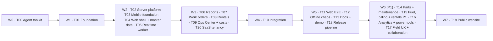

# AgroRende: Delivery plan for GitHub Copilot CLI `/fleet`

> The build plan. It splits `docs/PRD.md` and `docs/ARCHITECTURE.md` into 21 tasks (T00–T20) that parallel agents can execute without stepping on each other.

| | |
|---|---|
| Status | v1.5, ready for build |
| Date | 2026-10-08 |
| Doc set | Round 5 (2026-10) |
| Changelog | MongoDB 8 replaces PostgreSQL/Prisma for the MVP; pnpm workspaces replace Turborepo; visual direction and single palette; review fixes (round 5). v1.5: caveman chat voice for every agent and subagent report, `caveman-review` added to T00. |
| Inputs | `docs/PRD.md` (what and why, requirement IDs), `docs/ARCHITECTURE.md` (how, **normative names**), `docs/DELIVERY-PLAN.md`, `docs/TASKS.md` (ordered steps), `docs/ERRORS.md` (error catalog), `docs/LANDSCAPE.md` (business context, optional reading) |
| Audience | The Copilot CLI orchestrator (main agent running `/fleet`) and every subagent it starts |
| Scope | W0 = agent toolkit. Waves 1–5 = MVP app "Primeira safra" (all **P0**). W6 = v1.1 "Segunda safra" (**P1**). W7 = public site. |

---

## 0. How this plan is used

1. A human creates an empty **private GitHub repository**, applies the repository settings of ARCHITECTURE §18.2, puts the six documents in `docs/` (PRD, ARCHITECTURE, DELIVERY-PLAN, TASKS, ERRORS, LANDSCAPE) and starts `copilot` in it.

`docs/TASKS.md` breaks every card into ordered steps the subagents follow. Cards in §5 stay normative; TASKS only orders the work. `docs/LANDSCAPE.md` is business context and optional reading.

2. **Wave 0** (T00, Agent toolkit) runs **alone**, before the monorepo exists: it vendors skills, configures MCP and creates the UI reviewer.
3. **Wave 1** (T01, Foundation) runs **alone**, without `/fleet`: it creates the monorepo, all contracts, the full database schema, the seed, the core kernel and placeholder files for every route, so later tasks only fill in their own folders.
4. **Waves 2, 3, 5, 6 and 7** each run with one `/fleet` prompt or single-agent prompt as listed in §2.1. The orchestrator starts one subagent per task in the wave, in parallel when the wave has several tasks.
5. **Wave 4** (T10, Integration) runs alone: it wires the parallel work together and fixes the seams.
6. After every wave, the orchestrator runs the **wave gate** (§2.2) and commits.



---

## 1. Rules for every agent

These rules are **mandatory**. The orchestrator repeats them to each subagent.

| # | Rule |
|---|---|
| R1 | **Read first.** Read `docs/PRD.md`, `docs/ARCHITECTURE.md`, this plan, your task's section in `docs/TASKS.md`, and the `docs/ERRORS.md` sections for your task; `docs/LANDSCAPE.md` is not needed to build. Names in ARCHITECTURE (packages, files, models, enums, mutation names, events, routes, env vars, error codes) are **normative**: use them exactly. |
| R2 | **Stay in your lane.** Edit only the paths your task owns (§3). You may read everything. You may always create `docs/progress/<TASK>.md` and `docs/change-requests/<TASK>-<NNN>.md`. |
| R3 | **Change requests, not edits.** If you need something outside your paths (a contract field, a seam signature, a dependency, a factory, a translation key in another namespace), write a change request (§7.2), work around it inside your own folder with a typed adapter, and keep going. Never edit another owner's file. |
| R4 | **Frozen foundations after T01.** In waves 2+ nobody runs `pnpm add`/`pnpm remove`, edits `pnpm-lock.yaml`, `packages/db/**`, `packages/contracts/**`, root configs (`.npmrc`, `.node-version`, `patches/**`, `scripts/devloop*`, `scripts/check-only.ts`) or `.github/**` except T18's `.github/workflows/{release,deploy,mobile}.yml` and T11's narrow `e2e` job enablement. T01 installs **every** dependency listed in ARCHITECTURE §3 up front. Exception: W7/T19 runs alone and may edit every T19-owned path in its card (site app, Caddy site block, CI/release/deploy workflow site steps and root `dev:site`/`build:site` scripts) and add site-only dependencies. |
| R5 | **No git from subagents.** Subagents never run state-changing git commands (`commit`, `checkout`, `switch`, `branch`, `stash`, `reset`, `rebase`, `merge`). The orchestrator commits once per task after the wave gate passes. |
| R6 | **Isolated test database.** Before running tests set `MONGODB_DB=agrorende_<task>` (for example `agrorende_t07`) and use `setupTestDb(name)` from `@agrorende/db/testing`. Redis channels and BullMQ prefixes derive from `MONGODB_DB`; media tests use `MEDIA_ROOT=.data/media-<task>`, created and emptied by test setup. After T01 creates `docker-compose.yml`, the orchestrator starts `docker compose up -d --wait mongo redis` before each later wave. |
| R7 | **Green before done.** Run `pnpm check:only <filters>` for every package you touched (or `pnpm check` for the whole workspace), plus `pnpm i18n:check` when you touched translations. All must pass. |
| R8 | **No long-running processes in waves 2–3.** Do not start `pnpm dev`, `expo start`, watchers or servers. Tests and builds only. Waves 4–5 may start servers and must stop them before finishing. |
| R9 | **Translations.** Every user-facing string is an ICU key present in every **required** locale (pt-BR, en), in your own namespace files or a change request for shared namespaces (A§20). |
| R10 | **Progress file.** Finish by writing `docs/progress/<TASK>.md` (template §7.1): what was done (with requirement IDs), tests, gaps and change requests. |
| R11 | **No silent stubs.** `throw notImplemented("<name>")` is only allowed for seams owned by another task (§4). Anything you leave unfinished is listed under *Gaps* in your progress file. |
| R12 | **Same-wave seams.** When you call a seam owned by a task in the same wave, unit-test with `vi.mock` of that module's `service.ts`. T10 verifies the real wiring. |
| R13 | **Conventions.** ARCHITECTURE §19 applies (strict TS, no `any`, four screen states, money in cents, org timezone, no PII in logs). |
| R14 | **Ask nobody.** Subagents make reasonable assumptions, record them in the progress file and continue. They never wait for user input. |
| R15 | **Public npm only.** Never add a registry, scope registry or auth token to `.npmrc` or any config; never publish packages. |
| R16 | **Recovery.** Every error path you build follows `docs/ERRORS.md`: implement and test the EC entries your task owns, use the recovery kit, never ship a dead end (REC-01). New error cases you discover go in your progress file under *Error cases added* with a proposed EC entry; T10 merges them into `docs/ERRORS.md`. |

---

## 2. Waves

### 2.1 Wave table

| Wave | Tasks | Mode | Depends on | Goal |
|---|---|---|---|---|
| **W0** | T00 | Single agent, no `/fleet` | — | Agent toolkit: MCP, vendored skills, UI reviewer |
| **W1** | T01 | Single agent, no `/fleet` | W0 | Monorepo, contracts, DB schema + seed, core kernel, app skeletons, placeholders, CI |
| **W2** | T02, T03, T04, T05 | `/fleet`, 4 parallel subagents | W1 | Platform: auth + sync + media server, mobile offline foundation, web shell + master data, realtime + worker |
| **W3** | T06, T07, T08, T09, T20 | `/fleet`, 5 parallel subagents | W2 | Features F1–F5 plus SaaS tenancy, subscription lifecycle and platform console |
| **W4** | T10 | Single agent | W3 | Integration: seams, change requests, golden path, cross-tenant suite, live run |
| **W5** | T11, T12, T13, T18 | `/fleet`, 4 parallel subagents | W4 | Web E2E, offline chaos suite, docs + demo simulator, release pipeline |
| **W6** (P1) | T14, T15, T16, T17 | `/fleet`, 4 parallel subagents | W5 | v1.1 "Segunda safra" |
| **W7** | T19 | Single agent | W5 by default, or after W6 if v1.1 ships first | Public website |

T18 was added after the W6 cards were numbered; it runs in W5. T20 was added in Round 4; it runs in W3. T19 runs last by default, but may run right after W5 if the MVP launches before v1.1.

### 2.2 Wave gate (run by the orchestrator after each wave)

1. Confirm every task of the wave wrote `docs/progress/<TASK>.md`.
2. `pnpm install --frozen-lockfile` (must be a no-op after W1).
3. `pnpm check` and `pnpm i18n:check` — all green. If a task broke the build, send that task's subagent back with the failing output (it fixes only its own paths). Any P0 `DONE_WITH_GAPS` progress file fails the wave gate.
4. Review `docs/change-requests/*.md` with `Status: OPEN`. Apply small, clearly correct ones directly (the orchestrator is allowed to edit any path **between** waves), set them to `APPLIED`, and re-run step 3. In W2–W3 only, large items may be deferred to T10 (`Status: DEFERRED-T10`). From W4 on, a change request is repaired in the wave, assigned to a named later task, or blocks the release. Reject with a reason when they contradict ARCHITECTURE.
5. **UI review (W2+):** after all subagents finish, start the stack, run the read-only `ui-reviewer` on screens/pages touched in the wave using ARCHITECTURE §3.7 "Campo claro" and the dev style-guide pages as the brief (pt-BR, en and pseudo-locale; light, dark and outdoor themes; key states and recovery actions), send blocking findings back to the owning subagent like a failing test, then stop the stack.
6. Commit, one commit per task: `git add <task paths> docs/progress/<TASK>.md && git commit -m "feat(<scope>): <TASK> <title>"`, then one commit for applied change requests.

---

## 3. Ownership map

T00 creates the agent-toolkit files, then T01 keeps them. T01 creates the skeleton of **every** app path below (placeholders included). **From wave 2 on**, only the owner edits a path. Paths not listed belong to T01 and are frozen (R4), except the explicit T18 and T19 workflow/site exceptions.

### 3.1 Packages and services

| Path | Owner |
|---|---|
| Agent toolkit (`.mcp.json`, `.github/skills/**`, `.github/skills/THIRD_PARTY.md`, `.github/agents/ui-reviewer.agent.md`, `scripts/vendor-skills.sh`, initial `.github/copilot-instructions.md`, `.gitignore` with `.data/`) | T00, then T01 (frozen) |
| Root (`package.json`, `pnpm-workspace.yaml`, `.env.example`, `.gitignore`, `.dockerignore`, `docker-compose.yml`, `.npmrc`, `.node-version`, `pnpm-lock.yaml`), `**/AGENTS.md`, `scripts/devloop.ts`, `scripts/devloop/**`, `scripts/check-only.ts`, `scripts/i18n-check.ts`, `patches/**`, `.github/**` except `.github/workflows/{release,deploy,mobile}.yml`, `packages/config/**`, `packages/contracts/**`, `packages/db/**` (MongoDB driver wrapper, Zod document schemas, `indexes.ts`, migrations and `setupTestDb`), `packages/design-tokens/**`, `packages/i18n/**`, `docs/reviews/**` | T01 (frozen) |
| `infra/**`, `apps/{web,realtime,worker}/Dockerfile`, `.github/workflows/{release,deploy,mobile}.yml` | T18 |
| `apps/site/**`, `docs/SITE.md`; additive edits to `infra/caddy/Caddyfile`, `.github/workflows/{ci,release,deploy}.yml`, root `package.json` scripts `dev:site` and `build:site` | T19 |
| `packages/core/src/{context.ts, errors.ts, testing/**}`, `core/src/sync/{types,withSyncTx,registry}.ts`, `packages/core/src/events/**` (event outbox writer skeleton), `core/src/{numbering,activity,jobs}/**`, `core/src/pdf/base.tsx`, `core/src/auth/jwt.ts`, `packages/core/scripts/**` | T01 (frozen) |
| `packages/core/src/auth/**` (except `jwt.ts`), `packages/core/src/storage/**`, `core/src/sync/{push,pull,scopes,touch}.ts`, `core/src/notify/**`, `core/src/modules/{users,devices,media,notifications}/**` | T02 |
| `packages/api-client/**` | T02 |
| `packages/core/src/modules/{assets,sites,seasons,customers,checklists}/**` | T04 |
| `packages/core/src/modules/{locations,exports}/**` | T05 |
| `packages/core/src/modules/fieldReports/**` | T06 |
| `packages/core/src/modules/workOrders/**`, `core/src/pdf/workOrderReport.tsx` | T07 |
| `packages/core/src/modules/rentals/**`, `core/src/pdf/{rentalCheckout,rentalCheckin}.tsx` | T08 |
| `packages/core/src/modules/{ops,costs}/**` | T09 |
| `packages/core/src/modules/tenancy/**` | T20 |
| `packages/core/src/__tests__/**`, `scripts/smoke.ts` | T10 |
| `packages/core/src/modules/{parts,maintenance}/**` | T14 |
| `packages/core/src/modules/{fuel,billing}/**`, `core/src/pdf/billingDocument.tsx` | T15 |
| `packages/core/src/modules/comments/**` | T17 |
| `apps/realtime/**` | T05 |
| `apps/worker/src/{index.ts,health.ts}`, `apps/worker/src/jobs/{index.ts,notifications.push.ts,devices.staleSync.ts,media.cleanupPending.ts,diagnostics.prune.ts,locations.prune.ts,mutations.prune.ts,tombstones.prune.ts,exports.build.ts}` | T05 |
| `apps/worker/src/jobs/events.dispatch.ts` | T02 |
| `apps/worker/src/jobs/workOrders.slaScan.ts` | T07 |
| `apps/worker/src/jobs/rentals.overdueScan.ts` | T08 |
| `apps/worker/src/jobs/{usage.daily.ts,orgs.lifecycle.ts,orgs.purge.ts}` | T20 |
| `apps/worker/src/jobs/{maintenance.dueScan,stock.lowScan}.ts` | T14 |
| `apps/worker/src/simulate.ts` | T13 |

### 3.2 Web (`apps/web`)

| Path | Owner |
|---|---|
| `package.json`, `next.config.ts`, `tsconfig.json`, `src/server/**` (`withApi`, session, error mapping), `src/proxy.ts`, `src/features/imports/shared/**`, `messages/*/errors.json` | T01 (frozen) |
| `src/app/api/v1/{auth,sync,devices,media,users,notifications,settings,me,telemetry,health}/**` | T02 |
| `src/app/api/v1/{locations,exports}/**`, `src/features/exports/**` | T05 |
| `src/app/page.tsx`, `src/app/(auth)/**` except signup, `src/app/(admin)/layout.tsx`, `src/app/(dev)/style-guide/**`, `src/app/(admin)/{assets,sites,customers,team,templates,seasons,settings,notifications}/**`, `src/app/api/v1/{assets,sites,plots,seasons,customers,checklist-templates}/**`, `src/app/api/v1/imports/{assets,customers,sites,plots,seasons,checklist-templates}/**`, `src/components/**`, `src/lib/**`, `src/features/{shell,assets,sites,customers,team,templates,seasons,settings,notifications}/**`, `src/features/imports/{assets,customers,sites,plots,seasons,checklist-templates}/**`, `messages/*/{common,auth,admin,assets,settings,team,templates}.json` | T04 |
| `src/app/(admin)/reports/**`, `src/app/api/v1/field-reports/**`, `src/features/reports/**`, `messages/*/reports.json` | T06 |
| `src/app/(admin)/work-orders/**`, `src/app/api/v1/work-orders/**`, `src/features/work-orders/**`, `messages/*/jobs.json` | T07 |
| `src/app/(admin)/rentals/**`, `src/app/api/v1/{rentals,inspections,damages}/**`, `src/features/rentals/**`, `messages/*/rentals.json` | T08 |
| `src/app/(admin)/{ops,costs,attention}/**`, `src/app/api/v1/{ops,costs,attention}/**`, `src/app/api/v1/imports/{reports,work-orders,rentals,costs}/**`, `src/features/{ops,costs,attention}/**`, `src/features/imports/{reports,work-orders,rentals,costs}/**`, `messages/*/{ops,costs,attention}.json` | T09 |
| `src/app/(auth)/signup/**`, `src/app/(admin)/settings/subscription/**`, `src/app/(platform)/**`, `src/app/api/v1/signup/**`, `src/app/api/v1/org/**`, `src/app/api/v1/platform/**`, `src/features/{signup,subscription,platform,onboarding,tenancy}/**`, `messages/*/{signup,subscription,platform,tenancy}.json` | T20 |
| `src/app/api/__tests__/**` | T10 |
| `e2e/**`, `playwright.config.ts` | T11 |
| `src/app/(admin)/{parts,stock,maintenance}/**`, `src/app/api/v1/{parts,stock-locations,stock-levels,stock-movements,maintenance-plans}/**`, `src/features/{parts,maintenance}/**`, `messages/*/{parts,maintenance}.json` | T14 |
| `src/app/(admin)/{fuel,billing}/**`, `src/app/api/v1/{fuel-logs,billing-documents}/**`, `src/features/{fuel,billing}/**`, `messages/*/{fuel,billing}.json` | T15 |
| `src/app/(admin)/analytics/**`, `src/features/{analytics,command-palette}/**`, `messages/*/analytics.json` | T16 |
| `src/app/api/v1/comments/**`, `src/features/comments/**`, `messages/*/comments.json` | T17 |

### 3.3 Mobile (`apps/mobile`)

| Path | Owner |
|---|---|
| `package.json`, `app.config.ts`, `eas.json`, `plugins/**`, `babel.config.js`, `metro.config.js`, `src/i18n/*/errors.json` | T01 (frozen) |
| `app/_layout.tsx`, `app/(auth)/**`, `app/(app)/_layout.tsx`, `app/(app)/(tabs)/{_layout,today,more}.tsx`, `app/(app)/{assets,scan,sync-center,settings}*`, `app/(dev)/style-guide.tsx`, `src/{db,sync,media,location,realtime,auth,ui,components,lib}/**` (except the feature mutators below), `src/features/{home,assets,sync,settings}/**`, `src/i18n/*/{common,auth,sync,assets,settings}.json`, `src/i18n/index.ts`, `test/**` (except `test/sync/chaos*`) | T03 |
| `app/(app)/(tabs)/reports.tsx`, `app/(app)/reports/**`, `src/features/reports/**`, `src/sync/mutators/reports.ts`, `src/i18n/*/reports.json` | T06 |
| `app/(app)/(tabs)/jobs.tsx`, `app/(app)/jobs/**`, `src/features/jobs/**`, `src/sync/mutators/jobs.ts`, `src/i18n/*/jobs.json` | T07 |
| `app/(app)/(tabs)/rentals.tsx`, `app/(app)/rentals/**`, `src/features/rentals/**`, `src/sync/mutators/rentals.ts`, `src/i18n/*/rentals.json` | T08 |
| `test/sync/chaos.test.ts`, `test/sync/chaos/**` | T12 |
| `app/(app)/fuel/**`, `src/features/fuel/**`, `src/sync/mutators/fuel.ts`, `src/i18n/*/fuel.json` | T15 |
| `app/(app)/notifications.tsx`, `src/features/{notifications,comments}/**`, `src/sync/mutators/comments.ts`, `src/i18n/*/comments.json`, `.maestro/**` | T17 |
| `src/features/tenancy/OrgStatusBanner.tsx`, `src/i18n/*/tenancy.json` | T20 |

### 3.4 Docs

| Path | Owner |
|---|---|
| `docs/PRD.md`, `docs/ARCHITECTURE.md`, `docs/DELIVERY-PLAN.md`, `docs/TASKS.md`, `docs/ERRORS.md`, `docs/LANDSCAPE.md` | Human (read-only for agents; T10 may merge proposed EC entries into `docs/ERRORS.md`) |
| `README.md`, `docs/RUNBOOK.md`, `docs/DEMO.md`, `docs/SUPPORT.md`, `docs/TRANSLATING.md` | T13 (T01 creates a minimal README) |
| `docs/RELEASING.md` | T18 |
| `docs/SITE.md` | T19 |
| `docs/progress/<TASK>.md`, `docs/change-requests/<TASK>-<NNN>.md` | Each task, its own files only |


### 3.5 Wave 6 handover

By wave 6 the original owners are finished, so some of their paths move to a P1 task. T10 prepares the split (sub-folders and mount points, see the T10 card) so that **no two W6 tasks share a file**. Everything not listed keeps its original owner and is frozen in W6; a W6 task that needs it writes a change request, and the orchestrator applies it at the wave gate.

| Paths (original owner) | W6 owner |
|---|---|
| Core `modules/workOrders/{parts,sla,external}.ts` (T07); web `src/app/api/v1/work-orders/[id]/external-cost/**`, `src/features/work-orders/parts/**` (T07); mobile `app/(app)/jobs/[id]/parts.tsx`, `src/features/jobs/parts/**`, `src/sync/mutators/jobs.ts` (T07); mobile `src/i18n/*/parts.json` (T03) | **T14** |
| Core `modules/{rentals,costs}/**`, `core/src/pdf/{rentalCheckout,rentalCheckin}.tsx` (T08, T09); web `src/app/(admin)/rentals/**`, `src/app/api/v1/{rentals,inspections,damages}/**`, `src/features/rentals/**`, `messages/*/rentals.json` (T08); web `src/features/customers/**` (T04); mobile `(tabs)/rentals.tsx`, `app/(app)/rentals/**`, `src/features/rentals/**`, `src/sync/mutators/rentals.ts`, `src/i18n/*/rentals.json` (T08); mobile `src/features/assets/**`, `src/i18n/*/assets.json` (T03) | **T15** |
| Core `modules/{ops,assets,sites}/**` (T09, T04); web `src/app/(admin)/{ops,assets,sites}/**`, `src/app/api/v1/{ops,assets,sites,plots}/**`, `src/features/{ops,assets,sites}/**`, `messages/*/{ops,assets,admin,common}.json` (T09, T04); new `src/app/api/v1/search/**`; new `apps/web/e2e/power-tools.spec.ts` | **T16** |
| Core `modules/{fieldReports,devices}/**` (T06, T02); web `src/app/(admin)/reports/**`, `src/app/api/v1/{field-reports,devices}/**`, `src/features/reports/**`, `messages/*/reports.json` (T06, T02); mobile `(tabs)/{reports,jobs}.tsx`, `app/(app)/reports/**`, `app/(app)/jobs/[id]/index.tsx`, `src/features/reports/**`, `src/features/jobs/**` except `parts/**`, `src/sync/mutators/reports.ts`, `src/i18n/*/{reports,jobs}.json` (T06, T07); mobile `app/(auth)/**`, `app/(app)/(tabs)/{_layout,more}.tsx`, `app/(app)/sync-center.tsx`, `src/features/sync/**`, `src/components/MediaCapture/**`, `src/{auth,db,location}/**`, `src/i18n/*/{common,auth,sync}.json` (T03) | **T17** |

W6 tasks may **import** from any path (for example T15 uses `MediaCapture`, T17 calls the job transition mutator); importing never needs ownership.

W5 also leaves T18 artifacts in place: the release pipeline exists, `docs/RELEASING.md` exists, and W6 tasks do not touch Dockerfiles or workflows.

---

## 4. Cross-module seams

Modules talk to each other only through these exported functions (ARCHITECTURE §4). **T01 creates every seam below in the owner's `service.ts` with the exact signature** and a body of `throw notImplemented("<module>.<fn>")`, so every task compiles from day one. The owner replaces the body. Changing a signature requires a change request.

`Tx` is the transaction client handed out by `withSyncTx`; `Ctx` comes from `core/context.ts`. All seams run inside the caller's transaction and must **not** open their own.

| Seam (`packages/core/src/modules/<module>/service.ts`) | Owner | Called by |
|---|---|---|
| `assets.getSummary(tx: Tx, assetId: string): Promise<AssetSummary>` | T04 | T06, T07, T08, T14, T15 |
| `assets.listSummaries(tx: Tx, orgId: string, f: { ids?: string[]; category?: AssetCategory; includeRetired?: boolean }): Promise<AssetSummary[]>` | T04 | T14 |
| `assets.recomputeCondition(tx: Tx, assetId: string): Promise<AssetCondition>` — rule in ARCHITECTURE §6.4 | T04 | T06, T07, T08 |
| `assets.applyReadings(tx: Tx, ctx: Ctx, assetId: string, r: { hourMeter?: number; odometerKm?: number; source: EntityRef }): Promise<{ ignored: ("hourMeter" \| "odometerKm")[] }>` — monotonic rule | T04 | T07, T08, T15 |
| `assets.setCustody(tx: Tx, assetId: string, c: { currentRentalId: string \| null; currentSiteId?: string }): Promise<void>` | T04 | T08 |
| `seasons.currentSeasonId(tx: Tx, orgId: string): Promise<string \| null>` | T04 | T06, T07, T08, T15 |
| `seasons.criticalWindowFor(tx: Tx, orgId: string, category: AssetCategory, at: Date): Promise<CriticalWindow \| null>` (P1 use) | T04 | T14 |
| `checklists.snapshotPublished(tx: Tx, templateId: string): Promise<ChecklistSnapshot>` | T04 | T07, T08 |
| `checklists.defaultTemplateId(tx: Tx, orgId: string, kind: ChecklistKind, category: AssetCategory): Promise<string \| null>` — newest active template whose `appliesTo` has `kind` and whose `assetCategories` is empty or has `category` | T04 | T07, T08 |
| `sites.getSummary(tx: Tx, siteId: string): Promise<SiteSummary>` | T04 | T07, T08 |
| `customers.getForEligibility(tx: Tx, customerId: string): Promise<{ id: string; hasDocument: boolean; hasPhone: boolean }>` | T04 | T08 |
| `users.listActiveTechnicians(tx: Tx, orgId: string): Promise<TechnicianSummary[]>` | T02 | T07 |
| `media.listForParent(tx: Tx, parent: EntityRef): Promise<MediaRow[]>` (non-deleted) | T02 | T07, T08 |
| `media.markLateEvidence(tx: Tx, mediaIds: string[]): Promise<void>` | T02 | T07 |
| `notifications.create(tx: Tx, n: { type: NotificationType; userIds: string[]; entity: EntityRef; params: Record<string, string \| number> }): Promise<void>` — rows + push enqueue after commit | T02 | all |
| `notifications.officeRecipients(tx: Tx, orgId: string, roles: Role[]): Promise<string[]>` | T02 | all |
| `sync.touchDependents(tx: Tx, entity: EntityRef): Promise<void>` (`core/sync/touch.ts`) | T02 | T07, T08 |
| `locations.lastFixes(orgId: string, userIds: string[]): Promise<Map<string, LiveFix>>` (Redis hash, falls back to DB) | T05 | T07, T09 |
| `locations.liveSnapshot(orgId: string): Promise<LiveOperator[]>` | T05 | T09 |
| `fieldReports.createFromDamage(tx: Tx, ctx: Ctx, d: { damageId: string; rentalId: string; assetId: string }): Promise<{ id: string; number: string }>` — RN-09; sets `FieldReport.damageId` and `rentalId` (T08 then sets `Damage.fieldReportId`) | T06 | T08 |
| `workOrders.createFromSource(tx: Tx, ctx: Ctx, input: CreateWorkOrderInput): Promise<{ id: string; number: string }>` — `CreateWorkOrderInputSchema` in A§5.4; persists `damageIds` so completion can call `markDamagesRepaired` | T07 | T06, T08, T14 |
| `workOrders.openCountByAssignee(tx: Tx, orgId: string): Promise<Map<string, number>>` | T07 | T09 |
| `workOrders.maintenanceStatus(tx: Tx, planId: string, assetIds: string[]): Promise<Map<string, { hasOpen: boolean; lastCompleted: { at: Date; hourMeter: number \| null } \| null }>>` (P1 use) | T07 | T14 |
| `workOrders.billingSnapshot(tx: Tx, workOrderId: string): Promise<{ id: string; number: string; status: WorkOrderStatus; customerId: string \| null; workMinutes: number \| null; laborCostCents: number \| null; parts: { name: string; quantity: number; unit: string; unitCostCents: number \| null }[]; externalCostCents: number \| null; externalCostNote: string \| null }>` (P1 use) | T07 | T15 |
| `rentals.markDamagesRepaired(tx: Tx, input: { workOrderId: string; damageIds: string[] }): Promise<void>` | T08 | T07 |
| `rentals.activeRentalForAsset(tx: Tx, assetId: string): Promise<{ id: string; number: string } \| null>` | T08 | T06 (link report to rental) |

`EntityRef = { entityType: EntityType; entityId: string }`. `CreateWorkOrderInput`, `ChecklistSnapshot`, `TechnicianSummary`, `AssetSummary` (id, code, name, category, condition, ownerType, homeSiteId, currentSiteId, currentRentalId, lastLat, lastLng, hourMeter, odometerKm, tankCapacityL, isRentable, defaultRateCents, defaultRateUnit), `SiteSummary` (id, name, type, lat, lng, radiusM), `LiveFix`, `LiveOperator` and `CriticalWindow` are Zod-backed types that T01 defines in `@agrorende/contracts` (`dto/` and `realtime.ts`).

**Mobile seams** (T01 creates placeholders that render `null` or a "Em construção" screen):

| Seam | Owner | Used by |
|---|---|---|
| `src/features/reports/widgets.tsx` → `QuickReportCard`, `MyReportsCard` | T06 | T03 (`features/home/widgets.ts`) |
| `src/features/jobs/widgets.tsx` → `NextJobCard` | T07 | T03 |
| `src/features/rentals/widgets.tsx` → `RentalsTodayCard` | T08 | T03 |
| Every route file in ARCHITECTURE §13.1 and §14.1 | its owner | navigation, typed routes |

**Mutation handlers:** each module's `mutations.ts` exports a (possibly empty) map; `core/sync/registry.ts` imports them all statically (T01). Owners: `fieldReport.*` T06 · `media.*`, `user.setDuty`, `notification.markRead` T02 · `workOrder.*` T07 · `inspection.submit`, `rental.checkout`, `rental.checkin` T08 · `asset.updateReadings` T04 · `comment.create` T17 · `fuelLog.create` T15.

**Pull scopes** (`core/sync/scopes.ts`, T02) read every synced table directly; this is the second documented read-only exception besides the reporting modules.

---

## 5. Task cards

Each card lists the goal, dependencies, scope, acceptance criteria (AC) and the requirement IDs it covers. "Owns" refers to §3. ARCHITECTURE sections are cited as `A§n`.

### T00 · Agent toolkit (W0, single agent)

**Goal:** prepare the repository for the agents that will build AgroRende, before the monorepo exists.

**Depends on:** the six docs in `docs/`. **Owns:** `.mcp.json`, `.github/skills/**`, `.github/skills/THIRD_PARTY.md`, `scripts/vendor-skills.sh`, `.github/agents/ui-reviewer.agent.md`, `.github/copilot-instructions.md` initial toolkit block, `.gitignore` with `.data/`.

**Scope:**
- Create `.mcp.json` with only the Expo MCP server. The agent never logs in to Expo; the human authenticates with `/mcp` after T00.
- Vendor the 10 skills of ARCHITECTURE §4.3 (`caveman`, `caveman-review`, `frontend-design`, `playwright-cli` and the six Expo skills) into `.github/skills/<name>/` from the sources listed there, pinned to commit SHAs with licenses and update instructions in `THIRD_PARTY.md`.
- Create `scripts/vendor-skills.sh` for future updates.
- Create `.github/agents/ui-reviewer.agent.md`, read-only, using Playwright CLI for web/site and Expo MCP for mobile when a simulator is available; its brief is ARCHITECTURE §3.7 "Campo claro" and the web/mobile style-guide pages.
- Create `.github/copilot-instructions.md` with only the Agent toolkit block: the skill map (mobile UI: Expo skills + `frontend-design`; admin web and site: `frontend-design` + `playwright-cli`; findings: `caveman-review`), `ui-reviewer`, caveman as the chat voice of every agent including each subagent's final report (never other file content), cloud-agent note and folder trust.
- Add `.data/` to `.gitignore`.

**AC:**
- Files exist and `.mcp.json` is valid JSON with only `expo`.
- All 10 vendored skills have `SKILL.md`, a license and a `THIRD_PARTY.md` entry with source repo, path, SHA, license and update steps.
- The toolkit block states the skill map and the caveman rules of ARCHITECTURE §4.3.
- The `ui-reviewer` agent frontmatter is valid (`name`, `description`, `tools`).
- No secrets and no Expo login state are written.

**Error cases:** —.

**Covers:** A§4.3 agent toolkit.

---

### T01 · Foundation (W1, single agent)

**Goal:** a monorepo where every later task only fills in its own folders. Nothing in it is a feature, but everything compiles, migrates, seeds and runs.

**Scope:**
1. **Monorepo and tooling** (A§3.5, A§4, A§4.1, A§4.2, A§4.3, A§20): pnpm 11 workspace (no task runner), Node 24, pnpm catalog, pnpm 11 `allowBuilds`, `.npmrc` pinned to the public npm registry, `.node-version`, `patches/`, `scripts/check-only.ts` and the root scripts from A§16, `packages/config` (ESLint flat config with the `no-restricted-imports` dependency rules of A§4 and `no-console`; tsconfig bases with `strict` and `noUncheckedIndexedAccess`; Prettier), `packages/i18n` (`@agrorende/i18n`) with locale registry, shared ICU namespaces, formatting helpers, `helpUrl(code, locale)` for localized error help paths, and pseudo-locale generation.
2. **All dependencies up front:** install every MVP library named in A§3 into the right package (latest stable within the majors of A§3; Expo libraries with `npx expo install`), including `arctic`, `jose`, `mongodb`, `bson`, `expo-web-browser`, `expo-crypto`, `expo-apple-authentication` and the navikt `mock-oauth2-server` container fixture, excluding Phase 2 S3 packages such as `@aws-sdk/client-s3` and `@aws-sdk/s3-request-presigner`. Add `@playwright/cli` at the root and `expo-mcp` to `apps/mobile`. Later waves cannot add dependencies except T19 (R4).
3. **`packages/contracts`** (complete): enums and models for three roles, org status, auth providers and auth links (A§5.2), JSON schemas with defaults (A§5.4, including `OrgSettingsSchema` with `officePhone`, `officeWhatsApp`, `showLaborCostToManager`, onboarding, locale settings and supported locales), `LocalizedTextSchema`, `dto/*` for every entity, `mutations/*` payload schemas for **every** mutation in A§7.3 (P0 and P1), `sync.ts`, `machines/*` with full `canTransition` tables (A§6.1–6.3), eligibility and `validateCheckOut/CheckIn`, `computeRentalCharges` (A§7.4, vectors V1–V5), `isChecklistComplete`, `computeWorkOrderTimes`, `realtime.ts` (A§9 events, `OperatorState`, `deriveOperatorState`), `errors.ts` (`ErrorCode`, `ClientErrorCode`, `RecoveryPattern`, `ERROR_META`, context variants and HTTP mapping), `geo.ts`, CPF/CNPJ validators, and the seam types of §4. T01 fills `ERROR_META` and all `errors` namespace copy (pt-BR and en) for every code in `docs/ERRORS.md`; later tasks only assert behaviour unless a change request changes the catalog.
4. **`packages/db`** (complete): official `mongodb` Node driver access only (`getClient()`, `getDb()`, typed `collections`, `scoped(ctx)`, `platform(ctx)`, `withSyncTx`, `assertRefs`, `ensureIndexes()`), Zod document schemas in `src/schemas/<collection>.ts`, documents for **all** P0 and P1 entities from A§5.3 (`_id` UUID v7, BSON `Date`, integer cents, sync fields), `src/indexes.ts` with idempotent indexes, `migrations/NNN-<name>.ts` plus `_migrations`, `src/testing/` (`setupTestDb(name)`, factories), and seed (A§17, including org statuses, invite, mock Google identity and platform staff).
5. **`packages/design-tokens`** (A§13.4): the single "Campo claro" palette from ARCHITECTURE §3.7/§13.4, semantic status mappings, typography, radii and outdoor-theme tokens.
6. **`packages/core` kernel:** `context.ts` (`Ctx`, `requireRole`, `notImplemented`), `errors.ts` (`DomainError`), `sync/{types,withSyncTx,registry}.ts` backed by MongoDB transactions, `numbering/`, `activity/` (record actor, device, time, GPS: PLT-13), `events/` (frozen transactional event-outbox writer skeleton; T02 owns dispatch), `storage/` skeleton (local media driver is T02; A§7.7), `jobs/queues.ts`, `pdf/base.tsx`, `auth/jwt.ts`, `testing/ctx.ts`, `scripts/storage-init.ts` and `scripts/storage-seed.ts`. **Every module folder** from A§4 gets `service.ts` (with the §4 seams as stubs), `mutations.ts` (empty map), `queries.ts` and `dto.ts`.
7. **`apps/web`:** Next.js 16 (App Router, Tailwind 4, shadcn/ui initialised, next-intl), `output: "standalone"` in `next.config.ts`, `APP_ENV` in server config (A§18.1; the ribbon itself is T04), `src/server/withApi.ts` with session and error mapping (A§8 conventions), a minimal `GET /api/v1/health`, `src/proxy.ts` skeleton with the blob-route matcher that skips `/api/v1/media/*/blob*`, `src/features/imports/shared/**` (parser, preview table and error-file download), T20 tenancy placeholders with fixed signatures (`GettingStartedCard`, web `OrgStatusBanner`, `messages/*/tenancy.json`), and a **placeholder page for every route in A§14.1**. `messages/{pt-BR,en}/<ns>.json` for every namespace (empty objects, except `errors.json`, which T01 fills for every `ErrorCode`).
8. **`apps/mobile`:** latest stable Expo SDK (never a beta) + expo-router (`@agrorende/core` and `@agrorende/db` as devDependencies for the chaos suite, A§15), `app.config.ts` with app variants through `APP_VARIANT`, `expo-apple-authentication`, `expo-web-browser`, `ios.usesAppleSignIn: true`, `eas.json` profiles and channels, `plugins/withNavigationQueries.js` (A§13.5–13.6, A§18.1), a **placeholder screen for every route in A§13.1**, the widget placeholders of §4, T20 mobile tenancy placeholder `src/features/tenancy/OrgStatusBanner.tsx` with `src/i18n/*/tenancy.json`, and `src/i18n/{pt-BR,en}/<ns>.json` for every namespace (`errors.json` filled).
9. **`apps/realtime`, `apps/worker`:** bootable skeletons (config from env, pino, health endpoint, graceful shutdown); `apps/worker/src/jobs/index.ts` lists every job of A§10 with no-op processors.
10. **Root:** scripts (A§16.1–A§16.2, including `pnpm devloop` with all flags, `pnpm devloop --mobile --mcp`, `check:only` implemented in `scripts/check-only.ts`, and `i18n:check` implemented in `scripts/i18n-check.ts` with ICU, placeholder, required-locale, pseudo-locale, `ERROR_META` and `LocalizedText` checks), `pnpm dev:setup` that copies `.env.example` to `.env` when missing, seed/reset guards for `APP_ENV=production` (A§18.1), `docker-compose.yml` with MongoDB 8 as a single-node replica set, Redis 7 and local navikt `mock-oauth2-server` on 4003, `.env.example` with `MONGODB_URI`, `MONGODB_DB`, `MEDIA_DRIVER`, `MEDIA_ROOT`, `MEDIA_URL_SECRET`, OAuth/Apple/platform/terms/trial variables, `.gitignore` and `.dockerignore` with `.data/` and `.data/reviews/`, `docs/reviews/README.md`, scoped `AGENTS.md` files, `.github/` (T00 toolkit block kept verbatim, copilot-instructions summary of R1–R16 with links to the docs, CODEOWNERS, dependabot groups for `mongodb`/`bson` and Docker updates including `/infra`, PR template, agents, skills, `ci.yml`, `codeql.yml`, `copilot-setup-steps.yml` installing Chromium; A§18.2), a minimal `README.md`.

**AC:**
- From a clean clone: `pnpm install && pnpm dev:setup` succeeds and creates `.env` when missing; the database contains the A§17 seed (10 users across two orgs, one invite, mock Google identity, platform staff, 9 sites, 40 assets, 20 reports, 15 WOs, 8 rentals); seed media files exist under `MEDIA_ROOT`.
- `pnpm check`, `pnpm i18n:check` and `pnpm --filter web build` pass.
- Contract tests cover every allowed **and** forbidden transition of the three machines, V1–V5, eligibility, validators, times, operator state and CPF/CNPJ.
- Kernel tests: `withSyncTx` gives strictly increasing `syncVersion` under 20 concurrent transactions; `numbering.next` has no gaps or duplicates under concurrency; `setupTestDb("agrorende_t01")` applies all migrations to an isolated database.
- `pnpm dev` boots web (3000), realtime (4001) and worker (4002 health) without errors; `GET /api/v1/health` returns `ok`. Stop the servers afterwards.
- Every seam in §4 exists with its exact signature; every route in A§13.1 and A§14.1 resolves to a placeholder.
- `pnpm devloop --check` exits 0 on the agent's machine; warnings are allowed.
- `actionlint` passes on `.github/workflows/*.yml` (run with `docker run --rm -v "$PWD:/repo" -w /repo rhysd/actionlint:latest`).
- `pnpm config get registry` prints `https://registry.npmjs.org/`, and the lockfile has no other registry.
- `pnpm i18n:check` fails on missing required-locale keys, ICU errors, placeholder mismatches, missing `ERROR_META` copy and invalid `LocalizedText`.
- T00 toolkit files remain present and valid; Chromium install is in `copilot-setup-steps.yml`.

**Error cases:** defines shared error infrastructure (`ErrorCode`, `ClientErrorCode`, `RecoveryPattern`, `ERROR_META`, `helpUrl`); no owned EC entries.

**Covers:** foundations for all IDs; PLT-03, PLT-15, PLT-16, PLT-19…PLT-24 foundations, TEN model/env foundations, REC metadata infrastructure, PLT-13 (activity kernel), A§4.1, A§4.2, A§4.3, A§13.6, A§16.1, A§18.1, A§18.2, A§20, A§21, A§17 seed.

---

### T02 · Server platform: auth, sync, media, users, notifications (W2)

**Depends on:** T01. **Owns:** §3 rows marked T02.

**Scope:**
- **Auth and error envelope** (A§7.9, A§8, A§11, A§21): Google and Apple OAuth start/callback/exchange, native Apple endpoint, identity resolution, invite redemption, email+password for invited users, reset links, temporary password, account deletion with Apple revocation job enqueue, web cookies (`ar_access`/`ar_refresh`) and mobile tokens, refresh rotation with family reuse detection (`REFRESH_REUSED`), logout, `me` with org status and role, change password, `socket-token`, Argon2, rate limits, request refs and the error envelope `{ error: { code, message, details?, fieldErrors?, retryable, ref } }`, rendered from `packages/contracts/src/errors.ts` (`ErrorCode`, `ClientErrorCode`, `RecoveryPattern`, `ERROR_META`).
- **Sync server** (A§7.3, A§7.5, A§21): `POST /sync/push` (ordered batches up to 50, idempotency through `ProcessedMutation` with tenant-bound key, request hash and complete stored `MutationResult`, clock-skew clamping, stop-on-first-retryable semantics, org-status gate with 7-day suspended push grace, `REJECTED` results with `{ code, details, ref }`, `telemetry` array for `error_shown` / `error_recovered`), `GET /sync/pull` (opaque cursor, scopes per role, cursor paging, tombstones, `scopeEpoch`, `horizonVersion` resets and server `resolvedMutations` for the caller's own processed mutation resolutions), `touchDependents`, device health fields updated on every push, rejected mutations retained for the Needs attention queue.
- **Media** (A§7.7, A§8, A§11): `MediaStore` interface and `local` driver in `packages/core/src/storage` (config rejects any `MEDIA_DRIVER` other than `local` for the MVP), signed JWT media URL tokens using `MEDIA_URL_SECRET`, relative signed URLs, `media.register/update/delete`, `POST /api/v1/media`, `GET /api/v1/media/:id/url`, `POST /api/v1/media/:id/upload-url`, `POST /api/v1/media/:id/multipart/parts`, `PUT /api/v1/media/:id/blob`, `PUT /api/v1/media/:id/blob/parts/:n`, `GET /api/v1/media/:id/blob`, and `POST /api/v1/media/:id/complete`. Blob routes use `runtime = "nodejs"`, are excluded from the `proxy.ts` matcher, stream to `MEDIA_ROOT` without buffering, enforce path safety, size limits, disk guard and range reads, return `UPLOAD_URL_EXPIRED` as 410, and expose the late-evidence seam.
- **Users and devices:** user CRUD with one role, invite and share-link data, reset-link and temporary-password actions, role change with `LAST_ADMIN` guard (role change → `scopeEpoch++`), `User.locale`, `PATCH /api/v1/me { locale }`, deactivate/reactivate, `DELETE /auth/me` anonymization (client blocks pending data before calling it), `user.setDuty` with consent (`LOCATION_CONSENT_REQUIRED`), `POST /devices/register`, `POST /devices/:id/diagnostics` (≤ 256 KB, no PII), device list for OFF-11 and diagnostics display.
- **Notifications and server-rendered text:** `notifications.create` seam (rows inside the transaction, push enqueued after commit), notification ICU templates from `@agrorende/i18n` in the recipient locale, PDF/CSV shared formatting helpers, `GET /notifications`, `POST /notifications/read`, `notification.markRead` mutation.
- **Event dispatch:** implement `apps/worker/src/jobs/events.dispatch.ts` to dispatch undispatched `event_outbox` rows (Redis publish + BullMQ enqueue, idempotent by event id) and mark `dispatchedAt` after success; schedule it every 5 s and at worker startup.
- **Seams** (§4): `users.listActiveTechnicians`, `media.listForParent`, `media.markLateEvidence`, `notifications.create`, `notifications.officeRecipients`, `sync.touchDependents`, each with a core test against the seed.
- **Settings and telemetry:** `GET/PATCH /settings` (bumps the organization `syncVersion`, validates required `officePhone`, optional `officeWhatsApp`, locale settings); sync/API support for `Season.crop`; `POST /api/v1/telemetry` for web `error_shown` / `error_recovered` events and `POST /api/v1/telemetry/diagnostics` for mobile diagnostics queue uploads (batched, rate-limited, no PII); complete `GET /api/v1/health` (db, redis, version, writable `MEDIA_ROOT`).
- **`packages/api-client`:** a typed client for **every** endpoint in A§8 (not only T02's), built on the contracts DTOs, with bearer or cookie auth and the error envelope mapped to a typed `ApiError`. Other tasks use it from wave 3.

**AC:**
- Push: the same `mutationId` sent twice yields one effect and the same stored result; a batch with a retryable failure at #3 applies #1–#2 only; an unknown mutation returns `UNKNOWN_MUTATION`; the role check and tenant check of every handler are enforced.
- Pull: each seeded role receives exactly its scope (test per role); paging is stable under concurrent writes; a role change triggers a reset.
- Auth: refresh reuse revokes the family; the expired access token returns `TOKEN_EXPIRED`; rate limiting returns 429.
- Media: register → signed blob URL → PUT lands the file under `MEDIA_ROOT` → complete marks it UPLOADED; multipart with 3 parts completes; a token for another media id or an expired token gets 403; an upload over `max` gets 413; an unauthorized user gets `NOT_FOUND` for the redirect; path traversal is rejected. Error refs and recovery metadata are asserted for failures.
- Every route handler has a test for its role matrix (PRD §5 permissions).

**Error cases:** raises server codes `ACCOUNT_DISABLED`, `ACCOUNT_IN_OTHER_ORG`, `ACCOUNT_NOT_INVITED`, `APP_UPDATE_REQUIRED`, `DIAGNOSTICS_UNAVAILABLE`, `INTERNAL`, `INVALID_CREDENTIALS`, `INVITE_EMAIL_MISMATCH`, `INVITE_EXPIRED`, `LAST_ADMIN`, `LOCATION_CONSENT_REQUIRED`, `MEDIA_PART_MISSING`, `MEDIA_TOO_LARGE`, `MEDIA_TYPE_MISMATCH`, `OAUTH_PROVIDER_ERROR`, `OAUTH_STATE_EXPIRED`, `ORG_SUSPENDED`, `PASSWORD_CHANGE_REQUIRED`, `RATE_LIMITED`, `RESET_LINK_EXPIRED`, `RESET_REQUIRED`, `STORAGE_FULL`, `TOKEN_EXPIRED`, `UPLOAD_URL_EXPIRED`, `VALIDATION_FAILED` and `OAUTH_CANCELLED`. `ACCOUNT_DELETE_PENDING_DATA` is client-only and is asserted by T03/T12.

**Covers:** PLT-01, PLT-04 (server), PLT-07 (server), PLT-13, PLT-18 (settings schema/API), PLT-19…PLT-22 (auth/server parts), TEN-03 org-status sync gate, OFF-02…OFF-08, OFF-10, OFF-11 (data), OFF-16 (pull ordering), A§11 security items.

---

### T03 · Mobile foundation: offline engine, UI kit, shell screens (W2)

**Depends on:** T01. **Owns:** §3.3 rows marked T03.

**Scope:**
- **Local DB** (A§7.1): drizzle schema and migrations for every synced entity plus `outbox` (`inFlightAt`, `pushAttemptId`), `media_files`, `drafts`, `sync_state`, `conflicts`, `diagnostics_queue` (cap 500 rows / 7 days) and `location_buffer`; per-user database file (PLT-12-ready).
- **Sync engine** (A§7.2–7.6, A§7.10): outbox, push, pull, client `resolvedMutations`, apply (server wins, `_dirty` rebase), IN_FLIGHT recovery at app start and after any network failure, scope-reset rebase that deletes only clean rows and re-runs pending mutators locally over the fresh base, triggers (foreground, connectivity regained, interval, `sync:poke`, and the P1 `expo-background-task` trigger, built now so nobody reopens the engine in W6), `GET /api/v1/health` probe before credentialed pushes (captive portal / restricted data), slow-network essential-first mode, prioritised first sync, backoff, conflict records with plain-language messages, reset that keeps the outbox.
- **Mutators** for `media.*`, `user.setDuty`, `asset.updateReadings`, `notification.markRead` (feature mutators belong to T06–T08).
- **Media pipeline** (A§7.7): processing, durable files, upload queue (priorities, single and multipart, resume, Wi-Fi-only videos), pruning, free-space thresholds.
- **Location** (A§7.8): foreground and background tracking only while ON_DUTY, buffer, flush via socket with REST fallback, consent flow.
- **Realtime client**, **auth** (Google, Apple, password, invite code, trouble-signing-in sheet, `openAuthSessionAsync` + PKCE, native Apple on iOS, secure store, offline session, refresh), **navigation deep links** (A§13.5), local DB quick-check/backup/repair flow, account deletion flow with the client-only pending-outbox/media guard (`Enviar agora` and `Salvar cópia`), and OTA update ordering (fallback to embedded bundle; migrations only after the new bundle launches once).
- **UI kit and shared components** (A§13.3–13.4): `src/ui/*`, `Wizard`, `MediaCapture`, `ChecklistRunner`, `SignaturePad`, `AssetPicker`, `MapPreview`; light, dark and high-contrast outdoor themes using the single "Campo claro" palette; dev-only `app/(dev)/style-guide.tsx` (hidden in production builds) for tokens, themes and component states.
- **Language, permissions and recovery kit** (A§20–A§21): locale resolution and offline language switch; permission matrix for camera, microphone, foreground/background location, notifications and photos; mobile `src/ui/recovery/` with `ErrorSheet`, `ErrorBanner`, `InlineError`, `FullScreenError`, `UndoToast`, `AskOfficeButton`, `ScreenErrorBoundary`, `useRecovery(code)`, `RecentlyDeleted`, crash-resume on launch, Settings → Help with diagnostics, app version and Learn more links.
- **Screens** owned by T03 in A§13.1: root layout, auth/login screens with Google/Apple/password/invite paths, onboarding, tabs layout for all roles, Home with `features/home/widgets.ts` and the org-status banner seam used by T20, More, Assets list and profile, Scan, Sync Center, Settings and Settings → Conta.
- Home shows the mobile environment ribbon when `EXPO_PUBLIC_APP_ENV !== "production"` (A§18.1); ribbon labels live in the `common` namespace.

**AC:**
- Node tests (A§15 "Mobile sync engine" layer, without the chaos suite): mutator → outbox → push (msw) → apply; rejection creates a conflict and restores the server snapshot; pull paging, tombstones and eviction; reset keeps the outbox; media queue state machine with a fake `FileStore`; location buffer flush.
- UI tests: `Wizard` autosave and resume, `ChecklistRunner` completion, offline banner, `SyncBadge` states, recovery components, denied permissions, Ask office, diagnostics queue and language switch in pt-BR/en/pseudo-locale.
- `pnpm --filter mobile typecheck` and `pnpm --filter mobile exec expo export --platform android` (bundle only) pass.
- Every screen handles loading, empty, error and offline states; touch targets ≥ 48 dp.

**Error cases:** EC-PLT-01–42, EC-SYN-01–31.

**Covers:** PLT-01…PLT-05, PLT-06 (mobile P0), PLT-09, PLT-14, PLT-15, PLT-19…PLT-22 (mobile parts), PLT-24 shell hook, TEN-03 mobile banner, REC-01…REC-08, REC-10…REC-13, REC-16, OFF-01…OFF-16 (client side), UX-01…UX-14 (kit and patterns).

---

### T04 · Web shell and master data (W2)

**Depends on:** T01. **Owns:** §3.2 rows marked T04, core modules `assets, sites, seasons, customers, checklists`.

**Scope:**
- **Shell** (A§14.1–14.2, A§20–A§21): web login with Google, Apple and password, invite page `/i/[code]`, reset page `/r/[code]`, `OFFICE_ROLE_REQUIRED` page, account page, `(admin)/layout.tsx` with the T20 org-status banner mount, sidebar declared in `src/components/shell/nav.ts` for **every** page (P1 pages included; they stay placeholders until W6), theme toggle (OPS-09), language switch, notifications bell and page, Needs attention count badge, `useRealtime()` (OPS-10), and dev-only `src/app/(dev)/style-guide/**` for tokens, themes and component states (404 when `APP_ENV=production`).
- **Shared components** (A§14.2): `DataTable`, badges, `MediaGallery`, `MapView` with the `useMapLayers` registry, `EntityTimeline`, dialogs, pickers, `MoneyInput`, `CpfCnpjInput`, `src/lib/url-state.ts`, and `src/components/recovery/` (`ErrorAlert`, `FormErrorSummary`, `ReauthDialog`, `UnsavedChangesGuard`, `BulkResultDialog`, `ImportErrorReport`, `UndoToast`, `RealtimeStatus`).
- **Master data, API and pages:** assets (CRUD, retire/archive, history from ActivityEvents, `qr.png`, CSV import dry-run with row-level errors and downloadable error file), sites and plots (map picker, centroid, area, crop, archive instead of hard delete when referenced), seasons (critical windows, crop, single current season), customers (CPF/CNPJ checksum, archive), checklist templates (builder, reorder, pt-BR/en preview, publish bumps `version` with open-item warning), team (users, one role, invite share panel, resend invite, reset link, temporary password, role change, deactivate/reactivate, `JOINED_WITH_OTHER_EMAIL` attention, skills, hourly cost, device health and diagnostics using T02's API), settings form (`OrgSettingsSchema` with office phone warning), localized forms, `ReauthDialog`, concurrent-edit handling and web error boundaries.
- The web shell shows the environment ribbon when `APP_ENV !== "production"` (A§18.1); ribbon labels live in the `common` namespace.
- **Seams** (§4): `assets.getSummary`, `assets.listSummaries`, `assets.recomputeCondition`, `assets.applyReadings`, `assets.setCustody`, `seasons.currentSeasonId`, `seasons.criticalWindowFor`, `sites.getSummary`, `checklists.snapshotPublished`, `checklists.defaultTemplateId`, `customers.getForEligibility`; mutation `asset.updateReadings`.

**AC:**
- Core tests for every seam (condition rules 1–4 of A§6.4 with the `asset.conditionChanged` event, monotonic readings, publish versioning, single current season).
- Route tests for the role matrix: ADMIN and MANAGER can manage assets, sites, templates and customers; FIELD on the office web sees `OFFICE_ROLE_REQUIRED`; labour-cost visibility follows `showLaborCostToManager`.
- Component tests for `DataTable` URL state and `CpfCnpjInput` validation; `pnpm --filter web build` passes.
- Pages handle loading, empty, error and offline banner; layout works at tablet width.

**Error cases:** EC-OPS-01–10, EC-OPS-12–16, EC-OPS-24–29, EC-ERP-01, EC-ERP-03–06.

**Covers:** OPS-07 (P0), OPS-09, OPS-10, PLT-01 (web), PLT-06 (web), PLT-08 (web list, P0 data), PLT-15, PLT-18 (admin setup warning), PLT-19…PLT-22 (web/team parts), REC-01…REC-06, REC-09, REC-13, REC-14, ERP-01 (P0), ERP-02, UX-13.

---

### T05 · Realtime gateway, worker platform and locations (W2)

**Depends on:** T01. **Owns:** `apps/realtime/**`, worker platform files, `core/modules/locations`, `core/modules/exports`, `/api/v1/locations`, `/api/v1/exports`, `apps/worker/src/jobs/exports.build.ts` and `apps/worker/src/jobs/diagnostics.prune.ts`.

**Scope:**
- **Gateway and probes** (A§9): JWT handshake (`aud: realtime`), rooms (org, user, `org:<id>:ops` for ADMIN/MANAGER, entity), relay of `agrorende:events` including `org:status` with the Redis adapter, `location:batch` with ack, presence ZSET, operator state refresh using `deriveOperatorState`, `transports: ["websocket"]`; `GET /api/v1/health` returns JSON `{ ok: true, app: "agrorende" }` for mobile network probes.
- **Locations module** (A§7.8): validate and filter fixes (accuracy, speed sanity, ON_DUTY only), insert `location_pings`, update `live:<orgId>`, publish `operator:location`; seams `lastFixes` and `liveSnapshot`; `POST /locations/batch` fallback.
- **Worker and export jobs** (A§10): boot, `upsertJobScheduler` for repeatables, health on 4002 including writable `MEDIA_ROOT`, platform jobs `notifications.push` (Expo, receipts, token deactivation), `devices.staleSync`, `media.cleanupPending` (also deletes `.uploads/<uploadId>` older than 24 h and `.tmp` files older than 1 h), `diagnostics.prune`, `locations.prune`, `mutations.prune`, `tombstones.prune`, `auth.appleRevoke` registration (handler from T02), export API routes and `exports.build` for large export jobs with expiring download links. Feature, event-dispatch and tenancy jobs stay with T02, T07, T08, T14 and T20.

**AC:**
- Realtime tests with `socket.io-client`: rejected handshake without a valid token; a user only receives its org's events; `location:batch` is acked and visible in `liveSnapshot`; two gateway instances relay through Redis.
- Location tests: fixes from an OFF_DUTY user are dropped; prune deletes in chunks.
- Worker tests: each platform job is idempotent (running twice has one effect); push batches of 100 with an Expo client mock.

**Error cases:** raises `EXPORT_JOB_STARTED`; worker and health/export paths support EC-SYN worker cases and EC-OPS-11 tests.

**Covers:** PLT-04 (server), PLT-07 (delivery), OPS-01 (live data), OFF-11 (alert job), OFF-14 (health probe), TEN-02 status event delivery, PRD §13 privacy retention.

---

### T06 · F1 Inspect & Report (W3)

**Depends on:** W2. **Owns:** core `fieldReports`, `/field-reports/**`, mobile and web reports paths.

**Scope:**
- **Core:** `fieldReport.create` (number, current season, link to an active rental through `rentals.activeRentalForAsset`, `assets.recomputeCondition`, REPORT_CRITICAL notification), `fieldReport.withdraw`, office actions start review, mark for repair (calls `workOrders.createFromSource`), monitor and dismiss; `createFromDamage` seam (RN-09).
- **Mobile:** report wizard (A§13.3: Machine → Evidence → Details → Review) with autosave, unregistered-machine path, voice note, dictation; My reports tab; report detail; `QuickReportCard`, `MyReportsCard`; `mutators/reports.ts`.
- **Web:** triage inbox (table + preview drawer, URL filters), report detail with gallery, map, actions and the mark-for-repair dialog with suggested field users from `GET /work-orders/suggestions?fieldReportId=` (T07's endpoint; through `api-client`).

**AC:** a report created offline with 6 photos + 1 video is one report with 7 media after sync (unit + integration with mocks); critical report notifies the office; each office action follows A§6.1 (allowed and forbidden); the wizard reaches *Send* in ≤ 4 steps with a photo and a category only (UX-01); pages and screens handle the four states.

**Error cases:** EC-FR-01–17.

**Covers:** FR-01…FR-03, FR-05, FR-06 (P0), FR-07…FR-10, FR-13 (attach prompt), FR-20, FR-21, BR-F1-*.

---

### T07 · F2 Repair (W3)

**Depends on:** W2. **Owns:** core `workOrders`, `/work-orders/**`, `pdf/workOrderReport.tsx`, `jobs/workOrders.slaScan.ts`, mobile jobs and web work-orders paths.

**Scope:**
- **Core:** `createFromSource` seam; every transition of A§6.2 (`workOrder.transition`, `workOrder.complete` with guards, no-signature completion reasons, meter-replaced baseline reset, safety-critical stop-work, `saveChecklist`, `addPart`, `removePart`); late evidence (BR-F2-4); REST assign, reassign (with `touchDependents` and pokes), verify, reopen, cancel; `suggestTechnicians` (A§6.4; lists FIELD first but any active joined user may be assigned) for both `GET /work-orders/:id/suggestions` and `GET /work-orders/suggestions?fieldReportId=`; times and costs at completion (labour cost hidden from MANAGER when `showLaborCostToManager` is off); `damageIds` repaired through `rentals.markDamagesRepaired`; `openCountByAssignee`, `maintenanceStatus` and `billingSnapshot` seams. **Put the SLA due-date logic in `workOrders/sla.ts` and the parts logic in `workOrders/parts.ts`** (T14 extends both in W6).
- **Worker:** `workOrders.slaScan`.
- **PDF:** service report (WO-24), shareable from mobile (PLT-11), generated in the chosen report locale (PLT-16).
- **Mobile:** Jobs tab (Today · Upcoming · Done), job detail with the primary action bar, **Navigate** via `openNavigation` (destination fallback, copy directions, call contact, Ask office, Save this point; opens Google Maps, Apple Maps or Waze), call and WhatsApp, checklist, parts (free text in P0), completion with guards, no-signature path and meter-replaced flow; `NextJobCard`; `mutators/jobs.ts`.
- **Web:** WO board (`@dnd-kit`) and table, manual WO form, detail with timeline, before/after evidence, late-evidence flag, checklist, parts, times, costs (labour cost visibility rule), actions with suggestions, PDF.

**AC:** every allowed and forbidden transition is tested through the push handler; `complete` rejects without an AFTER photo, with an incomplete checklist and without a required signature; a transition from a previous assignee returns `WO_REASSIGNED` while its photos are applied as late evidence; times exclude ON_HOLD; SLA at-risk and breached notifications fire once; the primary action label follows `canTransition` (UI test); Navigate builds the right URL per app (unit test).

**Error cases:** EC-WO-01–19, EC-WO-21, EC-OPS-22.

**Covers:** WO-01, WO-03…WO-05, WO-07, WO-08, WO-09 (P0), WO-10, WO-20…WO-24, BR-F2-1, BR-F2-2 (P0 defaults), BR-F2-3…BR-F2-5, FR-13 (server rule, attach to WO), PLT-11 (WO), PLT-16, ERP-03 (capture).

---

### T08 · F3 Rent (W3)

**Depends on:** W2. **Owns:** core `rentals` (rentals, inspections, damages, charges), `/rentals/**`, `/inspections/**`, `/damages/**`, rental PDFs, `jobs/rentals.overdueScan.ts`, mobile and web rentals paths.

**Scope:**
- **Core:** create (DRAFT, defaults from the asset rate and org settings), eligibility endpoint, reserve (re-check inside the transaction), cancel, `inspection.submit` only for standalone inspections, composite `rental.checkout` and `rental.checkin` mutations carrying the full inspection payload and committing in one server transaction (A§6.3 validators, document locale, signer rules, no-signature check-in dispute window, unclear damages, accessory deltas, meter-replaced readings, terms version attention, auto charges A§7.4, new damages → `fieldReports.createFromDamage`, SEVERE → condition, `assets.setCustody`, `assets.applyReadings`), charges editor (manual lines, server recompute and versions), close blocked by open disputes, damage → WO (`workOrders.createFromSource`), `markDamagesRepaired` and `activeRentalForAsset` seams.
- **Worker:** `rentals.overdueScan` (due soon and overdue, once each).
- **PDFs:** check-out and check-in reports, shareable (PLT-11), generated in the document locale chosen at check-out/check-in (PLT-16).
- **Mobile:** Rentals tab for every role (Today's hand-overs · Today's returns · Active · Overdue), rental detail, check-out and check-in wizards (A§13.3, side-by-side comparison, charges preview), create rental (online only); `RentalsTodayCard`; `mutators/rentals.ts`.
- **Web:** rentals list with tabs, create with live eligibility, detail with terms, inspection compare, damages, charges editor, close and PDFs for ADMIN/MANAGER; CPF/CNPJ masking follows PRD §5.

**AC:** eligibility returns every code of A§6.3 (one test each); check-out is rejected without each required evidence item (table-driven test); offline check-in on the device and on the server compute identical charges for V1–V5; a new SEVERE damage creates a field report and sets NEEDS_REPAIR; overdue notification fires once per rental; check-out wizard completes offline (UI test with mocks).

**Error cases:** EC-RN-01–31.

**Covers:** RN-01…RN-05, RN-07…RN-11 (P0 parts), BR-F3-*, PLT-11 (rentals), PLT-16, ERP-04.

---

### T09 · F4 Operations Center and F5 costs (W3)

**Depends on:** W2. **Owns:** core `ops` and `costs`, attention routes, web `ops`, `costs` and `attention` paths. T09 integrates export status/download UI, but the export API, core module and worker job are T05-owned.

**Scope:**
- **Core and API (read-only modules):** `GET /ops/live` (operators from `locations.liveSnapshot` + DB, open WOs with destinations, active rentals, critical reports), `/ops/kpis` (A§6.4 SLA rules, MTTR, utilization), `/ops/activity`, `/ops/alerts`, `/ops/operators/:userId/trail`; `GET /api/v1/attention` and `POST /api/v1/attention/:kind/:id/resolve` for rejected mutations, stuck uploads, unsynced devices and diagnostics (REC-09); `GET /costs/rollup` (labour with `showLaborCostToManager`, parts, rental revenue and rent-in cost) by asset, site, plot, season, crop or category; streamed export UI integration and import previews for reporting-owned data (the large-export API/worker is T05); localized headers, machine-readable values and formula-injection sanitising.
- **Web:** Ops Center (A§14.3): full-screen MapLibre map with clustered layers registered via `useMapLayers` (operators with state colours and smooth movement, reports by severity, WOs, assets by condition, rented-out assets, sites), KPI strip that filters map and lists, live feed, alerts panel, operator side panel with the 2 h trail; live updates via `useRealtime()` without reload; Needs attention page with resolve notes; costs page with group-by, crop/season filters, CSV, export job status/downloads and import error previews.

**AC:** KPI and alert queries are tested against seeded scenarios (overdue rental, SLA at risk, stale device, critical unassigned report); CSV export escapes `=`, `+`, `-`, `@` prefixes; tenant isolation on every endpoint; operator markers update on `operator:location` events (component test with a mocked socket); the map stays smooth at ≥ 50 fps with 300 operator markers on the reference laptop, and the MVP load target is 100 live operators per organization (performance test with fake data).

**Error cases:** EC-OPS-11, EC-OPS-17–21, EC-OPS-23, EC-ERP-02.

**Covers:** OPS-01…OPS-05, OPS-06 (CSV), REC-09, REC-14, ERP-03 (roll-up), ERP-04 (reporting), ERP-09 (CSV).

---

### T20 · SaaS tenancy: sign-up, subscription lifecycle and platform console (W3)

**Depends on:** W2 (T02 auth primitives, T04 web shell, T05 worker platform). **Owns:** `apps/web/src/app/(auth)/signup/**`, `apps/web/src/app/(admin)/settings/subscription/**`, `apps/web/src/app/(platform)/**`, `apps/web/src/app/api/v1/signup/**`, `apps/web/src/app/api/v1/org/**`, `apps/web/src/app/api/v1/platform/**`, `packages/core/src/modules/tenancy/**`, worker jobs `usage.daily`, `orgs.lifecycle`, `orgs.purge`, `apps/web/src/features/tenancy/{GettingStartedCard,OrgStatusBanner}.tsx`, `apps/web/messages/*/tenancy.json`, `apps/mobile/src/features/tenancy/OrgStatusBanner.tsx` and `apps/mobile/src/i18n/*/tenancy.json`.

**Scope:**
- Self-service company sign-up: Google/Apple sign-up ticket, company form, required office phone, legal acceptance, trial organization, creator ADMIN, default settings and onboarding checklist.
- Subscription lifecycle: `OrgStatus` transitions, trial/past-due/suspended/cancelled banners, Settings → Subscription, cancellation/export window, terms re-acceptance and usage metering.
- Platform console: Google-only staff login, organization list/detail, status/plan/trial edits with required reason, usage history, admin reset link, audit events and no tenant business data access.
- Worker jobs: `usage.daily`, `orgs.lifecycle`, `orgs.purge`; reactivation emits `sync:poke` and `org:status` so held outboxes flush.

**AC:** sign-up transaction creates exactly one org/admin/default set; sign-up tickets expire and are single-use; sign-up is rate-limited; lifecycle transitions pass with a fake clock; suspended push has 7-day grace and then holds the outbox; purge deletes only that org and its media; platform routes reject tenant tokens; every staff action is audited.

**Tests:** sign-up transaction, ticket expiry, rate limits, lifecycle transitions with fake clock, 7-day push grace, cross-tenant purge, platform auth rejection and staff audit assertions.

**Error cases:** EC-PLT-40 (server side), EC-OPS-29.

**Covers:** TEN-01…TEN-07, TEN-10, EC-PLT-40, EC-OPS-29.

---

### T10 · Integration (W4, single agent)

**Depends on:** W3. **Owns:** `packages/core/src/__tests__/**`, `apps/web/src/app/api/__tests__/**`, `scripts/smoke.ts`. **Special rights:** T10 runs alone, so it may edit **any** path to fix wiring bugs; every edit outside its own paths is listed in `docs/progress/T10.md` with the reason. Contracts and database schemas/indexes still change only through a change request that T10 itself sets to `APPLIED` (with a new `packages/db/migrations/NNN-<cr-id>.ts` migration when needed).

**Scope:**
1. **Change requests and error catalog:** resolve every `OPEN` and `DEFERRED-T10` request (apply, or reject with a reason). Merge proposed EC entries from progress files into `docs/ERRORS.md`, and add a test that checks code index ↔ `ERROR_META` ↔ i18n keys across required locales.
2. **Real seam wiring:** replace the `vi.mock` seams of W3 with integration tests on real MongoDB (`MONGODB_DB=agrorende_t10` via `setupTestDb`): report → mark for repair → WO; check-in new damage → `fieldReports.createFromDamage` → `Damage.fieldReportId`; damage → WO → complete → `rentals.markDamagesRepaired`; `assets.getSummary`/`listSummaries`, `sites.getSummary`, `checklists.defaultTemplateId`, `openCountByAssignee`, `maintenanceStatus`, `billingSnapshot` against seed data. After this step `notImplemented(` appears only in its definition in `core/context.ts` and in the W6 placeholder `workOrders/external.ts` (step 7).
3. **Golden path** (`packages/core/src/__tests__/golden-path.test.ts`, PRD §8, seed fixtures of A§17, injected clock): starts with sign-up of a new company through mock Google and an invite redeemed through the mock, then every app step goes through the same push handlers and REST services the apps use, and asserts the events published on `agrorende:events` and what each user's pull returns.
   - Joana (FIELD) creates an offline report on `AGR-000012` with 3 photos, 1 video and a voice note, *Hydraulic*, *High*, not operable → one report with 5 media; the asset becomes NEEDS_REPAIR; the office gets REPORT_CRITICAL.
   - Marina (MANAGER): `GET /work-orders/suggestions?fieldReportId=` ranks **Carlos** first; mark for repair with Carlos assigned → WO_ASSIGNED; the WO appears in Carlos's pull.
   - Carlos (FIELD): accept → startRoute → arrive → startWork → BEFORE photo → hold (WAITING_PARTS) → resume → free-text part (P0) → AFTER photo → checklist → signature → complete with hour meter 4 312. Times exclude ON_HOLD; labour 3.5 h × R$ 85 = 29 750 cents; the asset is OPERATIONAL with hour meter 4 312.
   - Marina verifies; `GET /costs/rollup?groupBy=asset&assetId=` shows labour and parts for `AGR-000012`, site Fazenda Santa Clara and season Safra 2026/27.
   - Rafael (FIELD): rental to Fazenda Boa Vista with the V1 dates → reserve → check-out (7 walkaround photos, 2 known scratches confirmed, signatures) → check-in with a new MODERATE dent of 120 000 → charges equal V1 (A§7.4) → a field report is created for the dent → damage → WO → completed → damage repaired → close. Revenue appears in the roll-up.
4. **Cross-tenant suite** (`tenancy.test.ts`, A§15): for every REST GET by id and every mutation, a user from org B targeting an org-A id gets `NOT_FOUND`; platform routes require `ar_platform`; tenant tokens get `NOT_FOUND`/`UNAUTHENTICATED` on `/api/v1/platform/*`; a tenant user can never read another org's `OrgUsage`.
5. **Role matrix** (`apps/web/src/app/api/__tests__/roles.test.ts`): every row of the PRD §5 permissions table (P0 rows) is checked against the matching endpoints for all three roles.
6. **Live run:** implement `scripts/smoke.ts` (A§16). It accepts `--base-url` and `--ws-url` (defaults local) because T18 and `deploy.yml` reuse it, and its photo upload goes through the signed blob URL. Run `pnpm dev:setup`, start `pnpm dev`, run `pnpm smoke`, run `pnpm --filter mobile exec expo export --platform android` and `pnpm --filter web build`, then stop every server.
7. **Wave 6 preparation** (§3.5), so no two W6 tasks share a file:
   - Move the WO parts UI into `apps/web/src/features/work-orders/parts/` (exporting `PartsPanel` and a placeholder `ExternalCostPanel`) and `apps/mobile/src/features/jobs/parts/`; route files keep importing from there.
   - Create `packages/core/src/modules/workOrders/external.ts` (exported, `notImplemented`) and the route placeholder `apps/web/src/app/api/v1/work-orders/[id]/external-cost/route.ts`.
   - Create mount points that render `null` and take `{ entityType, entityId }`: web `CommentThread` (`src/features/comments/index.tsx`) on the report, WO and rental detail pages; web `BillingActions` (`src/features/billing/index.tsx`) on the WO detail page; web `CommandPalette` (`src/features/command-palette/index.tsx`, no props) in `(admin)/layout.tsx`; mobile `CommentThread` (`src/features/comments/index.tsx`) on the report, job and rental detail screens.

**AC:**
- `pnpm check` and `pnpm i18n:check` are green; the golden-path, tenancy and role-matrix suites pass.
- `grep -rn "notImplemented(" packages/core/src` returns only the definition in `context.ts` and the W6 placeholder `workOrders/external.ts`.
- No change request is left `OPEN` or `DEFERRED-T10`.
- `pnpm smoke` passes against the running stack, including a photo upload through the signed blob URL; the Android bundle and the web build succeed; no server is left running.
- Every W6 mount point and sub-folder of step 7 exists and renders without errors.
- Error catalog/code index checks pass, including `ERROR_META`, required-locale i18n keys and no missing recovery metadata.

**Error cases:** tests every code-indexed EC entry: code index ↔ `ERROR_META` ↔ required-locale `errors.<CODE>.title\|body\|action\|help`.

**Covers:** PRD §8 golden path (P0 parts), cross-cutting verification of OFF-04, PLT-13, PLT-19…PLT-22, TEN-01…TEN-07, TEN-10 and the PRD §5 permissions; A§15 cross-tenant suite.

---

### T11 · Web E2E and accessibility (W5)

**Depends on:** W4. **Owns:** `apps/web/e2e/**`, `apps/web/playwright.config.ts`; may enable the `e2e` job in `.github/workflows/ci.yml`. **May fix** bugs in `apps/web/src/**` and `packages/core/**` only (excluding `apps/web/Dockerfile` and every T18-owned path); each fix is listed in the progress file.

**Scope:**
- `playwright.config.ts` with `webServer` entries for web (`next dev --port 3100` with `NEXT_DIST_DIR=.next/e2e`), realtime (`REALTIME_PORT=4101`) and a navikt `mock-oauth2-server` container on port 4103 with issuer/callback env for 3100, `reuseExistingServer: false`, and the env `MONGODB_DB=agrorende_e2e`, `MEDIA_ROOT=.data/media-e2e`, `APP_URL=http://localhost:3100`, `REALTIME_CORS_ORIGINS=http://localhost:3100`, `NEXT_PUBLIC_REALTIME_URL=http://localhost:4101`. T13 runs `pnpm dev` on the default ports (3000/4001/4002, database `agrorende`) and T18 runs its container check on 3200/4201/4202 (`MONGODB_DB=agrorende_t18`, media root `.data/media-t18`) in the same wave, so the suite never touches those ports or databases; the one allowed edit to `apps/web/next.config.ts` is `distDir: process.env.NEXT_DIST_DIR ?? ".next"`. `globalSetup` runs `setupTestDb("agrorende_e2e")`, the seed and `storage:init`/`storage:seed` with the same env.
- Specs (A§15 "Web E2E"): `auth.spec.ts` (sign-up via mock Google, login with Google/Apple/password, invite redemption, FIELD with other email → attention item, FIELD on web → `OFFICE_ROLE_REQUIRED`, last-admin guard, platform console status change, change password, logout, wrong password, language switch), `triage.spec.ts` (inbox filters in the URL → report → mark for repair → assign the suggested technician), `work-orders.spec.ts` (board drag to ASSIGNED opens the assign dialog, verify, reopen, cancel with reason, PDF download), `rentals.spec.ts` (create with live eligibility, `CUSTOMER_INCOMPLETE` message, reserve, close with charges), `ops.spec.ts` (an API call that changes a WO or posts a location updates the map, KPI strip and feed without reload), `master-data.spec.ts` (asset create with QR download, site with the map picker, template publish, customer with CPF/CNPJ validation), `errors.spec.ts` (session expiry with unsaved form, CSV import row errors, bulk partial failure, realtime loss), `a11y.spec.ts` (`@axe-core/playwright` on every P0 page in light and dark themes; no serious or critical violations).
- Tablet viewport (1024 × 768) project for `triage` and `ops` (OPS-09). Run the web smoke in English and capture pseudo-locale screenshots for UI review.

**AC:** `pnpm --filter web exec playwright test` passes three consecutive times locally; `actionlint` passes after the `e2e` CI job is enabled (the orchestrator verifies CI green after push); every spec cleans up its own data or uses unique names; no server is left running.

**Error cases:** tests EC-OPS-02, EC-OPS-05, EC-OPS-07–10, EC-OPS-14–17 and EC-OPS-27–29 web journeys.

**Covers:** verification of FR-20, FR-21, WO-20…WO-24, RN-01, RN-02, RN-10, RN-11 (P0), OPS-01…OPS-07, OPS-09, OPS-10, REC-13, REC-14, PLT-15, PLT-19…PLT-22, TEN-01…TEN-07, UX-12, UX-13.

---

### T12 · Offline chaos suite (W5)

**Depends on:** W4. **Owns:** `apps/mobile/test/sync/chaos.test.ts`, `apps/mobile/test/sync/chaos/**`. **May fix** bugs in `apps/mobile/src/**`. Server bugs are **not** fixed here: write a change request and keep the scenario failing until the owning task or orchestrator repairs it; no `it.fails`, skips or quarantines may pass the wave/tag gate.

**Scope:** the harness and scenarios C1–C12 of A§15 (real mobile sync engine on `better-sqlite3`, real `@agrorende/core` in-process through msw on `MONGODB_DB=agrorende_t12`, media folder `.data/media-t12`, fault injection per scenario, fake clock for C5, C6 and C8, fake `FileStore` for C9 and C12), plus every `EC-SYN-*` case from `docs/ERRORS.md`, role change while offline, org suspended with pending outbox (grace and after grace), and account deletion with pending items.

**AC:** all twelve scenarios pass three consecutive times with no `it.fails`, skips or quarantines; any OPEN server-bug change request blocks the wave and the `v1.0.0-mvp` tag until repaired; the suite runs in under 5 minutes; C9 asserts local queries under 100 ms; no test leaves files outside `.data/media-t12`.

**Error cases:** tests EC-SYN-01–31, EC-PLT-40 and EC-PLT-42 in the offline chaos suite.

**Covers:** verification of OFF-01…OFF-16, REC sync/media cases, PLT-09, PLT-21, PLT-22, TEN-03, BR-F2-4, PRD §12.

---

### T13 · Docs, demo and simulator (W5)

**Depends on:** W4. **Owns:** `apps/worker/src/simulate.ts`, `README.md`, `docs/RUNBOOK.md`, `docs/DEMO.md`, `docs/SUPPORT.md`, `docs/TRANSLATING.md`.

**Scope:**
- **Simulator** (`pnpm simulate`, A§10): logs in as Carlos, Pedro, Lucas and Rafael through `@agrorende/api-client`, sets them ON_DUTY, streams `location:batch` every 3 s along straight lines between seed sites at 40–80 km/h, and pushes WO commands (accept, startRoute, arrive, startWork, complete) on a timeline; photos use a small embedded base64 JPEG. Flags: `--speed <n>` (time multiplier) and `--users <emails>`. Ctrl-C sets everyone OFF_DUTY before exiting.
- **README:** what AgroRende is, prerequisites, `pnpm install && pnpm dev:setup && pnpm dev`, `pnpm devloop` (A§16.1), the daily loop (A§16.2), seed logins (A§17), mobile on a physical phone with the **dev client** (Expo Go is not supported) and the LAN-IP variables, the scripts table, tests, links to the docs.
- **RUNBOOK:** operations only: environment variables, Google Cloud OAuth client, Apple Sign in with Apple key and redirect setup, platform staff email, VM restart, disk growth, restic restore of one media file and the whole media folder, Atlas PITR restore, rotating `MEDIA_URL_SECRET` (outstanding signed URLs expire within 60 min), resetting a user's device, triaging a stale device (OFF-11), reading logs and health endpoints; it links to `docs/RELEASING.md` for deployment.
- **DEMO.md:** a 10-minute script that starts from company sign-up and invite redemption, then follows PRD §8 with the seed data, including an **airplane-mode moment** (create a report offline, show "Waiting to send", reconnect, watch the pin appear on the Ops Center) and `pnpm simulate` for live movement.
- **SUPPORT.md:** one row per EC entry from `docs/ERRORS.md` with what support says or does, plus Team/Invites help pages and the Needs attention triage routine.
- **TRANSLATING.md:** adding-a-language checklist (locale registry, JSON folders, ICU checks, native strings, store listing, site pages, `pnpm i18n:check --locale <x>`).

**AC:** with `pnpm dev` and `pnpm simulate` running, `GET /ops/live` shows changed operator positions within 6 s; Ctrl-C leaves all simulated users OFF_DUTY; every command in README and DEMO.md was executed by the agent from a clean `pnpm dev:setup`; DEMO.md references only seed data that exists; no server is left running.

**Error cases:** keeps `docs/SUPPORT.md` in sync with `docs/ERRORS.md`.

**Covers:** OPS-01 (demo traffic), PRD §8 (demo), PLT-19…PLT-22 help, TEN go-live operations, A§16, A§20, REC support operations and operations documentation.

---

### T18 · Release pipeline and environments (W5)

**Depends on:** W4. **Owns:** `infra/**`, `apps/{web,realtime,worker}/Dockerfile`, `.github/workflows/{release,deploy,mobile}.yml`, `docs/RELEASING.md`.

**No special rights:** `package.json` files and app configs stay frozen. If an image build needs a change there, T18 writes a change request and the orchestrator applies it at the wave gate. The agent never connects to a real VM and never deploys.

**Scope:**
- Dockerfiles for `web`, `realtime` and `worker`: multi-stage, `pnpm deploy --filter <app> --prod /out` in the builder stage, `node:24-bookworm-slim`, non-root, `HEALTHCHECK`; the Next.js web image copies `.next/standalone`, `.next/static` and `public`, runs `node server.js`, and has a `migrate` target.
- `infra/compose/app.yml`: `web`, `realtime`, `worker` and a `migrate` one-off profile; used locally as an override of the root compose and on the VM with `infra/compose/vm.yml`.
- `infra/compose/vm.yml`: Caddy, Redis, a staging MongoDB 8 replica-set profile and the backup service; host volumes under `/srv/agrorende/{media,caddy,redis,mongo}`. `web` and `worker` mount the media folder; `realtime` does not.
- `infra/caddy/Caddyfile`, `infra/backup/` (restic script plus image config), `infra/vm/README.md` (VM provisioning: Docker, firewall 80/443/22 only, deploy user, swap, unattended upgrades, restic repo init), and `infra/aws/README.md` as the Phase 2 resource list.
- `release.yml` and `mobile.yml` as in A§18.2; release tags promote the exact staged image digest (`sha-<commit>` retagged to `v*` with `docker buildx imagetools create`, no rebuild on tags); `mobile.yml` uses EAS cloud builds (`eas build --non-interactive --no-wait`, `EXPO_TOKEN` secret); new Google/Apple/platform/terms secrets per environment, the local navikt `mock-oauth2-server` service is never deployed to staging or production, staging uses real Google/Apple with staging redirect URIs; `deploy.yml` is Phase 1 SSH deploy: copy `infra/compose/*.yml` and Caddy config to `/srv/agrorende`, write `.env` mode 600 from GitHub Environment secrets, `docker login ghcr.io` with read-only token, `IMAGE_TAG=<tag> docker compose pull`, run migrations, start worker/realtime, then web, wait for health, and run `pnpm smoke --base-url <env URL> --ws-url <env WS URL>` from the runner. Production requires reviewers and only accepts tags that already ran on staging; OIDC is Phase 2.
- `docs/RELEASING.md`: environments (A§18.1), Phase 1 VM topology and Phase 2 scale-out topology (A§18.3), versioning with `vX.Y.Z` tags, cutting a release, migrations, OTA vs store build by fingerprint, VM rollback, media restic restores, Atlas PITR restore, required GitHub settings and secrets per environment.

**AC:**
- The three images build locally (`docker build`) and run as non-root; images are < 400 MB (web) / < 250 MB (realtime, worker).
- The W5 container check uses `WEB_PORT=3200 REALTIME_PORT=4201 WORKER_PORT=4202 MONGODB_DB=agrorende_t18 MEDIA_ROOT_HOST=.data/media-t18`; `agrorende_t18` also namespaces Redis events and BullMQ.
- Data is prepared with `MONGODB_DB=agrorende_t18 MEDIA_ROOT=.data/media-t18 pnpm db:reset && pnpm storage:init && pnpm storage:seed` using the same env.
- Only app services start against shared infra after T01 has created `docker-compose.yml`: `docker compose -f docker-compose.yml -f infra/compose/app.yml up -d --build --wait web realtime worker`.
- `GET /api/v1/health` on the web container, realtime health and worker health return ok.
- `pnpm smoke --base-url http://localhost:3200 --ws-url http://localhost:4201` passes against the containers.
- T18 stops only app services with `docker compose -f docker-compose.yml -f infra/compose/app.yml rm --stop --force web realtime worker` and never runs `docker compose down` in W5.
- `docker compose -f infra/compose/app.yml -f infra/compose/vm.yml config` passes.
- `docker run --rm -v "$PWD/infra/caddy:/etc/caddy:ro" --entrypoint caddy caddy:2 validate --config /etc/caddy/Caddyfile --adapter caddyfile` passes.
- The backup script runs against a local restic repository and restores one file.
- `actionlint` passes on all workflows.
- `deploy.yml` refuses `production` without an existing tag.
- Every step in `docs/RELEASING.md` that can run locally was executed.
- No container is left running.

**Error cases:** —.

**Covers:** PRD §13 (Availability, Security, Backups as documented ops), PLT-01 deployment prerequisites, TEN environment secrets, A§18.1, A§18.2, A§18.3, A§18.4.

---

### T14 · Parts, stock and preventive maintenance (W6, P1)

**Depends on:** W5. **Owns:** §3 rows marked T14 and the T14 row of §3.5.

**Scope:**
- **Parts and stock** (`modules/parts`, A§8 "Parts and stock"): catalog (SKU, name, unit, cost, compatible categories, `minStock`), stock locations (WAREHOUSE, one VAN per technician), levels, movements IN, TRANSFER and ADJUSTMENT (movement and level change in one transaction; levels may go negative). Web pages `(admin)/parts` and `(admin)/stock`.
- **WO catalog parts** (`workOrders/parts.ts`): `workOrder.addPart` with `partId` + `stockLocationId` creates an `OUT_TO_WORK_ORDER` movement and decrements the level; `workOrder.removePart` reverses it. Mobile `jobs/[id]/parts.tsx` gets a catalog picker (search, the technician's van first, "not in catalog" falls back to free text, WO-09); the web `PartsPanel` shows catalog lines with stock.
- **External costs** (`workOrders/external.ts`): `PATCH /work-orders/:id/external-cost` (from COMPLETED on, bumps `syncVersion`) and the web `ExternalCostPanel`.
- **SLA in critical windows** (`workOrders/sla.ts`, BR-F2-2): `dueAt` is halved when `createdAt` falls inside a current-season critical window that lists the asset's category (`seasons.criticalWindowFor`).
- **Maintenance plans** (`modules/maintenance`, ERP-06): CRUD and `GET /maintenance-plans/:id/due`; per asset or per category (category plans compute the due point per asset via `assets.listSummaries`). "Last done" comes from `workOrders.maintenanceStatus` (the latest completed PREVENTIVE WO of the plan), falling back to `plan.lastDone*`. Web page `(admin)/maintenance`.
- **Worker:** `maintenance.dueScan` and `stock.lowScan` (A§10), with MAINTENANCE_DUE and LOW_STOCK to ADMIN and MANAGER recipients.

**AC:**
- Property test (fast-check style loop with a fixed seed): after any sequence of movements and WO part add/remove, Σ movements per part and location equals `StockLevel.quantity`.
- ADMIN and MANAGER may move stock; FIELD may only log `OUT_TO_WORK_ORDER` on their own WOs and own van (`FORBIDDEN` otherwise).
- With the seed season, a HIGH TRACTOR WO created 2026-10-15 gets a 12 h SLA, a TRUCK WO gets 24 h, and a TRACTOR WO created 2026-12-15 gets 24 h.
- `maintenance.dueScan` run twice creates one PREVENTIVE WO per due plan and asset (source MAINTENANCE through `createFromSource`) and one notification; it creates none while a preventive WO for that plan and asset is open.
- `stock.lowScan` notifies once per part, location and day.
- Pull: a technician receives only their van's stock levels; P1 mirror tables fill on the device.

**Error cases:** EC-WO-20.

**Covers:** ERP-05, ERP-06, WO-09 (P1), ERP-03 (external costs, capture), BR-F2-2 (P1).

---

### T15 · Fuel, billing and rentals P1 (W6, P1)

**Depends on:** W5. **Owns:** §3 rows marked T15 and the T15 row of §3.5.

**Scope:**
- **Fuel** (`modules/fuel`, ERP-07): `fuelLog.create` mutation (season filled automatically, readings through `assets.applyReadings`), `POST /fuel-logs` for office entry, consumption L/h; mobile `fuel/new.tsx` (asset picker, litres with big steppers, price, readings, pump photo via `MediaCapture`, works offline: OFF-01); web page `(admin)/fuel`.
- **Costs roll-up** (`modules/costs`): fill `fuelCents` from fuel logs and `externalCents` from `WorkOrder.externalCostCents` (the costs page already shows every column; the cost dashboard is T16's analytics).
- **Billing** (`modules/billing`, ERP-08): create from a WO (lines prefilled from `workOrders.billingSnapshot`; customer required, picked in the dialog when the WO has none) or a rental (lines from the charges); DRAFT → ISSUED → PAID; DRAFT or ISSUED → CANCELLED; NF-e reference fields; PDF (`pdf/billingDocument.tsx`); web pages `(admin)/billing` and `BillingActions` on the WO detail page; rental **close** creates and issues a RENTAL billing document whose total equals the rental charges total.
- **Rentals P1** (`modules/rentals`): extend with an availability check (RN-06); availability calendar on `(admin)/rentals?view=calendar` from `GET /rentals/calendar` (RN-11); **rent in** (RN-12): direction INBOUND, wizard labels *Receive* and *Return*, a partner asset created through `POST /assets` with `ownerType: PARTNER`, the supplier is a customer with `isSupplier`, and the cost goes to the season and site.
- **Mobile asset profile** (`src/features/assets`, PLT-06 P1): fuel history, consumption and a cost summary from `GET /costs/rollup?groupBy=asset&assetId=`.

**AC:**
- Consumption: two logs at hour meters 1 000 and 1 010 with 150 L in the second → 15 L/h; a log with a lower hour meter keeps the asset reading (monotonic).
- Every billing transition (allowed and forbidden, `INVALID_TRANSITION`) is tested; ADMIN and MANAGER can issue billing documents, and FIELD is blocked from billing endpoints.
- Closing the V1 rental creates an ISSUED billing document whose total equals the V1 total.
- Extending into another reservation returns `ASSET_DOUBLE_BOOKED`.
- An INBOUND rental never runs the `ASSET_NOT_RENTABLE` check and shows its cost (not revenue) in the roll-up.
- A fuel log created offline syncs exactly once (outbox test).

**Error cases:** EC-RN-32–34.

**Covers:** ERP-07, ERP-08, ERP-03 (fuel and external in the roll-up), RN-06, RN-11 (calendar), RN-12, PLT-06 (mobile P1), PLT-11 (billing PDF), OFF-01 (fuel).

---

### T16 · Analytics and power tools (W6, P1)

**Depends on:** W5. **Owns:** §3 rows marked T16 and the T16 row of §3.5.

**Scope:**
- **Analytics** (`ops/analytics.ts`, `GET /ops/analytics`, OPS-06): every metric defined in A§6.4 with date-range and season filters; page `(admin)/analytics` with Recharts (MTTR trend, first-time fix, reports by category, WOs per technician, downtime, top failing assets, rental utilization and revenue) and a **cost dashboard** tab (cost per asset, farm and season from the `cost` metric, ERP-03 P1).
- **⌘K** (`ops/search.ts`, `GET /search?q=`, OPS-08): `CommandPalette` with `cmdk`: results grouped by type, keyboard navigation, quick actions (new WO, new rental, go to page).
- **Map:** satellite layer toggle from `NEXT_PUBLIC_SATELLITE_TILES_URL` on the Ops Center (hidden when unset); plot boundary layer.
- **Plot boundaries** (ERP-01 P1): `terra-draw` polygon drawing and editing on the site detail page; area in hectares recomputed from the polygon.
- **QR label sheet** (OPS-07 P1): `POST /assets/qr-sheet` returns an A4 PDF of labels (QR `agrorende://a/<code>`, code and name); bulk action on the assets table.

**AC:**
- Each analytics metric has a test on a fixed fixture with a known answer (for example `first_time_fix` excludes a reopened WO and a WO held with WAITING_PARTS; `downtime` excludes RETIRED).
- `/search` returns at most 5 per type, never another org's rows, and answers in under 300 ms on the seed.
- ⌘K opens from any page and works with the keyboard only (new Playwright spec `apps/web/e2e/power-tools.spec.ts`).
- A drawn polygon round-trips as GeoJSON and its area is within 1 % of a reference value.
- The QR sheet for 30 assets is one PDF with 30 scannable codes.

**Error cases:** —.

**Covers:** OPS-06 (analytics), OPS-08, OPS-02 (satellite, boundaries), ERP-01 (drawing), ERP-03 (dashboard), OPS-07 (QR sheet).

---

### T17 · Field UX and collaboration (W6, P1)

**Depends on:** W5. **Owns:** §3 rows marked T17 and the T17 row of §3.5.

**Scope:**
- **Notification centre on mobile** (PLT-08): `app/(app)/notifications.tsx` from the local `notifications` table, unread badge on the **Mais** tab and its Notifications entry, `notification.markRead`, tap opens the entity (deep links of A§13.5).
- **Comments** (PLT-10): `modules/comments` (`comment.create` mutation and `GET/POST /comments`; COMMENT_ADDED to participants, A§6.5), web and mobile `CommentThread` filling the T10 mount points; works offline on mobile.
- **Shared devices** (PLT-12): login shows the users with data on this device and their pending counts; switching users never mixes databases; `POST /devices/register` clears `pushToken` on other users' rows with the same `installationId`; push goes to the active user only.
- **Report capture P1:** FR-04 photo annotation with `@shopify/react-native-skia` (circle, arrow, freehand; saves a flattened JPEG and keeps the original); FR-06 pin drag sets `locationAdjusted`; FR-11 edit, add media and withdraw while SUBMITTED (`fieldReport.update`, `REPORT_LOCKED`); FR-12 duplicate hint on the Machine step (open report or WO for the asset → "Add info to the existing one" or "Comment"); FR-22 link an unregistered machine to an asset, or create it, from the web report detail (`/field-reports/:id/link-asset`).
- **Jobs P1:** WO-02 jobs map (react-native-maps, pins by priority, tap opens the job); WO-06 arrival prompt while EN_ROUTE and within `Site.radiusM` (default 200 m) of the destination; WO-11 "While I'm here" opens the report wizard with `?assetId&siteId` prefilled.
- **Maestro** (`.maestro/`): the PRD §8 golden-path flows for Joana, Carlos and Rafael on an emulator, plus error flows for permission denied, storage low and crash-resume.

**AC:**
- C7 of the chaos suite still passes, and a new UI test shows two users on one device with separate pending counts.
- A comment written offline syncs once and notifies the participants except the author.
- `fieldReport.update` after triage returns `REPORT_LOCKED` and the device shows the conflict in plain language.
- The arrival prompt fires once per WO when the fix enters the radius (unit test with fake fixes); declining it does not prompt again for 10 minutes.
- An annotated photo uploads the flattened JPEG; the original stays on the device until the report syncs.
- The Maestro flows run green on an Android emulator, including permission denied, storage low and crash-resume error flows (or are documented in the progress file under *Gaps* if no emulator is available).
- Device diagnostics upload is **not** built (P2).

**Error cases:** tests EC-PLT-10, EC-PLT-11, EC-PLT-14, EC-PLT-17, EC-PLT-24, EC-PLT-30, EC-FR-05, EC-FR-12, EC-WO-12 and EC-RN-16 in Maestro flows.

**Covers:** PLT-08 (mobile), PLT-10, PLT-12, REC-10, REC-11, FR-04, FR-06 (P1), FR-11, FR-12, FR-22, WO-02, WO-06, WO-11, A§15 mobile E2E.

---

### T19 · Public website (W7, single agent)

**Depends on:** W5 by default (or W6 if v1.1 ships first). **Owns:** `apps/site/**`, `docs/SITE.md`; additive edits to `infra/caddy/Caddyfile`, `.github/workflows/{ci,release,deploy}.yml`, and root `package.json` scripts `dev:site` and `build:site`. **R4 exception:** W7 runs alone and may add site-only dependencies (`next-intl`, `@lhci/cli`, `sharp`, MDX) if absent, recording them in the progress file.

**Scope:**
- Build `apps/site` as a static Next.js 16 app (`output: "export"`) with locale-prefixed `pt-br` and `en` routes, self-hosted fonts and images, no API routes, no cookies and no third-party scripts.
- Implement Home, Features, Pricing, Help, one help page per error code, Privacy policy, Terms of use, DPA, account-deletion page and 404.
- CTAs use primary "Comece grátis — 30 dias" to `APP_URL/signup`, with WhatsApp, e-mail, Sign in and optional store badges as secondary actions.
- Generate SEO metadata, Open Graph images, `sitemap.xml`, `robots.txt`, JSON-LD and alternate links.
- Create `docs/SITE.md` with content, screenshot, legal-review and launch notes.
- Add the Caddy site block, release/deploy site artifact steps and CI build/check steps.

**AC:**
- SITE-01…SITE-08, SITE-10 and SITE-11 are met.
- `pnpm --filter site build` passes; Playwright smoke is green in both locales; help pages exist for every code in `ERROR_META`.
- Lighthouse CI budgets pass: mobile performance ≥ 90, accessibility/SEO/best practices ≥ 95, LCP < 2.5 s on 4G.
- No cookies and no third-party requests; Playwright asserts every request is same-origin.
- Legal pages carry the pending-review marker.
- The `frontend-design` skill uses ARCHITECTURE §3.7 "Campo claro" as its brief and `ui-reviewer` has no blocking findings against the site and style-guide baselines.
- `docker run --rm -v "$PWD/infra/caddy:/etc/caddy:ro" --entrypoint caddy caddy:2 validate --config /etc/caddy/Caddyfile --adapter caddyfile` passes with the site block.

**Error cases:** EC-SITE-01–07.

**Covers:** SITE-01…SITE-08, SITE-10, SITE-11, REC-15, PLT-03 (site), PLT-17 path for future locales, TEN-01 sign-up CTA, PLT-21 account deletion page.

---

## 6. Definition of done (every task)

A task is done only when **all** of these hold. The orchestrator checks them at the wave gate (§2.2).

1. Every AC of the card is met and each one is backed by an automated test, or by a command whose output is pasted in the progress file (live runs).
2. R7 is green for every touched package: `pnpm check:only <filters>` (or `pnpm check`) and, when translations changed, `pnpm i18n:check`.
3. Only owned paths changed (R2), no dependency or foundation file changed (R4), no registry or auth token was added (R15), and no git state was changed (R5).
4. Every requirement ID in **Covers** is implemented, or listed under *Gaps* with the reason. Error cases owned by the task are implemented and tested (R16), or listed under *Gaps* with the EC id and reason. Any P0 gap makes the task `DONE_WITH_GAPS`; the wave gate and the MVP tag fail until it is closed. P1 gaps may be listed for their later task.
5. UI review (`ui-reviewer`) has no open blocking finding for UI tasks.
6. No `notImplemented(` outside other owners' seams (R11), no `any`, no `console.*`, no `TODO` without a matching *Gaps* entry.
7. Every screen and page handles loading, empty, error and offline states; every user-facing string exists in every required locale (R9, A§20).
8. Every new endpoint and mutation checks the role (PRD §5) and the tenant (`NOT_FOUND` across orgs), writes ActivityEvents for state changes (PLT-13), and returns `ErrorCode` values from contracts.
9. Every new field-side write goes through a mutator and the outbox, so it works offline (OFF-01), unless A§13.1 marks the screen "online only".
10. `docs/progress/<TASK>.md` follows §7.1, and every change request follows §7.2.
11. No server, watcher or emulator started by the task is still running.

---

## 7. Templates

### 7.1 Progress file (`docs/progress/<TASK>.md`)

```markdown
# <TASK> · <title>

Status: DONE | DONE_WITH_GAPS
Wave: W<n> · Agent finished: <YYYY-MM-DD HH:mm>

## Done
- <REQ-ID>: <what was built> (<main paths>)

## Tests
- `<command>` → <result, e.g. "212 passed">

## Assumptions
- <decision taken without asking (R14) and why>

## Gaps
- <REQ-ID or AC>: <what is missing> · <why> · <suggested owner>

## Error cases added
- <proposed EC id/title>: <when it happens> · <recovery pattern> · <owner>

## Change requests
- <TASK>-<NNN>: <title> (<status>)

## Edits outside owned paths (T10, T11, T12 only)
- <path>: <reason>

## Notes for the next wave
- <anything a later task must know>
```

### 7.2 Change request (`docs/change-requests/<TASK>-<NNN>.md`)

```markdown
# <TASK>-<NNN> · <short title>

Status: OPEN | APPLIED | DEFERRED-T10 | REJECTED
Requested by: <TASK> · Wave: W<n>
Target: <path(s)> (owner: <TASK or T01>)
Kind: contract | schema | seam signature | dependency | translation | other

## Problem
<what blocks the requesting task, with the failing test or type error>

## Proposed change
<exact diff, new signature or new field, with names from ARCHITECTURE>

## Workaround in place
<typed adapter or test double inside the requester's own folder>

## Impact if rejected
<what stays broken or missing>

## Resolution
<filled by the orchestrator or T10: what was applied, commit, migration name, or why rejected>
```

---

## 8. Requirement coverage

Every requirement ID of `docs/PRD.md` §9, §11 and §12 maps to the task that builds it. P2 items are out of scope for this plan.

| Area | IDs | P0 task | P1 / later task |
|---|---|---|---|
| Platform | PLT-01 | T02 (server), T03 (mobile), T04 (web) | — |
| | PLT-02, PLT-05, PLT-09, PLT-14 | T03 | — |
| | PLT-03 | T01 (infrastructure), T03, T04 | T19 (site) |
| | PLT-04 | T03 (duty switch, tracking), T02, T05 (server) | — |
| | PLT-06 | T03 (mobile profile), T04 (web profile) | T15 (fuel and cost on mobile) |
| | PLT-07 | T02 (rows, templates), T05 (delivery) | — |
| | PLT-08 | T04 (web bell and page) | T17 (mobile centre) |
| | PLT-10 | — | T17 |
| | PLT-12 | T03 (P0 per-user isolation) | T17 (P1 fast switching UI) |
| | PLT-11 | T07 (WO), T08 (rentals) | T15 (billing PDF) |
| | PLT-13 | T01 (kernel), T02 | — |
| | PLT-15 | T01 (format helpers), T03, T04, T07, T08 | T19 (site formats) |
| | PLT-16 | T07 (WO report locale), T08 (rental document locale) | T15 (billing PDF) |
| | PLT-17 | T01 (locale registry and checklist) | T13 (TRANSLATING), T19 (site locale path) |
| | PLT-18 | T02 (settings schema/API), T04 (admin setup warning) | — |
| | PLT-19 | T02 (invite auth), T03 (mobile code entry), T04 (web invite pages) | — |
| | PLT-20 | T02 (reset/re-invite/temp password), T03 (trouble sheet), T04 (Team actions) | — |
| | PLT-21 | T02 (delete API), T03 (mobile account), T04 (web account), T19 (site page) | — |
| | PLT-22 | T02 (last-admin guard), T03 (scope reset), T04 (role UI) | — |
| | PLT-23 | — | P1/P2, not planned |
| | PLT-24 | T03 (shell hook) | P1, not planned |
| F1 Inspect & Report | FR-01…FR-03, FR-05, FR-07…FR-10, FR-20, FR-21, BR-F1-1…BR-F1-3 | T06 | — |
| | FR-06 | T06 (automatic capture) | T17 (pin drag) |
| | FR-04, FR-11, FR-12, FR-22 | — | T17 |
| | FR-13 | T06 (Attach to the existing job prompt), T07 (server `ASSET_REPAIR_ALREADY_OPEN`, attach to WO) | — |
| F2 Repair | WO-01, WO-03…WO-05, WO-07, WO-08, WO-10, WO-20…WO-24, BR-F2-1, BR-F2-3…BR-F2-5 | T07 | — |
| | WO-09 | T07 (free text) | T14 (catalog, van stock) |
| | BR-F2-2 | T07 (defaults by priority) | T14 (critical-window halving) |
| | WO-02, WO-06, WO-11 | — | T17 |
| | WO-25 | — | P2, not planned |
| F3 Rent | RN-01…RN-05, RN-07…RN-10, BR-F3-1…BR-F3-3 | T08 | — |
| | RN-11 | T08 (list, detail) | T15 (calendar) |
| | RN-06, RN-12 | — | T15 |
| F4 Operations Center | OPS-01…OPS-05 | T09 (T05 live data, T13 demo traffic) | T16 (OPS-02 satellite and boundaries) |
| | OPS-06 | T09 (CSV exports) | T16 (analytics) |
| | OPS-07, OPS-09, OPS-10 | T04 | T16 (OPS-07 QR sheet) |
| | OPS-08 | — | T16 |
| F5 Agro ERP | ERP-01 | T04 (sites, plots, centroid) | T16 (boundary drawing) |
| | ERP-02 | T04 | — |
| | ERP-03 | T07 (capture), T09 (roll-up, CSV) | T14 (external costs), T15 (fuel and external in the roll-up), T16 (dashboard) |
| | ERP-04 | T08 (capture), T09 (reporting) | — |
| | ERP-05, ERP-06 | — | T14 |
| | ERP-07, ERP-08 | — | T15 |
| | ERP-09 | T09 (CSV) | API keys, webhooks, NF-e: P2, not planned |
| Usability | UX-01…UX-14 | T03 (kit and patterns), T04 (UX-13), every feature task applies them; T11 checks web accessibility (UX-12) | T17 (Maestro flows) |
| Offline | OFF-01…OFF-13 | T02 (server), T03 (client), T05 (OFF-11 job), T04 (OFF-11 devices page); verified by T12 | T15 (OFF-01 fuel) |
| | OFF-14 | T05 (`/api/v1/health` probe), T03 (captive-portal / restricted-network banner); verified by T12 | — |
| | OFF-15, OFF-16 | T03 (essentials-first sending, staged first sync), T02 (pull ordering); verified by T12 | — |
| Recovery | REC-01…REC-06, REC-10…REC-13, REC-16 | T01 (metadata), T02 (server), T03 (mobile kit), T04 (web kit), feature tasks, T10/T11/T12 verification | T17 (P1 mobile error flows) |
| | REC-07, REC-08 | T02 (settings/diagnostics), T03 (Ask office and Send diagnostics) | — |
| | REC-09, REC-14 | T04 (shell/recovery), T09 (attention and office resilience), T11 (E2E) | — |
| | REC-15 | — | T19 (public help pages) |
| Golden path | PRD §8 | T10 (test), T13 (demo) | T17 (Maestro) |
| Non-functional | PRD §13 | T02 (security, A§11), T05 (retention), T09 (map performance), T12 (offline performance, C9), T18 (environments, release pipeline, VM media backups documented) | T19 (site quality budgets) |
| Public site | SITE-01…SITE-08 | — | T19 |
| | SITE-09 | — | P1, not planned |
| | SITE-10, SITE-11 | T19 | — |
| SaaS tenancy | TEN-01, TEN-02, TEN-03, TEN-04, TEN-05, TEN-06, TEN-07, TEN-10 | T20 | — |
| | TEN-08 | — | P1, not planned |
| | TEN-09 | — | P2, not planned |

REC-01…REC-16 are covered by the recovery kits (T03 mobile, T04 web) and the 187-entry catalog in `docs/ERRORS.md`; T10 verifies code, metadata and i18n coverage.

### Error cases

| Area | EC range | Owner | Test task |
|---|---|---|---|
| Platform and device | EC-PLT-01–42; new Round 4 EC-PLT-34, EC-PLT-35, EC-PLT-36, EC-PLT-37, EC-PLT-38, EC-PLT-39, EC-PLT-40, EC-PLT-41, EC-PLT-42 | T03 (client), T02/T20 (auth and org gates) | T03, T12, T17 |
| Sync and media | EC-SYN-01–31 | T03 (client), T02/T05 (server/worker) | T12 |
| Field reports | EC-FR-01–17 | T06 | T06, T10 |
| Repair | EC-WO-01–21 | T07, T14 | T07, T14, T17 |
| Rental | EC-RN-01–34 | T08, T15 | T08, T15, T17 |
| Office web | EC-OPS-01–29; new Round 4 EC-OPS-27, EC-OPS-28, EC-OPS-29 | T04, T09, T20 | T04, T09, T11, T20 |
| ERP backbone | EC-ERP-01–06 | T04, T09 | T04, T09 |
| Public site | EC-SITE-01–07 | T19 | T19 |

---

*End of the delivery plan. Start with T00 (§0, step 2).*
