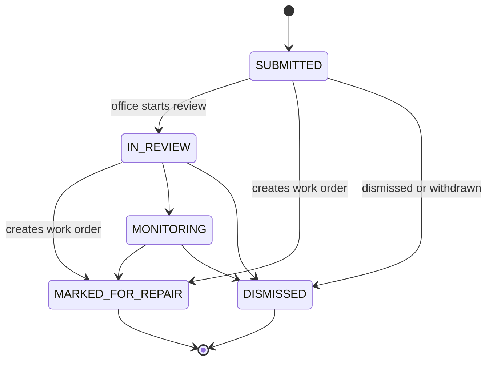
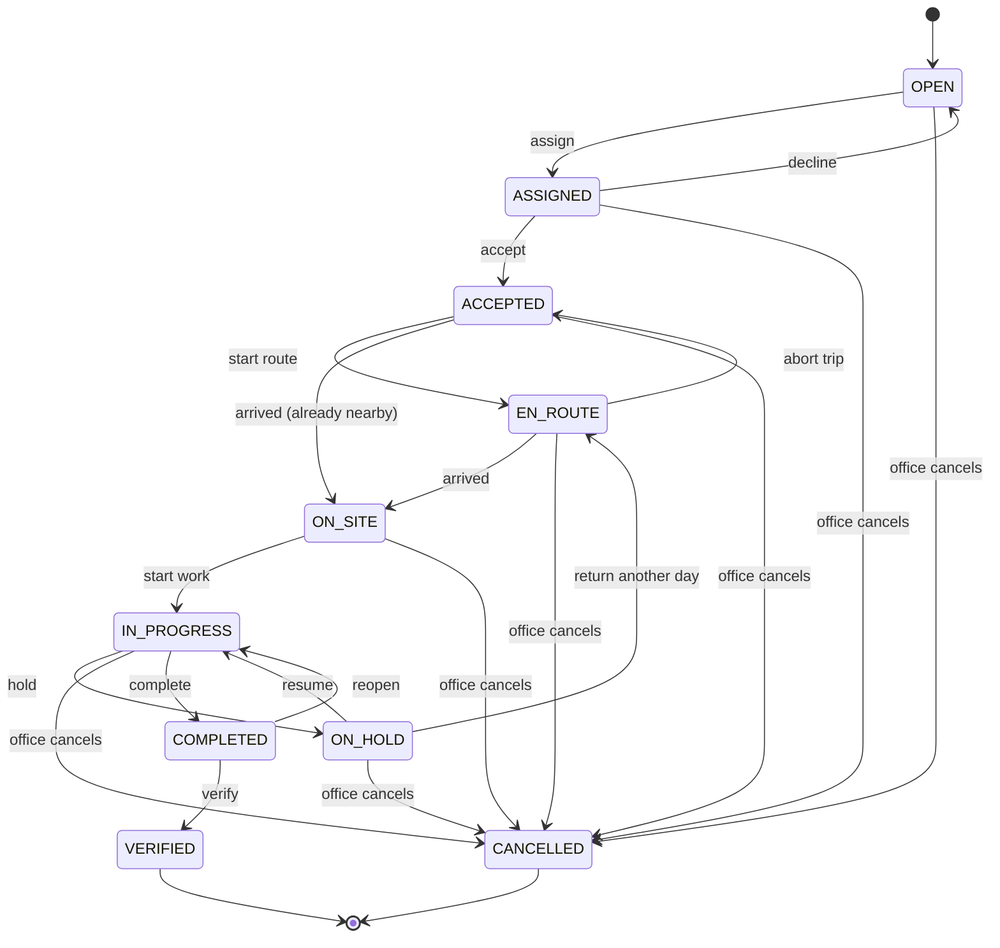
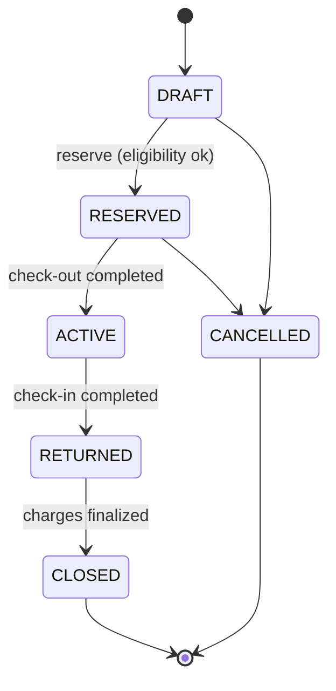

# AgroRende — Product Requirements Document (PRD)

> **An agro ERP built around field machinery work: inspect, repair, rent and run operations, online or offline.**

| | |
|---|---|
| Status | Draft v1.4, ready for build |
| Date | 2026-10-08 |
| Doc set | Round 5 (2026-10) |
| Product owner | Pedro Souza |
| Companion docs | `docs/ARCHITECTURE.md` (technology and design, normative names), `docs/DELIVERY-PLAN.md` (build plan for Copilot `/fleet`), `docs/TASKS.md`, `docs/ERRORS.md`, `docs/LANDSCAPE.md` |
| Requirement language | **MUST**: required for the release it is tagged with. **SHOULD**: expected unless a reason is documented. **MAY**: optional |
| Priorities | **P0**: MVP ("Primeira safra"). **P1**: after the MVP; v1.1 ("Segunda safra") ships only the W6 subset in §14. **P2**: roadmap; design for it but don't build it |

### Changelog

| Version | Date | Changes |
|---|---|---|
| v1.4 | 2026-10-08 | MongoDB 8 replaces PostgreSQL/Prisma for the MVP; pnpm workspaces replace Turborepo; visual direction and single palette; review fixes (round 5). |
| v1.3 | 2026-10-08 | Round 4: multi-tenant SaaS (self-service sign-up, trial, subscription status, platform console), sign-in with Google, Apple or invite + password, three roles (ADMIN, MANAGER, FIELD). |
| v1.2 | 2026-10-08 | Added self-recovery requirements REC-01…REC-16, multilingual launch requirements PLT-15…PLT-17, public site requirements SITE-01…SITE-09, Phase 1 local-media backups, and release assumptions A7/A8. |

---

## 1. Product name (Feature 0)

**AgroRende** (pronounced "AH-groh-HEN-jee"; ASCII code name `agrorende`).

In Brazilian Portuguese, *render* is what productive work does: "o dia rendeu", "a máquina rendeu", "o dinheiro rende". AgroRende is about **efficiency**: every machine hour, every service trip and every rental day should yield more. The product makes that happen by putting the whole field operation (inspect, repair, rent, dispatch) into one flow, from the first photo in the field to the last cost in the ERP, so the field crew and office work as one crew. Farmers say it naturally. English speakers can read it as "agro" + "render" (to deliver).

- **Tagline (pt-BR):** "O ERP de campo do agro. Cada hora rende mais."
- **Tagline (en):** "The field ERP for agribusiness. Make every hour count."
- **Brand cues:** the **Campo claro** direction uses "Mata" green `#2B8A3E`, "Terra" orange `#E8590C` and graphite neutrals across the app, admin and site. Mata is the action colour; Terra is for brand moments. The icon is a tractor wheel whose tread rises into an upward arrow: more yield from every turn.
- **Technical identifiers:** npm scope `@agrorende/*`, iOS bundle id and Android package `app.agrorende.field`, URL scheme `agrorende://`, asset code prefix `AGR-`.

Names screened on 2026-10-07 and 2026-10-08 (web search for software, apps and companies in agro and field service):

| Candidate | Result |
|---|---|
| AgroFlow | ❌ Taken: a Brazilian livestock ERP (agroflow.com.br) |
| AgriFlow, FieldFlow, CampoFlow | ❌ Taken: farm-management platforms (agriflow.co, FieldFlow by Doktar, campoflow.cl) |
| AgroFlux | ❌ Taken: an agricultural operations SaaS and a research sensor platform |
| AgroOps | ❌ Taken: an offline farm-operations app on Google Play |
| AgroRota | ❌ Taken: a Brazilian agro field CRM |
| AgroGiro | ❌ Taken: AgroGiroPro, an agro fleet ERP (and GIROAgro, a fertilizer brand) |
| AgroShift | ❌ Taken: an agri-commerce startup (agroshift.com) |
| AgroLoop | ❌ Taken: an agricultural waste platform |
| AgroMind | ❌ Taken: Agromind Tecnologias, a Brazilian platform for agro resellers (agromindtec.com), and AgroMind AI (Kenya) |
| Engrena, Capataz | ❌ Taken: a Brazilian workshop app and farm-management apps |
| AgroCrew | ⚠️ Close to AgCrew, a farm workforce app |
| AgroMotion | ⚠️ Close to Agri-Motion, a precision-farming kit |
| AgroTorque | ⚠️ A tractor YouTube channel with the same audience |
| Agrotimo | ⚠️ Close to Agroptima, a farm-management app |
| AgroÁgil | ⚠️ Agroágil, a Colombian rural-credit product |
| AgroLean | ⚠️ Agro Lean, a Brazilian agribusiness leadership school |
| Lida, Porteira | ⚠️ Close to existing farm apps |
| AgroEficaz | ⚠️ No software product, but companies named Agroeficaz exist in Colombia, Ecuador and Peru, and a purely descriptive word is harder to register as a trademark. **Runner-up** |
| Mutirão, AgroTurno | Free, but replaced by the product owner: first by an "Agro…" name, then by a name about efficiency |
| **AgroRende** | ✅ No software product, company or domain found |

Before public launch, run an INPI trademark search (classes 9 and 42) and check the domains `agrorende.app` and `agrorende.com.br`.

---

## 2. Executive summary

AgroRende is a **modular agro ERP**. AgroRende is sold as a multi-tenant SaaS: a company signs up in minutes with Google or Apple, gets a 30-day trial and invites its team by WhatsApp. Its first modules cover **machinery operations**: the tractors, harvesters, sprayers, trucks, generators and implements a harvest depends on. Today this work runs on WhatsApp groups, paper checklists and spreadsheets. AgroRende replaces them with a mobile-first platform that works offline:

1. **Inspect & Report (F1).** Anyone in the field can document a machine problem with photos, video, voice and GPS in under 2 minutes, even with no signal. The office then *marks the machine for repair*.
2. **Repair (F2).** FIELD users receive jobs and navigate there with the phone's own maps app. They fix the machine, record before and after photos, log parts and collect the customer's signature.
3. **Rent (F3).** FIELD users hand over and receive equipment with a guided check-out and check-in that records evidence, so damage disputes can be settled. The company can rent equipment out to customers and rent it in from partners.
4. **Operations Center (F4).** The office sees everything live: where each operator is, what is broken, what is rented and what is late.
5. **Agro ERP backbone (F5).** Farms and plots (talhões), seasons (safras), cost centres, parts and stock, preventive maintenance by hour meter, fuel logs and billing. Every repair and rental is recorded in the company's costs and revenue.

---

## 3. Problem and opportunity

In a typical Brazilian agro operation today:

- Machine problems are reported by WhatsApp audio or phone call. Reports often lack a photo of the right part, the location and the machine's history, and messages get lost in groups.
- Field users spend hours finding the machine inside a 5,000-hectare farm ("past the second silo, left at the eucalyptus").
- Nobody knows what a machine really costs. Parts, labour, fuel and downtime are tracked in different spreadsheets, or not at all.
- Equipment rentals start and end without evidence of the machine's condition. This leads to damage disputes, lost revenue and broken relationships.
- Managers only learn what happened at the end of the day. During harvest, an idle harvester can cost tens of thousands of reais per day.
- **Connectivity is poor where the work happens.** Apps that need signal fail exactly when people need them.

Generic ERPs such as TOTVS, SAP Business One and Siagri are strong in finance and tax but weak in the field. Field-service apps are strong in the field but don't model farms, seasons, hour meters or rentals. AgroRende fills the gap with **mobile UX built for field conditions on top of an agro-native ERP data model**.

No Brazilian product combines the whole loop: field report → repair WO → rental check-out/check-in with damage feeding back into repair → true cost per asset, farm and season, offline-first and multi-brand.

Competitor categories:

- **FSM:** Auvo, Field Control, uMov.me.
- **CMMS:** Engeman, Leankeep.
- **Farm ERPs:** Aegro, TOTVS Agro, Siagri.
- **Rental-management systems:** Sisloc, Expecto Loc, Nixloc.
- **Rental marketplaces:** Alluagro, TratorHub, ProntoLoc.
- **OEM/telemetry:** John Deere Operations Center, CNH FieldOps, Solinftec.

**Positioning:** AgroRende is the offline-first, multi-brand field ERP that connects inspect, repair, rent and cost reporting in one Operations Center.

Details, pricing benchmarks and a pricing hypothesis: `docs/LANDSCAPE.md`.

**Target customers**

1. Machinery dealers and service companies with mobile service crews (concessionárias, oficinas volantes).
2. Equipment rental companies serving agro and construction (locadoras).
3. Large farms, sugar-cane and ethanol mills (usinas) and cooperatives that run their own fleet and workshop.

**Initial market:** Brazil (pt-BR, BRL, LGPD). English is supported from day one.

---

## 4. Goals, non-goals and success metrics

### Goals

- **G1:** Capture every machine problem with evidence when it is first seen, online or offline.
- **G2:** Shorten the time from "problem seen" to "field user on the way", and from "job created" to "machine running".
- **G3:** Make every rental hand-over and return provable.
- **G4:** Give the office a single, real-time view of field operations.
- **G5:** Know the true cost of each machine, farm and season.
- **G6:** Be the easiest field app our users have ever used, and never lose their data.

### Non-goals for the MVP (P0)

- Tax documents (NF-e/NFS-e), payments and an accounting ledger. Planned for P2 through integrations.
- Purchasing and supplier orders (P2).
- Agronomy modules: crop planning, inputs, spraying prescriptions, yield (P2). Plots and seasons already prepare the data model for them.
- Telematics, ISOBUS and CAN-bus integration (P2).
- In-app turn-by-turn navigation. AgroRende hands off to Google Maps, Waze or Apple Maps.
- A customer self-service portal (P2). Chat is also out; comments arrive in P1.
- Online subscription payments (P1).
- Custom roles (P2).

### Success metrics (6 months after go-live)

| Metric | Definition | Target |
|---|---|---|
| Report time | Median time from "New report" to "Submit" | ≤ 2 min |
| Detection → dispatch | Median time from report received to WO assigned (HIGH/CRITICAL) | ≤ 2 h |
| MTTR | Median time from WO created to COMPLETED | −25 % vs baseline |
| First-time fix | WOs completed without a reopen or a WAITING_PARTS hold | ≥ 75 % |
| Evidence coverage | Completed WOs with before **and** after photos | ≥ 95 % |
| Rental disputes | Rentals with contested damage charges | ≤ 5 % |
| Data loss | Field records lost to connectivity or app issues | **0** |
| Sync freshness | Offline records reaching the server ≤ 5 min after connectivity returns | ≥ 95 % |
| Cost capture | Completed WOs with labour and parts cost recorded | ≥ 90 % |
| Adoption | Weekly active field users / licensed field users | ≥ 85 % |
| Usability | SUS score. A new field user completes a first report without training | ≥ 80. Yes |
| Self-recovery | Errors shown that the user resolves without contacting the office within 24 h | ≥ 90 % |
| Support load | Support contacts per 100 active field users per month | < 5 |

---

## 5. Personas and roles

| Persona | Role | Context | Needs most | Hates |
|---|---|---|---|---|
| **Joana**, field reporter or agronomist | `FIELD` | Walks fields and yards in sun and dust, wearing gloves, often with 0–1 bars of signal | Fast capture, no typing, confidence the report was sent | Forms, waiting for uploads |
| **Carlos**, mobile repair specialist | `FIELD` | Drives 200 km/day between farms in a service pickup that carries van stock | A clear job list, the exact location, machine history, quick close-out | Calling the office for directions, entering data twice |
| **Rafael**, yard and rental hand-over lead | `FIELD` | Works the yard and deliveries while the customer waits next to him | Guided checklist, proof, signatures, speed | Disputes like "that scratch was already there" |
| **Marina**, operations manager | `MANAGER` | Office, two monitors, phone ringing | A real-time view, triage, assigning the right person, SLA alerts | Finding out late |
| **Paulo**, owner or farm manager | `ADMIN` | Office and phone, weekly reviews | Costs per machine, farm and season; utilization; rental revenue | Spreadsheets that don't match |
| **Seu Antônio**, farmer or renter (customer) | no login | Signs on the responsible field user's phone | A fair, clear report on WhatsApp | Surprises on the bill |

Each person has exactly one role: **Administrador** (ADMIN), **Gestor** (MANAGER) or **Campo** (FIELD). Field work (reports, jobs, rental inspections) is open to every role, so a FIELD user who also does rental hand-overs needs nothing extra. Custom roles are P2.

Mapping from old roles for migration only: `ADMIN → ADMIN`; `MANAGER, DISPATCHER → MANAGER`; `INSPECTOR, TECHNICIAN, RENTAL_AGENT → FIELD`.

### Permissions (P0)

| Capability | ADMIN | MANAGER | FIELD |
|---|:-:|:-:|:-:|
| Use the mobile app (reports, my jobs, rental check-out/check-in, assets, Near me) | ✅ | ✅ | ✅ |
| Create field reports | ✅ | ✅ | ✅ |
| Progress and complete work orders assigned to me | ✅ | ✅ | ✅ |
| Rental check-out and check-in inspections (FIELD enters damage estimates at return) | ✅ | ✅ | ✅ |
| Update hour meter and odometer readings | ✅ | ✅ | ✅ |
| Use the office web | ✅ | ✅ | |
| Triage reports, mark for repair | ✅ | ✅ | |
| Create, assign, reassign, cancel, verify and reopen work orders | ✅ | ✅ | |
| Create, reserve, cancel, close rentals and edit charges | ✅ | ✅ | |
| Live map, Operations Center and Needs-attention queue | ✅ | ✅ | |
| Costs and analytics, CSV export | ✅ | ✅ (labour rates per setting) | |
| Manage assets, sites, plots, checklist templates, customers | ✅ | ✅ | |
| See customer CPF/CNPJ | ✅ | ✅ | only on rentals in their sync scope |
| Manage team (invites, roles, deactivate), settings, seasons, labour rates | ✅ | | |
| Subscription page (status, usage, cancel) | ✅ | | |
| Fuel logs (P1) | ✅ | ✅ | ✅ |
| Parts and stock movements (P1) | ✅ | ✅ | own van |
| Maintenance plans (P1) | ✅ | ✅ | |
| Billing documents (P1) | ✅ | ✅ | |
| Comment on reports, WOs and rentals (P1, anyone who can see the record) | ✅ | ✅ | ✅ |

---

## 6. Glossary

| Term (en / pt-BR) | Meaning |
|---|---|
| Asset / Máquina | A machine or implement tracked in AgroRende. Each has a unique code (`AGR-000123`) printed on a QR tag |
| Site / Local | A place with coordinates: farm (fazenda), yard (pátio), workshop (oficina), dealer or construction site |
| Plot / Talhão | A named area inside a farm. It can have a boundary polygon and a crop |
| Season / Safra | A crop season (for example "Safra 2026/27"). It is used as a cost dimension and can have critical windows (planting, harvest) |
| Customer / Cliente | A company or person we serve or rent to. A partner or supplier is a customer with the supplier flag |
| Field report / Relato de campo | Evidence of a machine problem captured in the field (F1) |
| Marked for repair / Marcado para reparo | The triage decision that turns a report into a work order |
| Work order (WO) / Ordem de serviço (OS) | A repair job assigned to a FIELD user (F2) |
| Inspection / Vistoria | A checklist with photos and readings, done at rental hand-over or return, or during a repair |
| Damage / Avaria | A recorded defect on an asset (zone, severity, photo). Each asset keeps a damage register |
| Rental / Locação | Renting our asset out, or renting a partner's asset in, for a period |
| Check-out / Check-in (Entrega / Devolução) | Guided inspection at hand-over and at return |
| Hour meter / Horímetro | Engine hours, the main usage measure for agro machines |
| On duty / Em serviço | While a user is on duty, their location is shared with the office |
| Sync / Sincronização | Exchanging offline data with the server |
| Outbox / Fila de envio | Actions waiting on the device to be sent |
| Conflict / Conflito | An offline action the server could not apply, for example because the job was cancelled in the meantime |

---

## 7. Product principles

1. **Field first.** Design for a dusty phone in direct sun, held with gloves, with one bar of signal.
2. **Offline is the normal case, not an error.** Every field flow works with no connectivity at all.
3. **Evidence over words.** Photos, video, GPS, time and signature are attached automatically.
4. **One screen, one decision.** Big buttons, short wizards, smart defaults.
5. **Never lose data, never block the user, never leave them stuck.**
6. **Live where it matters.** The ops map updates in real time. Elsewhere, it is fine if data catches up after a short delay.
7. **Built for agro.** Farms, plots, seasons, hour meters and harvest windows are core concepts.
8. **Portuguese first, multilingual by design.** pt-BR is the default language and the reference copy; English ships at launch; adding a language is a translation task, not a code change.

---

## 8. Golden path (end-to-end story)

1. **Inspect (offline).** Joana spots a hydraulic leak on tractor `AGR-000012` in Talhão 2 of Fazenda Santa Clara. There is no signal. She scans the QR tag, takes 3 photos and a 20-second video, records a voice note, picks *Hydraulic* and *High*, answers *Machine still operable?* with *No*, and submits. The app shows "Waiting to send".
2. **Sync.** On the road back, signal returns. The report and media upload in the background, and the report gets number `FR-000482`.
3. **Triage.** A red pin appears on the Operations Center map and the tractor's status changes to *Needs repair*. Marina watches the video, clicks **Mark for repair** and sets priority *High*. AgroRende suggests Carlos: he is on duty, has the hydraulic skill, is about 20 km away and has 1 open job. She assigns the job to him.
4. **Dispatch.** Carlos gets a push notification, opens the job and taps **Accept**, then **Start route**, and chooses Waze. Marina watches his avatar move on the map.
5. **On site.** Within 200 m of the site, the app asks "Arrived at Fazenda Santa Clara?" and he taps **Yes**. He takes before photos, runs the safety checklist and finds a burst hose. He has no spare in his van, so he sets **On hold – waiting for parts**.
6. **Complete.** The next day he returns, replaces the hose and logs it as a free-text part (catalog and van stock come in P1). He takes after photos, records hour meter 4,312 h and writes the resolution. The farm manager signs on the phone and Carlos taps **Complete**. He shares the PDF report on WhatsApp. The tractor is back to *Operational*, and the labour (3.5 h) and parts costs are recorded against the asset, the farm and season *Safra 2026/27*.
7. **Verify.** Marina reviews the job and **verifies** it.
8. **Rent.** Two weeks later the tractor is rented to Fazenda Boa Vista. Rafael scans the QR tag, takes the 7 guided walkaround photos and records hours and fuel. He confirms 2 known scratches, gives the safety briefing, and both the customer and Rafael (the responsible field user) sign. The rental is now *Active*.
9. **Return.** At return, each check-in step shows the check-out photo side by side. Rafael finds a new dent on the left fender and records it as a new damage, severity *Moderate*, estimated at R$ 1,200. AgroRende proposes the charges: 10 days × R$ 850, 6 extra hours, a 15 % fuel difference and the dent. It also creates a field report for the dent automatically.
10. **Close.** Rafael closes the rental. A billing document is issued (P1), and the revenue is recorded against the asset and the season.

---

## 9. Functional requirements

Format: **ID: requirement, priority**, followed by acceptance criteria (AC) where they are not obvious.

### 9.0 Platform (shared by all modules)

- **PLT-01:** Sign in with Google (any Gmail or Google Workspace account), Apple, or e-mail and password. Google and Apple need no new password and no IT department. People join a company only by invite (§PLT-19); companies sign up by themselves (TEN-01). Users stay signed in for 30 days. After the first successful sign-in and sync, the app opens and works offline. **P0**
  - AC: in airplane mode, killing and reopening the app lands on Home with cached data.
- **PLT-02:** Role-aware Home ("Hoje" / "Today") and tabs. All roles see the same field tabs; the office web is for Administrador and Gestor. **P0**
- **PLT-03:** Language per user. Launch languages: pt-BR (default) and English. The app follows the device language on first launch when supported, otherwise the organization's default, otherwise pt-BR. Users can switch language at any time, offline, without restarting. All user-facing text, notifications, PDFs, emails and the public site are translated. User-written text (descriptions, notes) is shown as written. **P0**
- **PLT-04:** Duty switch (On duty / Off duty). Location is shared only while the user is on duty, with the lawful basis and transparent LGPD notice recorded. A visible indicator stays on screen the whole time, and first activation asks for consent where required. **P0**
- **PLT-05:** Find an asset by QR scan, barcode or serial scan, search (name, code, plate, serial), *Near me* (sorted by distance) or *Recent*. Works offline. **P0**
  - AC: QR unreadable offers torch and type-code fallback; unknown or other-org QR shows "Not one of ours" plus the unregistered-machine path where allowed; retired assets are shown with a badge (reports allowed, rental/WO blocked); offline search with no result says "Not on this phone yet" plus unregistered or Ask the office; *Near me* without GPS falls back to *Recent* and the site picker.
- **PLT-06:** Asset profile: cover photo, specs, condition, owner, home site, last known location, hour meter, known damages, history (reports, WOs, rentals, fuel) and a cost summary for managers. **P0** (fuel and the cost summary on mobile are P1)
- **PLT-07:** Push notifications for: job assigned; job changed or cancelled; report marked for repair (sent to the reporter); rental due soon or overdue; SLA at risk. If alerts are off, Home shows a banner "Alerts are off: you'll still see new jobs here when you open the app" with **Turn on**; Home/Today remains the source of truth. Device push status is visible in the office device page. **P0**
- **PLT-08:** In-app notification centre on mobile and web. **P1**
- **PLT-09:** **Sync Center** showing the last sync time, pending actions, uploads with progress and conflicts with explanations. It has a *Sync now* button and an *Upload videos only on Wi-Fi* setting. **P0**
- **PLT-10:** Comment threads on reports, WOs and rentals, between the field and the office. **P1**
- **PLT-11:** Share PDF reports (WO report, rental hand-over report, rental return report) through the native share sheet (WhatsApp, email). Sharing needs connectivity. Offline, the button explains that it becomes available after sync. If no share target exists, the app offers **Copy summary** and **Save to files**. **P0**
- **PLT-12:** Shared devices. **P0:** per-user local isolation (separate local database per user id, encrypted keys in secure store); sign-out with pending items warns and keeps them for that user; the next user never sees them. **P1:** fast user-switching UI for tablets shared by crews.
- **PLT-13:** Audit trail: every create, update and status change records who did it, when, location when available (not applicable on web), and from which device. **P0**
- **PLT-14:** Onboarding: 3 intro screens, plus an explanation for each permission (camera, location, notifications, microphone) before the OS prompt appears. **P0**
- **PLT-15:** Locale-aware formats: dates, times, numbers, currency and units follow the user's language (pt-BR `1.234,5` and DD/MM/YYYY; en `1,234.5` and an unambiguous date format `08 Oct 2026`); currency follows the organization (BRL). Number inputs accept the locale's decimal separator. **P0**
- **PLT-16:** Customer-facing documents (rental hand-over and return PDFs, work order report) are generated in the language chosen at the start of the check-out or completion (default: organization language), independently of the responsible field user's app language. **P0**
- **PLT-17:** Adding a language: an organization admin can request it; the product team adds it with no code changes (translation files, store listing, site pages). Spanish (`es`) is the next candidate. **P1**
- **PLT-18:** Office contact settings: `officePhone` is required at organization setup (E.164; seed has it) and `officeWhatsApp` is optional. If no office contact exists, Ask the office is hidden and diagnostics plus handoff are offered instead; the admin dashboard shows a setup warning. **P0**
- **PLT-19:** Invites by code/link/QR shared by WhatsApp, 7-day single use, with role and email rules. **P0**
- **PLT-20:** Account help without email: office reset link, re-invite to link another Google/Apple account, and temporary password. **P0**
- **PLT-21:** Delete my account in the app and web, with provider revocation. On the device, deletion is blocked while the outbox or media queue has pending items and offers **Enviar agora** and **Salvar cópia**. The server anonymizes the user account and keeps company records that are legally required. **P0**
- **PLT-22:** Last-admin protection and role changes take effect on next sync without losing captured work. **P0**
- **PLT-23:** More sign-in options: native Google one-tap, phone/WhatsApp code, self-service email reset and email invites (SMTP), link/unlink sign-in methods, company-domain auto-join (public domains such as gmail.com, hotmail.com, outlook.com, yahoo.com, icloud.com, uol.com.br, bol.com.br, terra.com.br never auto-join). **P1**
- **PLT-24:** Per-person tab visibility. **P1**

### 9.1 F1: Inspect & Report (Vistoria e relato)

Mobile:

- **FR-01:** *New report* wizard with 4 steps: **Machine → Evidence → Details → Review**. Reachable in ≤ 2 taps from Home. **P0**
- **FR-02:** Machine step: QR scan, search, *Near me*, *Recent*, or **Machine not registered** (free text plus a photo of the plate). When the site is a farm, an optional plot (talhão) picker appears; if plots are empty or stale, the user can **Continue without plot** and the office can set it later. **P0**
- **FR-03:** Evidence step: multiple photos, videos up to 60 s (max 5 per report), voice notes up to 2 min, and picks from the gallery. Every item is stamped with time. GPS is attached when available, with accuracy and source; if unavailable, the item records the reason. At least one photo **or** video is required. **P0**
- **FR-04:** Photo annotation: draw circles, arrows or freehand lines in high-visibility colours to point at the problem. **P1**
- **FR-05:** Details step: **P0**
  - Category, shown as an icon grid: engine, hydraulic, electrical, transmission, tyres/tracks, brakes, structure, cab, implement, leak, safety, other.
  - Severity: Low, Medium, High or Critical, each with a plain-language explanation.
  - *Machine still operable?* (yes/no).
  - Suggested action: repair now, repair soon, monitor or info only.
  - Title, pre-filled from the category and the asset.
  - Description, with dictation encouraged.
- **FR-06:** Location is captured automatically when available, and its accuracy/source is shown. If GPS is poor or unavailable, the user sees the reason and can continue with the site location; dragging the pin is **P1**. **P0** for automatic capture when available.
- **FR-07:** The draft is saved automatically at every step. Drafts survive an app kill and a phone restart. Home offers *Continue draft*. **P0**
- **FR-08:** Submit works offline. The status badge changes from *Waiting to send* to *Sent · FR-000482*. **P0**
- **FR-09:** After submit, the app offers *Add another for this machine* and *Done*. **P0**
- **FR-10:** A *My reports* list shows each report's status (Submitted, In review, Marked for repair, Monitoring, Dismissed) and the linked WO's status. **P0**
- **FR-11:** While a report is *Submitted*, the reporter can add media, edit details or withdraw it with a reason. **P1**
- **FR-12:** Duplicate hint: when the asset already has an open report or WO, the app shows it and offers *Add info to existing* instead. **P1**
- **FR-13:** One open repair per asset: marking a report for repair when the asset already has an open WO shows **Attach to the existing job** (primary) or **Create anyway** (MANAGER/ADMIN only, with a reason). **P0**

Office (web):

- **FR-20:** Triage inbox listing new reports by severity and age. For each report it shows a media gallery with a video and audio player, a mini map, the asset's history and the reporter. **P0**
- **FR-21:** Triage actions: **P0**
  - **Start review.**
  - **Mark for repair** creates a WO pre-filled with the title, description, priority (from severity), asset, location and media. The office can optionally assign it straight away.
  - **Monitor** with a note. A re-check date comes in P1.
  - **Dismiss**, with a required reason.
- **FR-22:** Link an unregistered machine to an existing asset, or create the asset from the report. **P1**

Business rules:

- **BR-F1-1:** When the server receives a report, it recomputes asset condition using `ARCHITECTURE.md` §6.4. It keeps `IN_REPAIR`, `OUT_OF_SERVICE` and `RETIRED`; otherwise a report with *repair now*, *operable = no* or *severity = Critical* sets the asset to `NEEDS_REPAIR` and notifies the office.
- **BR-F1-2:** The server assigns report numbers (`FR-000482`) when it receives the report. Until then, the app shows a local reference.
- **BR-F1-3:** Marking a report for repair moves the asset to `NEEDS_REPAIR` (if it was `OPERATIONAL`) and notifies the reporter.
- **BR-F1-4:** Reports are never rejected because of asset state. Retired assets are accepted and flagged; rented-out assets are accepted, linked to the rental and notify the office; assets already in repair attach the report as info to the open WO; unknown or other-org machines are stored as unregistered. Only validation errors reject a report.

### 9.2 F2: Repair (Reparo)

Mobile (field user):

- **WO-01:** *My jobs* with tabs Today, Upcoming and Done. Jobs are sorted by priority, then due time, then distance. Each shows its status, SLA countdown, distance and customer. **P0**
- **WO-02:** Jobs shown on a map. **P1**
- **WO-03:** Job detail: **P0**
  - What: title, instructions, original report media.
  - Machine: profile, last 5 history items, known damages.
  - Where: map preview, address, location notes, plot, distance.
  - Who: customer contact, with call and WhatsApp buttons.
  - Checklist, parts, notes and timeline.
- **WO-04:** One big **primary action** moves the job through **Accept → Start route → Arrived → Start work → Complete**. **P0**
  - Secondary actions: **Decline** (with a reason), **On hold** (reason: waiting parts, waiting customer, weather, safety, needs specialist, other), **Resume** and **Voltar outro dia / Return another day** from On hold (moves the job back to `EN_ROUTE`).
  - Each change records the time and location when available, and works offline.
- **WO-05:** **Navigate** opens the phone's maps app with the destination: Google Maps, Waze or Apple Maps (iOS). Destination falls back in order: machine point → site point → site address text → original report location. If there is no usable destination, show **Copy directions**, **Call the contact** and **Ask the office**. On arrival, the field user can **Save this point**, updating the site point and timeline. The chosen maps app is remembered. **P0**
- **WO-06:** Arrival prompt: while *En route* and within the site radius (default 200 m), the app asks "Arrived at X?" with **I'm here**, **Not here yet** and **Wrong place → Save this point**. The status never changes without the field user's confirmation. **P1**
- **WO-07:** Before and after photos and videos (tagged), and notes. **P0**
- **WO-08:** Checklist from the WO's template, with pass/fail/NA, number and text items, items that require a photo, and safety-critical items. A failed safety-critical item shows a stop-work screen, sets the WO to **On hold · safety**, and notifies the office; only MANAGER/ADMIN can release it. **P0**
- **WO-09:** Parts used. In P0 these are free text (name, part number, quantity, unit, optional unit cost). In P1 the field user picks from the catalog and the quantity is deducted from van stock. **P0 / P1**
- **WO-10:** **Complete** screen with: **P0**
  - Resolution (required).
  - Root cause (optional).
  - Hour meter reading. If lower than the last reading, the app offers **Meter was replaced** (photo required, resets the baseline and notifies the office) or **Fix the number**; a very large jump asks for confirmation.
  - Customer name and signature. If the customer is absent or refuses, the field user selects a reason (absent, refused, other), adds a photo of the finished work and optionally a witness name; the WO completes as **Completed · no signature**, an attention item is created, and the PDF says "Not signed: <reason>". A signature is never faked.
  - Summary.
  - Guards: at least 1 *after* photo, and all required checklist items answered.
- **WO-11:** "While I'm here": the field user creates a new report for another problem found on site, using the F1 flow with the site pre-filled. **P1**

Office (web):

- **WO-20:** Board view (Kanban by status) and table view, with filters for status, priority, assignee, asset, farm, season and date. **P0**
- **WO-21:** Create a WO manually (corrective, preventive or inspection). **P0**
- **WO-22:** Assign or reassign with **suggested field users**, ranked by FIELD users first, then on-duty status, skill match, distance to the job and current open jobs. Any active joined user can be assigned. **P0**
- **WO-23:** **Verify** completed jobs, **Reopen** them with a reason, or **Cancel** with a reason. **P0**
- **WO-24:** WO PDF report with the job data, timeline, photos, checklist, parts, costs (optional) and signature. **P0**
- **WO-25:** Dispatch timeline (field user × day, drag to schedule). **P2**

Business rules:

- **BR-F2-1:** Asset condition follows the WO. When a WO is `IN_PROGRESS` or `ON_HOLD`, the asset is `IN_REPAIR`. When it is `COMPLETED` and the asset has no other open WOs, the asset returns to `OPERATIONAL`. Assets set manually to `OUT_OF_SERVICE` or `RETIRED` are never changed automatically.
- **BR-F2-2:** The SLA due time defaults by priority (org setting): Critical 4 h, High 24 h, Medium 72 h, Low 7 days. **During a season's critical window (planting or harvest), the SLA is halved for the asset categories that window lists** (P1).
- **BR-F2-3:** Time is calculated automatically. Travel time runs from En route to On site; work time is In progress minus On hold. Labour cost is work hours × the field user's hourly cost (P0), shown only to ADMIN and MANAGER.
- **BR-F2-4:** If a job was reassigned or cancelled while the field user was offline, the app explains what happened in plain language on the next sync. The field user's photos and notes are **kept and attached to the WO as late evidence**, and the office is notified. Nothing is discarded.
- **BR-F2-5:** A field user should have only one job *In progress*. Starting a second one shows a warning but is not blocked.

### 9.3 F3: Rent (Locação)

- **RN-01:** Create a rental on the web, or on mobile when online, with these fields: **P0**
  - Direction: **Rent out** (P0) or **Rent in** (P1).
  - Asset and customer or partner.
  - Planned start and end.
  - Rate per hour, day, week or month; deposit; included hours per day; extra-hour rate; late fee per day.
  - Fuel policy (full-to-full, charge the difference, or included) and fuel price.
  - Pickup or delivery, with address and coordinates.
  - Responsible field user (`agentId`) for hand-over and return; ADMIN/MANAGER can reassign it. The rental appears on that user's phone and on ADMIN/MANAGER devices.
  - Season and notes.
- **RN-02:** Eligibility check. Each failure is shown with a clear reason. **P0**
  - The asset is rentable and in condition `OPERATIONAL`.
  - The asset has no open Critical report and no overlapping reserved or active rental.
  - The customer has a CPF or CNPJ and a phone number.
- **RN-03:** Mobile rental list with *Today's hand-overs*, *Today's returns*, *Active* and *Overdue*. **P0**
- **RN-04:** Guided **check-out** (works offline). **P0**
  1. Scan the asset's QR tag. It must match the rental's asset.
  2. Walkaround photos with silhouette guides: front, rear, left, right, cab/interior, hour meter, fuel gauge. All are required.
  3. Readings: hour meter, odometer (road vehicles), fuel level slider. Lower readings offer **Meter was replaced** (photo required, resets baseline and notifies the office) or **Fix the number**; very large jumps ask for confirmation.
  4. Checklist from the template for the asset category: tyres, lights, fluids, hydraulics, safety devices, documents.
  5. Known damages: confirm each damage in the asset's register, and add new pre-existing damages (zone, severity, photo). Dark or blurry photos suggest Retake, with **Keep anyway** as a non-blocking option.
  6. Accessories handed over, from the template, with expected and present quantities; missing accessories are listed on the hand-over PDF.
  7. Safety briefing given ✓, plus the operator's name and document.
  8. Document language and terms summary shown to the customer and accepted; the signed terms version is recorded, and older terms accepted while offline create an attention item instead of rejecting.
  9. Signatures from the customer or a representative (name, role and optional CPF/RG) and the responsible field user are required. Refused or absent customer signature saves a draft and offers Ask the office; check-out cannot complete.
  10. Summary, then **Confirm hand-over**. The check-out inspection and rental hand-over are confirmed as one step; the rental becomes *Active* and the asset is *Rented out*.
- **RN-05:** Due-soon (24 h before the end) and overdue notifications go to the responsible field user and every ADMIN and MANAGER. A report created on a rented asset is linked to the rental. **P0**
- **RN-06:** Extend a rental, with an availability check. **P1**
- **RN-07:** Guided **check-in** (works offline). No terms acceptance or safety briefing appears at check-in. **P0**
  1. Scan the asset's QR tag. It must match the rental's asset.
  2. Return walkaround photos, each shown beside its check-out photo.
  3. Readings: hour meter, odometer where relevant, and fuel level; lower readings and very large jumps use the meter-replaced / confirm flow of RN-04.
  4. Return checklist from the template.
  5. Known damages: for each one, the app asks "Same as before?".
  6. New damages: flag *New*; unclear damages (for example mud-covered) offer **Clean and re-photograph** or **Mark as unclear**, and are not charged until office review.
  7. Accessories returned, with missing accessories proposed as charge lines for office review.
  8. Customer or representative signature, or ABSENT/REFUSED with reason; new damages are marked *not acknowledged* and open the dispute flow.
  9. Charges estimate.
  10. Summary, then **Confirm return**. The return inspection and rental check-in are confirmed as one step.
- **RN-08:** Charges proposal at check-in is labelled **Estimate**. It is calculated on the device (so it works offline) and recalculated on the server, which wins; if totals differ or the office edits charges before close, the field user sees "Totals updated by the office" and the return PDF is reissued. It covers the base, extra time, extra hours, fuel, missing accessories and damages, and shows the deposit. Disputed or unclear damage charges are held; a rental cannot close with open disputes. FIELD can edit damage estimates only; ADMIN and MANAGER can edit charge lines before closing. **P0**
- **RN-09:** Each *new* damage creates a field report linked to the rental. A *Severe* damage also sets the asset to `NEEDS_REPAIR`. **P0**
- **RN-10:** **Close rental**: finalize the charges and record a settlement reference. Closing is blocked while damage disputes are open. In P0, payment happens outside AgroRende; in P1, closing issues a billing document. **P0**
- **RN-11:** Rentals list on the web with filters, and a rental detail page with check-out and check-in side by side. **P0** An availability calendar per rentable asset is **P1**.
- **RN-12:** **Rent in** from a partner, using the same inspections labelled *Receive* and *Return*. The asset is registered as partner-owned, and costs go to the season and farm. **P1**

Business rules:

- **BR-F3-1:** *Overdue* is derived: the rental is Active and the current time is after the planned end plus the grace period (org setting, default 2 h).
- **BR-F3-2:** Charges (exact formula in `ARCHITECTURE.md` §7.4):
  - Base = planned units × rate.
  - Extra time = late units × late fee (or the rate).
  - Extra hours = max(0, used hours − included hours × rental days) × extra-hour rate.
  - Fuel = missing fuel % × tank capacity × fuel price, depending on the fuel policy.
  - Damages = the sum of estimated costs of *new* damages.
- **BR-F3-3:** Check-out cannot be completed without all required photos and both the customer/representative signature and responsible field user signature. Check-in cannot be completed without all required photos, but can be completed with an absent/refused customer signature using the dispute flow above.

### 9.4 F4: Operations Center (Central de operações, web)

- **OPS-01:** **Live map**, the default landing page. **P0**
  - Operators appear as avatars coloured by state: *On site* green, *En route* blue, *Working* amber, *On hold* purple, *Idle* grey, *Offline > 5 min* faded with a red ring. Movement is smooth.
  - Clicking an operator opens a side panel with name, phone, current job, speed, battery, last update and the trail of the last 2 h.
- **OPS-02:** Map layers: operators, open reports (by severity), work orders, assets (by condition), rented-out assets, sites and plot boundaries. Points cluster when zoomed out. A satellite toggle comes in P1. **P0**
- **OPS-03:** Live KPI strip: open reports, unassigned WOs, in progress, completed today, SLA at risk, active rentals, overdue rentals, operators on duty. Clicking a KPI filters the map and lists. **P0**
- **OPS-04:** Live activity feed (for example "Carlos arrived at Fazenda Boa Vista · 2 min ago"). **P0**
- **OPS-05:** Alerts panel: SLA at risk, overdue rentals, critical reports and **devices with unsynced data for more than 24 h**. **P0**
- **OPS-06:** Analytics with date-range and season filters. **P1** CSV exports of reports, WOs, rentals and costs are **P0**. The analytics cover:
  - MTTR trend and first-time fix rate.
  - Reports by category and WOs per field user.
  - Downtime per asset and top failing assets.
  - Rental utilization and revenue.
  - Cost per asset, farm and season.
- **OPS-07:** Management pages: **P0**
  - Assets: CRUD. A printable QR label sheet (PDF) is P1.
  - Sites and plots, with a map picker. Polygon drawing is P1.
  - Customers.
  - Team: users, role, skills, hourly cost, and devices with their sync health.
  - Checklist templates, with a builder.
  - Seasons.
  - Settings: SLA, signature requirement, rental terms, grace period, upload policy.
- **OPS-08:** Global search and command palette (⌘K). **P1**
- **OPS-09:** Dark and light themes. The layout works down to tablet size. **P0**
- **OPS-10:** Everything updates in real time without a page reload. **P0**

### 9.5 F5: Agro ERP backbone

- **ERP-01:** Organization structure: company → sites (farms, yards, workshops) → plots (talhões, with area in hectares, crop and an optional boundary). **P0** Plots ship without boundary drawing; drawing is **P1**.
- **ERP-02:** Seasons (safras) with start and end dates and optional critical windows. One season is current. Reports, WOs, rentals and fuel logs carry a season, filled in automatically with the current one. **P0**
- **ERP-03:** Cost capture per WO: labour (derived hours × hourly cost) plus parts (quantity × unit cost). Third-party services come in P1. Costs roll up per asset, site, plot and season. **P0** The roll-up ships as a CSV and on the asset page; a dashboard is **P1**.
- **ERP-04:** Rental revenue (rent-out) and rental costs (rent-in) are recorded against the asset, site and season. **P0**
- **ERP-05:** Parts catalog (SKU, name, unit, cost, compatible categories) and stock per location (warehouse, field user's van). Stock movements: in, out to a WO, transfer and adjustment. Low-stock alerts. **P1**
- **ERP-06:** Preventive maintenance plans by hour meter and/or calendar (for example every 250 h or every 6 months), per asset or per category. Preventive WOs are created automatically when due. The hour meter is updated from inspections, WOs and fuel logs. **P1**
- **ERP-07:** Fuel logs (abastecimento): asset, litres, price, hour meter, site or plot, season, operator and a photo of the pump. Works offline. Consumption (L/h) per asset. **P1**
- **ERP-08:** Billing documents (pre-invoices) for repairs and rentals: lines, totals, status (draft, issued, paid, cancelled) and an external NF-e reference. **P1**
- **ERP-09:** Integrations: CSV exports (**P0**); REST API keys and outbound webhooks (**P2**); NF-e issuance and accounting connectors such as TOTVS, Omie and Conta Azul (**P2**).

---

### 9.6 F6: Public website (Site)

Goal: explain AgroRende to Brazilian agro companies and convert visitors into a conversation (WhatsApp/e-mail) and, for existing customers, a sign-in or app download.

| ID | Requirement | Priority |
|---|---|---|
| SITE-01 | Pages: Home (landing), Features (F1–F5 with real screenshots), Pricing ("Planos" with pricing copy approved after the model is decided; prices shown only when `SITE_SHOW_PRICES=true`, else "Fale com a gente"), Help (`/ajuda`: FAQ + one page per error code, REC-15), Privacy policy, Terms of use, DPA, account deletion and 404. Primary CTA: "Comece grátis — 30 dias" → `APP_URL/signup`. | P0 for the site |
| SITE-02 | Home sections: hero with tagline and primary CTA; the problem (paper, WhatsApp photos, lost hours); how it works in 4 steps (Vistoria → Reparo → Locação → Central); works without signal highlight; who it is for (service/repair companies, machinery rental, farms with their own fleet); modules; FAQ; final CTA. No invented testimonials, logos or metrics; a "Pilot" section uses placeholders flagged for the product owner. | P0 |
| SITE-03 | Languages pt-BR (default) and en with locale-prefixed URLs (`/pt-br/...`, `/en/...`), `/` redirects by `Accept-Language` (default pt-br), language switch keeps the page, `hreflang` + `x-default`. | P0 |
| SITE-04 | Calls to action: primary "Comece grátis — 30 dias" → `APP_URL/signup`; secondary WhatsApp (`wa.me` link with a prefilled message in the page language), e-mail (`mailto:` with subject), Sign in (link to the web app), and app store badges shown only when store URLs are configured. A lead form with storage is P1 (needs a vendor or backend decision). | P0 |
| SITE-05 | Performance and quality: Lighthouse (mobile) ≥ 90 performance, ≥ 95 accessibility, ≥ 95 SEO, ≥ 95 best practices; LCP < 2.5 s on 4G; works without JavaScript for reading; WCAG 2.2 AA. | P0 |
| SITE-06 | Privacy: no cookies and no third-party scripts in the MVP (so no cookie banner), self-hosted fonts and images; LGPD contact (encarregado) in the footer; legal pages are templates marked **"Revisão jurídica pendente"** until a lawyer approves them. | P0 |
| SITE-07 | SEO and sharing: per-page title/description per locale, Open Graph and Twitter images per locale, `sitemap.xml` with alternates, `robots.txt`, JSON-LD `Organization` + `SoftwareApplication`. | P0 |
| SITE-08 | Brand: Campo claro visual direction from UX-15 and `ARCHITECTURE.md` §3.7: "Mata" green `#2B8A3E`, "Terra" orange `#E8590C`, graphite neutrals, the wheel-arrow icon (PRD §1), and the same palette as the app and admin. The site is photo-led with real machinery in Brazilian fields, warm earth light and large pt-BR headlines; no generic SaaS gradients, glassmorphism or 3D blobs; dark mode follows the OS. | P0 |
| SITE-09 | Privacy-friendly analytics (self-hosted, cookieless) and the lead form. | P1 |
| SITE-10 | Account-deletion page (`/pt-br/excluir-conta`, `/en/delete-account`): how to delete in the app, what is kept for the company, and contact path. | P0 |
| SITE-11 | Terms of use and DPA pages per locale, versioned; privacy policy stays covered by SITE-06. | P0 |

### 9.7 SaaS tenancy and subscription

| ID | Requirement | Priority |
|---|---|---|
| TEN-01 | Self-service company sign-up with Google or Apple, company form, accepted legal documents, default settings and seed templates. | P0 |
| TEN-02 | 30-day trial, organization status lifecycle and banners for TRIAL, PAST_DUE, SUSPENDED and CANCELLED. | P0 |
| TEN-03 | Field work is never lost on suspension: 7-day push grace, and the outbox stays on the device after that. | P0 |
| TEN-04 | Settings → Subscription shows status, plan, usage, cancel, export window and terms re-acceptance. | P0 |
| TEN-05 | Usage metering counts active field users, office users, storage and assets by month. | P0 |
| TEN-06 | Platform console for staff manages status, plan, trial and reset links without tenant business data access. | P0 |
| TEN-07 | Cancellation keeps data 90 days for export, then purges tenant rows and media. | P0 |
| TEN-08 | Online payments (Pix, boleto, card) through a Brazilian gateway, plan limits and seat enforcement. | P1 |
| TEN-09 | Several companies per account with a company switcher. | P2 |
| TEN-10 | Getting-started checklist after sign-up; example data is P1. | P0 / P1 |

---

## 10. Lifecycles (business view)

Field report:

Work order (the office can cancel any non-terminal state before COMPLETED with a required reason, and reassigning returns the job to ASSIGNED):

Rental:

Asset **condition** values: `OPERATIONAL`, `NEEDS_REPAIR`, `IN_REPAIR`, `OUT_OF_SERVICE`, `RETIRED`. Asset **custody** is derived from rentals: *Available*, *Reserved*, *Rented out* or *Rented in*.

---

## 11. Usability requirements ("easy to use")

- **UX-01:** ≤ 3 taps from Home to start a report, start a check-out or open the next job. Signing in takes two taps with Google or Apple; joining a team takes one code from WhatsApp.
- **UX-02:** Touch targets are ≥ 48 dp. Primary buttons are 56 dp, full width and anchored at the bottom (thumb zone), so they work with gloves on.
- **UX-03:** Readable outdoors: a high-contrast theme, body text ≥ 16 sp, no light-grey text, and a dark mode.
- **UX-04:** One primary action per screen. Wizards have a step indicator and a back button, and progress is saved automatically.
- **UX-05:** Minimal typing:
  - Pickers, icon grids, voice notes and keyboard dictation instead of free text.
  - Smart defaults: GPS, time, current user, asset from the QR tag, title from the category.
- **UX-06:** Icons always come with text, so the app works for users with low literacy. Copy uses plain language and no jargon, and a native speaker reviews the pt-BR copy.
- **UX-07:** Never wait on the network. Field flows show no spinners waiting for the server; updates apply immediately and a sync badge shows their state.
- **UX-08:** Every record shows a clear sync status (✓ sent, ⏳ waiting, ⚠ needs attention), and the header shows a global indicator.
- **UX-09:** Errors use plain language and say what to do next. User input is never lost on an error. See §12.2 and `docs/ERRORS.md`.
- **UX-10:** Haptic and sound confirmation on key actions: submit, status change, signature.
- **UX-11:** Before each OS permission prompt, a priming screen explains why the permission is needed.
- **UX-12:** Accessibility:
  - Every control has a screen reader label.
  - Critical flows still work with dynamic type at 200 %.
  - Colour is never the only indicator.
- **UX-13:** Admin web:
  - Keyboard-friendly, with ⌘K (P1) and bulk actions.
  - Filters are stored in the URL.
  - Empty states explain what to do next.
- **UX-14:** Performance as UX: the app opens to a usable Home in < 2 s on a mid-range Android phone (Moto G class), and screen transitions take < 300 ms.
- **UX-15:** Visual direction **Campo claro**. The product has a calm, field-grade look: one green for action, Terra orange only for brand moments, graphite neutrals, and every status shown as colour + icon + word. The single brand palette (Mata green `#2B8A3E`, Terra orange `#E8590C`, graphite neutrals) is consistent across the field app, admin and site. Pattern references are inspiration only, never copying: driver/courier apps and WhatsApp capture for the field app; Linear, Vercel, Samsara-style fleet consoles and Stripe for admin quality. Details live in `ARCHITECTURE.md` §3.7. **P0**
- **Validation:** before general availability, run a usability test with 5 field users per persona; the SUS score must be ≥ 80.

---

## 12. Offline, resilience and error recovery

### 12.1 Offline and resilience

- **OFF-01:** All field flows work 100 % offline once the user has logged in and synced once. That covers reports, job progress (including completion with signature), check-out, check-in and fuel logs (P1).
- **OFF-02:** Data captured offline is stored durably on the device. It survives an app kill, a phone restart and the OS reclaiming memory. It is never discarded silently, not even on logout, app update or token expiry.
- **OFF-03:** Sync starts automatically in the background when connectivity returns, and can be resumed. Large videos resume from where they stopped.
- **OFF-04:** The server applies actions in the order the user performed them, keeping the original times and locations when available.
- **OFF-05:** Conflicts (for example a job cancelled while the field user was offline) are explained to the user in plain language and shown to the office. The evidence is kept.
- **OFF-06:** Users can see exactly what is pending (Sync Center) and force a retry.
- **OFF-07:** The data a field user needs is downloaded in advance and refreshed on every sync: their jobs, the org's assets, sites, plots, customers and templates, known damages, and active rentals.
- **OFF-08:** Works on low bandwidth:
  - Photos are compressed on the device to about 0.5 MB.
  - Videos are recorded at 720p.
  - Thumbnails upload first.
  - An "upload videos only on Wi-Fi" option is available.
- **OFF-09:** While the user is on duty, location tracking buffers offline and uploads later, so the office sees the trail after the fact.
- **OFF-10:** The app supports at least 7 days offline with 500 pending actions and 5 GB of media without slowing down. It warns when free storage drops below 1 GB. The offline harness verifies this with 5 GB of pending media represented by sparse files plus at least 10,000 media metadata rows.
- **OFF-11:** The office (admin web) sees each device's last sync time and pending item count, and gets an alert when a device has been unsynced for more than 24 h.
- **OFF-12:** App updates, including over-the-air updates, never wipe local data. Database migrations on the device only go forward and are tested.
- **OFF-13:** A server outage or partial outage behaves like being offline: retries with backoff and no duplicate records (requests are idempotent).
- **OFF-14:** Before credentialed pushes, the app probes `/api/v1/health` expecting AgroRende JSON. A captive portal or restricted network shows a banner with Open Wi-Fi login and Use mobile data actions; repeated probe timeouts show a data-saver/mobile-data settings path. **P0**
- **OFF-15:** On slow networks (< 50 kB/s), the app sends mutations and photo thumbnails first; full photos and videos wait. Sync Center shows "Slow connection: sending the essentials first" and offers one-time **Send everything now** or **Use mobile data for this video** overrides. **P0**
- **OFF-16:** First sync is prioritised: user + org settings; then today's/assigned jobs and rentals with their assets, sites and templates; then everything else. The app is usable after the second stage and Home shows a resumable progress card. **P0**

### 12.2 Error handling and self-recovery

Every error is a detour, never a dead end. The user always sees what happened, knows their data is safe, and has one obvious next step they can take alone, offline, in under 30 seconds. Calling the office is a fallback offered next to that step, never the only way out.

| ID | Requirement | Priority |
|---|---|---|
| REC-01 | **No dead ends.** Every error state offers at least one action that moves the user forward. A lone "OK" is not allowed. | P0 |
| REC-02 | **Message anatomy:** title, body, primary action, optional secondary action and reference on mobile and web; copy reviewed by a native speaker per language. | P0 |
| REC-03 | **Right surface:** inline, banner, sheet, full screen or toast by severity; errors needing action never auto-dismiss. | P0 |
| REC-04 | **Input is never lost:** mobile wizards and forms autosave on every change; web forms keep values after any error and warn before leaving with unsaved changes. | P0 |
| REC-05 | **Safe retries:** every retry (automatic or manual) is idempotent and never creates duplicates. | P0 |
| REC-06 | **Undo and restore:** P0 Undo covers local evidence and drafts only. Server transitions such as cancel and archive require confirmation instead of Undo. *Recently deleted* drafts stay on the device for 7 days; the office restore page is P1. | P0 |
| REC-07 | **Ask the office** button in every field error sheet and on job and rental screens (Call / WhatsApp with prefilled context). | P0 |
| REC-08 | **Send diagnostics** from Settings → Help; works offline (queued); visible to the office on the device page. | P0 |
| REC-09 | **Needs attention queue** in the office web: rejected field actions (conflicts), uploads stuck > 24 h, devices unsynced > 24 h (OFF-11), new diagnostics; each item has a *Resolve* action and a note; the field user sees when the office resolved it. | P0 |
| REC-10 | **Permission recovery:** a denied or permanently denied permission explains why, offers Open settings and Check again, and the flow degrades (no GPS → pick site; no camera → gallery; no microphone → typed notes); unrelated flows are never blocked. | P0 |
| REC-11 | **Crash recovery:** each screen has an error boundary ("Something went wrong on this screen. Your data is saved." + Reload screen + Go to Today); after an app crash the next launch offers to resume the draft at the same step. | P0 |
| REC-12 | **Session recovery:** an expired or revoked session never discards local data; re-login in place. A disabled user keeps pending items on the device; evidence that was already captured for assigned reports, WOs or rentals can still be sent for 72 h through a sync-only scope. Anything else stays local and offers **Salvar cópia** and **Pedir ao escritório**. Logging out with pending items warns and keeps them in that user's isolated local database; another user on the same device never sees them. | P0 |
| REC-13 | **Validation guidance:** client validation uses the same Zod schemas as the server; inline errors give an example of a valid value; numeric input accepts the locale's decimal separator (`,` in pt-BR) and also `.`. | P0 |
| REC-14 | **Office web resilience:** session expiry opens a re-login dialog over the page and replays the paused request once; bulk actions report per-item results with *Retry failed*; CSV import has dry-run preview, row-level errors, downloadable error CSV and imports valid rows only after confirmation; large exports run as jobs and notify when ready; referenced records offer **Archive instead** rather than hard delete; concurrent edits show what changed with Keep mine / Use theirs / Review; realtime loss shows *Live updates paused, reconnecting…* with the last update time. | P0 |
| REC-15 | **Learn more:** each error code has a localized help page on the public site (`/pt-br/ajuda/erros/<code-kebab>` and `/en/help/errors/<code-kebab>`), linked from the error when online. | P0 |
| REC-16 | **Measured:** `error_shown` and `error_recovered` telemetry (code, surface, pattern, time to recover; no PII). Targets in §4 success metrics. | P0 |

The most important recovery cases are below. They are a summary; the catalog remains normative.

| # | EC ID | Case | What the user can do alone | REC |
|---:|---|---|---|---|
| 1 | EC-SYN-05 | Wi-Fi captive portal | Open Wi-Fi login, use mobile data, or wait for automatic retry. | REC-05 |
| 2 | EC-SYN-06 | Very slow connection | Send essentials first; wait for Wi-Fi or allow one video on mobile data. | REC-05 |
| 3 | EC-PLT-06 | Re-login without data loss | Sign in again in place; keep working offline meanwhile. | REC-12 |
| 4 | EC-PLT-14 | Device storage full | Open storage settings, free space, check again, or finish without video. | REC-01 |
| 5 | EC-SYN-13 | Local DB repair | Repair now, send diagnostics, or save pending work for the office. | REC-11 |
| 6 | EC-SYN-02 | Stuck field action | Try again or send diagnostics; the office can see the stuck item. | REC-08, REC-09 |
| 7 | EC-SYN-27 | Attachment stuck over a day | Retry upload, send diagnostics, hand off, or call the office. | REC-09 |
| 8 | EC-WO-03 | Job cancelled while offline | View read-only job or call the office; evidence is preserved. | REC-09 |
| 9 | EC-WO-09 | Safety stop-work | Put job on hold for safety and call office. | REC-01 |
| 10 | EC-WO-12 | Customer signature exception | Sign again or record absent/refused reason, witness and final photo. | REC-07 |
| 11 | EC-RN-13 | Rental signer unavailable | Try signature again, use representative, save draft, or ask office. | REC-01 |
| 12 | EC-RN-23 | Damage unclear in field | Re-photograph after cleaning or mark unclear for office review. | REC-04 |
| 13 | EC-OPS-02 | Web re-auth while editing | Sign in again over the form; values stay on screen. | REC-14 |
| 14 | EC-PLT-03 | Disabled access with pending work | Send eligible evidence for 72 h; otherwise **Salvar cópia** or **Pedir ao escritório**. | REC-12 |
| 15 | EC-PLT-24 | QR unreadable | Search, type code, use Recent, or ask office. | REC-01 |

Full catalog with pt-BR and English copy: `docs/ERRORS.md`.

---

## 13. Non-functional requirements

| Area | Requirement |
|---|---|
| Performance | API p95 < 300 ms for list and detail requests and < 800 ms for a sync push of 50 mutations. The Ops map stays smooth (≥ 50 fps on the reference laptop) with 300 operator markers. A first full sync of 5,000 assets takes < 30 s on 4G. |
| Availability | API 99.5 % monthly. The field app keeps working during an API outage (offline mode). |
| Scale (MVP) | Multi-tenant SaaS; up to 200 organizations and 3,000 users on the Phase 1 topology; per organization up to 300 users, 10k assets and 100 concurrent live operators. Phase 2 starts when exceeded. |
| Security | TLS everywhere. RBAC and tenant isolation enforced on every request. Argon2 password hashing. Login rate limiting. Short-lived signed URLs for media. Refresh tokens rotate, and reuse is detected. Sign-in with Google and Apple uses OpenID Connect with PKCE; provider tokens are not stored except the encrypted Apple refresh token used to revoke on account deletion; platform staff have no access to tenant business data. |
| Privacy (LGPD) | Location is collected only while on duty, with lawful basis recorded and transparent notice shown. Raw location pings are kept for 30 days. Customer documents are minimized. Data export and deletion on request keep legally required records. |
| Devices | iOS 16+ and Android 10+, phones and tablets. Admin web: the latest two versions of Chrome, Edge, Safari and Firefox; unsupported browsers show a full-page update message. |
| Localization | Launch languages pt-BR (default) and en; the locale registry supports more without code changes (next candidate es). BRL, metric units, org time zone (default America/Sao_Paulo). Formats per PLT-15. Text layouts tolerate +40 % length. |
| Auditability | Every state change is recorded with actor, time, location when available (not applicable on web), and device. |
| Backups | Database and media recovery keeps 30 daily recovery points plus 12 month-end backups, with a monthly restore drill. |
| Environments | local, CI, staging and production; staging never holds production data; production and staging run in Brazil (São Paulo region). |
| Delivery | Every change to `main` reaches staging automatically after CI; production releases are approved by a person; mobile fixes without native changes ship over the air the same day. |

---

## 14. Release plan

Go-live prerequisites: create the Google Cloud OAuth client, configure Sign in with Apple keys and redirect URIs, set the first platform staff email, and publish the site privacy policy before Google brand verification.

| Release | Scope |
|---|---|
| **MVP "Primeira safra"** | Every **P0** app requirement plus the public site (built in W7 after the app is feature-complete; it can run right after W5 if the MVP launches before v1.1). Target: a pilot with 1 company, about 30 field users, during an off-season. |
| **v1.1 "Segunda safra"** | The W6 subset of **P1** only: parts and stock, preventive maintenance, catalog parts on WOs, external costs, critical-window SLA, fuel logs, billing documents, rental extension/calendar/rent-in, mobile asset fuel and cost summary, analytics and cost dashboard, ⌘K, satellite and plot boundary layers, QR label sheet, notification centre, comments, shared-device switching, report annotation/pin adjustment/edit/duplicate/link-asset, jobs map, arrival prompt and "While I'm here". Other P1 requirements remain backlog after v1.1. |
| **Roadmap** | **P2**: NF-e and accounting integrations, purchasing, public API and webhooks, telematics, customer portal, dispatch timeline, agronomy modules, WhatsApp Business notifications to customers. |

---

## 15. Assumptions, decisions and risks

**Assumptions (decided for the build; revisit after the pilot)**

- **A1:** "Rent a hardware with someone" means two things. Renting our equipment out to customers is P0; renting in from partners is P1. Both use the same check procedures.
- **A2:** AgroRende is a multi-tenant SaaS: many companies share one deployment and are isolated by `organizationId` on every record and query. One company per user account in the MVP.
- **A3:** Customers don't log in. They sign on the responsible field user's device and receive PDFs through WhatsApp or email.
- **A4:** In the MVP, payments and NF-e happen in the customer's existing ERP or accounting tool. AgroRende exports CSV.
- **A5:** Rural connectivity means field users can be offline for hours to days.
- **A6:** Devices are a mix of company-provided and personal phones, mostly Android, with some iPhones.
- **A7:** Launch languages are pt-BR and English; Spanish is the most likely third language.
- **A8:** The public site is static and has no backend in the MVP; leads arrive through WhatsApp and e-mail.
- **A9:** Most field workers have a Google account on their Android phone; iPhone users can use Apple. People without either use an invite + password.
- **A10:** The MVP has no email provider: invites and resets travel by WhatsApp; billing is handled outside the app by staff.
- **A11:** Store rules: Sign in with Apple is offered on iOS (guideline 4.8), account deletion is in the app (5.1.1(v)) and on the site (Google Play), and the app shows no prices or purchase buttons.

**Risks and mitigations**

| Risk | Mitigation |
|---|---|
| Background location drains the battery or gets rejected in app store review | Track only while on duty, with adaptive intervals. Show a visible Android foreground-service notification. Write clear store justification text. |
| Large videos on expensive rural data plans | Limit videos to 60 s at 720p. Offer the Wi-Fi-only option. Upload thumbnails first. |
| Older or less tech-savvy field users don't adopt the app | Voice notes, icons with text, a 3-screen onboarding, a 2-minute training video, and a usability test with real users. |
| Sync bugs cause data loss, the worst possible failure | Idempotent sends from an on-device queue, an automated offline chaos test suite, and device sync-health monitoring in the admin. |
| Scope creep toward a full ERP | Strict P0/P1/P2 gates. ERP modules are added one by one on the shared backbone (sites, plots, seasons, costs). |

**Open questions (not blocking the build):**

- Pricing model (per field user vs per asset), with benchmarks and a hypothesis in `docs/LANDSCAPE.md` §5.
- Entry segment: cooperatives, custom operators and rural mechanics that serve small farms, with a free single-user Solo plan as the funnel, versus selling to small farms directly (`docs/LANDSCAPE.md` §7).
- 48 h damage-dispute window mechanics: start event, notice, expiry and resolve actions.
- Seasons: one current season per organization, or several active seasons per site/crop.
- Customer directory sync minimisation: full customer directory on devices, or only customers in assigned work.
- REC-14 split: whether CSV import, export jobs and concurrent-edit merge move from P0 to P1.
- TEN-04–TEN-07 pilot scope: keep subscription UI, metering, platform console and purge in the MVP, or move them to P1.
- Whether customers need WhatsApp Business notifications.
- How much of NF-e to build in-house and how much to integrate.
