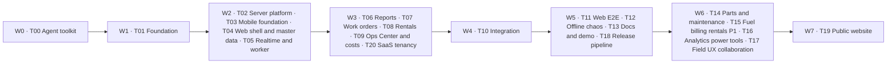

# AgroRende — Agent tasks

| Field | Value |
|---|---|
| Document | Agent tasks |
| Version | v1.4 |
| Date | 2026-10-08 |
| Doc set | Round 5 (2026-10) |
| Inputs | `docs/PRD.md`, `docs/ARCHITECTURE.md`, `docs/DELIVERY-PLAN.md`, `docs/ERRORS.md` |
| Round 5 note | MongoDB 8 replaces PostgreSQL/Prisma for the MVP; pnpm workspaces replace Turborepo; Campo claro design and review fixes are now normative. |

### Changelog

- 2026-10-08: Agent toolkit: caveman is the default chat voice of every agent and subagent report; `caveman-review` vendored for review findings; skill sources pinned in A§4.3.
- 2026-10-08: Round 5: MongoDB 8 replaces PostgreSQL/Prisma for the MVP; pnpm workspaces replace Turborepo; visual direction and single palette; review fixes.
- 2026-10-08: Round 4: multi-tenant SaaS (self-service sign-up, trial, subscription status, platform console), sign-in with Google, Apple or invite + password, three roles (ADMIN, MANAGER, FIELD).

## 0. How to use this file

This file is read by the wave orchestrator and by every build subagent. The orchestrator copies one task section verbatim into the subagent brief, next to the matching DELIVERY-PLAN §5 card and the relevant `docs/ERRORS.md` coverage rows. The subagent then works through the subtasks in order and treats the §5 card as the source of truth.

Precedence is strict: `docs/DELIVERY-PLAN.md` §5 card > `docs/ARCHITECTURE.md` > `docs/ERRORS.md` for error copy and recovery > this file. If a subtask appears to conflict with a card, follow the card, record the gap, and continue.

Notation:

- Tasks run from T00 through T20, grouped into W0 through W7.
- `Txx.n` is an ordered subtask id.
- **Do** says what to build and names the intended paths.
- **Done when** is a concrete check: command, test name, file existence, grep, route response, or AC assertion.
- **Refs** cites Architecture sections, PRD IDs, Delivery-plan sections, or `docs/ERRORS.md` areas.
- Paths are repo-relative because this file becomes `docs/TASKS.md`.

Progress:

- Each subagent creates `docs/progress/<TASK>.md` from the template in §2.
- Tick subtasks there as work is completed.
- Record assumptions, gaps, change requests, error cases added, and command results in that progress file.
- If a subtask cannot be finished, write the gap and move on.
- Never edit outside owned paths. Use `docs/change-requests/<TASK>-<NNN>.md` for another owner.

## 1. Waves at a glance



| Wave | Mode | Tasks | Gate extras | Tag |
|---|---|---|---|---|
| W0 | single agent | T00 | toolkit files, vendored skills, MCP JSON, UI reviewer validation; no Expo login | — |
| W1 | single agent | T01 | actionlint on T01 workflows; `pnpm devloop --check`; registry, lockfile, i18n, toolkit-preservation checks | — |
| W2 | `/fleet` 4 subagents | T02, T03, T04, T05 | schema and media-root isolation; seam mocks only by R12; UI-review gate starts here | — |
| W3 | `/fleet` 5 subagents | T06, T07, T08, T09, T20 | no long-running servers; feature and tenancy seams may be mocked with `vi.mock`; UI-review gate | — |
| W4 | single agent | T10 | resolve change requests and proposed EC entries; smoke test; no unexpected `notImplemented(`; UI-review gate | — |
| W5 | `/fleet` 4 subagents | T11, T12, T13, T18 | Playwright, chaos, docs, release workflows, actionlint, container isolation, UI-review gate, stop servers and containers | `v1.0.0-mvp` |
| W6 | `/fleet` 4 subagents | T14, T15, T16, T17 | P1 handover paths only; Maestro where available; UI-review gate | `v1.1.0` |
| W7 | single agent | T19 | site build, Lighthouse, link/a11y checks, Caddy site block, UI-review gate | — |

## 2. Shared conventions for every subagent

- Read first per D§1 R1: `docs/PRD.md`, `docs/ARCHITECTURE.md`, `docs/DELIVERY-PLAN.md`, this task section, and the `docs/ERRORS.md` sections for your task.
- Stay in owned paths per D§1 R2 and D§3. Read everything; edit only your lane plus your own progress and change-request files.
- Use change requests per D§1 R3. Do not patch contracts, schema, root configs, lockfile, or another task's namespace after T01 unless your card grants a specific exception.
- Frozen foundation per D§1 R4: no `pnpm add`, no `pnpm remove`, no lockfile edits, no MongoDB document-schema/index edits, no registry changes, no `.github/**` edits except T18's release workflows. Dependency manifests must match the A§3 manifest audit unless a change request is approved. T19 may add site-only dependencies and scripts because W7 runs alone.
- No state-changing git in subagents per D§1 R5. The orchestrator commits once per task after gates pass.
- Isolate tests per D§1 R6: set `MONGODB_DB=agrorende_<task id lowercase>`, Redis channel `agrorende:events:<MONGODB_DB>` and BullMQ prefix `test:<MONGODB_DB>`, and media tests use `MEDIA_ROOT=.data/media-<task id lowercase>` created and emptied by setup.
- Run the touched-package lint, typecheck, and test commands per D§1 R7. Run `pnpm i18n:check` whenever translations changed.
- Do not start long-running servers in W2 or W3 per D§1 R8. Only T10 and W5+ cards that explicitly require servers may start them, and they must stop them.
- Every user-facing string is an ICU key in every required locale (pt-BR, en) per D§1 R9 and A§20; render key screens in pt-BR, en and `en-XA` when the task has UI.
- Leave no silent stubs per D§1 R11. `notImplemented(` is only for seams owned by a later task.
- For same-wave seams, unit-test with `vi.mock` of the owning module's `service.ts` per D§1 R12.
- Follow A§19: strict TypeScript, no `any`, no `console.*`, money in cents, org timezone, four states for every screen or page, no PII in logs.
- Public npm only per D§1 R15. `.npmrc` contains only `registry=https://registry.npmjs.org/`.
- Node 24 and pnpm 11 are the runtime and package manager for MVP; do not introduce Bun or a Bun lockfile.
- Recovery per D§1 R16: every error path follows `docs/ERRORS.md`, uses the recovery kits, never dead-ends, and has tests. New error cases go under *Error cases added* in progress; do not invent per-error subtasks here until the catalog is final.
- UI tasks must follow A§3.7 Campo claro: design tokens, icon + text statuses, 48 dp mobile targets, and style-guide pages as the visual baseline; clear the `ui-reviewer` wave-gate report or document non-blocking findings in progress.
- Record command results, assumptions, gaps, change requests, error cases added, and UI-review results in the task progress file.
- Chat in caveman voice per A§4.3: your final reply to the orchestrator is a terse caveman report (status, gaps, change requests, failing commands verbatim, progress-file path). Files you write stay full prose.

Progress file template:

```markdown
# <TASK> · <title>

Status: TODO | IN_PROGRESS | DONE | DONE_WITH_GAPS
Wave: W<n> · Agent finished: <YYYY-MM-DD HH:mm>

## Subtasks
- [ ] Txx.1 <summary>

## Done
- <REQ-ID>: <what was built> (<main paths>)

## Tests
- `<command>` → <result>

## Assumptions
- <decision taken without asking and why>

## Gaps
- <REQ-ID or AC>: <what is missing> · <why> · <suggested owner>

## Error cases added
- <proposed EC id or title>: <when / code / recovery / owner>

## Change requests
- <TASK>-<NNN>: <title> (<status>)

## UI review
- `docs/reviews/<TASK>-ui.md` → <result or N/A>

## Commands run with results
- `<command>` → <result>

## Notes for the next wave
- <handoff note>
```

## 3. Tasks

### T00 · Agent toolkit (W0)

| Field | Value |
|---|---|
| Agent persona | Senior agent-platform engineer for MCP, vendored skills, instructions, and UI-review automation |
| Wave and mode | W0 single agent |
| Depends on | Six docs copied into `docs/` |
| Owns | `.mcp.json`, `.github/skills/**`, `.github/skills/THIRD_PARTY.md`, `scripts/vendor-skills.sh`, `.github/agents/ui-reviewer.agent.md`, initial `.github/copilot-instructions.md`, `.gitignore` with `.data/`; see D§3.1 |
| Read first | D§5 T00; A§4.3; round3 spec §4 |

**Subtasks**

1. `T00.1` **Do:** Create `.mcp.json` at the repo root with only the Expo MCP server.  
   **Done when:** `python3 -m json.tool .mcp.json` succeeds and `grep -n "expo" .mcp.json` shows the only server entry.  
   **Refs:** A§4.3.

2. `T00.2` **Do:** Vendor the 10 skills of A§4.3 (`caveman`, `caveman-review`, `frontend-design`, `playwright-cli` and the six Expo skills) into `.github/skills/<name>/` from the sources listed there, whole folders, each pinned to a source SHA with license files preserved.  
   **Done when:** every vendored skill has `SKILL.md`, a license file, and no generated secrets or auth state.  
   **Refs:** D§5 T00.

3. `T00.3` **Do:** Write `.github/skills/THIRD_PARTY.md` with source repo, SHA, license, and update steps for every vendored skill.  
   **Done when:** `grep -n "SHA\|License\|Update" .github/skills/THIRD_PARTY.md` shows entries for all vendored skills.  
   **Refs:** A§4.3.

4. `T00.4` **Do:** Create `scripts/vendor-skills.sh` for future pinned updates using `npx` or `pnpm dlx` only because no package manifest exists yet.  
   **Done when:** `bash -n scripts/vendor-skills.sh` passes and the script documents SHA inputs.  
   **Refs:** A§4.3.

5. `T00.5` **Do:** Create `.github/agents/ui-reviewer.agent.md` with valid frontmatter and read-only source instructions for Playwright CLI and Expo MCP reviews.  
   **Done when:** frontmatter includes `name`, `description`, and `tools`, and the body writes findings to `docs/reviews/<TASK>-ui.md`, one line each in `caveman-review` format, with screenshots under `.data/reviews/`.  
   **Refs:** A§4.3.

6. `T00.6` **Do:** Create `.github/copilot-instructions.md` with only the Agent toolkit block: skill map (which skills each kind of work loads), UI reviewer, caveman as the chat voice of every agent including subagent reports, `caveman-review` for findings, cloud-agent note, and folder trust.  
   **Done when:** the block says every agent replies in caveman voice, findings use the `caveman-review` format, caveman never applies to other file content or user-facing copy, and no app-build rules duplicate later T01 instructions.  
   **Refs:** round3 spec §4.

7. `T00.7` **Do:** Add `.data/` to `.gitignore` for reviews, screenshots, local media, and other generated artifacts.  
   **Done when:** `grep -n "^\.data/" .gitignore` returns one line.  
   **Refs:** A§4.3.

8. `T00.8` **Do:** Write `docs/progress/T00.md` with human follow-up steps: trust the folder, run `/mcp`, and authenticate Expo.  
   **Done when:** progress records that the agent did not log in to Expo and did not write credentials.  
   **Refs:** D§5 T00 AC.

**Seams**

- Provides the agent toolkit files that T01 keeps and extends without removing the T00 block.
- Consumes only docs and public vendored skill sources.

**Handoff**

- T01 keeps the toolkit block verbatim, adds app build instructions around it, installs `@playwright/cli` and `expo-mcp`, and adds `.data/reviews/` plus `docs/reviews/README.md`.

**Final check**

- `python3 -m json.tool .mcp.json`
- `bash -n scripts/vendor-skills.sh`
- Validate `ui-reviewer` frontmatter contains `name`, `description`, `tools`
- `grep -R "token\|secret\|password" .mcp.json .github/skills .github/agents scripts/vendor-skills.sh` returns no secrets except prose mentions

### T01 · Foundation (W1)

| Field | Value |
|---|---|
| Agent persona | Senior platform engineer for monorepo, tooling, contracts, CI, and local infrastructure |
| Wave and mode | W1 single agent |
| Depends on | none |
| Owns | Root configs, agent toolkit after T00, `packages/config`, `packages/contracts`, `packages/db`, `packages/design-tokens`, `packages/i18n`, frozen core kernel, app skeletons, `.github/**`, scoped `AGENTS.md`, `docs/reviews/**`; see D§3.1 |
| Read first | D§5 T01; A§3, A§4, A§4.1, A§4.2, A§4.3, A§5, A§6, A§7, A§13.6, A§16, A§17, A§18.1, A§18.2, A§20, A§21; PRD §9.0, §12, §13; docs/ERRORS.md index |

**Subtasks**

1. `T01.1` **Do:** Scaffold pnpm 11 workspace with no task runner, Node 24, `.node-version`, `.npmrc` registry-only, `pnpm-workspace.yaml` catalog and pnpm policy from A§4.2, `patches/`, root scripts table, `scripts/check-only.ts`, and keep the T00 toolkit block in `.github/copilot-instructions.md`; do not create a task-runner config file.  
   **Done when:** `pnpm config get registry` prints `https://registry.npmjs.org/`, `grep -R "registry=" .npmrc pnpm-workspace.yaml` shows no other registry, root scripts include `check`, `check:only`, `db:shell`, and no task-runner config file exists.  
   **Refs:** D§5 T01 scope 1, R15; A§4.2.

2. `T01.2` **Do:** Install every MVP dependency named in A§3 into the correct package, using latest stable versions within the documented majors and Expo-compatible installs for mobile; add `@playwright/cli` at root and `expo-mcp` to mobile; leave Phase 2 object-store packages out of the MVP lockfile.  
   **Done when:** `pnpm install --frozen-lockfile` succeeds from a clean checkout and the dependency manifest audit proves every MVP dependency is present in the correct package; later additions require a change request.  
   **Refs:** D§5 T01 scope 2; A§3.

3. `T01.3` **Do:** Create `packages/config` with ESLint flat config, import boundary rules, `no-console`, TypeScript bases with `strict` and `noUncheckedIndexedAccess`, and Prettier config.  
   **Done when:** `pnpm --filter @agrorende/config run lint` passes and downstream packages can extend the presets.  
   **Refs:** A§4 dependency rules, A§19.

4. `T01.4` **Do:** Build complete `packages/contracts`: enums, DTOs, JSON schemas, mutation payload schemas for P0 and P1, sync types, machine transition tables, eligibility, rental charges V1-V5, `LocalizedTextSchema`, checklist, WO times, realtime, errors, geo, validators, and seam types.  
   **Done when:** Contract tests cover allowed and forbidden transitions, V1-V5, eligibility codes, validators, WO times, operator state, geo helpers, and CPF/CNPJ.  
   **Refs:** A§5.2, A§5.4, A§6, A§7.3, A§7.4, A§9.

5. `T01.5` **Do:** Build `packages/db` with the official MongoDB driver, `getClient()`, `getDb()`, typed `collections`, `scoped(ctx)`, `platform(ctx)`, Zod document schemas, `ensureIndexes()` generated from A§5 index comments, a migration runner recording `_migrations`, `setupTestDb(name)`, factories, and deterministic seed data that writes documents plus `sync_counters` and `number_sequences`.  
   **Done when:** `MONGODB_DB=agrorende_t01 pnpm --filter @agrorende/db test` passes against the Compose MongoDB replica set and `setupTestDb("agrorende_t01")` drops, indexes, migrates and seeds an isolated database.  
   **Refs:** A§5.3, A§15, A§17.

6. `T01.6` **Do:** Create `packages/design-tokens` with the colors, spacing, typography, status colors, and Tailwind CSS variables required by A§13.4.  
   **Done when:** tokens export for React Native and web, and a typecheck imports them from both app skeletons.  
   **Refs:** A§13.4; UX-03, UX-12.

7. `T01.7` **Do:** Create frozen `packages/core` kernel files: `context.ts`, `errors.ts`, `sync/{types,withSyncTx,registry}.ts`, `numbering/`, `activity/`, `events/`, `storage/` skeleton, `jobs/queues.ts`, `pdf/base.tsx`, `auth/jwt.ts`, testing helpers, and storage scripts; T01 owns the event outbox skeleton and T02 fills the local `MediaStore` driver.  
   **Done when:** kernel tests prove `withSyncTx` sync versions and `numbering.next` are concurrency-safe.  
   **Refs:** D§5 T01 scope 6; PLT-13; A§7, A§10, A§15.

8. `T01.8` **Do:** Create every core module folder listed in A§4 with `service.ts`, `mutations.ts`, `queries.ts`, and `dto.ts`; add every D§4 seam with exact signature and `notImplemented`.  
   **Done when:** Every seam exists with the exact signature; `grep -R "notImplemented(" packages/core/src/modules` lists only seam stubs and `pnpm check:only @agrorende/core` passes.  
   **Refs:** D§4 seams; D§5 T01 AC.

9. `T01.9` **Do:** Scaffold `apps/web` with Next.js 16 App Router, Tailwind 4, shadcn/ui, next-intl, standalone output, `APP_ENV` config, `src/server/withApi.ts`, `/api/v1/health`, frozen `src/proxy.ts` with a matcher that skips `/api/v1/media/*/blob*`, and placeholders for every A§14.1 route.  
   **Done when:** `pnpm --filter web build` passes and each A§14.1 route resolves to a placeholder.  
   **Refs:** A§8, A§14.1, A§18.1.

10. `T01.10` **Do:** Scaffold `apps/mobile` with the latest stable Expo SDK (never beta), expo-router, app variants via `APP_VARIANT`, `eas.json`, `plugins/withNavigationQueries.js`, i18n namespaces, route placeholders, and home widget placeholders.  
    **Done when:** `pnpm --filter mobile typecheck` and `pnpm --filter mobile exec expo export --platform android` pass, and every A§13.1 route has a placeholder.  
    **Refs:** A§13.1, A§13.5, A§13.6, A§18.1.

11. `T01.11` **Do:** Scaffold `apps/realtime` and `apps/worker` with env config, pino, health endpoints, graceful shutdown, and no-op processors for every A§10 job.  
    **Done when:** `pnpm dev` boots web 3000, realtime 4001, worker 4002; `GET /api/v1/health` and worker health return ok; servers are stopped.  
    **Refs:** A§9, A§10, A§16.

12. `T01.12` **Do:** Implement root dev scripts: `dev:setup`, `dev`, `dev:mobile`, `db:migrate`, `db:seed`, `db:reset`, `db:shell`, `storage:init`, `storage:seed`, `i18n:check`, placeholder `smoke`, and production guards for seed/reset.  
    **Done when:** `pnpm dev:setup` succeeds from a clean clone and seed media files exist under `MEDIA_ROOT`.  
    **Refs:** A§16, A§18.1, A§17.

13. `T01.13` **Do:** Implement `scripts/devloop.ts` and `scripts/devloop/{check,setup,env,mobile,actions,log,shell}.ts` with all A§16.1 flags, `pnpm devloop --mobile --mcp`, menu for humans, and noninteractive agent flags.  
    **Done when:** `pnpm devloop --check` exits 0 or records only documented warnings, and `pnpm devloop --doctor` runs the documented checks.  
    **Refs:** A§16.1, A§16.2.

14. `T01.14` **Do:** Create root and scoped `AGENTS.md` files plus `.github/copilot-instructions.md`, CODEOWNERS, Dependabot, PR template, agent files, skills, `ci.yml`, `codeql.yml`, `copilot-setup-steps.yml` with Chromium install, and `docs/reviews/README.md`.  
    **Done when:** files exist at the A§4 paths and actionlint passes for the T01 workflows.  
    **Refs:** A§4.1, A§18.2.

15. `T01.15` **Do:** Create `docker-compose.yml` with MongoDB 8 as a single-node replica set and Redis 7, `.env.example` with `MONGODB_URI`, `MONGODB_DB`, `MEDIA_DRIVER=local`, `MEDIA_ROOT` and `MEDIA_URL_SECRET`, `.gitignore` and `.dockerignore` with `.data/`, and minimal `README.md`.  
    **Done when:** `docker compose up -d --wait mongo redis` starts MongoDB with `rs.status().ok` and Redis, `pnpm db:shell` opens `mongosh agrorende`, `pnpm storage:init` creates `MEDIA_ROOT/{.tmp,.uploads}` idempotently, and `.env.example` lists all A§16 variables.  
    **Refs:** A§16, A§18.1.

16. `T01.16` **Do:** Freeze the foundation by running `pnpm check`, i18n, web build, dev run, devloop check, actionlint, registry checks, and the MongoDB health check; write `docs/progress/T01.md`.  
    **Done when:** every D§5 T01 AC is pasted into progress with command output and no server remains running.  
    **Refs:** D§6 DoD; D§7.1.

17. `T01.17` **Do:** Create `packages/i18n` (`@agrorende/i18n`) with `SUPPORTED_LOCALES`, `DEFAULT_LOCALE`, `REQUIRED_LOCALES`, `LOCALE_META`, `resolveLocale`, shared ICU namespaces, `format.ts`, `parseLocaleNumber`, `pickText`, `helpUrl`, and dev/CI pseudo-locale `en-XA`.  
    **Done when:** unit tests cover locale resolution, `formatMoney`, `parseLocaleNumber` for pt-BR and en, pseudo-locale generation, and `helpUrl(code, locale)` paths.  
    **Refs:** A§20; PLT-03, PLT-15, REC-15.

18. `T01.18` **Do:** Extend lint and i18n tooling: `eslint-plugin-i18next`, ICU syntax and placeholder checks, required-locale key checks, generated `ERROR_META` plus all `errors.<CODE>.title|body|action` copy from `docs/ERRORS.md`, optional `help` checks only when present, empty-string checks, `LocalizedText` seed validation, `.data/reviews/` ignore, and toolkit preservation checks.  
    **Done when:** `pnpm i18n:check` fails for missing required locale keys, ICU placeholder mismatch, missing generated `errors.<CODE>.title|body|action`, missing optional `help` only when declared in `ERROR_META.contexts`, and invalid `LocalizedText`; `docs/reviews/README.md` exists.  
    **Refs:** A§20.3, A§21.

19. `T01.19` **Do:** Add mobile native locale files, app/site URL env names, `SITE_URL` and `EXPO_PUBLIC_SITE_URL` placeholders, and root scripts or placeholders needed by later site and help-link tasks without building the site.  
    **Done when:** `.env.example` lists site link env vars and `pnpm devloop --check` reports them consistently.  
    **Refs:** A§13.6, A§16, A§22.

20. `T01.20` **Do:** Extend contracts and database foundations for SaaS tenancy: `OrgStatus`, `AuthProvider`, `AuthMethod`, `AuthLinkKind`, three-role `Role { ADMIN MANAGER FIELD }`, role mapping note, permissions table in `contracts/permissions.ts`, `OrgUsage`, `UserIdentity`, `AuthLink`, `PlatformAuditEvent`, organization lifecycle fields, optional `User.email`/`passwordHash`, single `User.role`, `joinedAt`, `deletedAt`, invite fields and `OrgSettingsSchema.showLaborCostToManager` plus onboarding.  
    **Done when:** schema, factories and contract tests cover the three-role matrix, org lifecycle fields, invite/reset models, usage rows and default settings.  
    **Refs:** Round 4 spec §4, §5, §10 T01.

21. `T01.21` **Do:** Add the Round 4 environment schema and local infrastructure: OAuth and Apple env vars, `AUTH_ENCRYPTION_KEY`, `OAUTH_MOBILE_SCHEMES`, `PLATFORM_ADMIN_EMAILS`, `PLATFORM_SUPPORT_WHATSAPP`, `TRIAL_DAYS`, `TERMS_VERSION`, production issuer guards and navikt `mock-oauth2-server` compose service on 4003 with E2E override 4103.  
    **Done when:** env validation fails in production for mock Google issuer or missing Apple keys, and local compose starts `oidc-mock` without adding it to staging/production deploy paths.  
    **Refs:** Round 4 spec §9, §10 T01.

22. `T01.22` **Do:** Add Round 4 app scaffolding and seed data: Expo plugins `expo-apple-authentication`, `expo-web-browser`, `ios.usesAppleSignIn`, route placeholders for signup, invite, reset, subscription and platform console, new error codes in `ERROR_META`, org B trial seed, invited user seed, mock Google identity and platform staff env defaults.  
    **Done when:** seed tests prove org A ACTIVE, org B TRIAL, invited FIELD user code `K7QM2XPA9F`, platform staff login seed and no old role enum values remain.  
    **Refs:** Round 4 spec §7, §9, §10 T01.

23. `T01.23` **Do:** Create the transactional event outbox skeleton in `packages/core/src/events/**`: event types, `events.emit(tx, event)`, idempotent dispatch helpers, Redis/BullMQ job IDs by event id, and `event_outbox` indexes including 7-day TTL on `dispatchedAt`.  
    **Done when:** unit tests insert an event inside `withSyncTx`, aborting the transaction leaves no event, duplicate dispatch by event id is ignored, and `ensureIndexes()` creates the TTL index.  
    **Refs:** A§7.3; D1.1; A2.

24. `T01.24` **Do:** Add shared validators in `packages/contracts`: `E164Schema`, discriminated `CreateWorkOrderInputSchema` requiring the matching source id, MAINTENANCE forcing `PREVENTIVE`, `validateChecklistResponse`, `isChecklistComplete(snapshot, responses, validMediaIds)`, and `resolveDestination()`.  
    **Done when:** contract tests cover valid and invalid phone numbers, every work-order source branch, MAINTENANCE type coercion/rejection, checklist item-type validation, media ids outside `validMediaIds`, and destination fallback order.  
    **Refs:** A20, A21, A24, A25.

25. `T01.25` **Do:** Extend rental contracts with `ChargeTypeEnum.ACCESSORY`, canonical `accessoryKey`, `replacementCostCents`, and `computeRentalCharges` vectors for missing accessories.  
    **Done when:** charge vector tests prove server and device outputs include missing-accessory lines at replacement-cost cents and keep V1-V5 stable.  
    **Refs:** A§7.4; A22; RN-08.

26. `T01.26` **Do:** Create the Campo claro palette and semantic status mappings in `packages/design-tokens`, replacing legacy brand colors and exporting web, site and React Native tokens.  
    **Done when:** token tests assert the exact Round 5 hex values, semantic status mapping includes every enum value with icon+word metadata, and both app skeletons import the tokens.  
    **Refs:** A§3.7, A§13.4; G.

27. `T01.27` **Do:** Implement `scripts/check-only.ts` and root `check:only` exactly as D2: lint, then typecheck, then test with `pnpm -r --filter <arg> run <step>`, stopping at the first failure; support affected filters such as `...[origin/main]`.  
    **Done when:** script tests prove filter arguments are passed to all three steps in order, a failing lint step skips typecheck/test, and `pnpm check:only @agrorende/core web` is documented in the root scripts table.  
    **Refs:** D2; A§16.

28. `T01.28` **Do:** Create shared import foundations: `apps/web/src/features/imports/shared/**` for parser, preview table and error-file download, frozen for entity owners.  
    **Done when:** component/unit tests cover CSV preview and error-file download, and ownership docs route entity-specific imports to `features/imports/<entity>/**` while reporting previews stay under T09.  
    **Refs:** O2; REC-14.

29. `T01.29` **Do:** Create T20 tenancy mount placeholders with fixed signatures: web `GettingStartedCard`, web and mobile `OrgStatusBanner`, plus web/mobile tenancy i18n namespaces.  
    **Done when:** type tests import each placeholder, signatures are exactly `(): JSX.Element | null`, and T03/T04/T09 mount tests can render null safely.  
    **Refs:** O4; T20 handoff.

30. `T01.30` **Do:** Generate all error catalog metadata and copy from `docs/ERRORS.md`: one `ERROR_META` row per code, optional context variants, optional `help`, and pt-BR/en namespace entries.  
    **Done when:** generation tests prove all catalog codes have title/body/action copy, context variants fall back correctly, `help` is validated only when present, and later task tests can only assert missing coverage rather than edit frozen contracts.  
    **Refs:** O14, O19, O27.

31. `T01.31` **Do:** Add MongoDB-only local/CI plumbing: Compose health initiates `rs0`, tests use the real Compose MongoDB replica set, `MONGODB_URI`/`MONGODB_DB` replace SQL envs, Redis/BullMQ namespace from `MONGODB_DB`, and Dependabot groups `mongodb`/`bson`.  
    **Done when:** `docker compose up -d --wait mongo redis` is enough for integration tests, `pnpm devloop --check` reports MongoDB port 27017 and `.env` fixes, and no MongoDB memory server or SQL container is referenced.  
    **Refs:** D1.3, D2, O24.

**Seams**

- Provides every D§4 seam signature and module placeholder to T02-T18.
- Provides mutation registry imports so later tasks add handlers without touching the registry.
- Provides app route placeholders so navigation and route imports compile before features exist.
- Consumes no other task output.

**Handoff**

- Later waves rely on the frozen lockfile, contracts, database schema, seed, core kernel, route placeholders, app configs, devloop, CI, i18n check, and every stubbed seam.
- `docs/progress/T01.md` must list installed dependency versions, any pnpm settings removed as invalid, all warnings from `pnpm devloop --check`, and exact commands used to stop servers.

**Final check**

- `pnpm install --frozen-lockfile`
- `pnpm dev:setup`
- `MONGODB_DB=agrorende_t01 MEDIA_ROOT=.data/media-t01 pnpm check`
- `pnpm i18n:check`
- `pnpm --filter web build`
- `pnpm --filter mobile exec expo export --platform android`
- `pnpm devloop --check`
- `docker run --rm -v "$PWD:/repo" -w /repo rhysd/actionlint:latest .github/workflows/*.yml`
- Start `pnpm dev`, check health endpoints, then stop all servers.

### T02 · Server platform: auth, sync, media, users, notifications (W2)

| Field | Value |
|---|---|
| Agent persona | Senior backend engineer for auth, sync, local media, users, notifications, and typed API clients |
| Wave and mode | W2 `/fleet` subagent |
| Depends on | T01 |
| Owns | T02 rows in D§3.1 and D§3.2, plus `packages/api-client/**` |
| Read first | D§5 T02; D§4 seams; A§7.3, A§7.5, A§7.7, A§7.9, A§8, A§11, A§15; PRD §5, PLT-01, PLT-04, PLT-07, OFF-02..OFF-11 |

**Subtasks**

1. `T02.1` **Do:** Implement auth services and routes for login, refresh rotation, logout, `me`, change password, socket token, Argon2 hashing, CSRF origin check, and rate limits.  
   **Done when:** auth route tests cover refresh reuse revocation, expired token `TOKEN_EXPIRED`, wrong password, and 429 rate limits.  
   **Refs:** A§7.9, A§8, A§11; PLT-01.

2. `T02.2` **Do:** Implement `POST /sync/push` with ordered batches, idempotent `processed_mutations`, stored retry results, clock-skew clamp, stop-on-first-retryable, and role and tenant checks.  
   **Done when:** tests prove duplicate `mutationId` has one effect, unknown mutation returns `UNKNOWN_MUTATION`, and batch failure #3 applies only #1-#2.  
   **Refs:** A§7.3; OFF-04, OFF-13.

3. `T02.3` **Do:** Implement `GET /sync/pull`, scopes, paging, tombstones, `scopeEpoch`, `horizonVersion`, and `sync.touchDependents`.  
   **Done when:** each seed role gets exactly its scope, paging is stable under concurrent writes, and a role change forces a reset.  
   **Refs:** A§7.5; OFF-07.

4. `T02.4` **Do:** Implement `packages/core/src/storage` `MediaStore`, the `local` driver selected by `MEDIA_DRIVER=local`, JWT media URL tokens signed with `MEDIA_URL_SECRET`, key/path safety, disk guard, and `put/get/head/delete`; config validation rejects any `MEDIA_DRIVER` other than `local` with a clear startup error.  
   **Done when:** storage tests write, read, head, delete, reject traversal and symlink paths, return `STORAGE_FULL` below the free-space threshold, reject `MEDIA_DRIVER=s3`, and prove no S3 stub or third `notImplemented(` is added.  
   **Refs:** A§7.7, A§11; OFF-03, OFF-08.

5. `T02.5` **Do:** Implement media mutations and routes: `media.register/update/delete`, `POST /media`, `GET /media/:id/url`, `POST /api/v1/media/:id/upload-url`, `POST /api/v1/media/:id/multipart/parts`, `PUT /media/:id/blob`, `PUT /media/:id/blob/parts/:n`, `GET /media/:id/blob`, and `POST /media/:id/complete`; blob routes run on Node, rely on the T01 proxy matcher that bypasses `/api/v1/media/*/blob*`, stream to `MEDIA_ROOT`, support range reads, and expose late-evidence seam.  
   **Done when:** integration tests prove register → upload-url → PUT lands under `MEDIA_ROOT` → complete marks original UPLOADED; multipart parts URL issuance and 3-part complete work; wrong-media gets 403; expired local upload URLs get `UPLOAD_URL_EXPIRED` 410; over-`max` gets 413; unauthorized redirect gets `NOT_FOUND`; traversal is rejected.  
   **Refs:** A§7.7, A§8; OFF-03, OFF-08.

6. `T02.6` **Do:** Implement users and devices: CRUD, roles, deactivate, reset password, duty consent, device register, device list, `scopeEpoch++` on role change, OFF-11 data.  
   **Done when:** role-matrix tests cover user routes, `LOCATION_CONSENT_REQUIRED`, and device health updates after push.  
   **Refs:** PRD §5; PLT-04, OFF-11.

7. `T02.7` **Do:** Implement notifications rows, push enqueue after commit, localized templates, list/read routes, `notification.markRead` mutation, office recipients, every T02 seam, settings routes, and complete `/api/v1/health` with db, redis, version, and writable `MEDIA_ROOT`.  
   **Done when:** seam tests prove notifications persist in transaction and enqueue after commit; templates exist in pt-BR and en; `PATCH /settings` bumps organization `syncVersion`; health fails if `MEDIA_ROOT` is not writable.  
   **Refs:** A§6.5, A§8, A§18.1; PLT-07, PLT-08 P0 data.

8. `T02.8` **Do:** Build `packages/api-client` with typed functions for every A§8 endpoint, bearer or cookie auth, signed blob route helpers, and typed `ApiError` mapping.  
   **Done when:** generated or handwritten client tests compile against all endpoint contracts and feature packages import it without deep API shapes.  
   **Refs:** A§8; D§5 T02 scope.

9. `T02.9` **Do:** Assert the frozen runtime error framework generated by T01: `ErrorCode`, `ClientErrorCode`, `RecoveryPattern`, `ERROR_META`, error envelope types, retryable metadata, `ProcessedMutation` rejection fields, `DeviceDiagnostic`, and organization `supportedLocales`, `officePhone`, `officeWhatsApp` fields; do not edit `packages/contracts/src/errors.ts` or error copy.  
   **Done when:** unit tests assert every T02-owned code has generated metadata and required-locale i18n keys, the envelope includes `fieldErrors`, `retryable` and `ref`, and rejected mutation fields are persisted.  
   **Refs:** A§21; REC-01..REC-16.

10. `T02.10` **Do:** Implement diagnostics and telemetry plumbing: `POST /devices/:id/diagnostics`, web `POST /api/v1/telemetry`, `POST /api/v1/telemetry/diagnostics`, push-body `telemetry`, no-PII validation, rate limits, and structured `ux.error` logs.  
   **Done when:** tests reject oversize diagnostics, accept mobile `diagnostics_queue` uploads after successful push, queue offline diagnostics through sync, and log `error_shown` / `error_recovered` without form contents or PII.  
   **Refs:** A§21.2; REC-08, REC-16.

**Error cases**

11. `T02.11` **Do:** Raise auth and account server codes with exact HTTP status and envelope: `INVALID_CREDENTIALS` 401, `TOKEN_EXPIRED` 401, `ACCOUNT_DISABLED` 403, `PASSWORD_CHANGE_REQUIRED` 403, `RESET_LINK_EXPIRED` 410, `RESET_REQUIRED` 409, `APP_UPDATE_REQUIRED` 426, `LOCATION_CONSENT_REQUIRED` 409 and `RATE_LIMITED` 429. Assert the T01-generated `ERROR_META` and `errors.<CODE>.title|body|action` in pt-BR and en.  
    **Done when:** auth, refresh, password, device-version and duty-consent route tests assert `{ error: { code, retryable, ref } }`, localized copy keys, no account enumeration and no draft/outbox loss.  
    **Refs:** C§13 T03 server side; A§21; EC-PLT-02, EC-PLT-03, EC-PLT-04, EC-PLT-05, EC-PLT-06, EC-PLT-07, EC-PLT-08, EC-PLT-12, EC-PLT-19.

12. `T02.12` **Do:** Raise sync and mutation server codes with exact status and recovery metadata: `INTERNAL` 500, `VALIDATION_FAILED` 422, `RESET_REQUIRED` 409, `STORAGE_FULL` 507 and `RATE_LIMITED` 429; include `serverTime` and `clockOffsetMs` support in push responses.  
    **Done when:** push/pull tests cover stop-on-first-retryable, stale scope reset, validation rejection, storage-full retryability, clock-offset banner data and `errors.<CODE>` keys.  
    **Refs:** C§13 T03 server side; G1.12; EC-SYN-04, EC-SYN-07, EC-SYN-08, EC-SYN-09, EC-SYN-22.

13. `T02.13` **Do:** Raise media server codes with exact status and envelope: `UPLOAD_URL_EXPIRED` 410, `MEDIA_TOO_LARGE` 413, `MEDIA_TYPE_MISMATCH` 422 and `MEDIA_PART_MISSING` 409; keep files local and retryable metadata correct.  
    **Done when:** media route tests prove expired upload links refresh, oversize/type mismatch preserve local file recovery, missing part returns retryable details and every code has pt-BR/en error copy.  
    **Refs:** G1.3, G1.4; EC-SYN-20, EC-SYN-21, EC-SYN-23, EC-SYN-24.

14. `T02.14` **Do:** Finish diagnostics, health and settings error plumbing: `DIAGNOSTICS_UNAVAILABLE` 410, `officePhone` required E.164, optional `officeWhatsApp`, `Device.pushStatus`, supported locales and `/api/v1/health` returning `{ ok: true, app: "agrorende" }`.  
    **Done when:** route tests assert diagnostics expiry, settings `VALIDATION_FAILED`, required `officePhone`, `Device.pushStatus` updates and the health probe shape used by captive-portal detection.  
    **Refs:** C§13 T04 server side; G1.5, G2.7, G2.10; EC-OPS-24, EC-OPS-25.

15. `T02.15` **Do:** Ensure every T02-owned server code is exported through `packages/api-client` as typed `ApiError` and never exposes developer messages to mobile or web.  
    **Done when:** api-client tests map all T02 codes to typed errors, `ERROR_META` recovery patterns and `errors.<CODE>.title|body|action` in both required locales.  
    **Refs:** A§8, A§21; C§12 code index.

16. `T02.16` **Do:** Implement Google and Apple sign-in primitives: OAuth start/callback with PKCE, mobile login-code exchange, native iOS Apple verification, encrypted Apple refresh token storage, provider token verification, state expiry, provider error handling and same-user reauth.  
    **Done when:** route tests cover web and mobile Google, browser Apple, native Apple, `OAUTH_STATE_EXPIRED`, `OAUTH_PROVIDER_ERROR`, `OAUTH_CANCELLED` client mapping and no provider tokens stored except encrypted Apple refresh token.  
    **Refs:** Round 4 spec §2.1-§2.4, §10 T02.

17. `T02.17` **Do:** Implement identity resolution, invites, reset links, temporary passwords and role changes: `AuthLink` code normalization, `/auth/invites/:code`, invite password redemption, `/auth/reset/:code`, admin reset-link and temporary-password routes, `LAST_ADMIN`, `JOINED_WITH_OTHER_EMAIL` attention and one-company-per-account checks.  
    **Done when:** tests cover identity resolution order, FIELD invite with other email, ADMIN/MANAGER invite email match, expired invite/reset, temporary password `mustChangePassword`, role change `scopeEpoch++` and last-admin guard.  
    **Refs:** Round 4 spec §2.4, §3, §10 T02.

18. `T02.18` **Do:** Implement account deletion and Apple revoke support: `DELETE /auth/me` only anonymizes server-side data, revokes refresh/device records, returns the local-delete response, and enqueues `auth.appleRevoke` for encrypted Apple refresh tokens; pending-outbox/media checks are client guards owned by T03.  
    **Done when:** tests prove `DELETE /auth/me` does not inspect client pending items, deleting the last ADMIN returns `LAST_ADMIN`, anonymized business records remain and Apple revoke job is queued idempotently.  
    **Refs:** Round 4 spec §3.6, §10 T02.

19. `T02.19` **Do:** Add org-status gates in `withApi`, `sync/push` and `/auth/me`: reads allowed, writes blocked/read-only by status, 7-day suspended push grace, hourly retry after grace, `org.status` fields returned and Redis cache invalidation hooks.  
    **Done when:** route and push tests cover TRIAL, ACTIVE, PAST_DUE, SUSPENDED and CANCELLED behaviour, `ORG_SUSPENDED` envelope and reactivation poke seam.  
    **Refs:** Round 4 spec §1.1, §2.7, §10 T02.

20. `T02.20` **Do:** Add Round 4 server error coverage for EC-PLT-34, EC-PLT-35, EC-PLT-36, EC-PLT-37, EC-PLT-38, EC-PLT-39, EC-PLT-40 and EC-OPS-28 with codes `ACCOUNT_NOT_INVITED`, `INVITE_EXPIRED`, `INVITE_EMAIL_MISMATCH`, `ACCOUNT_IN_OTHER_ORG`, `OAUTH_STATE_EXPIRED`, `OAUTH_PROVIDER_ERROR`, `ORG_SUSPENDED`, `LAST_ADMIN`; `ACCOUNT_DELETE_PENDING_DATA` is client-only in T03.  
    **Done when:** API tests assert exact HTTP statuses, retryability, and the frozen T01-generated `ERROR_META` plus `errors.<CODE>.title|body|action` in pt-BR and en for every listed server code.  
    **Refs:** Round 4 spec §7, §11.

21. `T02.21` **Do:** Implement the `events.dispatch` worker job and startup/every-5-second scheduler for the T01 event outbox: publish to Redis, enqueue BullMQ with `jobId = event._id`, then set `dispatchedAt`.  
    **Done when:** worker tests leave one undispatched event older than 10 s, run the job twice, publish/enqueue once by event id, set `dispatchedAt`, and keep realtime/notification consumers idempotent.  
    **Refs:** A2; D1.1.

22. `T02.22` **Do:** Implement `ProcessedMutation` as tenant-bound idempotency: `_id = organizationId:mutationId`, `requestHash`, `userId`, complete `MutationResult`, duplicate-key replay handling, conflict rejection, and 400-day TTL.  
    **Done when:** sync tests prove same org/user/hash replays full APPLIED and REJECTED results, same id with a different user/hash returns `VALIDATION_FAILED` without side effects, cross-tenant ids do not collide, and `ensureIndexes()` creates the TTL.  
    **Refs:** A1; D1.2.

23. `T02.23` **Do:** Implement disabled-user drain tokens: revoke sessions on disable, issue one 72 h `sync:drain` token, allow only evidence push and media upload routes for assigned work at `disabledAt`, and reject everything else with `USER_DISABLED`.  
    **Done when:** route tests prove normal access is revoked, allowed evidence drains, non-evidence mutations are kept client-side with `USER_DISABLED`, and expired drain tokens fail.  
    **Refs:** A3; OFF-02.

24. `T02.24` **Do:** Add `organizationId` to refresh tokens and implement refresh rotation with 30 s same-family grace for concurrent tabs.  
    **Done when:** auth tests prove a second use inside 30 s returns the same new pair, later reuse revokes the family with `REFRESH_REUSED`, and token lookups are tenant-indexed.  
    **Refs:** A26.

25. `T02.25` **Do:** Add `resolvedMutations` to pull responses for the caller's own processed mutation resolutions, including office conflict resolutions that set `syncVersion` inside `withSyncTx`.  
    **Done when:** pull tests return only the caller's own resolved mutations, page them with the normal cursor, and show office resolution after a conflict is saved.  
    **Refs:** A9.

26. `T02.26` **Do:** Implement per-variant media status in server DTOs and local driver reads: `variants.thumb|poster|original.status`, overall `UPLOADED` only after original, and missing variants return `MEDIA_NOT_IN_STORAGE`.  
    **Done when:** media tests prove thumbnail/poster completion does not mark original uploaded, original completion does, and requesting a missing variant returns the catalog envelope.  
    **Refs:** A10.

27. `T02.27` **Do:** Add `PATCH /api/v1/me { locale }` for online language sync and notification/PDF locale selection.  
    **Done when:** route tests validate supported locales, update the user locale, reject invalid locale with `VALIDATION_FAILED`, and notifications/PDF helpers read the stored locale.  
    **Refs:** A28.

28. `T02.28` **Do:** Implement opaque bootstrap pull cursors `{v:1, phase, snap, after}` and steady-state cursor promotion only after phase 3 finishes.  
    **Done when:** pull tests prove phases 1-3 all read `syncVersion <= snap`, rows changed during bootstrap arrive in the first steady-state pull, and malformed cursors return `VALIDATION_FAILED`.  
    **Refs:** A8.

29. `T02.29` **Do:** Own all server telemetry routes under `apps/web/src/app/api/v1/telemetry/**`, including diagnostics upload from T03 and web UX telemetry.  
    **Done when:** route tests cover rate limits, payload caps, no-PII validation, successful diagnostics deletion signal, and structured logs with task-safe fields.  
    **Refs:** O12; A11.

**Seams**

- Provides `users.listActiveTechnicians`, `media.listForParent`, `media.markLateEvidence`, `notifications.create`, `notifications.officeRecipients`, `sync.touchDependents`, and the local `MediaStore` to T03-T09 and W6.
- Consumes mutation handlers from feature owners through the registry; before they exist, tests register small local handlers or assert unknown mutation behavior.
- Same-wave callers must mock `packages/core/src/modules/users|media|notifications/service.ts` per R12.

**Handoff**

- T03 consumes auth, sync, media, devices, and notifications APIs plus relative signed blob URLs.
- T04 consumes settings and users devices data.
- T06-T09 consume API client methods and notification/media seams.
- Progress file must list endpoint role matrices, media token edge cases, and any API client gaps.

**Final check**

- `MONGODB_DB=agrorende_t02 MEDIA_ROOT=.data/media-t02 pnpm check:only @agrorende/core @agrorende/api-client web`
- `pnpm i18n:check`
- No dev server started.

### T03 · Mobile foundation: offline engine, UI kit, shell screens (W2)

| Field | Value |
|---|---|
| Agent persona | Senior React Native engineer for offline-first mobile infrastructure and UX systems |
| Wave and mode | W2 `/fleet` subagent |
| Depends on | T01 |
| Owns | T03 rows in D§3.3 |
| Read first | D§5 T03; A§7.1, A§7.2, A§7.6, A§7.7, A§7.8, A§7.9, A§7.10, A§13, A§15; PRD PLT-01..PLT-06, PLT-09, PLT-14, OFF-01..OFF-13, UX-01..UX-14 |

**Subtasks**

1. `T03.1` **Do:** Implement mobile SQLite drizzle schema and migrations for synced entities plus `outbox`, `media_files`, `drafts`, `sync_state`, `conflicts`, and `location_buffer`, with per-user database files.  
   **Done when:** migration tests create a fresh DB and upgrade an older fixture without losing pending rows.  
   **Refs:** A§7.1; PLT-12-ready, OFF-02.

2. `T03.2` **Do:** Implement sync engine: outbox, push, pull, apply, server-wins rebase, triggers, background trigger stub, backoff, conflict records, and reset that keeps outbox.  
   **Done when:** Node tests cover mutator to outbox to push to apply, rejection conflict with snapshot restore, pull paging, tombstones, eviction, and reset.  
   **Refs:** A§7.2-A§7.6, A§7.10; OFF-01..OFF-13.

3. `T03.3` **Do:** Implement mobile mutators for `media.*`, `user.setDuty`, `asset.updateReadings`, and `notification.markRead`.  
   **Done when:** mutator tests assert offline optimistic updates, role-safe payloads, and correct mutation names.  
   **Refs:** D§4 mutation handlers; PLT-04, PLT-09.

4. `T03.4` **Do:** Implement media pipeline: capture processing, durable files, upload queue priorities, single and multipart uploads, resume, Wi-Fi-only videos, pruning, free-space thresholds, fake FileStore for tests.  
   **Done when:** media queue tests cover each state transition and blocked capture under low storage thresholds.  
   **Refs:** A§7.7; OFF-03, OFF-08, OFF-10.

5. `T03.5` **Do:** Implement location, realtime, auth, secure store, offline session, token refresh, and navigation deep-link helpers including `openNavigation`.  
   **Done when:** tests cover ON_DUTY-only buffering and REST fallback, expired-token refresh, and navigation URL fallbacks.  
   **Refs:** A§7.8, A§7.9, A§13.5; PLT-04, WO-05 support.

6. `T03.6` **Do:** Build UI kit and shared components: `Wizard`, `MediaCapture`, `ChecklistRunner`, `SignaturePad`, `AssetPicker`, `MapPreview`, themes, banners, badges, four states, haptics.  
   **Done when:** UI tests cover `Wizard` autosave/resume, `ChecklistRunner` completion, offline banner, `SyncBadge` states, and 48 dp targets.  
   **Refs:** A§13.3, A§13.4; UX-01..UX-14.

7. `T03.7` **Do:** Implement owned mobile screens: root providers, auth, onboarding, app layouts, tabs, Home widget registry, More, Assets, Scan, Sync Center, Settings, and environment ribbon.  
   **Done when:** every owned route renders loading, empty, error, and offline states, and role-aware tabs hide correctly.  
   **Refs:** A§13.1, A§13.2, A§18.1; PLT-02, PLT-03, PLT-05, PLT-09, PLT-14.

8. `T03.8` **Do:** Add pt-BR and en keys for owned namespaces and write `docs/progress/T03.md`.  
   **Done when:** `pnpm i18n:check`, `pnpm --filter mobile typecheck`, and Android bundle export pass.  
   **Refs:** A§20; D§6.

9. `T03.9` **Do:** Implement mobile recovery and language foundations in `apps/mobile/src/ui/recovery/`, Settings → Help, diagnostics queue, Ask office actions, crash-resume, Recently deleted drafts, device-local locale switch applied immediately, and Learn more links gated by connectivity.  
   **Done when:** component tests render recovery surfaces in pt-BR, en and `en-XA`, deny permissions with alternate paths, keep draft input after errors, queue diagnostics offline, and switch language without restart.  
   **Refs:** A§20, A§21; REC-01..REC-08, REC-10..REC-13, REC-16.

**Error cases**

10. `T03.10` **Do:** Implement auth and account recovery flows for EC-PLT-01, EC-PLT-02, EC-PLT-03, EC-PLT-04, EC-PLT-05, EC-PLT-06, EC-PLT-07, EC-PLT-08, EC-PLT-09 and EC-PLT-33 with codes `FIRST_LOGIN_ONLINE_REQUIRED`, `INVALID_CREDENTIALS`, `ACCOUNT_DISABLED`, `PASSWORD_CHANGE_REQUIRED`, `RESET_LINK_EXPIRED`, `TOKEN_EXPIRED`, `REFRESH_REUSED`, `RESET_REQUIRED`, `LOGOUT_PENDING_DATA`, `SHARED_DEVICE_PENDING_DATA`. Use `FullScreenError`, `ErrorSheet`, `ErrorBanner`, `Reauth` flow, `AskOfficeButton` and per-user DB partitions.  
    **Done when:** mobile auth/recovery tests prove same-user reauth, disabled-user 7-day pre-disable sends, protected sessions, pending sign-out and shared-device isolation with pt-BR/en `errors.<CODE>.title|body|action`.  
    **Refs:** C§13 T03; G2.1..G2.4.

11. `T03.11` **Do:** Implement permission, device-health and office-contact recovery for EC-PLT-10, EC-PLT-11, EC-PLT-12, EC-PLT-13, EC-PLT-14, EC-PLT-15, EC-PLT-16, EC-PLT-17 and EC-PLT-31, EC-PLT-32 with codes `PERMISSION_MEDIA_BLOCKED`, `PERMISSION_LOCATION_LIMITED`, `LOCATION_CONSENT_REQUIRED`, `PERMISSION_NOTIFICATIONS_OFF`, `DEVICE_STORAGE_FULL`, `BATTERY_BACKGROUND_RESTRICTED`, `NETWORK_RESTRICTED`, `DEVICE_CLOCK_SKEWED`, `DIAGNOSTICS_SEND_FAILED`, `OFFICE_CONTACT_MISSING`. Use permission-matrix sheets, Home banners, Settings deep links, diagnostics queue and hidden Ask office fallback when `officePhone` is missing.  
    **Done when:** component/device-health tests cover camera, microphone, foreground/background location, notifications, storage, battery, clock-offset banner, diagnostics failure and missing office phone in pt-BR/en/pseudo-locale.  
    **Refs:** C§13 T03; G2.5..G2.10.

12. `T03.12` **Do:** Implement crash, update, locale, lookup and share recovery for EC-PLT-18, EC-PLT-19, EC-PLT-20, EC-PLT-21, EC-PLT-22, EC-PLT-23, EC-PLT-24, EC-PLT-25, EC-PLT-26, EC-PLT-27, EC-PLT-28, EC-PLT-29, EC-PLT-30 with codes `DEVICE_MEMORY_LOW`, `APP_UPDATE_REQUIRED`, `OTA_UPDATE_FAILED`, `SCREEN_CRASHED`, `LOCALE_FALLBACK_USED`, `INVALID_LOCALE_NUMBER`, `SCAN_UNREADABLE`, `ASSET_QR_OTHER_ORG`, `ASSET_LOOKUP_UNAVAILABLE`, `SERIAL_OCR_FAILED`, `OFFLINE_SEARCH_NO_RESULTS`, `GPS_UNAVAILABLE`, `PDF_SHARE_UNAVAILABLE`. Use `ScreenErrorBoundary`, `RecentlyDeleted`, `UndoToast`, Settings links, manual lookup, Copy summary and Save to files.  
    **Done when:** UI tests prove crash-resume, locale fallback, number parsing, QR/serial fallback, offline search and PDF-share fallback without losing drafts or media.  
    **Refs:** C§13 T03; G2.8, G2.9.

13. `T03.13` **Do:** Implement Sync Center outbox and pull recovery for EC-SYN-01, EC-SYN-02, EC-SYN-03, EC-SYN-04, EC-SYN-05, EC-SYN-06, EC-SYN-07, EC-SYN-08, EC-SYN-09, EC-SYN-10, EC-SYN-11 and EC-SYN-31 with codes `OUTBOX_BACKLOG`, `OUTBOX_ITEM_STUCK`, `PUSH_PARTIAL_RETRY`, `INTERNAL`, `CAPTIVE_PORTAL`, `SLOW_CONNECTION`, `RATE_LIMITED`, `RESET_REQUIRED`, `VALIDATION_FAILED`, `PULL_FAILED`, `FIRST_SYNC_LARGE`, `SAME_USER_MULTIPLE_DEVICES`. Use `ErrorBanner`, `ErrorSheet`, Sync Center row actions and first-sync progress cards.  
    **Done when:** sync-engine tests cover health probe captive portal, slow essentials-first mode, first-sync phases, partial retry, role reset, stale app validation and same-user multiple-device messaging.  
    **Refs:** C§13 T03; G1.5..G1.7, G1.11.

14. `T03.14` **Do:** Implement local DB and capture safety for EC-SYN-12, EC-SYN-13, EC-SYN-14, EC-SYN-15, EC-SYN-16, EC-SYN-17, EC-SYN-18 with codes `LOCAL_MIGRATION_FAILED`, `LOCAL_DB_REPAIR_REQUIRED`, `MEDIA_CAPTURE_FAILED`, `MEDIA_DEVICE_STORAGE_LOW`, `VIDEO_TOO_LONG`, `LOCAL_MEDIA_MISSING`, `LOCAL_MEDIA_CORRUPT`. Run `PRAGMA quick_check`, copy the DB before local migrations and provide **Save my pending work** export.  
    **Done when:** tests simulate quick_check failure, migration failure, disk-full capture, missing/corrupt media and zip handoff; the app never drops tables automatically and pt-BR/en copy is present.  
    **Refs:** C§13 T03; G1.8.

15. `T03.15` **Do:** Implement upload and media queue recovery for EC-SYN-19, EC-SYN-20, EC-SYN-21, EC-SYN-22, EC-SYN-23, EC-SYN-24, EC-SYN-25, EC-SYN-26 with codes `UPLOAD_INTERRUPTED`, `UPLOAD_URL_EXPIRED`, `MEDIA_TOO_LARGE`, `STORAGE_FULL`, `MEDIA_TYPE_MISMATCH`, `MEDIA_PART_MISSING`, `WIFI_ONLY_MEDIA_WAITING`, `THUMBNAIL_FAILED`. Use media queue rows, retry buttons, one-time mobile-data override and thumbnail-first UI.  
    **Done when:** tests prove URL refresh, multipart missing-part resend, media type/size guidance, Wi-Fi-only video override, thumbnail failure fallback and i18n keys for every code.  
    **Refs:** C§13 T03; G1.3, G1.4, G1.6.

16. `T03.16` **Do:** Implement stale media, location and device recovery for EC-SYN-27, EC-SYN-28, EC-SYN-29, EC-SYN-30 with codes `MEDIA_PENDING_STALE`, `LOCATION_BUFFER_TRIMMED`, `DEVICE_UNSYNCED_STALE`, `UPLOAD_RESUME_AFTER_RESTART`. Cap the location buffer at 50,000 points and show stale-device/media attention links.  
    **Done when:** tests thin locations older than 48 h, preserve recent points, resume upload after restart and show pending-media-over-24h and unsynced-device banners without data loss.  
    **Refs:** C§13 T03; G1.2, G1.10.

17. `T03.17` **Do:** Wire `helpUrl(code, locale)` into mobile Learn more actions for all owned EC codes, only when online and `EXPO_PUBLIC_SITE_URL` is set.  
    **Done when:** tests assert `/pt-br/ajuda/erros/<code-kebab>` and `/en/help/errors/<code-kebab>` links for selected PLT/SYN codes and no broken offline action.  
    **Refs:** G5.9; REC-15.

18. `T03.18` **Do:** Implement Round 4 mobile auth and account UX: login screen with equal Google/Apple/password buttons, invite-code entry, trouble-signing-in sheet, PKCE browser flow with `openAuthSessionAsync`, native Apple on iOS, delete-account client guard, sign-in methods read-only page, mount the T01 org-status banner seam for T20 copy, and the same tabs for ADMIN, MANAGER and FIELD.  
    **Done when:** mobile tests cover Google/Apple cancel/success, invite card, same-user reauth, delete-account pending items, org-status banner and all five tabs visible for every role.  
    **Refs:** Round 4 spec §2, §3.6, §4.3, §10 T03.

19. `T03.19` **Do:** Add Round 4 mobile auth error screens for EC-PLT-34, EC-PLT-35, EC-PLT-37, EC-PLT-38, EC-PLT-39 and EC-PLT-41 with codes `ACCOUNT_NOT_INVITED`, `INVITE_EXPIRED`, `ACCOUNT_IN_OTHER_ORG`, `OAUTH_STATE_EXPIRED`, `OAUTH_PROVIDER_ERROR`, `OAUTH_CANCELLED`. Use `FullScreenError`, `InlineError`, invite-code action and create-company secondary action.  
    **Done when:** component tests prove unknown Google identity shows email and three actions, expired invite permits another code, other-org account blocks safely and cancelled OAuth is quiet.  
    **Refs:** Round 4 spec §11.

20. `T03.20` **Do:** Implement Round 4 org/account recovery for EC-PLT-40 and client-only EC-PLT-42 with codes `ORG_SUSPENDED` and `ACCOUNT_DELETE_PENDING_DATA`. Use banner, **Enviar agora**, **Salvar cópia**, second-confirm delete and outbox/media-preservation copy.  
    **Done when:** component and chaos-facing tests prove suspended org keeps field capture, after-grace outbox is held, reactivation flushes, and delete-account is blocked while outbox or media queue is non-empty with explicit send/export choices.  
    **Refs:** Round 4 spec §1.1, §3.6, §11.

21. `T03.21` **Do:** Add outbox `IN_FLIGHT` lease fields `inFlightAt` and `pushAttemptId`, and reset `IN_FLIGHT` rows to `PENDING` at app start and after any network failure.  
    **Done when:** sync-engine tests simulate process death and network failure, then prove leased rows retry safely and idempotency prevents duplicate server effects.  
    **Refs:** A7.

22. `T03.22` **Do:** Rework scope reset to keep dirty rows with pending outbox commands, delete only clean rows, pull the base, then re-run pending mutators locally over the fresh base.  
    **Done when:** reset tests prove optimistic work survives a role/scope reset and conflicts are rebuilt over the new server snapshot.  
    **Refs:** A5.

23. `T03.23` **Do:** Add local `diagnostics_queue` with cap 500 rows / 7 days and upload it to T02 `POST /api/v1/telemetry/diagnostics` after each successful push, deleting rows only on 2xx.  
    **Done when:** diagnostics tests cap and prune rows, persist through offline restarts, upload after push, keep rows on 4xx/5xx/network failure, and remove them on 2xx.  
    **Refs:** A11; O12.

24. `T03.24` **Do:** Consume server `resolvedMutations` in pull, matching them to local outbox/conflict records and clearing or surfacing office resolutions.  
    **Done when:** pull tests apply a resolved rejection, update Sync Center state, and leave unrelated users' mutations invisible.  
    **Refs:** A9.

25. `T03.25` **Do:** Move media code to modern Expo APIs: `expo-video` `generateThumbnailsAsync`, `expo-file-system` `Paths`, `File`, `Directory`, and `expo-file-system/legacy` `createUploadTask` with `sessionType: BACKGROUND` and absolute URLs.  
    **Done when:** media tests mock the modern APIs, poster generation uses `expo-video`, uploads request fresh absolute URLs after restart, and no deprecated thumbnail-package import remains.  
    **Refs:** A12.

26. `T03.26` **Do:** Configure SQLite with `openDatabaseSync("agrorende.db", { enableChangeListener: true })` and bundle Drizzle migrations through `useMigrations` from generated `drizzle/migrations.js`.  
    **Done when:** migration tests run bundled migrations, `useLiveQuery` updates after writes, and `drizzle-kit` is dev-only.  
    **Refs:** A13.

27. `T03.27` **Do:** Implement the client-only account-deletion guard: refuse delete while outbox or media queue is non-empty and offer **Enviar agora** and **Salvar cópia** before calling T02 `DELETE /auth/me`.  
    **Done when:** component tests cover pending outbox, pending media, successful send-now, protected export copy, and only the empty-queue path calls the server delete route.  
    **Refs:** O15; EC-PLT-42.

28. `T03.28` **Do:** Add the dev-only mobile style guide at `apps/mobile/app/(dev)/style-guide.tsx`, hidden in production builds, rendering Campo claro tokens, themes and UI-kit components with all states.  
    **Done when:** route tests prove it renders in development, is absent in production, includes status icon+word examples, and `ui-reviewer` can use it as the mobile baseline.  
    **Refs:** G; A§3.7.

29. `T03.29` **Do:** When the user changes language, apply it locally at once and, when online, call `PATCH /api/v1/me { locale }` so notifications and PDFs use the same locale.  
    **Done when:** Settings tests prove immediate local change offline, queued/online PATCH behavior, invalid-locale recovery, and persisted locale after app restart.  
    **Refs:** A28.

**Seams**

- Provides mobile components and infrastructure to T06, T07, T08, T12, T15, and T17.
- Consumes T02 auth, sync, media, devices, and notifications APIs; mock them through `@agrorende/api-client` in tests until T10.
- Consumes feature widgets from T06-T08 through T01 placeholders until those owners implement them.

**Handoff**

- Feature tasks use `src/sync/mutators/<feature>.ts`, `Wizard`, `MediaCapture`, `ChecklistRunner`, `SignaturePad`, `AssetPicker`, and the Home widget registry.
- Progress file must list migration versions, fake stores used in tests, and any missing OS capability under gaps.

**Final check**

- `MONGODB_DB=agrorende_t03 MEDIA_ROOT=.data/media-t03 pnpm check:only mobile`
- `pnpm --filter mobile typecheck`
- `pnpm --filter mobile exec expo export --platform android`
- `pnpm i18n:check`
- No dev server, Metro, emulator, or watcher started.

### T04 · Web shell and master data (W2)

| Field | Value |
|---|---|
| Agent persona | Senior full-stack web engineer for admin UX, master data, and core business seams |
| Wave and mode | W2 `/fleet` subagent |
| Depends on | T01 |
| Owns | T04 rows in D§3.1 and D§3.2 |
| Read first | D§5 T04; D§4 seams; A§6.4, A§8, A§14.1, A§14.2, A§14.4, A§18.1; PRD OPS-07, OPS-09, OPS-10, PLT-06, PLT-08, ERP-01, ERP-02, UX-13 |

**Subtasks**

1. `T04.1` **Do:** Implement web auth pages, admin layout, sidebar for every A§14.1 page, theme toggle, language switch, notifications bell and page, realtime hook, environment ribbon, mount the T01 web `OrgStatusBanner`, and preserve the frozen T01 `src/proxy.ts` media-blob matcher.  
   **Done when:** component tests cover tablet layout, language switch, ribbon visibility, and route protection.  
   **Refs:** A§14.1, A§18.1; OPS-09, OPS-10, PLT-08.

2. `T04.2` **Do:** Build shared web components following Campo claro: `DataTable`, badges, `MediaGallery`, `MapView`, layer registry, `EntityTimeline`, dialogs, pickers, money and document inputs, URL-state helpers.  
   **Done when:** component tests cover URL filters, CPF/CNPJ validation, empty/error/loading states, and realtime invalidation hook behavior.  
   **Refs:** A§14.2, A§14.4; UX-13.

3. `T04.3` **Do:** Implement assets core, API, and pages: CRUD, retire, history, QR PNG, CSV import, asset profile, condition rules, readings, custody seam.  
   **Done when:** core tests cover condition rules 1-4, `asset.conditionChanged`, monotonic readings, and role matrix.  
   **Refs:** A§6.4, A§8; OPS-07, PLT-06.

4. `T04.4` **Do:** Implement sites and plots with map picker, centroid, area, crop, summaries, and route pages.  
   **Done when:** route tests cover tenant isolation and MANAGER manage versus FIELD forbidden.  
   **Refs:** A§8, A§14.1; ERP-01.

5. `T04.5` **Do:** Implement seasons with critical windows, the existing `Season.crop` field, single current season rule, and `seasons.currentSeasonId` and `criticalWindowFor` seams.  
   **Done when:** tests prove only one current season and critical-window lookups by category and date.  
   **Refs:** A§6.4; ERP-02.

6. `T04.6` **Do:** Implement customers with CPF/CNPJ checksum, incomplete-customer state for rentals, supplier flag field support, and eligibility seam.  
   **Done when:** tests cover valid and invalid CPF/CNPJ, role matrix, and `CUSTOMER_INCOMPLETE` inputs for T08.  
   **Refs:** A§8; RN-02, RN-12 support.

7. `T04.7` **Do:** Implement checklist templates with builder, reorder, pt-BR/en preview, publish versioning, snapshots, and default-template lookup.  
   **Done when:** tests prove publish bumps version and running snapshots are immutable.  
   **Refs:** A§8; WO-08, RN-04, RN-07 support.

8. `T04.8` **Do:** Implement team and settings pages for users, roles, skills, hourly cost, device health display, and `OrgSettingsSchema`; add translations and progress.  
   **Done when:** `pnpm --filter web build` passes, route tests cover role matrix, and `pnpm i18n:check` passes.  
   **Refs:** OPS-07, OFF-11, A§20.

9. `T04.9` **Do:** Implement web recovery kit `src/components/recovery/**`, `ReauthDialog`, unsaved changes guard, route `error.tsx` and `not-found.tsx`, locale-aware forms, Settings office phone fields, diagnostics display on device pages, and Needs attention shell/count badge.  
   **Done when:** component tests cover reauth over an unsaved form, form values surviving errors, bulk result summary, import error report shell, realtime paused banner, localized validation, and count badge updates.  
   **Refs:** A§20, A§21; REC-01..REC-06, REC-09, REC-13, REC-14.

**Error cases**

10. `T04.10` **Do:** Implement web auth, permission and record-not-found recovery for EC-OPS-01, EC-OPS-02, EC-OPS-03, EC-OPS-04 with codes `RATE_LIMITED`, `TOKEN_EXPIRED`, `FORBIDDEN`, `NOT_FOUND`. Use `ReauthDialog`, route error pages, allowed-link full screens and PRD §5 permission matrix checks.  
    **Done when:** route/component tests prove login pacing, reauth over unsaved forms, forbidden role links, missing/archive restore paths and pt-BR/en `errors.<CODE>.title|body|action`.  
    **Refs:** C§13 T04; G5.1.

11. `T04.11` **Do:** Implement concurrent-edit, validation and bulk-result recovery for EC-OPS-05, EC-OPS-06, EC-OPS-07 and EC-OPS-26 with codes `CONFLICT`, `VALIDATION_FAILED`, `BULK_PARTIAL_FAILURE`. Use `FormErrorSummary`, merge dialog, `BulkResultDialog`, `If-Match`/version headers and time-zone preview.  
    **Done when:** tests prove stale `If-Match` returns `CONFLICT`, field errors keep form values, bulk retry targets failed rows only and org timezone validation stays localized.  
    **Refs:** C§13 T04; G5.5.

12. `T04.12` **Do:** Implement entity CSV imports for assets, customers, sites, plots, seasons and checklist templates under `src/features/imports/<entity>/**`, consuming T01 `src/features/imports/shared/**`, for EC-OPS-08, EC-OPS-09, EC-OPS-10 with codes `CSV_ENCODING_UNSUPPORTED`, `CSV_FORMAT_UNSUPPORTED`, `IMPORT_ROW_ERRORS`: dryRun preview, confirm import, BOM/Latin-1 fallback, `;`/`,` detection, decimal comma parsing and downloadable error CSV. Use `ImportErrorReport`.  
    **Done when:** API/component tests cover dryRun, confirm partial import, no writes before confirm, BOM/Latin-1 fixtures, separator detection, row errors, shared parser reuse, entity-folder ownership and pt-BR/en recovery copy.  
    **Refs:** C§13 T04; G5.3.

13. `T04.13` **Do:** Implement archive/template/diagnostics/office-contact recovery for EC-OPS-12, EC-OPS-13, EC-OPS-24 and EC-OPS-25 with codes `RECORD_IN_USE`, `TEMPLATE_VERSION_IN_USE`, `DIAGNOSTICS_UNAVAILABLE`, `OFFICE_CONTACT_MISSING`. Use archive dialogs, publish warning, diagnostics empty state and settings warning.  
    **Done when:** tests prove referenced records archive instead of delete, template snapshots stay versioned, expired diagnostics do not leak payloads, and `officePhone` E.164 is required before Ask office is shown.  
    **Refs:** C§13 T04; G5.4, G2.10.

14. `T04.14` **Do:** Implement browser/offline/upload recovery for EC-OPS-14, EC-OPS-15, EC-OPS-16 with codes `BROWSER_OFFLINE`, `UNSUPPORTED_BROWSER`, `UPLOAD_FILE_INVALID`. Use `RealtimeStatus`, full unsupported-browser page and inline upload validation.  
    **Done when:** Playwright/unit tests cover offline form editing, supported-browser gate, invalid upload type/size/name and no lost form state.  
    **Refs:** C§13 T04; G5.8.

15. `T04.15` **Do:** Implement ERP master-data recovery for EC-ERP-01, EC-ERP-03, EC-ERP-04, EC-ERP-05 and EC-ERP-06 with codes `SEASON_OVERLAP`, `PLOT_GEOMETRY_INVALID`, `SITE_COORDS_MISSING`, `VALIDATION_FAILED`, `SEASON_OPEN_WORK_WARNING`. Use the existing `Season.crop` field and same-crop overlap rules.  
    **Done when:** core/API tests prove same-crop overlap rejects, different crops can overlap, plot geometry errors guide correction, site coordinates can be deferred and closing seasons with open work shows a safe warning.  
    **Refs:** C§13 T04; G5.7.

16. `T04.16` **Do:** Surface device health in Team pages, including `Device.pushStatus`, stale sync, diagnostics, location/notification/battery status and recovery-kit health.  
    **Done when:** component tests show push status OK/DENIED/TOKEN_INVALID, office contact setup warnings and diagnostics links without PII.  
    **Refs:** G2.6, G2.7; EC-OPS-24, EC-OPS-25.

17. `T04.17` **Do:** Wire web Learn more actions through `helpUrl(code, locale)` for all T04-owned recovery surfaces.  
    **Done when:** tests assert canonical pt-BR/en help paths for representative OPS/ERP codes and no Learn more link appears without `SITE_URL`.  
    **Refs:** G5.9; REC-15.

18. `T04.18` **Do:** Implement Round 4 web auth and team UX: Google/Apple/password login, `/i/[code]`, `/r/[code]`, invite share panel with WhatsApp/copy/QR, state chips, resend invite, reset link, temporary password, role change, Account page and `JOINED_WITH_OTHER_EMAIL` attention kind.  
    **Done when:** route/component tests cover invite lookup, reset link, share panel URLs, FIELD other-email attention, temporary password and Account page delete action.  
    **Refs:** Round 4 spec §3, §6, §10 T04.

19. `T04.19` **Do:** Add Round 4 web error surfaces for EC-PLT-35, EC-PLT-36, EC-OPS-27 and EC-OPS-28 with codes `INVITE_EXPIRED`, `INVITE_EMAIL_MISMATCH`, `OFFICE_ROLE_REQUIRED`, `LAST_ADMIN`.  
    **Done when:** tests prove expired invites, email-mismatch office invites, FIELD office-web full page with store badges/QR and last-admin demotion/deactivation guard.  
    **Refs:** Round 4 spec §11.

20. `T04.20` **Do:** Add the dev-only web style guide at `apps/web/src/app/(dev)/style-guide/page.tsx`, rendering Campo claro tokens, light/dark themes, shadcn/ui primitives, app components and all states; return 404 when `APP_ENV=production`.  
    **Done when:** route/component tests prove development renders the guide, production returns 404, token/status examples match `@agrorende/design-tokens`, and UI review snapshots use the page.  
    **Refs:** G; A§3.7.

**Seams**

- Provides `assets.*`, `seasons.*`, `sites.getSummary`, `checklists.*`, and `customers.getForEligibility` to T06-T08 and W6.
- Consumes T02 users and devices routes through `@agrorende/api-client`; mock client calls for same-wave tests.
- Same-wave consumers mock `packages/core/src/modules/assets|seasons|sites|checklists|customers/service.ts`.

**Handoff**

- T06-T08 rely on asset summaries, template snapshots, default templates, site summaries, current season, and eligibility inputs.
- T09 relies on web shell, map base, layer registry, and cost page shell.
- Progress file must list every sidebar page and any P1 placeholder left intact.

**Final check**

- `MONGODB_DB=agrorende_t04 MEDIA_ROOT=.data/media-t04 pnpm check:only @agrorende/core web`
- `pnpm --filter web build`
- `pnpm i18n:check`
- No dev server started.

### T05 · Realtime gateway, worker platform and locations (W2)

| Field | Value |
|---|---|
| Agent persona | Senior realtime and platform engineer for sockets, workers, and location data |
| Wave and mode | W2 `/fleet` subagent |
| Depends on | T01 |
| Owns | `apps/realtime/**`, T05 worker files, `packages/core/src/modules/locations/**`, `/api/v1/locations`, `packages/core/src/modules/exports/**`, `apps/web/src/app/api/v1/exports/**`, `apps/worker/src/jobs/exports.build.ts`, and `apps/worker/src/jobs/diagnostics.prune.ts` |
| Read first | D§5 T05; A§7.8, A§9, A§10, A§15, A§16; PRD PLT-04, PLT-07, OPS-01, OFF-11, PRD §13 privacy |

**Subtasks**

1. `T05.1` **Do:** Implement Socket.IO gateway boot, JWT handshake with `aud: realtime`, rooms, CORS, websocket-only transport, Redis adapter, and graceful shutdown.  
   **Done when:** socket tests reject invalid tokens and two gateway instances relay through Redis.  
   **Refs:** A§9; PLT-07.

2. `T05.2` **Do:** Implement Redis event relay from `agrorende:events` and database-aware channel names when `MONGODB_DB` is not `agrorende`.  
   **Done when:** tests prove `MONGODB_DB=agrorende_t05` receives only its own `entity:changed`, `activity:new`, and notification events.  
   **Refs:** A§9, A§15.

3. `T05.3` **Do:** Implement `location:batch`, presence pings, live Redis hash, `operator:location`, `operator:presence`, `lastFixes`, `liveSnapshot`, and operator state refresh.  
   **Done when:** socket client test acks a batch and `liveSnapshot` returns the accepted fix and derived state.  
   **Refs:** A§7.8, A§9; PLT-04, OPS-01.

4. `T05.4` **Do:** Implement locations module validation, filtering, DB inserts, Redis updates, ON_DUTY enforcement, speed and accuracy sanity, and `POST /locations/batch` REST fallback.  
   **Done when:** tests drop OFF_DUTY fixes, reject invalid payloads, and insert accepted pings into `MONGODB_DB=agrorende_t05`.  
   **Refs:** A§7.8; OFF-09.

5. `T05.5` **Do:** Implement worker platform boot, `upsertJobScheduler`, health on 4002 including writable `MEDIA_ROOT`, queues, and platform jobs: push, stale sync, media cleanup, location prune, mutation prune, tombstone prune.  
   **Done when:** worker tests prove each job is idempotent, push sends batches of 100 with a mocked Expo client, and media cleanup removes stale `.uploads` and `.tmp` files.  
   **Refs:** A§10; OFF-11, PRD §13 privacy retention.

6. `T05.6` **Do:** Add translations and progress details for alert surfaces owned here.  
   **Done when:** `pnpm i18n:check` passes and `docs/progress/T05.md` lists schedules, Redis prefixes, and cleanup behavior.  
   **Refs:** D§7.1, A§20.

7. `T05.7` **Do:** Add platform support for attention, diagnostics and telemetry operations owned by realtime/worker: diagnostics pruning, media-pending attention signal, stale device signal, health probe shape `{ ok, app: "agrorende" }`, and structured telemetry-safe logging around gateway and worker errors.  
   **Done when:** worker tests cover diagnostic pruning, media pending > 24 h attention source, stale device signal, and health probe JSON used by captive-portal detection.  
   **Refs:** A§10, A§21; REC-08, REC-09, REC-16.

**Error cases**

8. `T05.8` **Do:** Implement exports core/API/worker ownership for `EXPORT_JOB_STARTED` (HTTP 202) and `EXPORT_READY`: schedule `exports.build`, namespace queues by `MONGODB_DB`, store output through `MediaStore`, and notify once.  
   **Done when:** worker/API tests prove a >50k-row export creates one `ExportJob`, returns the `EXPORT_JOB_STARTED` envelope, builds once, sanitizes CSV output, stores a 7-day download and emits one `EXPORT_READY` notification.  
   **Refs:** C§13 T09 server side; G5.2; EC-OPS-11.

9. `T05.9` **Do:** Implement platform jobs and probes behind error recovery: `/api/v1/health` JSON for captive-portal checks, `mutations.prune` 30/90-day retention, attention media >24 h, stale-device signal and diagnostics pruning.  
   **Done when:** worker tests cover health shape, media-pending attention item, rejected/applied mutation retention windows, stale device alerts and diagnostics prune idempotency.  
   **Refs:** G1.1, G1.2, G1.5; EC-SYN-05, EC-SYN-27, EC-SYN-29.

10. `T05.10` **Do:** Add Round 4 realtime and worker platform hooks: `org:status` event, ops room limited to ADMIN and MANAGER, `usage.daily`, `orgs.lifecycle`, `orgs.purge` scheduler registration and `auth.appleRevoke` job registration that calls the T02 handler.  
    **Done when:** tests prove org-status broadcasts to tenant devices, FIELD is excluded from ops room, jobs are scheduled idempotently and Apple revoke retries without leaking tokens.  
    **Refs:** Round 4 spec §1.1, §1.2, §9, §10 T05.

11. `T05.11` **Do:** Build the canonical exports module under `packages/core/src/modules/exports/**`, API routes under `apps/web/src/app/api/v1/exports/**`, and `apps/worker/src/jobs/exports.build.ts`; T09 only integrates status/download UI.  
    **Done when:** tests cover small streaming exports, large queued exports, tenant filters, formula sanitization, localized headers, 7-day download expiry, and no T09 core export ownership.  
    **Refs:** O3; EC-OPS-11.

12. `T05.12` **Do:** Implement `apps/worker/src/jobs/diagnostics.prune.ts` and wire it into the worker scheduler.  
    **Done when:** worker tests prune expired diagnostics idempotently, keep non-expired rows, and report metrics without payload PII.  
    **Refs:** O10; A11.

13. `T05.13` **Do:** Make realtime and notification consumers idempotent by event id from the transactional outbox.  
    **Done when:** gateway/worker tests deliver the same event twice and prove sockets, notifications and attention signals update once.  
    **Refs:** A2; D1.1.

**Seams**

- Provides `locations.lastFixes` to T07 and T09, and `locations.liveSnapshot` to T09.
- Consumes T02 socket-token route and notifications push queue definitions; mock same-wave auth in gateway tests.
- Feature worker jobs remain no-ops until T07, T08, and T14 own them.

**Handoff**

- T09 consumes live operator snapshots, map events, activity events, and stale-device alerts.
- T07 consumes technician last fixes for suggestions.
- Progress file must include Redis channel names and worker repeatable schedules.

**Final check**

- `MONGODB_DB=agrorende_t05 MEDIA_ROOT=.data/media-t05 pnpm check:only @agrorende/core realtime worker web`
- `pnpm i18n:check`
- No dev server started.

### T06 · F1 Inspect and Report (W3)

| Field | Value |
|---|---|
| Agent persona | Senior full-stack feature engineer for field reporting and media-heavy offline flows |
| Wave and mode | W3 `/fleet` subagent |
| Depends on | W2 |
| Owns | T06 rows in D§3.1, D§3.2, and D§3.3 |
| Read first | D§5 T06; D§4 seams; A§6.1, A§7.2, A§8 field reports, A§13.1, A§13.3, A§14.1; PRD FR-01..FR-10, FR-20, FR-21, BR-F1-1..BR-F1-3 |

**Subtasks**

1. `T06.1` **Do:** Implement `packages/core/src/modules/fieldReports` with `fieldReport.create`, numbering, `seasonId` from `seasons.currentSeasonId(tx, orgId)`, active rental link, condition recompute, report notifications, and `createFromDamage` seam.  
   **Done when:** core tests create normal, critical, unregistered, and rental-linked reports and assert `REPORT_CRITICAL` and asset condition changes.  
   **Refs:** A§6.1, A§6.4; FR-01..FR-10, RN-09, BR-F1-1.

2. `T06.2` **Do:** Implement office actions: start review, mark for repair, monitor, dismiss, withdraw mutation, and status reasons.  
   **Done when:** allowed and forbidden A§6.1 transitions are tested through REST and push handlers.  
   **Refs:** A§6.1; FR-21, BR-F1-3.

3. `T06.3` **Do:** Implement web routes and pages for triage inbox and report detail, gallery, map, filters in URL, actions, and mark-for-repair dialog using T07 suggestions through `@agrorende/api-client`.  
   **Done when:** web tests cover filters, preview drawer, actions, role matrix, and same-wave suggestions mocked via API client.  
   **Refs:** A§14.1; FR-20, FR-21, UX-13.

4. `T06.4` **Do:** Implement mobile report wizard following Campo claro: Machine, Evidence, Details, Review, autosave, unregistered-machine path, voice note, dictation, draft resume, submit, and My reports.  
   **Done when:** UI test reaches Send in no more than 4 steps with one photo and category, and draft survives engine recreation.  
   **Refs:** A§13.1, A§13.3; FR-01..FR-10, UX-01.

5. `T06.5` **Do:** Implement `src/sync/mutators/reports.ts`, `QuickReportCard`, `MyReportsCard`, report detail, and local status badges.  
   **Done when:** an offline report with 6 photos and 1 video syncs to one report with 7 media rows in tests using mocked media services.  
   **Refs:** A§13.2; OFF-01, FR-08.

6. `T06.6` **Do:** Add reports i18n namespaces for mobile and web, plain-language errors, and four states on pages and screens.  
   **Done when:** `pnpm i18n:check` passes and snapshots cover loading, empty, error, and offline states.  
   **Refs:** A§20; UX-06, UX-09.

7. `T06.7` **Do:** Write progress and document mocked same-wave seams.  
   **Done when:** `docs/progress/T06.md` maps every FR and BR-F1 coverage item plus command output.  
   **Refs:** D§6, D§7.1.

**Error cases**

8. `T06.8` **Do:** Implement report Machine-step recovery for EC-FR-01, EC-FR-02, EC-FR-03, EC-FR-04 and EC-FR-16 with codes `REPORT_MACHINE_NOT_FOUND`, `REPORT_UNREGISTERED_MACHINE_INCOMPLETE`, `REPORT_MACHINE_CHANGED`, `REPORT_ASSET_ATTENTION`, `REPORT_DUPLICATE_HINT`. Use `InlineError`, `ErrorSheet`, duplicate banner and office handoff actions.  
   **Done when:** wizard tests cover unknown QR/search, unregistered details, second scan, retired/rented/in-repair accepted-with-flag and duplicate hint, with pt-BR/en code copy.  
   **Refs:** C§13 T06; G3.1, G3.2.

9. `T06.9` **Do:** Implement report Evidence-step recovery for EC-FR-05, EC-FR-06, EC-FR-07, EC-FR-08 with codes `REPORT_EVIDENCE_REQUIRED`, `REPORT_VIDEO_LIMIT_EXCEEDED`, `VOICE_NOTE_FAILED`, `REPORT_MEDIA_METADATA_MISSING`. Use `InlineError`, `ErrorSheet`, `UndoToast` and media metadata choices.  
   **Done when:** component tests prove missing evidence, sixth video, voice-note failure and EXIF-less media all keep the draft and expose recovery actions.  
   **Refs:** C§13 T06.

10. `T06.10` **Do:** Implement report Details/Location/draft recovery for EC-FR-09, EC-FR-10, EC-FR-11, EC-FR-12 with codes `REPORT_DETAILS_INCOMPLETE`, `REPORT_LOCATION_WEAK`, `REPORT_NO_PLOTS_AVAILABLE`, `REPORT_DRAFT_RESTORED`. Use `FormErrorSummary`, location banner and draft resume.  
    **Done when:** tests prove invalid details focus first field, weak GPS can continue with site/approximate location, missing plots are non-blocking and draft restore resumes exact step.  
    **Refs:** C§13 T06; G3.11.

11. `T06.11` **Do:** Implement busy asset and repair handoff recovery for EC-FR-13, EC-FR-14, EC-FR-15 with codes `REPORT_ASSET_BUSY`, `REPORT_MARKED_FOR_REPAIR_STATUS`, `ASSET_REPAIR_ALREADY_OPEN`. Use post-send banners, notifications and web attach-existing dialog.  
    **Done when:** service/route tests prove busy critical reports notify office, mark-for-repair updates status, open-repair conflict returns 409 with attach-existing primary and manager create-anyway reason.  
    **Refs:** C§13 T06; G3.1, G3.2.

12. `T06.12` **Do:** Implement duplicate merge/status recovery for EC-FR-14 and EC-FR-17 with codes `REPORT_MARKED_FOR_REPAIR_STATUS`, `REPORT_DUPLICATE_MERGED`. Use report status badges and notification/detail links.  
    **Done when:** integration tests prove evidence stays linked after mark-for-repair or duplicate merge and reporter notifications use required locale copy.  
    **Refs:** C§13 T06.

**Seams**

- Provides `fieldReports.createFromDamage` to T08.
- Consumes T04 `assets.recomputeCondition` and `seasons.currentSeasonId`, T02 notifications, T08 `rentals.activeRentalForAsset`, and T07 `workOrders.createFromSource` plus suggestions endpoint.
- Before T07 or T08 exist, tests use `vi.mock` of the owning `service.ts` per R12.

**Handoff**

- T07 relies on field-report source data for mark-for-repair and suggestions.
- T08 relies on `createFromDamage` for new rental damage reports.
- T10 relies on report status transitions, media references, and report-to-WO wiring.
- Progress file must call out all mocks and any change requests against seams.

**Final check**

- `MONGODB_DB=agrorende_t06 MEDIA_ROOT=.data/media-t06 pnpm check:only @agrorende/core web mobile`
- `pnpm i18n:check`
- No dev server started.

### T07 · F2 Repair (W3)

| Field | Value |
|---|---|
| Agent persona | Senior backend and mobile feature engineer for work orders, technician UX, jobs, PDF, and SLA |
| Wave and mode | W3 `/fleet` subagent |
| Depends on | W2 |
| Owns | T07 rows in D§3.1, D§3.2, D§3.3, and `apps/worker/src/jobs/workOrders.slaScan.ts` |
| Read first | D§5 T07; D§4 seams; A§6.2, A§6.4, A§8 work orders, A§10, A§13.5, A§14.1; PRD WO-01, WO-03..WO-10, WO-20..WO-24, BR-F2-1..BR-F2-5 |

**Subtasks**

1. `T07.1` **Do:** Implement `workOrders` core with `createFromSource`, manual create using canonical `description` and `scheduledFor`, assign, reassign, verify, reopen, cancel, source-side `seasonId` from `seasons.currentSeasonId(tx, orgId)`, `openCountByAssignee`, `maintenanceStatus`, and `billingSnapshot`.  
   **Done when:** service tests cover role checks, tenant checks, report and manual sources, and seam outputs.  
   **Refs:** A§6.2, A§8; WO-20..WO-23.

2. `T07.2` **Do:** Implement mutation handlers `workOrder.transition`, `workOrder.complete`, `saveChecklist`, `addPart`, `removePart`, with guards, late evidence, and previous-assignee handling.  
   **Done when:** every allowed and forbidden transition is tested through the push handler, including `WO_REASSIGNED` and `WO_CANCELLED`.  
   **Refs:** A§6.2; WO-04, WO-07..WO-10, BR-F2-4.

3. `T07.3` **Do:** Implement `workOrders/sla.ts`, default due times, at-risk and breached fields, and `workOrders.slaScan` notifications.  
   **Done when:** tests prove times by priority, notifications fire once, and P1 critical-window extension point remains isolated for T14.  
   **Refs:** A§6.4, A§10; BR-F2-2 P0.

4. `T07.4` **Do:** Implement technician suggestions through `suggestTechnicians` using skills, on-duty status, distance from `locations.lastFixes`, and open counts.  
   **Done when:** `GET /work-orders/:id/suggestions` and `GET /work-orders/suggestions?fieldReportId=` rank the expected seed technician first with reasons.  
   **Refs:** A§6.4; WO-22.

5. `T07.5` **Do:** Implement PDF service report in `core/src/pdf/workOrderReport.tsx` and web PDF route.  
   **Done when:** route test downloads a PDF for a completed WO with timeline, media, checklist, parts, costs, and signature fields.  
   **Refs:** WO-24, PLT-11.

6. `T07.6` **Do:** Implement mobile Jobs tab, job detail, primary action bar, checklist, free-text parts, complete screen, navigation helper calls, `NextJobCard`, and `mutators/jobs.ts`.  
   **Done when:** UI tests cover primary action labels from `canTransition`, completion guards, and Navigate URL creation per app option.  
   **Refs:** A§13.1, A§13.3, A§13.5; WO-01, WO-03..WO-10.

7. `T07.7` **Do:** Implement web WO board, table, manual form, detail, actions, evidence, late-evidence flags, parts, times, costs visibility, suggestions, assignee picker listing FIELD users first and active skilled users, and PDF link.  
   **Done when:** route and component tests cover board drag to ASSIGNED dialog, labour visibility, verify, reopen, cancel, and filters.  
   **Refs:** A§14.1; WO-20..WO-24, ERP-03.

8. `T07.8` **Do:** Add jobs translations and four states for all screens and pages.  
   **Done when:** `pnpm i18n:check` passes and snapshots cover loading, empty, error, and offline.  
   **Refs:** A§20.

9. `T07.9` **Do:** Write progress with AC mapping and mocked seams.  
   **Done when:** progress lists every WO and BR-F2 coverage item, commands, and late-evidence behavior.  
   **Refs:** D§6.

**Error cases**

10. `T07.10` **Do:** Implement job assignment and dispatch recovery for EC-WO-01, EC-WO-02, EC-WO-18, EC-WO-19 and EC-OPS-22 with codes `WO_ASSIGNED_STALE`, `WO_DECLINE_REASON_REQUIRED`, `WO_REOPENED_BY_OFFICE`, `WO_ASSIGNEE_OFF_DUTY`, `ASSIGNEE_UNAVAILABLE`. Use job-card banners, inline decline errors and assign-dialog warnings.  
    **Done when:** pull, route and component tests prove offline assignment, decline reason, reopen notice, off-duty override and inactive/unavailable assignee recovery with pt-BR/en copy.  
    **Refs:** C§13 T07; EC-OPS-22.

11. `T07.11` **Do:** Implement offline conflict recovery for EC-WO-03, EC-WO-04, EC-WO-05 and EC-WO-15, EC-WO-16, EC-WO-17 with codes `WO_CANCELLED`, `WO_REASSIGNED`, `WO_CHANGED_STALE`, `WO_ALREADY_VERIFIED`, `WO_ASSET_RETIRED`, `WO_CONCURRENT_TECHNICIAN`. Use conflict banners, read-only views, late-evidence handoff and Needs attention notes.  
    **Done when:** push/chaos tests prove cancelled/reassigned/verified stale work keeps media/checklist as late evidence, retired asset blocks unsafe continuation and concurrent technician state is clear.  
    **Refs:** C§13 T07; G3.9.

12. `T07.12` **Do:** Implement navigation and arrival recovery for EC-WO-06, EC-WO-07, EC-WO-08 and EC-WO-21 with codes `NAV_APP_MISSING`, `WO_DESTINATION_MISSING`, `NAV_DESTINATION_DOUBTFUL`, `WO_ARRIVAL_PROMPT_MISMATCH`. Use `ErrorSheet`, copy directions, call contact, Ask office and Save this point.  
    **Done when:** unit/component tests cover no maps app, missing destination, wrong-place correction and arrival false positive/negative without automatic status changes.  
    **Refs:** C§13 T07; G3.5, G3.8.

13. `T07.13` **Do:** Implement safety and completion guard recovery for EC-WO-09, EC-WO-10, EC-WO-11 with codes `WO_SAFETY_STOP_REQUIRED`, `GUARD_AFTER_PHOTO_REQUIRED`, `GUARD_CHECKLIST_INCOMPLETE`. Use stop-work sheet, checklist summary, camera-after action and draft preservation.  
    **Done when:** tests prove safety-critical fail sets On hold · safety, manager/admin release is required, completion guard errors focus missing evidence/checklist and retain all completion data.  
    **Refs:** C§13 T07; G3.6.

14. `T07.14` **Do:** Implement signature, waiting-parts and reading recovery for EC-WO-12, EC-WO-13, EC-WO-14 with codes `WO_SIGNATURE_EXCEPTION`, `WO_WAITING_PARTS_HOLD`, `METER_READING_LOWER`, `METER_READING_JUMP`. Use signature exception sheet, office handoff, meter-replaced photo and confirm-big-jump flows.  
    **Done when:** component/service tests prove absent/refused signature completes honestly with PDF marker, waiting-parts hold stops work time and meter lower/jump never lowers master readings without explanation.  
    **Refs:** C§13 T07; G3.3, G3.4.

15. `T07.15` **Do:** Assert frozen `ERROR_META` and pt-BR/en `errors.<CODE>.title|body|action` coverage for every T07-owned WO and dispatch code.  
    **Done when:** WO tests fail on missing metadata, missing locale keys or a recovery surface that only offers OK.  
    **Refs:** A§21; C§12 code index.

16. `T07.16` **Do:** Apply Round 4 role rules to work orders: any active joined user can be assigned, suggestions score FIELD users plus skilled users, office actions are ADMIN/MANAGER, and sync mutations are allowed for every role subject to ownership and state guards.  
    **Done when:** role tests cover ADMIN/MANAGER assignment, FIELD assignee progress, inactive/deactivated assignee rejection and no old role names in WO code or copy.  
    **Refs:** Round 4 spec §4.2, §4.3, §10 T07.

17. `T07.17` **Do:** Enforce the Round 5 work-order contract: routes map any legacy `instructions` input to canonical `description`, persist `scheduledFor: string | null`, allow `createdById: null` for system jobs, and require `CreateWorkOrderInputSchema` source discriminants; MAINTENANCE always creates `type: PREVENTIVE`.  
    **Done when:** service/route tests cover manual, report, rental and maintenance sources, missing matching source ids fail validation, maintenance cannot create corrective WOs, and DTOs expose `description`/`scheduledFor`.  
    **Refs:** A20.

**Seams**

- Provides `workOrders.createFromSource`, `openCountByAssignee`, `maintenanceStatus`, and `billingSnapshot` to T06, T08, T09, T14, and T15.
- Consumes T02 users, media, notifications, touch; T04 assets, checklists, sites; T05 locations; T08 `rentals.markDamagesRepaired`; T06 report source data.
- Same-wave T06 and T08 calls use `vi.mock` until T10.

**Handoff**

- T10 relies on real transitions, suggestions, late evidence, PDF, and smoke path.
- T14 extends `workOrders/parts.ts`, `workOrders/sla.ts`, and external-cost placeholders after T10 split.
- T15 consumes `billingSnapshot`.
- Progress file must list all W6 extension points.

**Final check**

- `MONGODB_DB=agrorende_t07 MEDIA_ROOT=.data/media-t07 pnpm check:only @agrorende/core web mobile worker`
- `pnpm i18n:check`
- No dev server started.

### T08 · F3 Rent (W3)

| Field | Value |
|---|---|
| Agent persona | Senior full-stack engineer for rentals, inspections, charges, damages, and rental PDFs |
| Wave and mode | W3 `/fleet` subagent |
| Depends on | W2 |
| Owns | T08 rows in D§3.1, D§3.2, D§3.3, and `apps/worker/src/jobs/rentals.overdueScan.ts` |
| Read first | D§5 T08; D§4 seams; A§6.3, A§7.4, A§8 rentals and inspections, A§10, A§13.3, A§14.1; PRD RN-01..RN-11 P0, BR-F3-1..BR-F3-3, PLT-11, ERP-04 |

**Subtasks**

1. `T08.1` **Do:** Implement rentals core create, eligibility, reserve with transaction re-check, cancel, close, `activeRentalForAsset`, `markDamagesRepaired`, and custody updates.  
   **Done when:** eligibility returns each A§6.3 code in table-driven tests and reserve prevents overlap under transaction.  
   **Refs:** A§6.3; RN-01, RN-02, RN-10.

2. `T08.2` **Do:** Implement standalone `inspection.submit` plus composite `rental.checkout` and `rental.checkin` mutations carrying inspection payloads, validators, readings, condition updates, damages, accessories, signatures, charge estimates, severe-damage rules, source-side `seasonId` from `seasons.currentSeasonId(tx, orgId)`, and generated field reports for new damage.  
   **Done when:** check-out rejects missing required evidence items one by one and check-in creates the expected field report and asset condition change.  
   **Refs:** A§6.3; RN-04, RN-07, RN-09, BR-F3-3.

3. `T08.3` **Do:** Implement charges editor, manual lines, recompute, server charge calculation including accessory charges, and parity with device `computeRentalCharges`.  
   **Done when:** offline check-in and server compute identical charges for vectors V1-V5 plus missing-accessory vectors.  
   **Refs:** A§7.4; RN-08, BR-F3-2.

4. `T08.4` **Do:** Implement `rentals.overdueScan` for due-soon and overdue notifications, deduped once each.  
   **Done when:** worker tests run the job twice and create one due-soon and one overdue notification per eligible rental.  
   **Refs:** A§10; RN-05, BR-F3-1.

5. `T08.5` **Do:** Implement rental checkout and checkin PDFs in `core/src/pdf/{rentalCheckout,rentalCheckin}.tsx` and routes.  
   **Done when:** PDF route tests include signatures, walkaround media, readings, known damages, new damages, and charges.  
   **Refs:** PLT-11, RN-11.

6. `T08.6` **Do:** Implement mobile rentals tab, detail, check-out wizard, check-in wizard, online-only create rental, `RentalsTodayCard`, and `mutators/rentals.ts`.  
   **Done when:** UI test completes check-out offline with mocked services and all required photos, checklist, briefing, terms, and signatures.  
   **Refs:** A§13.1, A§13.3; RN-03, RN-04, RN-07.

7. `T08.7` **Do:** Implement web rentals list, create with live eligibility, detail with inspections side by side, damages, charges editor, close and PDFs for ADMIN/MANAGER office actions, while mobile FIELD users still perform check-out and check-in.  
   **Done when:** route tests cover role matrix, `CUSTOMER_INCOMPLETE`, reserve, close, and side-by-side inspection compare.  
   **Refs:** A§14.1; RN-01, RN-02, RN-11.

8. `T08.8` **Do:** Add rentals translations, four states, and progress.  
   **Done when:** i18n passes and progress maps every RN and BR-F3 AC.  
   **Refs:** A§20, D§6.

**Error cases**

9. `T08.9` **Do:** Implement reservation eligibility recovery for EC-RN-01, EC-RN-02, EC-RN-03, EC-RN-04, EC-RN-05 with codes `ASSET_DOUBLE_BOOKED`, `ASSET_NOT_RENTABLE`, `CUSTOMER_INCOMPLETE`, `RENTAL_DATES_INVALID`, `RENTAL_SITE_MISMATCH`. Use inline form errors, sheet alternatives and Ask office.  
   **Done when:** reservation tests cover each eligibility code, preserve draft values and assert `ERROR_META` plus pt-BR/en copy.  
   **Refs:** C§13 T08; G4.9.

10. `T08.10` **Do:** Implement check-out identity/evidence recovery for EC-RN-06, EC-RN-07, EC-RN-08, EC-RN-09, EC-RN-10, EC-RN-11 with codes `RENTAL_ASSET_MISMATCH`, `RENTAL_PHOTO_UNUSABLE`, `METER_READING_LOWER`, `METER_READING_JUMP`, `RENTAL_ACCESSORIES_MISSING`, `RENTAL_SAFETY_BRIEFING_MISSING`. Use wizard inline errors, retake/gallery actions, meter-replaced photo and accessory notes.  
    **Done when:** component/server tests prove wrong QR, photo quality, reading review, accessories and safety briefing keep the check-out draft and focus the missing step.  
    **Refs:** C§13 T08; G3.4, G4.5, G4.10.

11. `T08.11` **Do:** Implement terms, signer, checkout guard, document and draft recovery for EC-RN-12, EC-RN-13, EC-RN-14, EC-RN-15, EC-RN-16 with codes `RENTAL_TERMS_OLDER_ACCEPTED`, `RENTAL_SIGNER_UNAVAILABLE`, `GUARD_CHECKOUT_INCOMPLETE`, `RENTAL_DOCUMENT_UNAVAILABLE`, `RENTAL_DRAFT_INTERRUPTED`. Use signer sheet, draft resume, document retry and older-terms attention handoff.  
    **Done when:** tests prove check-out absent/refused stays draft, older signed terms are accepted with attention, incomplete guard focuses step and document/PDF retry does not lose evidence.  
    **Refs:** C§13 T08; G4.1, G4.2, G4.6.

12. `T08.12` **Do:** Implement active-rental flow recovery for EC-RN-17, EC-RN-18, EC-RN-19, EC-RN-20, EC-RN-21 with codes `RENTAL_OVERDUE`, `RENTAL_EARLY_RETURN`, `RENTAL_BREAKDOWN_REPORTED`, `RENTAL_LOCATION_CHANGED`, `RENTAL_NOT_ACTIVE`. Use banners, field-report handoff, current-site picker and Needs attention for stale check-in.  
    **Done when:** component/integration tests prove overdue/early-return copy, breakdown creates linked report draft, location change records timeline metadata and inactive rental keeps return evidence.  
    **Refs:** C§13 T08; G4.8, G4.9.

13. `T08.13` **Do:** Implement return accessories and damage review recovery for EC-RN-22, EC-RN-23, EC-RN-24, EC-RN-25 with codes `RENTAL_ACCESSORY_RETURN_MISSING`, `RENTAL_DAMAGE_MATCH_UNCLEAR`, `RENTAL_DAMAGE_DISPUTED`, `RENTAL_DAMAGE_COST_UNKNOWN`. Use side-by-side evidence, dispute sheet, unknown-cost inline state and office handoff.  
    **Done when:** tests prove missing return item requires note/photo, unclear/disputed damages are not charged silently and unknown cost creates review state.  
    **Refs:** C§13 T08; G4.3, G4.4, G4.5.

14. `T08.14` **Do:** Implement return readings, fuel, charges, guard and agent recovery for EC-RN-26, EC-RN-27, EC-RN-28, EC-RN-29, EC-RN-30 with codes `METER_READING_LOWER`, `METER_READING_JUMP`, `RENTAL_FUEL_READING_INVALID`, `RENTAL_CHARGES_UPDATED`, `GUARD_CHECKIN_INCOMPLETE`, `RENTAL_DIFFERENT_AGENT_CHECKIN`. Use charge comparison sheet, meter-replaced photo and return-step focus.  
    **Done when:** tests prove server recomputation wins with `chargesVersion`, invalid readings/fuel are recoverable and different-agent check-in preserves both signer identities.  
    **Refs:** C§13 T08; G3.4, G4.7.

15. `T08.15` **Do:** Implement damage-report failure recovery for EC-RN-31 with code `RENTAL_DAMAGE_REPORT_FAILED`. Use retryable banner, idempotency key and Needs attention handoff.  
    **Done when:** integration tests simulate report-create failure and prove atomic retry or attention item with no lost damage photos.  
    **Refs:** C§13 T08; G4.8.

16. `T08.16` **Do:** Assert frozen `ERROR_META` and pt-BR/en error namespace coverage for every T08 rental code, including shared `METER_READING_LOWER` and `METER_READING_JUMP`.  
    **Done when:** rental tests fail on missing metadata, missing locale keys or recovery surfaces without a safe draft path.  
    **Refs:** A§21; C§12 code index.

17. `T08.17` **Do:** Apply Round 4 rental permissions and privacy: check-out/check-in mutations work for ADMIN, MANAGER and FIELD; office create/reserve/cancel/close/edit-charge actions are ADMIN/MANAGER; customer `taxId` is masked for FIELD except the full value inside the rental-scoped DTO `rental.customerSnapshot.taxId` while the rental is in scope.  
    **Done when:** role and pull-scope tests cover FIELD inspections, ADMIN/MANAGER office rental actions and masked versus full tax IDs.  
    **Refs:** Round 4 spec §4.2, §4.3, §10 T08.

18. `T08.18` **Do:** Make `rental.checkout` and `rental.checkin` fully composite mutations: walkaround, readings, checklist, damages, accessories, signatures and charge estimate commit in one server transaction; `inspection.submit` remains only for standalone inspections.  
    **Done when:** mutation tests prove partial checkout/checkin failures leave no persisted inspection/rental state, successful submissions produce one transaction version, and standalone inspections still work.  
    **Refs:** A6.

19. `T08.19` **Do:** Add accessory charge handling end to end: `ACCESSORY` charge type, `accessoryKey`, missing return lines at `replacementCostCents`, and PDFs/API DTOs showing accessory charges.  
    **Done when:** checkout/checkin and PDF tests cover missing accessories, manual override visibility, and parity with T01 `computeRentalCharges` vectors.  
    **Refs:** A22; RN-08.

20. `T08.20` **Do:** Limit full customer `taxId` to rental-scoped DTOs only, with `taxIdMasked` everywhere else on FIELD mirrors and customer list/detail responses.  
    **Done when:** pull-scope and API tests prove FIELD receives full `rental.customerSnapshot.taxId` only while assigned to the rental, loses it when scope ends, and never receives full tax IDs in directory rows.  
    **Refs:** A4.

**Seams**

- Provides `rentals.markDamagesRepaired` to T07 and `rentals.activeRentalForAsset` to T06.
- Consumes T04 assets, checklists, sites, customers, seasons; T02 media and notifications; T06 `fieldReports.createFromDamage`; T07 `workOrders.createFromSource`; T02 touch dependents.
- Same-wave T06 and T07 services are mocked with `vi.mock` until T10.

**Handoff**

- T09 consumes rental revenue and cost data.
- T10 relies on rental golden-path wiring, damage-to-report-to-WO, and charge vectors.
- T15 extends rentals for availability calendar, extend, rent-in, and billing.
- Progress file must list exact charge vector results and any mocked same-wave seams.

**Final check**

- `MONGODB_DB=agrorende_t08 MEDIA_ROOT=.data/media-t08 pnpm check:only @agrorende/core web mobile worker`
- `pnpm i18n:check`
- No dev server started.

### T09 · F4 Operations Center and F5 costs (W3)

| Field | Value |
|---|---|
| Agent persona | Senior web and reporting engineer for live operations, costs, exports, and map performance |
| Wave and mode | W3 `/fleet` subagent |
| Depends on | W2 |
| Owns | T09 rows in D§3.1 and D§3.2; `apps/web/src/app/(admin)/attention/**`, `apps/web/src/app/api/v1/attention/**`, `apps/web/src/features/attention/**`, `apps/web/messages/*/attention.json`, Ops/costs UI, reporting-owned import previews, and export status/download UI only |
| Read first | D§5 T09; D§4 seams; A§6.4, A§8 ops costs exports, A§9, A§14.3, A§15; PRD OPS-01..OPS-06 P0, ERP-03, ERP-04, ERP-09 |

**Subtasks**

1. `T09.1` **Do:** Implement `core/modules/ops` queries for `/ops/live`, `/ops/kpis`, `/ops/activity`, `/ops/alerts`, and operator trails.  
   **Done when:** tests cover overdue rental, SLA at risk, stale device, critical unassigned report, and tenant isolation.  
   **Refs:** A§8, A§14.3; OPS-01..OPS-05.

2. `T09.2` **Do:** Implement costs roll-up by asset, site, plot, season, and category with labour visibility, parts, rental revenue, and rent-in cost columns; costs never reject seasonless writes and group missing seasons as **Sem safra / No season**.  
   **Done when:** tests prove totals against seeded WOs and rentals, seasonless records roll up under **Sem safra / No season**, and MANAGER labour visibility follows `showLaborCostToManager`.  
   **Refs:** A§6.4, A§8; ERP-03, ERP-04.

3. `T09.3` **Do:** Integrate T05 exports in the UI for field reports, work orders, rentals, assets, costs, and location pings with status, downloads, localized headers preview, UTF-8 BOM expectations, semicolon separator, and formula-sanitization assertions.  
   **Done when:** UI/API-client tests prove export requests call T05 endpoints, status/download states render, `=`, `+`, `-`, and `@` prefixes are displayed as escaped in previews, and `location-pings` is ADMIN only.  
   **Refs:** A§8; ERP-09, OPS-06 P0.

4. `T09.4` **Do:** Implement Ops Center page following Campo claro with MapLibre layers, KPI strip filters, live feed, alerts panel, operator side panel, trail, smooth marker movement, clustering, realtime updates, and the T01 `GettingStartedCard` mount.  
   **Done when:** component tests show `operator:location` changes markers and KPI click updates URL filters.  
   **Refs:** A§14.3; OPS-01..OPS-05, OPS-10.

5. `T09.5` **Do:** Implement costs page with group-by, filters, T05 CSV export integration, and columns for P1 cost fields left as zero until W6.  
   **Done when:** page tests cover group-by filters, no cross-tenant rows, and all columns render.  
   **Refs:** A§14.1; ERP-03, ERP-04.

6. `T09.6` **Do:** Add ops and costs translations, four states, and map accessibility labels.  
   **Done when:** i18n passes and the map legend never relies on color alone.  
   **Refs:** A§20; UX-12.

7. `T09.7` **Do:** Add performance test for 300 synthetic operators and progress.  
   **Done when:** fake update batches do not block the main thread over 50 ms and progress includes benchmark output.  
   **Refs:** D§5 T09 AC; PRD §13 performance.

8. `T09.8` **Do:** Implement office resilience and Needs attention content in the owned attention paths: `GET /attention`, resolve notes, rejected mutation queue, pending media, stale devices, diagnostics list, large-export job handoff from T05, localized CSV headers, and per-item retry or resolve actions.  
   **Done when:** route and page tests cover attention aggregation, resolve race refresh, localized CSV headers, export-job notification handoff, tenant isolation, and recovery actions from `docs/ERRORS.md`.  
   **Refs:** A§21; REC-09, REC-14.

**Error cases**

9. `T09.9` **Do:** Integrate large export recovery UI for EC-OPS-11 with code `EXPORT_JOB_STARTED` (HTTP 202): >50k rows call T05 exports, show queued/running/ready states, surface `EXPORT_READY`, and expose the 7-day download.  
   **Done when:** route/component tests prove large exports return the typed envelope from T05, status polling reaches ready, one ready notification is shown and small exports still stream through the immediate path.  
   **Refs:** C§13 T09; G5.2.

10. `T09.10` **Do:** Implement Ops Center realtime/map recovery for EC-OPS-17, EC-OPS-18, EC-OPS-19, EC-OPS-20, EC-OPS-21 with codes `REALTIME_DISCONNECTED`, `MAP_TILES_UNAVAILABLE`, `OPS_NO_LIVE_OPERATORS`, `OPERATOR_STALE`, `ALERTS_COLLAPSED`. Use `RealtimeStatus`, map panel banners, stale markers and grouped alert panel.  
    **Done when:** component/performance tests cover socket loss, map-tile failure, empty live operators, stale markers with gaps from location-buffer trimming and grouped alerts with keyboard access.  
    **Refs:** C§13 T09; G1.10.

11. `T09.11` **Do:** Implement Needs attention resolve race for EC-OPS-23 with code `ALREADY_RESOLVED`, plus media-pending >24 h and stale-device attention rows from T05 signals.  
    **Done when:** API/component tests prove second resolver sees colleague name/note, the queue refreshes, media-pending and stale-device rows appear and tenant isolation holds.  
    **Refs:** C§13 T09; G1.2, G5.10.

12. `T09.12` **Do:** Implement costs recovery display for EC-ERP-02 with code `COST_SEASON_MISSING` only as legacy/read-side copy; new cost writes are accepted seasonless and shown under **Sem safra / No season**.  
    **Done when:** costs tests prove seasonless cost writes are accepted, preserve inputs, and roll up with localized **Sem safra / No season** copy; no 409 is returned for missing season.  
    **Refs:** C§13 T09.

**Seams**

- Provides read-only reporting outputs to T10 and W5.
- Consumes T05 `locations.liveSnapshot`, T07 `openCountByAssignee`, T04 assets and sites data, T08 rentals data, and T02 notifications data by read-only tenant-filtered queries.
- Same-wave service calls are mocked only where direct read-only queries are not allowed.

**Handoff**

- T10 golden path uses `/costs/rollup` and `/ops/live`.
- T11 uses Ops Center and costs behavior in E2E.
- T16 extends analytics, satellite, boundaries, QR sheet, and search without editing W3 paths except the W6 handover permits.
- Progress file must include performance numbers and export sanitization evidence.

**Final check**

- `MONGODB_DB=agrorende_t09 MEDIA_ROOT=.data/media-t09 pnpm check:only @agrorende/core web`
- `pnpm i18n:check`
- No dev server started.

### T10 · Integration (W4)

| Field | Value |
|---|---|
| Agent persona | Senior integration engineer for seam wiring, regression suites, smoke tests, and wave handover |
| Wave and mode | W4 single agent |
| Depends on | W3 |
| Owns | `packages/core/src/__tests__/**`, `apps/web/src/app/api/__tests__/**`, `scripts/smoke.ts`; special rights per D§5 T10 |
| Read first | D§5 T10; D§4 seams; D§7.2; A§15, A§16, A§17; PRD §5 and §8 |

**Subtasks**

1. `T10.1` **Do:** Review all `docs/change-requests/*.md` with `Status: OPEN` or `DEFERRED-T10`, apply small correct ones, reject contradictions, and run needed migrations only through documented change requests.  
   **Done when:** `grep -R "Status: OPEN\|Status: DEFERRED-T10" docs/change-requests` returns nothing or only absent-directory output.  
   **Refs:** D§2.2, D§7.2.

2. `T10.2` **Do:** Replace W3 seam mocks with integration tests on MongoDB database `agrorende_t10` for report-to-WO, damage-to-report, damage-to-WO-to-repaired, asset summaries, sites, templates, open counts, maintenance status, and billing snapshot.  
   **Done when:** `packages/core/src/__tests__/seams.test.ts` passes using the real MongoDB replica set and no `vi.mock` of module services.  
   **Refs:** D§5 T10 scope 2, D§4.

3. `T10.3` **Do:** Implement `packages/core/src/__tests__/golden-path.test.ts` following PRD §8 with seeded fixtures and injected clock.  
   **Done when:** the test asserts report sync, media count, condition changes, notifications, technician ranking, WO lifecycle, costs, rental lifecycle, damage report, damage WO, and revenue.  
   **Refs:** PRD §8; A§17.

4. `T10.4` **Do:** Implement cross-tenant suite for every REST GET by id and every mutation.  
   **Done when:** a user from org B targeting org A receives `NOT_FOUND` in all cases.  
   **Refs:** A§15; PRD §13 security.

5. `T10.5` **Do:** Implement `apps/web/src/app/api/__tests__/roles.test.ts` for every P0 row in PRD §5 permissions.  
   **Done when:** each endpoint accepts and rejects roles according to the table.  
   **Refs:** PRD §5; D§5 T10 scope 5.

6. `T10.6` **Do:** Implement `scripts/smoke.ts` accepting `--base-url` and `--ws-url`, checking health, login, push report with a photo uploaded through the signed blob URL, socket `entity:changed`, `/ops/live`, and CSV export.  
   **Done when:** `pnpm smoke` passes against a running local stack.  
   **Refs:** A§16 root scripts; D§5 T10 scope 6.

7. `T10.7` **Do:** Run live stack validation: `pnpm dev:setup`, start `pnpm dev`, run smoke, Android bundle export, and web build, then stop every server.  
   **Done when:** progress records PIDs or stop commands and no web, realtime, worker, Metro, or watcher remains.  
   **Refs:** D§5 T10 AC, R8.

8. `T10.8` **Do:** Prepare W6 split: move WO parts UI to owned subfolders, create `workOrders/external.ts`, route placeholder, web and mobile `CommentThread`, `BillingActions`, and `CommandPalette` mount points.  
   **Done when:** every path named in D§5 T10 step 7 exists and renders `null` or placeholder without errors.  
   **Refs:** D§3.5, D§5 T10 scope 7.

9. `T10.9` **Do:** Audit `notImplemented(` after wiring.  
   **Done when:** `grep -R "notImplemented(" packages/core/src` returns exactly two hits: the definition in `context.ts` and the W6 placeholder `workOrders/external.ts`.  
   **Refs:** D§5 T10 AC.

10. `T10.10` **Do:** Write `docs/progress/T10.md` with all edits outside owned paths and reasons.  
    **Done when:** progress lists every applied or rejected change request, golden path results, live-run commands, and W6 handover files.  
    **Refs:** D§6, D§7.1.

11. `T10.11` **Do:** Merge proposed EC entries from task progress files into `docs/ERRORS.md` when they are not per-case catalog work already pending, then validate the code index, `ERROR_META`, required-locale i18n keys, optional help copy, help URLs and recovery metadata.  
    **Done when:** integration tests fail on missing code-index entries, missing `ERROR_META`, missing `errors.<CODE>.title|body|action`, missing recovery pattern, or a broken `helpUrl`/`help` entry when one is declared.  
    **Refs:** A§21; D§1 R16; docs/ERRORS.md.

**Error cases**

12. `T10.12` **Do:** Add the final catalog integrity suite: parse `docs/ERRORS.md` §12/§13 and verify code index ↔ `ERROR_META` ↔ `errors.<CODE>.title|body|action` (plus `help` only when present) ↔ `helpUrl(code, locale)` for every code and required locale.  
    **Done when:** tests fail on missing, unused or mismatched server/client codes, missing recovery metadata, missing pt-BR/en keys, broken declared help paths or a task-owned EC entry with no declared test.  
    **Refs:** C§13 T10; G5.9; A§21, A§22.

13. `T10.13` **Do:** Update integration for Round 4: three-role matrix (ADMIN, MANAGER, FIELD), cross-tenant platform additions, org usage isolation, tenant tokens rejected on platform APIs, platform token rejected on tenant APIs, and no tenant can read another org's `OrgUsage`.  
    **Done when:** role-matrix and cross-tenant suites pass with the new roles and platform boundaries.  
    **Refs:** Round 4 spec §1.4, §4, §10 T10.

14. `T10.14` **Do:** Start the golden path from self-service signup through mock Google, company creation and invite redemption, then continue the existing field-report, repair and rental path.  
    **Done when:** golden-path test creates a new TRIAL org, redeems an invite through the navikt `mock-oauth2-server` issuer, sees the getting-started checklist and completes the existing PRD §8 flow.  
    **Refs:** Round 4 spec §2.6, §10 T10.

15. `T10.15` **Do:** Add package-boundary and event-outbox integration checks: `.collection(` calls and `mongodb` imports may appear only inside `packages/db`, and `event_outbox` dispatch must be idempotent when a dispatcher retries the same row.  
    **Done when:** CI fails on raw driver access outside `packages/db`, and the outbox test proves repeated dispatch publishes/enqueues once per event id and safely sets `dispatchedAt`.  
    **Refs:** D1.1; D1.2; A2.

**Seams**

- Consumes every W2-W3 seam in real integration mode and validates there are no mock-only contracts left.
- Provides W6 mount points and the `smoke` script to T11, T13, T18, and deploy workflows.
- May edit any path to fix wiring bugs, but must document each outside owned paths in progress.

**Handoff**

- W5 relies on stable full-stack smoke, no open change requests, real seam wiring, role/tenant suites, and W6 mount points.
- Progress file must include command output for `pnpm smoke`, bundle export, web build, raw-driver boundary audit, outbox idempotency and grep audit.

**Final check**

- `MONGODB_DB=agrorende_t10 MEDIA_ROOT=./.data/media-t10 pnpm check`
- `pnpm i18n:check`
- `grep -R "notImplemented(" packages/core/src` returns exactly the two allowed hits
- Boundary check proves `.collection(` and `mongodb` imports appear only under `packages/db`
- `pnpm dev:setup`, start `pnpm dev`, run `pnpm smoke`, `pnpm --filter mobile exec expo export --platform android`, `pnpm --filter web build`, then stop servers.

### T11 · Web E2E and accessibility (W5)

| Field | Value |
|---|---|
| Agent persona | Senior QA automation engineer for Playwright, accessibility, and web regression |
| Wave and mode | W5 `/fleet` subagent |
| Depends on | W4 |
| Owns | `apps/web/e2e/**`, `apps/web/playwright.config.ts`; may edit only the `e2e` job in `.github/workflows/ci.yml`; may fix W5 bugs per card, excluding T18-owned release/container paths |
| Read first | D§5 T11; A§15 web E2E; A§14; PRD FR-20, FR-21, WO-20..WO-24, RN-01, RN-02, RN-10, RN-11, OPS-01..OPS-07, OPS-09, OPS-10, UX-12, UX-13 |

**Subtasks**

1. `T11.1` **Do:** Configure Playwright with isolated web port 3100, realtime port 4101, `NEXT_DIST_DIR=.next/e2e`, `MONGODB_DB=agrorende_e2e`, `MEDIA_ROOT=./.data/media-e2e`, global setup for database reset, seed, storage init and storage seed, plus a navikt `mock-oauth2-server` on port 4103 with issuer `http://localhost:4103/google`.  
   **Done when:** one smoke spec asserts `MONGODB_DB`, `MEDIA_ROOT`, web/realtime/OIDC ports and issuer before the full suite runs.  
   **Refs:** D§5 T11 scope.

2. `T11.2` **Do:** Implement `auth.spec.ts` and `master-data.spec.ts`.  
   **Done when:** tests cover login, change password, logout, wrong password, language switch, asset QR download, site map picker, template publish, and CPF/CNPJ validation.  
   **Refs:** A§15, A§14.1.

3. `T11.3` **Do:** Implement `triage.spec.ts`, `work-orders.spec.ts`, and `rentals.spec.ts`.  
   **Done when:** tests cover URL filters to mark-for-repair, assign suggested technician, board drag to assign dialog, verify, reopen, cancel, PDF download, customer incomplete, reserve, and close with charges.  
   **Refs:** D§5 T11 scope; feature ACs.

4. `T11.4` **Do:** Implement `ops.spec.ts` and tablet viewport projects for triage and ops.  
   **Done when:** an API change to a WO or location updates map, KPI strip, and feed without reload at 1024 by 768.  
   **Refs:** OPS-01..OPS-10.

5. `T11.5` **Do:** Implement `a11y.spec.ts` with axe on P0 pages in light and dark themes.  
   **Done when:** no serious or critical axe violations are reported.  
   **Refs:** UX-12, A§15.

6. `T11.6` **Do:** Enable only the `e2e` CI job, run three consecutive local Playwright passes, run actionlint locally, record any W5 bug fixes, and stop all servers; CI green after push is a release gate, not this task's done-when.  
   **Done when:** `pnpm --filter web exec playwright test` passes three times, actionlint passes, and no server remains.  
   **Refs:** D§5 T11 AC.

7. `T11.7` **Do:** Add web error journeys and multilingual visual checks for EC-OPS-02, EC-OPS-05, EC-OPS-07, EC-OPS-08, EC-OPS-09, EC-OPS-10, EC-OPS-14, EC-OPS-15, EC-OPS-16 and EC-OPS-17: `errors.spec.ts`, session expiry with unsaved form, CSV import row errors, bulk partial failure, realtime loss, English smoke, and pseudo-locale screenshots for UI review.  
   **Done when:** Playwright proves recovery actions work without data loss, no action-only errors auto-dismiss, en smoke passes, and screenshots are attached for `ui-reviewer`.  
   **Refs:** A§15, A§20, A§21; REC-13, REC-14, PLT-15.

**Error cases**

8. `T11.8` **Do:** Add Playwright recovery journeys for EC-OPS-02 and EC-OPS-05 with codes `TOKEN_EXPIRED` and `CONFLICT`. Use `ReauthDialog`, merge dialog and preserved form state.  
   **Done when:** tests expire a session while editing, replay the request after sign-in, then force stale `If-Match` and prove Keep mine / Use theirs / Review paths.  
   **Refs:** C§13 T11; G5.1, G5.5.

9. `T11.9` **Do:** Add Playwright journeys for EC-OPS-07, EC-OPS-08, EC-OPS-09, EC-OPS-10 with codes `BULK_PARTIAL_FAILURE`, `CSV_ENCODING_UNSUPPORTED`, `CSV_FORMAT_UNSUPPORTED`, `IMPORT_ROW_ERRORS`. Use `BulkResultDialog` and `ImportErrorReport`.  
   **Done when:** tests prove bulk retry-failed, dryRun import preview, BOM/Latin-1 and `;`/`,` detection, row-error download and confirm-partial import.  
   **Refs:** C§13 T11; G5.3.

10. `T11.10` **Do:** Add Playwright journeys for EC-OPS-14, EC-OPS-15, EC-OPS-16, EC-OPS-17 with codes `BROWSER_OFFLINE`, `UNSUPPORTED_BROWSER`, `UPLOAD_FILE_INVALID`, `REALTIME_DISCONNECTED`. Use offline banner, unsupported-browser page, upload inline error and `RealtimeStatus`.  
    **Done when:** tests keep form data offline, reject unsupported user agents, keep invalid uploads out of storage and show realtime loss without clearing Ops Center data.  
    **Refs:** C§13 T11; G5.8.

11. `T11.11` **Do:** Capture pt-BR, en and `en-XA` screenshots for each web error journey for the UI-review gate.  
    **Done when:** progress links screenshot paths under `.data/reviews/` and the `ui-reviewer` report has no blocking error-state findings.  
    **Refs:** A§4.3, A§20, A§21.

12. `T11.12` **Do:** Add Round 4 Playwright E2E coverage: mock Google signup, invite redemption where FIELD joins with another email and creates attention, FIELD on web gets `OFFICE_ROLE_REQUIRED`, last-admin guard, platform console status change and subscription banner.  
    **Done when:** E2E tests pass in `MONGODB_DB=agrorende_e2e` using `GOOGLE_OIDC_ISSUER=http://localhost:4103/google` and no real provider credentials.  
    **Refs:** Round 4 spec §10 T11; EC-OPS-27, EC-OPS-28, EC-OPS-29.

**Seams**

- Consumes the full W4 integrated app and may fix bugs in `apps/web/**` or `packages/core/**` because no W5 feature owner shares those paths.
- Provides E2E coverage to wave gates and CI.
- If a fix touches a prior owner, list it in progress with reason.

**Handoff**

- CI gains e2e coverage after T11, but the orchestrator/release gate owns post-push CI status.
- Progress file must list every spec, cleanup strategy, bug fix outside owned e2e paths, actionlint output and the three pass results.

**Final check**

- `MONGODB_DB=agrorende_e2e MEDIA_ROOT=./.data/media-e2e pnpm --filter web exec playwright test` three times
- `MONGODB_DB=agrorende_t11 MEDIA_ROOT=./.data/media-t11 pnpm check:only web @agrorende/core`
- `pnpm i18n:check`
- `docker run --rm -v "$PWD:/repo" -w /repo rhysd/actionlint:latest .github/workflows/ci.yml`
- Stop all Playwright web and realtime servers.

### T12 · Offline chaos suite (W5)

| Field | Value |
|---|---|
| Agent persona | Senior mobile reliability engineer for offline chaos, sync durability, and fault injection |
| Wave and mode | W5 `/fleet` subagent |
| Depends on | W4 |
| Owns | `apps/mobile/test/sync/chaos.test.ts`, `apps/mobile/test/sync/chaos/**`; may fix `apps/mobile/src/**` per card |
| Read first | D§5 T12; A§15 offline chaos; A§7.1-A§7.10; PRD OFF-01..OFF-13, PLT-09, BR-F2-4 |

**Subtasks**

1. `T12.1` **Do:** Build chaos harness using real mobile sync engine on `better-sqlite3`, real core in-process through msw, MongoDB database `agrorende_t12`, media folder `./.data/media-t12`, fault injection, fake clock, and fake FileStore.  
   **Done when:** harness setup creates the database and media root idempotently and all requests default to pass-through core handlers.  
   **Refs:** A§15.

2. `T12.2` **Do:** Implement scenarios C1-C3 for offline report media durability, lost push response idempotency, and multipart video resume.  
   **Done when:** each scenario asserts exactly one server effect and completed media uploads.  
   **Refs:** OFF-02, OFF-03, OFF-08, OFF-13.

3. `T12.3` **Do:** Implement C4-C6 for cancelled WO conflict with late evidence, expired access refresh, and expired refresh relogin with pending data intact.  
   **Done when:** conflict and relogin messages are plain-language and outbox drains without data loss.  
   **Refs:** BR-F2-4, OFF-05, OFF-06.

4. `T12.4` **Do:** Implement C7-C9 for shared-device isolation, clock skew, and 500 pending mutations plus 5 GB metadata.  
   **Done when:** user data never mixes, order is preserved, and local queries stay under 100 ms.  
   **Refs:** PLT-09, OFF-04, OFF-10, PLT-12-ready.

5. `T12.5` **Do:** Implement C10-C12 for partial 500 retry, app update migration with outbox, and low-storage capture blocking and pruning.  
   **Done when:** all pass before the MVP tag; no `it.fails`, skips or OPEN server-bug change requests are accepted for C1-C12.  
   **Refs:** OFF-11, OFF-12, OFF-13.

6. `T12.6` **Do:** Run C1-C12 three consecutive times under 5 minutes, run idempotency and corruption cases, record gaps and any mobile fixes, and clean all started resources.  
   **Done when:** progress includes three C1-C12 pass outputs plus deterministic idempotency/corruption outputs, no `it.fails`/skips, and test file cleanup leaves no test-owned files outside the harness scratch area.  
   **Refs:** D§5 T12 AC.

7. `T12.7` **Do:** Extend the chaos suite to cover every EC-SYN-01…EC-SYN-31 entry in `docs/ERRORS.md`, using catalog names and recovery expectations from that file instead of inventing per-case subtasks here.  
   **Done when:** each owned sync/media catalog entry has a passing deterministic scenario, and progress lists coverage by EC id.  
   **Refs:** A§15, A§21; OFF-01..OFF-13, REC sync/media cases.

**Error cases**

8. `T12.8` **Do:** Add chaos coverage for outbox and push/pull EC-SYN-01, EC-SYN-02, EC-SYN-03, EC-SYN-04, EC-SYN-05, EC-SYN-06, EC-SYN-07, EC-SYN-08, EC-SYN-09, EC-SYN-10, EC-SYN-11 plus EC-SYN-31 with codes `OUTBOX_BACKLOG`, `OUTBOX_ITEM_STUCK`, `PUSH_PARTIAL_RETRY`, `INTERNAL`, `CAPTIVE_PORTAL`, `SLOW_CONNECTION`, `RATE_LIMITED`, `RESET_REQUIRED`, `VALIDATION_FAILED`, `PULL_FAILED`, `FIRST_SYNC_LARGE`, `SAME_USER_MULTIPLE_DEVICES`.  
   **Done when:** scenarios prove health-probe captive portal, essentials-first slow connection, rate-limited retry, first-sync phases, scope reset, stale app conflict and independent per-device queues.  
   **Refs:** C§13 T12; G1.5..G1.7, G1.11.

9. `T12.9` **Do:** Add chaos coverage for local DB safety EC-SYN-12, EC-SYN-13 with codes `LOCAL_MIGRATION_FAILED` and `LOCAL_DB_REPAIR_REQUIRED`: quick_check, copy-before-migrate and **Save my pending work** zip handoff.  
   **Done when:** tests corrupt a copied DB, prove no table drop, export outbox/media safely and recover after retry or handoff.  
   **Refs:** C§13 T12; G1.8.

10. `T12.10` **Do:** Add chaos coverage for capture and local media EC-SYN-14, EC-SYN-15, EC-SYN-16, EC-SYN-17, EC-SYN-18 with codes `MEDIA_CAPTURE_FAILED`, `MEDIA_DEVICE_STORAGE_LOW`, `VIDEO_TOO_LONG`, `LOCAL_MEDIA_MISSING`, `LOCAL_MEDIA_CORRUPT`.  
    **Done when:** tests prove capture failure, low storage, long video, missing media and corrupt media keep draft rows and surface recovery actions.  
    **Refs:** C§13 T12.

11. `T12.11` **Do:** Add chaos coverage for upload and server media EC-SYN-19, EC-SYN-20, EC-SYN-21, EC-SYN-22, EC-SYN-23, EC-SYN-24, EC-SYN-25, EC-SYN-26 with codes `UPLOAD_INTERRUPTED`, `UPLOAD_URL_EXPIRED`, `MEDIA_TOO_LARGE`, `STORAGE_FULL`, `MEDIA_TYPE_MISMATCH`, `MEDIA_PART_MISSING`, `WIFI_ONLY_MEDIA_WAITING`, `THUMBNAIL_FAILED`.  
    **Done when:** tests prove resume-after-network, fresh URL on 410, multipart missing-part resend, server storage full, type/size errors and Wi-Fi-only video override.  
    **Refs:** C§13 T12; G1.3, G1.4, G1.6.

12. `T12.12` **Do:** Add chaos coverage for stale media, location and device EC-SYN-27, EC-SYN-28, EC-SYN-29, EC-SYN-30 with codes `MEDIA_PENDING_STALE`, `LOCATION_BUFFER_TRIMMED`, `DEVICE_UNSYNCED_STALE`, `UPLOAD_RESUME_AFTER_RESTART`.  
    **Done when:** tests run 7 days on duty offline, cap and thin the 50,000-point location buffer, raise media >24 h attention, mark stale devices and resume upload after restart.  
    **Refs:** C§13 T12; G1.2, G1.10.

13. `T12.13` **Do:** Assert every EC-SYN scenario checks `ERROR_META`, pt-BR/en `errors.<CODE>.title|body|action`, recovery-kit component usage and no lost local work.  
    **Done when:** the chaos suite fails if an EC-SYN code lacks metadata, locale keys or a safe recovery action.  
    **Refs:** A§21; C§13 T12.

14. `T12.14` **Do:** Add Round 4 chaos cases: role change while offline, org suspended with pending outbox during 7-day grace, org suspended after grace with hourly retry and account deletion with pending items.  
    **Done when:** chaos tests prove captured work is never rejected for role reasons, suspended outbox is preserved, reactivation flushes without duplicates and delete-account pending sheet gates local deletion.  
    **Refs:** Round 4 spec §1.1, §3.6, §4.3, §10 T12; EC-PLT-40, EC-PLT-42.

15. `T12.15` **Do:** Add A5 scope-reset chaos coverage where a scope shrink happens with pending outbox commands.  
    **Done when:** dirty rows survive reset, clean out-of-scope rows are removed, the base is pulled and pending mutators re-run without losing local work.  
    **Refs:** A5; EC-SYN-08.

16. `T12.16` **Do:** Add A7 `IN_FLIGHT` recovery coverage by killing the sync loop after marking rows in flight.  
    **Done when:** app restart/network failure resets `IN_FLIGHT` rows to `PENDING` with `pushAttemptId` safety and idempotency prevents duplicates.  
    **Refs:** A7; OFF-03.

17. `T12.17` **Do:** Add A6 composite rental checkout/checkin atomicity coverage.  
    **Done when:** injected failures around checkout and check-in prove inspection payload, signatures, charges and rental state commit together or not at all.  
    **Refs:** A6; RN-04; RN-10.

18. `T12.18` **Do:** Add A1 processed-mutation reuse coverage.  
    **Done when:** the same `mutationId` with another user or request hash is rejected with `VALIDATION_FAILED` context `mutationIdReuse`, applies nothing and cannot disclose another user's stored result.  
    **Refs:** A1; D1.2.

**Notes**

- Chaos suite size remains an open product-owner question; default for now is C1-C12 ×3 plus idempotency/corruption cases, while EC-SYN and the remaining error flows are deterministic.

**Seams**

- Consumes W4 real server code in-process and T03 mobile engine.
- Provides regression evidence for offline requirements and may fix only mobile source bugs; server issues become change requests.

**Handoff**

- T17 must keep C7 passing after shared-device UI additions.
- T15 adds P1 fuel offline coverage and can reuse the harness patterns.
- Progress file must list each C1-C12 status and suite timing.

**Final check**

- `MONGODB_DB=agrorende_t12 MEDIA_ROOT=./.data/media-t12 pnpm check:only mobile`
- Run C1-C12 three consecutive times plus idempotency/corruption cases with `MONGODB_DB=agrorende_t12` and media root `./.data/media-t12`.
- `pnpm i18n:check`
- Stop any helper process started by the tests.

### T13 · Docs, demo and simulator (W5)

| Field | Value |
|---|---|
| Agent persona | Senior developer-experience and demo engineer for runbooks, simulator, and product demo validation |
| Wave and mode | W5 `/fleet` subagent |
| Depends on | W4 |
| Owns | `apps/worker/src/simulate.ts`, `README.md`, `docs/RUNBOOK.md`, `docs/DEMO.md`, `docs/SUPPORT.md`, `docs/TRANSLATING.md` |
| Read first | D§5 T13; A§10 simulator, A§16, A§17, A§20, A§21; PRD §8, OPS-01, OFF-11; docs/ERRORS.md |

**Subtasks**

1. `T13.1` **Do:** Implement `pnpm simulate` in `apps/worker/src/simulate.ts` using `@agrorende/api-client` to log in seeded Carlos, Pedro, Lucas, and Rafael, set ON_DUTY, stream `location:batch`, and push WO commands on a timeline.  
   **Done when:** with stack running, `GET /ops/live` shows changed operator positions within 6 seconds.  
   **Refs:** A§10; OPS-01.

2. `T13.2` **Do:** Add simulator flags `--speed <n>` and `--users <emails>`, embedded base64 JPEGs for photos, and Ctrl-C cleanup to set simulated users OFF_DUTY.  
   **Done when:** interrupting the simulator leaves all simulated users OFF_DUTY and progress records the verification command.  
   **Refs:** D§5 T13 scope.

3. `T13.3` **Do:** Write `README.md` with product summary, prerequisites, install, `dev:setup`, `dev`, `devloop`, daily loop, seed logins, mobile dev client, LAN variables, scripts, tests, and doc links, labelling commands as automated-local or human/manual.  
   **Done when:** every automated-local command in README is executed from a clean `pnpm dev:setup` and recorded; human-only steps are labelled and not run by the agent.  
   **Refs:** A§16, A§17.

4. `T13.4` **Do:** Write `docs/RUNBOOK.md` for operations: env vars, VM restart, disk growth, restic restore of one media file and the whole media folder, Atlas PITR/mongodump restore, rotating `MEDIA_URL_SECRET`, device reset, stale-device triage, logs, and health endpoints; link deployment to `docs/RELEASING.md`.  
   **Done when:** runbook contains no deployment steps duplicated from T18, covers OFF-11 triage, and notes outstanding media URLs expire within 60 minutes after secret rotation.  
   **Refs:** PRD §13, OFF-11.

5. `T13.5` **Do:** Write `docs/DEMO.md` as a 10-minute script following PRD §8 with seed data, airplane-mode moment, reconnect, Ops Center pin, and `pnpm simulate`.  
   **Done when:** every named seed user, asset, site, and rental exists in A§17 and every command was run.  
   **Refs:** PRD §8; A§17.

6. `T13.6` **Do:** Run `pnpm dev`, `pnpm simulate`, demo checks and automated README checks, then stop all servers and simulator processes.  
   **Done when:** progress records live-run output and no server remains.  
   **Refs:** D§5 T13 AC.

7. `T13.7` **Do:** Write `docs/SUPPORT.md` and `docs/TRANSLATING.md`: support actions per EC entry, Needs attention triage, diagnostics handling, locale-addition checklist, ICU rules, native strings, store listing and site pages.  
   **Done when:** `docs/SUPPORT.md` has one row per current EC entry and `docs/TRANSLATING.md` explains adding a locale without code changes.  
   **Refs:** A§20, A§21; D§5 T13.

8. `T13.8` **Do:** Update README, RUNBOOK, SUPPORT and DEMO for Round 4: Google Cloud OAuth and Apple Developer human steps, platform staff setup, Team/Invites help pages, account deletion help pages, org lifecycle support steps and demo starting from sign-up.  
   **Done when:** docs include real-provider go-live prerequisites, local mock-only notes, invite/reset support scripts and a demo that starts from signup without using seed-only shortcuts.  
   **Refs:** Round 4 spec §9, §10 T13.

**Seams**

- Consumes T10 smoke-ready stack, T02 API client, T05 realtime/location, T07 WO commands, and T09 Ops Center.
- Provides human docs and demo traffic used by release and sales demos.

**Handoff**

- `README.md`, `docs/RUNBOOK.md`, `docs/DEMO.md`, `docs/SUPPORT.md`, and `docs/TRANSLATING.md` become the primary operator, support and developer docs.
- `pnpm simulate` is reused for demos and possibly staging smoke data.
- Progress file must list every executed command and cleanup action.

**Final check**

- `MONGODB_DB=agrorende_t13 MEDIA_ROOT=./.data/media-t13 pnpm check:only worker`
- `pnpm i18n:check`
- Start `pnpm dev`, run `pnpm simulate`, verify `/ops/live`, run automated README and DEMO commands that can run locally, then stop all servers and simulator.

### T14 · Parts, stock and preventive maintenance (W6)

| Field | Value |
|---|---|
| Agent persona | Senior ERP backend and web/mobile engineer for stock, parts, external costs, and maintenance |
| Wave and mode | W6 `/fleet` subagent |
| Depends on | W5 |
| Owns | T14 rows in D§3.1, D§3.2, D§3.5, and `apps/worker/src/jobs/{maintenance.dueScan,stock.lowScan}.ts` |
| Read first | D§5 T14; D§3.5 W6 handover; A§8 parts and maintenance; A§10 P1 jobs; PRD ERP-05, ERP-06, WO-09 P1, ERP-03, BR-F2-2 P1 |

**Subtasks**

1. `T14.1` **Do:** Implement `modules/parts` catalog, stock locations, levels, and movements IN, TRANSFER, ADJUSTMENT with movement and level change in one transaction.  
   **Done when:** property-style fixed-seed test proves movement sums equal `StockLevel.quantity` after random sequences.  
   **Refs:** ERP-05, A§8.

2. `T14.2` **Do:** Enforce stock permissions: ADMIN and MANAGER can manage stock; FIELD can only create `OUT_TO_WORK_ORDER` movements for their own work orders and own van stock.  
   **Done when:** route tests prove ADMIN and MANAGER stock writes succeed, FIELD own-WO `OUT_TO_WORK_ORDER` succeeds, and every other FIELD stock movement returns `FORBIDDEN`.  
   **Refs:** PRD §5; D§5 T14 AC.

3. `T14.3` **Do:** Extend WO parts in handover paths: catalog picker, `workOrder.addPart`, `workOrder.removePart`, `OUT_TO_WORK_ORDER` movement, web `PartsPanel`, mobile `jobs/[id]/parts.tsx`, and free-text fallback.  
   **Done when:** add/remove part updates stock and WO lines atomically and reversal restores quantity.  
   **Refs:** WO-09 P1; D§3.5.

4. `T14.4` **Do:** Implement external costs in `workOrders/external.ts`, `PATCH /work-orders/:id/external-cost`, and web `ExternalCostPanel`.  
   **Done when:** route allows update from COMPLETED on, bumps `syncVersion`, and costs roll-up includes external cents.  
   **Refs:** ERP-03 P1; A§8.

5. `T14.5` **Do:** Extend SLA in `workOrders/sla.ts` for critical windows through `seasons.criticalWindowFor`.  
   **Done when:** seed season tests prove HIGH TRACTOR on 2026-10-15 gets 12 h, TRUCK gets 24 h, and TRACTOR on 2026-12-15 gets 24 h.  
   **Refs:** BR-F2-2 P1.

6. `T14.6` **Do:** Implement `modules/maintenance`, web maintenance page, maintenance-plan API, due calculation, and automatic preventive WOs through `createFromSource`.  
   **Done when:** `maintenance.dueScan` run twice creates one preventive WO and one notification per due plan and asset, and none while one is open.  
   **Refs:** ERP-06, A§10.

7. `T14.7` **Do:** Implement `stock.lowScan`, P1 pull data for technician van stock, translations, and progress.  
   **Done when:** `stock.lowScan` notifies once per part, location, and day; pull tests show FIELD users receive only their own van levels.  
   **Refs:** ERP-05, A§7.5.

**Error cases**

8. `T14.8` **Do:** Assert server recovery for EC-WO-20 with code `WO_PART_NOT_IN_VAN_STOCK` (HTTP 409), using the `ERROR_META` and pt-BR/en `errors.<CODE>.title|body|action` generated by T01.  
   **Done when:** stock tests reject unavailable van stock without decrementing levels, return the typed envelope and fail if generated metadata/copy is missing.  
   **Refs:** C§13 T14.

9. `T14.9` **Do:** Implement mobile/web parts recovery for EC-WO-20 using `ErrorSheet`, free-text part fallback, On hold · waiting parts and transfer/office request actions.  
   **Done when:** component tests prove missing van stock keeps the WO part draft and exposes free-text/hold paths.  
   **Refs:** G3.10; WO-09 P1.

10. `T14.10` **Do:** Add P1 regression coverage so stock recovery does not violate movement sums or create negative stock.  
    **Done when:** property-style stock tests still prove movement sums equal `StockLevel.quantity` after EC-WO-20 recovery paths.  
    **Refs:** D§5 T14 AC.

**Seams**

- Consumes T04 `assets.listSummaries` and `seasons.criticalWindowFor`, T07 `workOrders.createFromSource` and `maintenanceStatus`, and T02 notifications.
- Provides updated stock and maintenance data to T16 analytics and W6 regression.

**Handoff**

- T15 and T16 can read external cost and stock/cost fields after this task.
- Progress file must list W6 handover files touched and stock invariant results.

**Final check**

- `MONGODB_DB=agrorende_t14 MEDIA_ROOT=./.data/media-t14 pnpm check:only @agrorende/core web mobile worker`
- `pnpm i18n:check`
- No long-running server left.

### T15 · Fuel, billing and rentals P1 (W6)

| Field | Value |
|---|---|
| Agent persona | Senior ERP and payments-adjacent engineer for fuel, billing, rental extensions, and mobile P1 profile |
| Wave and mode | W6 `/fleet` subagent |
| Depends on | W5 |
| Owns | T15 rows in D§3.1, D§3.2, D§3.3, and D§3.5 |
| Read first | D§5 T15; D§3.5; A§6.3, A§8 fuel and billing, A§13.1, A§14.1; PRD ERP-07, ERP-08, ERP-03 P1, RN-06, RN-11, RN-12, PLT-06 P1, PLT-11, OFF-01 fuel |

**Subtasks**

1. `T15.1` **Do:** Implement `modules/fuel`, `fuelLog.create`, office `POST /fuel-logs`, `seasonId` fill via `seasons.currentSeasonId(tx, orgId)`, readings through `assets.applyReadings`, pump photo, and consumption L/h.  
   **Done when:** two logs at 1000 h and 1010 h with 150 L in the second compute 15 L/h, and lower hour meter is ignored.  
   **Refs:** ERP-07.

2. `T15.2` **Do:** Implement mobile `app/(app)/fuel/new.tsx`, `src/features/fuel/**`, `src/sync/mutators/fuel.ts`, asset picker, steppers, price, readings, pump photo via `MediaCapture`, and offline behavior.  
   **Done when:** outbox test proves one offline fuel log syncs exactly once.  
   **Refs:** OFF-01 fuel, A§13.1.

3. `T15.3` **Do:** Extend costs roll-up to fill `fuelCents` and `externalCents` from fuel logs and WO external costs without rejecting seasonless records.  
   **Done when:** costs tests show new columns with known fixture totals and records without a season appear under `Sem safra` / `No season`.  
   **Refs:** ERP-03 P1.

4. `T15.4` **Do:** Implement `modules/billing`, transitions, source-prefilled WO and rental documents, NF-e reference fields, PDF, web billing pages, and WO `BillingActions`.  
   **Done when:** tests cover every allowed and forbidden billing transition with `INVALID_TRANSITION`, and ADMIN and MANAGER can bill rental sources; FIELD is forbidden.  
   **Refs:** ERP-08, PLT-11.

5. `T15.5` **Do:** Extend rental close to create and issue a RENTAL billing document whose total equals rental charges.  
   **Done when:** closing V1 rental creates ISSUED billing document with the exact V1 total.  
   **Refs:** RN-10 P1, ERP-08.

6. `T15.6` **Do:** Implement rentals P1: extend availability check, `/rentals/calendar`, rent-in direction, partner asset flow, supplier flag use, labels Receive and Return, and rent-in cost roll-up.  
   **Done when:** extending into another reservation returns `ASSET_DOUBLE_BOOKED`, and INBOUND skips `ASSET_NOT_RENTABLE` and appears as cost.  
   **Refs:** RN-06, RN-11 P1, RN-12.

7. `T15.7` **Do:** Extend mobile asset profile with fuel history, consumption, and cost summary; add translations and progress.  
   **Done when:** mobile profile tests read `GET /costs/rollup?groupBy=asset&assetId=` and i18n passes.  
   **Refs:** PLT-06 P1, A§20.

**Error cases**

8. `T15.8` **Do:** Implement rental-extension recovery for EC-RN-32 with code `ASSET_DOUBLE_BOOKED`. Use inline date conflict recovery, calendar link and Ask office.  
   **Done when:** P1 integration tests prove an extension into another reservation returns 409, keeps the old planned end and localizes copy.  
   **Refs:** C§13 T15; RN-06, RN-11.

9. `T15.9` **Do:** Implement billing failure recovery for EC-RN-33 with code `RENTAL_BILLING_DOCUMENT_FAILED` (HTTP 502). Use retry sheet, idempotency key, Needs attention and office handoff.  
   **Done when:** tests prove failure then retry creates exactly one billing document and preserves rental charges.  
   **Refs:** C§13 T15; G4.11.

10. `T15.10` **Do:** Implement inbound partner rental recovery for EC-RN-34 with code `INBOUND_RENTAL_INCOMPLETE`. Use inline partner/asset/site errors and draft preservation.  
    **Done when:** validation tests prove INBOUND skips `ASSET_NOT_RENTABLE` but requires supplier, PARTNER asset ownership, season and site, with pt-BR/en copy.  
    **Refs:** C§13 T15; RN-12.

**Seams**

- Consumes T04 `assets.applyReadings` and `seasons.currentSeasonId`, T07 `billingSnapshot`, T08 rental charges and close flow, T09 costs roll-up, T03 `MediaCapture`.
- Provides fuel and billing data to T16 analytics and release regression.

**Handoff**

- T16 analytics consumes fuel, external, billing, rent-in, and revenue totals.
- Progress file must list billing transition matrix and rental extension edge cases.

**Final check**

- `MONGODB_DB=agrorende_t15 MEDIA_ROOT=./.data/media-t15 pnpm check:only @agrorende/core web mobile`
- `pnpm i18n:check`
- No long-running server left.

### T16 · Analytics and power tools (W6)

| Field | Value |
|---|---|
| Agent persona | Senior analytics and web productivity engineer for dashboards, search, map layers, and PDFs |
| Wave and mode | W6 `/fleet` subagent |
| Depends on | W5 |
| Owns | T16 rows in D§3.2 and D§3.5 plus `apps/web/e2e/power-tools.spec.ts` |
| Read first | D§5 T16; D§3.5; A§6.4 analytics, A§8 analytics and search, A§14.1, A§14.3; PRD OPS-06, OPS-08, OPS-02 P1, ERP-01 P1, ERP-03 dashboard, OPS-07 QR sheet |

**Subtasks**

1. `T16.1` **Do:** Implement `ops/analytics.ts` and `GET /ops/analytics` for every A§6.4 metric with date range and season filters.  
   **Done when:** each metric has a fixed-fixture test with known answer, including first-time fix and downtime exclusions.  
   **Refs:** OPS-06, A§6.4.

2. `T16.2` **Do:** Implement web analytics page with Recharts metrics and cost dashboard tab by asset, farm, and season.  
   **Done when:** page tests render every chart state and cost dashboard from fixture data.  
   **Refs:** ERP-03 dashboard.

3. `T16.3` **Do:** Implement `ops/search.ts`, `GET /search?q=`, and `CommandPalette` with grouped results, keyboard navigation, and quick actions.  
   **Done when:** search returns at most 5 per type, never another org's rows, answers under 300 ms on seed, and Playwright proves keyboard-only use.  
   **Refs:** OPS-08.

4. `T16.4` **Do:** Extend Ops Center map with satellite layer toggle from `NEXT_PUBLIC_SATELLITE_TILES_URL` and plot boundary layer.  
   **Done when:** toggle is hidden when env is unset and visible when set, with accessible labels.  
   **Refs:** OPS-02 P1.

5. `T16.5` **Do:** Implement plot boundary drawing/editing on site detail with GeoJSON round-trip and area recompute.  
   **Done when:** area is within 1 percent of reference value after save and reload.  
   **Refs:** ERP-01 P1.

6. `T16.6` **Do:** Implement QR label sheet endpoint and bulk action for assets, translations, Playwright `power-tools.spec.ts`, and progress.  
   **Done when:** 30 assets produce one PDF with 30 scannable codes and i18n passes.  
   **Refs:** OPS-07 P1, A§15.

**Seams**

- Consumes read-only data from ops, assets, sites, costs, rentals, WOs, reports, fuel, and billing through W6 handover permissions.
- Provides analytics, search, map P1 layers, and QR sheet to v1.1 gate.

**Handoff**

- Progress file must include metric fixture answers, search timing, Playwright output, and QR PDF verification.

**Final check**

- `MONGODB_DB=agrorende_t16 MEDIA_ROOT=./.data/media-t16 pnpm check:only @agrorende/core web`
- `pnpm --filter web exec playwright test e2e/power-tools.spec.ts`
- `pnpm i18n:check`
- Stop any Playwright server.

### T17 · Field UX and collaboration (W6)

| Field | Value |
|---|---|
| Agent persona | Senior mobile collaboration engineer for P1 field UX, comments, shared devices, and mobile E2E |
| Wave and mode | W6 `/fleet` subagent |
| Depends on | W5 |
| Owns | T17 rows in D§3.1, D§3.2, D§3.3, and D§3.5 |
| Read first | D§5 T17; D§3.5; A§6.5, A§7, A§13.1, A§13.3, A§15; PRD PLT-08, PLT-10, PLT-12, FR-04, FR-06 P1, FR-11, FR-12, FR-22, WO-02, WO-06, WO-11 |

**Subtasks**

1. `T17.1` **Do:** Implement mobile notification centre from local notifications table, unread badge on Mais and Notifications entry, `notification.markRead`, and deep-link open.  
   **Done when:** UI tests show unread count changes and tap opens the target entity.  
   **Refs:** PLT-08, A§13.1.

2. `T17.2` **Do:** Implement `modules/comments`, `comment.create`, comments REST routes, COMMENT_ADDED notifications, web and mobile `CommentThread`, and offline mobile comments.  
   **Done when:** comment written offline syncs once and notifies participants except the author.  
   **Refs:** PLT-10, A§6.5.

3. `T17.3` **Do:** Implement shared-device UX: login user list with pending counts, database separation, active-user push token behavior, and register clearing other user push tokens on same installation.  
   **Done when:** C7 still passes and a UI test shows two users with separate pending counts.  
   **Refs:** PLT-12, OFF-02.

4. `T17.4` **Do:** Implement report P1 capture: photo annotation, pin drag, submitted edit/add-media/withdraw, duplicate hint, and web link-asset flow for unregistered machines.  
   **Done when:** `fieldReport.update` after triage returns `REPORT_LOCKED`, annotation uploads flattened JPEG, and original remains on device until sync.  
   **Refs:** FR-04, FR-06 P1, FR-11, FR-12, FR-22.

5. `T17.5` **Do:** Implement jobs P1: jobs map, arrival prompt within `Site.radiusM`, and While I'm here report shortcut with prefilled `assetId` and `siteId`.  
   **Done when:** fake-fix unit test fires arrival prompt once per WO and decline suppresses it for 10 minutes.  
   **Refs:** WO-02, WO-06, WO-11.

6. `T17.6` **Do:** Add Maestro flows for PRD §8 golden path for Joana, Carlos, and Rafael on Android emulator when available.  
   **Done when:** flows run green or progress documents emulator unavailability under gaps.  
   **Refs:** A§15 mobile E2E, PRD §8.

7. `T17.7` **Do:** Add comments, notifications, reports, jobs, and shared-device translations and progress; explicitly do not build device diagnostics upload.  
   **Done when:** i18n passes and progress lists P2 diagnostic upload as not built.  
   **Refs:** D§5 T17 AC, A§20.

8. `T17.8` **Do:** Add Maestro and component error flows for permission denied, storage low, crash-resume, shared-device pending data, offline comments, and mobile Learn more links where online.  
   **Done when:** flows pass on an emulator when available, or progress records emulator gaps; component tests still prove recovery copy and actions in pt-BR, en and `en-XA`.  
   **Refs:** A§15, A§21; REC-10, REC-11, PLT-12.

**Error cases**

9. `T17.9` **Do:** Add Maestro P0 field recovery flows for permissions and storage: EC-PLT-10, EC-PLT-11 and EC-PLT-14 with codes `PERMISSION_MEDIA_BLOCKED`, `PERMISSION_LOCATION_LIMITED`, `DEVICE_STORAGE_FULL`. Use recovery sheets, settings links, gallery/manual-site alternatives and draft preservation.  
   **Done when:** Maestro or component fallback tests prove denied camera/location and low storage keep the field draft and expose the alternate path.  
   **Refs:** C§13 T17; G2.5.

10. `T17.10` **Do:** Add Maestro P0 field recovery flows for clock, QR and PDF share: EC-PLT-17, EC-PLT-24 and EC-PLT-30 with codes `DEVICE_CLOCK_SKEWED`, `SCAN_UNREADABLE`, `PDF_SHARE_UNAVAILABLE`. Use clock banner, manual code entry, Copy summary and Save to files.  
    **Done when:** flows show clock-offset warning, unreadable QR fallback and PDF share fallback in pt-BR/en without data loss.  
    **Refs:** C§13 T17; G1.12, G2.8, G2.9.

11. `T17.11` **Do:** Add Maestro P0 field recovery flows for report draft and evidence: EC-FR-05 and EC-FR-12 with codes `REPORT_EVIDENCE_REQUIRED`, `REPORT_DRAFT_RESTORED`. Use inline Evidence focus, draft resume and `UndoToast` where applicable.  
    **Done when:** flows prove missing evidence blocks send safely and killing/reopening during the report wizard restores the same step.  
    **Refs:** C§13 T17; REC-11.

12. `T17.12` **Do:** Add Maestro P0 field recovery flows for signature/rental draft: EC-WO-12 and EC-RN-16 with codes `WO_SIGNATURE_EXCEPTION`, `RENTAL_DRAFT_INTERRUPTED`. Use signature exception sheet and rental draft-resume banner.  
    **Done when:** flows prove absent/refused signature never fakes a signature, creates handoff when needed, and interrupted rental hand-over resumes from the saved step.  
    **Refs:** C§13 T17; G3.3, G4.2.

**Seams**

- Consumes T03 auth, db, location, media, sync, and components; T06 field reports; T07 jobs; T02 devices and notifications; T10 comment mount points.
- Provides comments and P1 mobile collaboration features to v1.1 gate.

**Handoff**

- Progress file must list C7 result, comment notification behavior, arrival-prompt timing, annotation storage behavior, and Maestro result or gap.

**Final check**

- `MONGODB_DB=agrorende_t17 MEDIA_ROOT=./.data/media-t17 pnpm check:only @agrorende/core web mobile`
- `pnpm i18n:check`
- Run `.maestro` flows if emulator is available; otherwise record gap.
- Stop emulator or helper processes started by the task.

### T18 · Release pipeline and environments (W5)

T18 is numbered last but runs in W5 with T11, T12, and T13.

| Field | Value |
|---|---|
| Agent persona | Senior release engineer for containers, VM hosting, GitHub Actions, environments, and deployment safety |
| Wave and mode | W5 `/fleet` subagent |
| Depends on | W4 |
| Owns | `infra/**`, `apps/{web,realtime,worker}/Dockerfile`, `.github/workflows/{release,deploy,mobile}.yml`, `docs/RELEASING.md`; see D§3.1 |
| Read first | D§5 T18; A§18.1, A§18.2, A§18.3, A§18.4; A§16 production-like run; MVP simplification spec §3; PRD §13 |

**Subtasks**

1. `T18.1` **Do:** Validate the frozen root `.dockerignore` supports Docker builds and excludes `.data/`, caches, local env files, generated mobile native folders, coverage, and node_modules; write a change request if the frozen file is insufficient.  
   **Done when:** Docker build context checks show no local media or secrets are copied, without editing the frozen root file.  
   **Refs:** D§3.1, A§18.2.

2. `T18.2` **Do:** Create `apps/web/Dockerfile` multi-stage with `pnpm deploy --filter web --prod /out`, `node:24-bookworm-slim`, frozen install, build, non-root runtime, `HEALTHCHECK`, standalone `node server.js`, and a `migrate` target running `pnpm db:migrate` for MongoDB indexes/data migrations.  
   **Done when:** `docker build --target runner -f apps/web/Dockerfile .` and `docker build --target migrate -f apps/web/Dockerfile .` succeed locally.  
   **Refs:** D§5 T18, A§18.2, A§18.3.

3. `T18.3` **Do:** Create `apps/realtime/Dockerfile` with `pnpm deploy --filter realtime --prod /out`, Node 24 slim, non-root runtime, healthcheck, and only runtime dependencies.  
   **Done when:** local Docker build succeeds and image healthcheck references realtime health endpoint.  
   **Refs:** A§9, A§18.2.

4. `T18.4` **Do:** Create `apps/worker/Dockerfile` with `pnpm deploy --filter worker --prod /out`, Node 24 slim, non-root runtime, healthcheck including writable media-root check, and no dev-only files.  
   **Done when:** local Docker build succeeds and worker starts with env-only config.  
   **Refs:** A§10, A§18.2.

5. `T18.5` **Do:** Create `infra/compose/app.yml` with `web`, `realtime`, `worker`, and `migrate` one-off profile; use it locally as root compose override and on VM with `infra/compose/vm.yml`; pass env through and mount media for web and worker only.  
   **Done when:** `docker compose -f docker-compose.yml -f infra/compose/app.yml config --services` lists infra plus app services, no storage service, and app services use MongoDB, Redis, and local media env.  
   **Refs:** D§5 T18 scope; A§16.2.

6. `T18.6` **Do:** Create `infra/compose/vm.yml`, `infra/caddy/Caddyfile`, and `infra/backup/` for Phase 1 VM hosting: Caddy edge, Redis, staging MongoDB profile, backup service, host volumes under `/srv/agrorende/{media,caddy,redis,mongo}`, json-file log rotation, and restic media backup.  
   **Done when:** `docker compose -f infra/compose/app.yml -f infra/compose/vm.yml config` passes and `docker run --rm -v "$PWD/infra/caddy:/etc/caddy:ro" --entrypoint caddy caddy:2 validate --config /etc/caddy/Caddyfile --adapter caddyfile` passes.  
   **Refs:** A§18.3; PRD §13 backups.

7. `T18.7` **Do:** Prepare and run the isolated W5 container check using ports 3200, 4201, 4202, `MONGODB_DB=agrorende_t18`, and `MEDIA_ROOT_HOST=./.data/media-t18`; never run `docker compose down`.  
   **Done when:** `MONGODB_DB=agrorende_t18 MEDIA_ROOT=./.data/media-t18 pnpm db:reset && pnpm storage:init && pnpm storage:seed` prepares data, `WEB_PORT=3200 REALTIME_PORT=4201 WORKER_PORT=4202 MONGODB_DB=agrorende_t18 MEDIA_ROOT_HOST=./.data/media-t18 docker compose -f docker-compose.yml -f infra/compose/app.yml up -d --build --wait web realtime worker` succeeds, smoke passes, and `docker compose -f docker-compose.yml -f infra/compose/app.yml rm --stop --force web realtime worker` stops only app services.  
   **Refs:** D§5 T18 AC; A§15.

8. `T18.8` **Do:** Implement `.github/workflows/release.yml` for PR build-only, main image build with `pnpm deploy`, GHCR tag `sha-<12>`, provenance, staging call, and tag promotion that re-tags the exact staged digest as `vX.Y.Z` with `docker buildx imagetools create` instead of rebuilding.  
   **Done when:** actionlint passes and workflow conditions never push images from PRs, and tag releases promote the staged digest recorded by A15.  
   **Refs:** A§18.2.

9. `T18.9` **Do:** Implement `.github/workflows/deploy.yml` for Phase 1 SSH deploy with inputs `environment` and `image_tag`: copy compose and Caddy files to `/srv/agrorende`, write `.env` mode 600 from GitHub Environment secrets, login to GHCR with read-only token, pull `IMAGE_TAG`, run `pnpm db:migrate`, roll worker and realtime, roll web, wait for health, and run smoke from the runner; production jobs must set `environment: production`.  
   **Done when:** actionlint passes, production uses GitHub Environment human reviewers, production accepts only tags already promoted from staging, and the workflow never connects to a real VM during agent validation.  
   **Refs:** A§18.2, A§18.4.

10. `T18.10` **Do:** Implement `.github/workflows/mobile.yml` with dispatch inputs `profile` and `platform`, tag trigger, fingerprint decision, EAS Update when unchanged, EAS cloud builds when changed (`eas build --non-interactive --no-wait`) using the `EXPO_TOKEN` secret, artifacts, submit for production, and optional PR preview branch.  
    **Done when:** actionlint passes, cloud build steps require `EXPO_TOKEN`, and workflow never deploys from the agent machine.  
    **Refs:** A§13.6, A§18.2.

11. `T18.11` **Do:** Write `infra/vm/README.md` with VM provisioning: Docker, Compose v2, firewall 80/443/22 only, deploy user, swap, unattended upgrades, media disk, restic repository init, backup restore drill, and monitoring; write `infra/aws/README.md` only as the Phase 2 resource list.  
    **Done when:** README files clearly separate Phase 1 VM operations from Phase 2 scale-out resources.  
    **Refs:** A§18.3.

12. `T18.12` **Do:** Write `docs/RELEASING.md` with environments, GitHub settings, versioning, release cut, MongoDB migrations/indexes, SSH deploy flow, VM rollback, media restic restores, Atlas PITR/mongodump restore, OTA versus EAS cloud build by fingerprint, secrets by environment, and local-only checks.  
    **Done when:** every locally runnable step is executed and recorded; remote push, SSH, or deploy steps are documented but not run by the agent machine.  
    **Refs:** A§18.1, A§18.4, PRD §13.

13. `T18.13` **Do:** Verify image size, non-root runtime, compose config, Caddy config, local restic backup and one-file restore, actionlint on all workflows, write progress, and stop containers.  
    **Done when:** images are under 400 MB web and under 250 MB realtime and worker, non-root is proven, restic restore succeeds against a local repo, actionlint passes, and no app container remains.  
    **Refs:** D§5 T18 AC, D§6.

14. `T18.14` **Do:** Add Round 4 release/deploy environment handling: Google and Apple OAuth secrets, `AUTH_ENCRYPTION_KEY`, platform admin/support vars, terms version, trial days and explicit checks that the navikt `mock-oauth2-server` is local/E2E only and never deployed to staging or production.  
    **Done when:** workflow/env docs list all new secrets, production validation rejects mock issuers, staging uses real provider redirect URIs and compose deploy files contain no `mock-oauth2-server` service.  
    **Refs:** Round 4 spec §9, §10 T18.

**Seams**

- Consumes T10 `pnpm smoke`, root compose, app health endpoints, web standalone build, realtime and worker health, and local media env.
- Provides release workflows, Dockerfiles, production-like compose override, VM compose, Caddy config, backup scripts, releasing docs, VM README, and Phase 2 resource notes to W5 and W6.
- Has no special rights to `package.json`, app configs, or root configs; if builds need those changes, write a change request.

**Handoff**

- W5 gate uses `release.yml`, `deploy.yml`, `mobile.yml`, actionlint, local image builds, production-like compose, VM compose config, Caddy validation, restic restore check, smoke on ports 3200 and 4201, and `docs/RELEASING.md`.
- Progress file must list image digests or ids, sizes, non-root checks, exact stop command, local media-root paths, restic restore output, and any remote-only release steps not run.

**Final check**

- `MONGODB_DB=agrorende_t18 MEDIA_ROOT=./.data/media-t18 pnpm check:only web realtime worker @agrorende/core`
- `pnpm i18n:check`
- `docker build -f apps/web/Dockerfile .`
- `docker build -f apps/realtime/Dockerfile .`
- `docker build -f apps/worker/Dockerfile .`
- `MONGODB_DB=agrorende_t18 MEDIA_ROOT=./.data/media-t18 pnpm db:reset && pnpm storage:init && pnpm storage:seed`
- `WEB_PORT=3200 REALTIME_PORT=4201 WORKER_PORT=4202 MONGODB_DB=agrorende_t18 MEDIA_ROOT_HOST=./.data/media-t18 docker compose -f docker-compose.yml -f infra/compose/app.yml up -d --build --wait web realtime worker`
- `curl -fsS http://localhost:3200/api/v1/health`, realtime health on 4201, worker health on 4202
- `pnpm smoke --base-url http://localhost:3200 --ws-url http://localhost:4201`
- `docker compose -f docker-compose.yml -f infra/compose/app.yml rm --stop --force web realtime worker`
- `docker compose -f infra/compose/app.yml -f infra/compose/vm.yml config`
- `docker run --rm -v "$PWD/infra/caddy:/etc/caddy:ro" --entrypoint caddy caddy:2 validate --config /etc/caddy/Caddyfile --adapter caddyfile`
- Run the restic backup script against a local repository in a task-owned scratch folder and restore one file.
- `docker run --rm -v "$PWD:/repo" -w /repo rhysd/actionlint:latest .github/workflows/*.yml`
- Verify image sizes and non-root users; never push images, SSH to a VM, or deploy from the agent machine.

### T19 · Public website (W7)

| Field | Value |
|---|---|
| Agent persona | Senior frontend and growth engineer for static public site, SEO, accessibility, and launch quality |
| Wave and mode | W7 single agent |
| Depends on | W5 by default, or W6 if v1.1 ships first |
| Owns | `apps/site/**`, `docs/SITE.md`; additive edits to `infra/caddy/Caddyfile`, `.github/workflows/{ci,release,deploy}.yml`, root `package.json` scripts `dev:site` and `build:site`; see D§3.1 |
| Read first | D§5 T19; Arch §3.7 visual direction and single palette; A§20, A§22; PRD SITE-01..SITE-08, REC-15, PLT-03, PLT-17; docs/ERRORS.md code index |

**Subtasks**

1. `T19.1` **Do:** Create `apps/site` as a static Next.js 16 app with `output: "export"`, Tailwind 4, the Arch §3.7 single palette/design tokens, `next-intl`, locale-prefixed `pt-br` and `en` routes, self-hosted fonts, no API routes, no cookies and no third-party scripts.  
   **Done when:** `pnpm --filter site build` emits static `out/` and Playwright sees no cross-origin requests.  
   **Refs:** A§22; SITE-03, SITE-05, SITE-06.

2. `T19.2` **Do:** Implement Home, Features, Pricing, Help, Privacy policy, Terms of use, DPA, account-deletion page and 404 with typed content or MDX per locale, pending legal-review markers, no invented testimonials, logos or metrics, and pricing visibility controlled by `SITE_SHOW_PRICES`.  
   **Done when:** every route exists in both locales, legal pages carry the pending-review marker, and pricing hides numeric prices when disabled.  
   **Refs:** SITE-01, SITE-02, SITE-06.

3. `T19.3` **Do:** Generate one help page per error code from `ERROR_META` plus the `errors` namespace, using canonical localized paths and `helpUrl` compatibility.  
   **Done when:** a build-time check proves every `ErrorCode` and `ClientErrorCode` has `/pt-br/ajuda/erros/<code-kebab>` and `/en/help/errors/<code-kebab>`.  
   **Refs:** REC-15, A§22.1, docs/ERRORS.md.

4. `T19.4` **Do:** Implement primary CTA "Comece grátis — 30 dias" to `APP_URL/signup`, plus WhatsApp, e-mail, Sign in and optional app-store CTAs with localized prefilled text and no backend lead storage.  
   **Done when:** link tests validate `wa.me`, `mailto:`, web sign-in URL and store-badge visibility by env.  
   **Refs:** SITE-04.

5. `T19.5` **Do:** Add SEO and sharing assets: per-page metadata, Open Graph and Twitter images per locale, `sitemap.xml` with alternates, `robots.txt`, JSON-LD and `hreflang` with `x-default`.  
   **Done when:** Playwright or a link checker validates alternates, sitemap entries and metadata on every page.  
   **Refs:** SITE-07.

6. `T19.6` **Do:** Build static asset pipeline: `apps/site/scripts/images.ts` with sharp, AVIF/WebP at three widths, `<picture>` component, self-hosted fonts and screenshot placeholders or generated screenshots from local stack.  
   **Done when:** `pnpm --filter site exec tsx apps/site/scripts/images.ts` runs, generated assets are committed under `apps/site/public/img/`, and progress lists any missing mobile screenshots.  
   **Refs:** A§22.2, SITE-08.

7. `T19.7` **Do:** Add site CI, release and deploy integration: root scripts `dev:site` and `build:site`, CI build/check steps, release artifact, SSH deploy copy to `/srv/agrorende/site`, and Caddy site block with apex/`www` redirect plus `/` `Accept-Language` routing (`en*` → `/en/`, otherwise `/pt-br/`) and static `index.html` meta-refresh fallback to `/pt-br/`.  
   **Done when:** `docker run --rm -v "$PWD/infra/caddy:/etc/caddy:ro" --entrypoint caddy caddy:2 validate --config /etc/caddy/Caddyfile --adapter caddyfile` passes with the site block and workflows pass actionlint.  
   **Refs:** A§22.3, D§5 T19.

8. `T19.8` **Do:** Run site quality gates: Playwright smoke in both locales, link checker, axe, Lighthouse CI budgets, no console errors, no cookies, no third-party requests and static `out/` served on 3301.  
   **Done when:** Lighthouse mobile performance is at least 90, accessibility/SEO/best practices at least 95, LCP under 2.5 s, and all checks are recorded.  
   **Refs:** SITE-05, SITE-06.

9. `T19.9` **Do:** Apply `frontend-design` guidance within Arch §3.7 Campo claro rules and the single palette and write `docs/SITE.md` with content notes, screenshot sources, legal-review notes, launch checklist and dependency changes.  
   **Done when:** `ui-reviewer` has no blocking findings against the style-guide baselines and progress records every site-only dependency added under the W7 R4 exception.  
   **Refs:** SITE-08, A§4.3.

**Error cases**

10. `T19.10` **Do:** Implement site locale, 404 and help-code recovery for EC-SITE-01, EC-SITE-02 and EC-SITE-07 with codes `SITE_LOCALE_UNSUPPORTED`, `SITE_PAGE_NOT_FOUND`, `SITE_ERROR_CODE_UNKNOWN`. Use localized static pages, help search/contact links and `helpUrl(code, locale)` compatibility.  
    **Done when:** Playwright tests unsupported locale redirect, localized 404 and unknown help-code pages in pt-BR/en with `ERROR_META` copy.  
    **Refs:** C§13 T19; G5.9.

11. `T19.11` **Do:** Implement CTA fallback recovery for EC-SITE-03 and EC-SITE-04 with codes `WHATSAPP_UNAVAILABLE`, `MAIL_CLIENT_UNAVAILABLE`. Use fallback panels with copy phone/e-mail and localized prefilled text.  
    **Done when:** component tests simulate blocked `wa.me` and `mailto:` and prove no visitor data is sent or stored.  
    **Refs:** C§13 T19; SITE-04.

12. `T19.12` **Do:** Implement progressive enhancement and slow-network recovery for EC-SITE-05 and EC-SITE-06 with codes `JS_DISABLED`, `SITE_SLOW_NETWORK`. Use no-script content, text-first loading and lighter images.  
    **Done when:** Playwright with JavaScript disabled and Lighthouse throttling prove pages remain readable, CTAs work and no layout-blocking spinner appears.  
    **Refs:** C§13 T19; SITE-05, SITE-06.

13. `T19.13` **Do:** Generate localized help pages for every code in `ERROR_META`, including `errors.<CODE>.title|body|action` and optional `help` copy when present, with canonical pt-BR/en paths.  
    **Done when:** build-time check fails if any code lacks a help page or if `helpUrl(code, locale)` disagrees with the site route.  
    **Refs:** C§13 T19; REC-15, A§22.

14. `T19.14` **Do:** Add Round 4 site requirements SITE-10 and SITE-11: localized account deletion page, Terms of use, Privacy policy and DPA pages per locale with version markers and links from signup/legal footer.  
    **Done when:** Playwright validates `/pt-br/excluir-conta`, `/en/delete-account`, Terms, Privacy and DPA pages, and CTA points to `APP_URL/signup`.  
    **Refs:** Round 4 spec §8, §10 T19; SITE-10, SITE-11.

**Seams**

- Consumes `@agrorende/i18n`, `ERROR_META`, design tokens, Caddy config and release/deploy workflows.
- Provides public help pages linked by mobile and web Learn more actions.

**Handoff**

- Release/deploy workflows gain a static site artifact and VM Caddy serves it from `/srv/agrorende/site`.
- Progress file must list Lighthouse scores, link-check output, same-origin assertion, legal-review markers and any missing screenshots.

**Final check**

- `pnpm --filter site build`
- `pnpm i18n:check`
- Serve `apps/site/out` on 3301 and run Playwright smoke for both locales
- Run axe and link checks
- Run Lighthouse CI budgets with `@lhci/cli`
- `docker run --rm -v "$PWD/infra/caddy:/etc/caddy:ro" --entrypoint caddy caddy:2 validate --config /etc/caddy/Caddyfile --adapter caddyfile`
- `docker run --rm -v "$PWD:/repo" -w /repo rhysd/actionlint:latest .github/workflows/*.yml`

### T20 · SaaS tenancy: sign-up, subscription lifecycle and platform console (W3)

| Field | Value |
|---|---|
| Agent persona | Senior SaaS platform engineer for multi-tenant lifecycle, signup, billing-state operations and platform console |
| Wave and mode | W3 `/fleet` subagent |
| Depends on | W2: T02 auth primitives, T04 web shell, T05 worker platform |
| Owns | `apps/web/src/app/(auth)/signup/**`, `apps/web/src/app/(admin)/settings/subscription/**`, `apps/web/src/app/(platform)/**`, `apps/web/src/app/api/v1/signup/**`, `apps/web/src/app/api/v1/org/**`, `apps/web/src/app/api/v1/platform/**`, `packages/core/src/modules/tenancy/**`, worker jobs `usage.daily`, `orgs.lifecycle`, `orgs.purge`, `apps/web/src/features/tenancy/GettingStartedCard.tsx`, `apps/web/src/features/tenancy/OrgStatusBanner.tsx`, `apps/mobile/src/features/tenancy/OrgStatusBanner.tsx`, `apps/web/messages/*/tenancy.json`, `apps/mobile/src/i18n/*/tenancy.json`; see D§3.1 |
| Read first | D§5 T20; Round 4 spec §1, §2.6, §5, §10, §11; A§5, A§8, A§10, A§14, A§21; PRD TEN-01..TEN-07, TEN-10 |

**Context**

T20 makes AgroRende a multi-tenant SaaS without changing the single shared deployment model: many `Organization` rows share one database and app, tenant isolation remains `organizationId`, and billing state is operationally controlled through the platform console in the MVP.

**Subtasks**

1. `T20.1` **Do:** Implement tenancy core services in `packages/core/src/modules/tenancy/**`: organization signup transaction, default settings, number sequences, default checklist templates, terms acceptance, getting-started state and usage reads.  
   **Done when:** unit tests prove signup creates one TRIAL org, ADMIN creator, identity link, defaults, terms fields and onboarding checklist atomically.  
   **Refs:** Round 4 spec §1, §2.6, §5; TEN-01, TEN-10.

2. `T20.2` **Do:** Implement signup web routes and API: `(auth)/signup`, `(auth)/signup/company`, `POST /api/v1/signup/organization`, sign-up ticket consumption, Google/Apple-only company creation, officePhone E.164, CNPJ checksum, timezone/language defaults, terms/privacy/DPA acceptance and mobile redirect login-code finish.  
   **Done when:** route tests cover ticket expiry, 5/day/IP and 3/day/identity rate limits, required terms, required phone and mobile signup redirect.  
   **Refs:** Round 4 spec §2.6; TEN-01.

3. `T20.3` **Do:** Implement organization lifecycle services and routes: `GET /org/subscription`, `POST /org/cancel`, `POST /org/accept-terms`, status cache invalidation, reactivation poke, 30-day trial, PAST_DUE grace, SUSPENDED/CANCELLED read-only rules and 90-day `purgeAfter`.  
   **Done when:** fake-clock tests cover TRIAL → PAST_DUE → SUSPENDED, cancel with company-name confirmation, reaccepting new terms and reactivation sending `sync:poke`.  
   **Refs:** Round 4 spec §1.1, §1.5; TEN-02, TEN-03, TEN-04, TEN-07.

4. `T20.4` **Do:** Implement usage metering `usage.daily`: active field users, office users, storage bytes and asset count per organization/month, shown on subscription and platform pages.  
   **Done when:** worker tests upsert idempotent monthly `OrgUsage` rows and cross-tenant tests prove one org cannot read another org's usage.  
   **Refs:** Round 4 spec §1.2; TEN-05.

5. `T20.5` **Do:** Implement platform console auth and routes: `/platform/login`, Google-only staff sign-in using `PLATFORM_ADMIN_EMAILS`, `ar_platform` cookie, Organizations table, detail page, status/plan/trial edits with required reason, admin reset-link generation and `PlatformAuditEvent`.  
   **Done when:** route tests prove tenant cookies cannot access platform APIs, platform cookies cannot access tenant APIs, staff actions are audited and no tenant business data or impersonation is exposed.  
   **Refs:** Round 4 spec §1.3, §1.4; TEN-06.

6. `T20.6` **Do:** Implement `orgs.lifecycle` and `orgs.purge`: daily status transitions, purge CANCELLED orgs after `purgeAfter` in dependency-safe order, delete the org media folder and audit the purge.  
   **Done when:** worker tests purge only the target org, keep other org data/media intact and record platform audit events.  
   **Refs:** Round 4 spec §1.1, §1.3; TEN-07.

7. `T20.7` **Do:** Implement org-status banners, getting-started card and subscription UI: ADMIN trial countdown, ADMIN/MANAGER PAST_DUE warning, SUSPENDED/CANCELLED read-only banner, export guidance, `apps/web/messages/*/tenancy.json` and `apps/mobile/src/i18n/*/tenancy.json`.  
   **Done when:** component tests render the correct card/banner by role and status in pt-BR/en on web and mobile, with FIELD mobile copy supplied through the owned tenancy i18n files.  
   **Refs:** Round 4 spec §1.1, §4.2; EC-PLT-40, EC-OPS-29.

**Error cases**

8. `T20.8` **Do:** Assert EC-PLT-40 lifecycle behaviour for code `ORG_SUSPENDED` without owning the suspended-org push gate (T02) or chaos coverage (T12): lifecycle transitions, reactivation `sync:poke`, banners and generated `ERROR_META`/`errors.ORG_SUSPENDED.title|body|action` copy.  
   **Done when:** tenancy tests prove lifecycle and reactivation behaviour, API-facing assertions confirm the T02 push gate contract is present, banner copy is available, and no ERROR_META or error-copy source is edited by T20.  
   **Refs:** Round 4 spec §1.1, §7, §11.

9. `T20.9` **Do:** Implement EC-OPS-29 office recovery for code `ORG_SUSPENDED`: every office page shows read-only banner, exports remain allowed, mutations are blocked and support WhatsApp uses `PLATFORM_SUPPORT_WHATSAPP`.  
   **Done when:** web route/component tests prove SUSPENDED and CANCELLED office pages are read-only, CSV export still works and mutations return the typed `ORG_SUSPENDED` envelope.  
   **Refs:** Round 4 spec §1.1, §7, §11.

**Seams**

- Consumes T02 OAuth/session/identity primitives, org-status gates and Apple revoke handler; T04 shell components and Team routes; T05 worker scheduling and realtime event plumbing; T03 mobile banner component seam.
- Provides tenancy services, subscription routes, platform routes, usage data, org lifecycle jobs, purge behaviour and org-status banner copy to T10, T11, T12, T13 and T18.

**Handoff**

- T10 verifies signup-to-golden-path, platform cross-tenant isolation and usage boundaries.
- T11 verifies signup, invite, platform console status change and subscription banners.
- T12 verifies suspended-org outbox grace and reactivation using the T02 gate and T20 lifecycle states.
- T13 documents SaaS operations; T18 deploys the new secrets without deploying local mocks.
- Progress file must list status transition tests, purge evidence, platform audit examples and every tenant-boundary test.

**Final check**

- `MONGODB_DB=agrorende_t20 MEDIA_ROOT=./.data/media-t20 pnpm check:only @agrorende/core web worker`
- `pnpm i18n:check`
- Run platform route tests and tenancy lifecycle worker tests with fake clock
- Verify the old role-name grep from Round 4 returns zero matches in T20-owned files
- No dev server started.

## 4. Wave gates

- A wave gate fails on any P0 gap, including a task marked `DONE_WITH_GAPS`; only P1/backlog gaps may be listed for later waves.
- Compose-dependent gates start only after T01 creates `docker-compose.yml` at the end of W1; W2+ stack checks use MongoDB/Redis from Compose.
- `ui-reviewer` uses Arch §3.7 and the dev style-guide pages (`apps/web/src/app/(dev)/style-guide/page.tsx`, `apps/mobile/app/(dev)/style-guide.tsx`) as visual baselines.

### W0 gate

- [ ] `docs/progress/T00.md` exists.
- [ ] `.mcp.json` is valid JSON and contains only Expo MCP.
- [ ] Vendored skills each have `SKILL.md`, license and THIRD_PARTY entry.
- [ ] `ui-reviewer` frontmatter is valid.
- [ ] `.data/` is ignored.
- [ ] No secrets or Expo login state were written.

### W1 gate

- [ ] `docs/progress/T01.md` exists and maps every T01 AC.
- [ ] `pnpm install --frozen-lockfile` is a no-op.
- [ ] `pnpm check` passes.
- [ ] `pnpm i18n:check` passes, including ICU, required locales, `ERROR_META` keys and `LocalizedText`.
- [ ] `pnpm --filter web build` and `pnpm --filter mobile exec expo export --platform android` pass.
- [ ] `.env` exists (or `pnpm devloop --check` reports that `pnpm dev:setup` will create it) and `pnpm devloop --check` exits 0 or warnings are documented.
- [ ] `pnpm devloop --mobile --mcp` path is documented without starting a long-lived server.
- [ ] T00 toolkit files remain valid and the toolkit block is preserved.
- [ ] `actionlint` passes on T01 workflows.
- [ ] Public npm registry and lockfile checks pass.
- [ ] `docker-compose.yml` exists before any Compose-dependent command starts, and no dev server or container started by the task remains running.

### W2 gate

- [ ] Progress files exist for T02, T03, T04 and T05.
- [ ] `pnpm install --frozen-lockfile` is a no-op.
- [ ] `pnpm check` passes.
- [ ] `pnpm i18n:check` passes.
- [ ] Error/recovery kit tests for owned surfaces pass; proposed EC entries are in progress files, not invented here.
- [ ] Same-wave seams are either real or tested through `vi.mock` of owner `service.ts`.
- [ ] UI review runs for changed mobile and web shell screens against the style-guide pages; no blocking finding remains.
- [ ] Change requests are triaged.
- [ ] No server, watcher or emulator remains running.

### W3 gate

- [ ] Progress files exist for T06, T07, T08, T09 and T20.
- [ ] `pnpm install --frozen-lockfile` is a no-op.
- [ ] `pnpm check` passes.
- [ ] `pnpm i18n:check` passes.
- [ ] Feature and tenancy task ACs, SaaS lifecycle paths and owned recovery paths are mapped to tests or command output.
- [ ] Same-wave seams are mocked only through owner `service.ts`; no direct table writes across modules; T20 platform routes reject tenant tokens.
- [ ] UI review runs for changed feature screens/pages against the style-guide pages; no blocking finding remains.
- [ ] Change requests and proposed EC entries are triaged, with large wiring issues deferred to T10.
- [ ] No server, watcher or emulator remains running.

### W4 gate

- [ ] `docs/progress/T10.md` exists and lists all edits outside owned paths.
- [ ] No change request remains OPEN or DEFERRED-T10.
- [ ] Proposed EC entries from task progress files are merged or explicitly deferred.
- [ ] `pnpm install --frozen-lockfile` is a no-op.
- [ ] `pnpm check` passes.
- [ ] `pnpm i18n:check` passes.
- [ ] Golden path, tenancy, role matrix and error catalog/code-index suites pass.
- [ ] `grep -R "notImplemented(" packages/core/src` returns exactly the two allowed entries.
- [ ] `pnpm smoke`, web build and `pnpm --filter mobile exec expo export --platform android` pass against live stack.
- [ ] W6 mount points and handover subfolders exist.
- [ ] UI review runs for integration-touched screens against the style-guide pages; no blocking finding remains.
- [ ] No server or watcher remains running.

### W5 gate

- [ ] Progress files exist for T11, T12, T13 and T18.
- [ ] `pnpm install --frozen-lockfile` is a no-op.
- [ ] `pnpm check` passes.
- [ ] `pnpm i18n:check` passes.
- [ ] Playwright suite, including `errors.spec.ts`, passes and `e2e` CI job is enabled.
- [ ] Offline chaos C1-C12 passes three times with no `it.fails`/skips; EC-SYN deterministic coverage passes.
- [ ] SUPPORT and TRANSLATING docs exist.
- [ ] T18 local image builds, VM compose config, Caddy validation, restic restore, image size, non-root and actionlint checks pass.
- [ ] Container check uses ports 3200, 4201, 4202, `MONGODB_DB=agrorende_t18`, `MEDIA_ROOT_HOST=./.data/media-t18`, and stops only app services with the full compose `rm` command.
- [ ] UI review runs for W5 touched screens/docs flows where applicable against the style-guide pages; no blocking finding remains.
- [ ] No server, container, watcher, simulator or emulator remains running.

### W6 gate

- [ ] Progress files exist for T14, T15, T16 and T17.
- [ ] `pnpm install --frozen-lockfile` is a no-op.
- [ ] `pnpm check` passes.
- [ ] `pnpm i18n:check` passes.
- [ ] Playwright P1 power-tools spec passes.
- [ ] Maestro golden path and error flows pass or emulator gap is recorded.
- [ ] W6 tasks touched only W6 handover paths and owned P1 paths.
- [ ] UI review runs for P1 screens against the style-guide pages; no blocking finding remains.
- [ ] Change requests are triaged and no frozen-foundation edits remain pending.
- [ ] No server, container, watcher, simulator or emulator remains running.

### W7 gate

- [ ] `docs/progress/T19.md` exists.
- [ ] `pnpm install --frozen-lockfile` is stable after site-only dependency changes are recorded.
- [ ] `pnpm --filter site build` passes.
- [ ] `pnpm i18n:check` passes for site messages and help pages.
- [ ] Playwright smoke, link check, axe and Lighthouse budgets pass in both locales.
- [ ] Help pages exist for every code in `ERROR_META`.
- [ ] Playwright asserts no cookies and no third-party requests.
- [ ] Caddy validation uses `docker run --rm -v "$PWD/infra/caddy:/etc/caddy:ro" --entrypoint caddy caddy:2 validate --config /etc/caddy/Caddyfile --adapter caddyfile`, and actionlint passes with site changes.
- [ ] UI review runs for the site against Arch §3.7 and style-guide baselines; no blocking finding remains.
- [ ] No site preview server remains running.

## 5. Status

### W0

- [ ] T00 · Agent toolkit

### W1

- [ ] T01 · Foundation

### W2

- [ ] T02 · Server platform: auth, sync, media, users, notifications
- [ ] T03 · Mobile foundation: offline engine, UI kit, shell screens
- [ ] T04 · Web shell and master data
- [ ] T05 · Realtime gateway, worker platform and locations

### W3

- [ ] T06 · F1 Inspect and Report
- [ ] T07 · F2 Repair
- [ ] T08 · F3 Rent
- [ ] T09 · F4 Operations Center and F5 costs
- [ ] T20 · SaaS tenancy: sign-up, subscription lifecycle and platform console

### W4

- [ ] T10 · Integration

### W5

- [ ] T11 · Web E2E and accessibility
- [ ] T12 · Offline chaos suite
- [ ] T13 · Docs, demo and simulator
- [ ] T18 · Release pipeline and environments

### W6

- [ ] T14 · Parts, stock and preventive maintenance
- [ ] T15 · Fuel, billing and rentals P1
- [ ] T16 · Analytics and power tools
- [ ] T17 · Field UX and collaboration

### W7

- [ ] T19 · Public website
