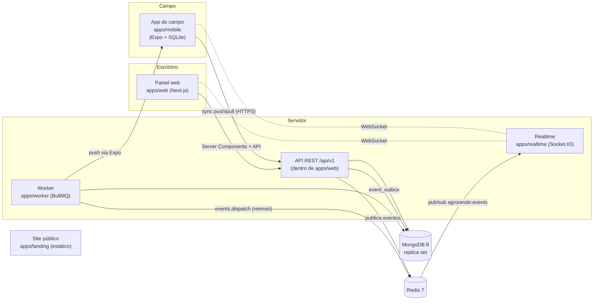
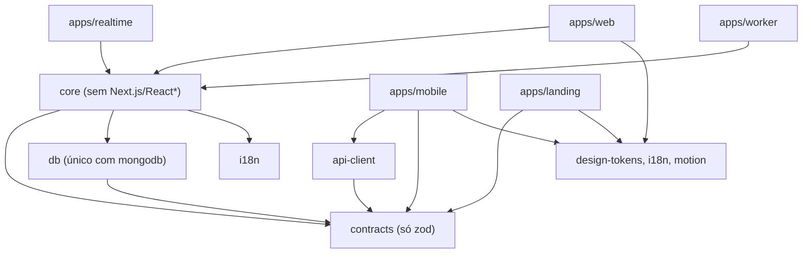
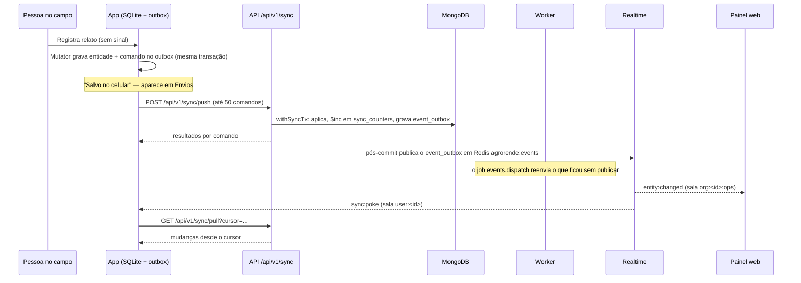

# Arquitetura

Resumo navegável de [`docs/ARCHITECTURE.md`](https://github.com/pedroafsouza/agrorende/blob/main/docs/ARCHITECTURE.md),
que continua sendo a fonte normativa. Todo nome definido ali (pacotes, arquivos, coleções, enums,
mutações, eventos, rotas, variáveis de ambiente, códigos de erro) deve ser usado exatamente.

## Visão geral do sistema



## Mapa do monorepo

```text
apps/
  web/        Painel do escritório + API REST /api/v1 + console da plataforma (Next.js)
  landing/    Site público estático, pt-BR e en (Next.js output: export)
  mobile/     App de campo offline-first (Expo)
  realtime/   Gateway Socket.IO
  worker/     Jobs BullMQ e o simulador de demo
packages/
  contracts/  Esquemas zod, enums, máquinas de estado, mutações, erros, eventos realtime
  db/         Cliente MongoDB, coleções, índices, migrações, seed, scoped(), withSyncTx()
  core/       Regras de negócio, auth, sync, eventos, PDFs, exportações, jobs
  api-client/ Cliente tipado da API
  i18n/       Catálogos compartilhados e formatação
  design-tokens/  Tokens "Campo claro" e SVGs da marca
  motion/     Animações Lottie geradas por código
  config/     tsconfig, ESLint e Prettier compartilhados
scripts/      dev-setup, devloop, check-only, i18n-check, smoke
infra/        Compose de produção e infraestrutura
docs/         Especificação, planos, revisões e esta wiki
```

> O site público se chama `apps/landing` no repositório. Alguns trechos antigos da especificação
> ainda o chamam de `site`.

## Regras de dependência

Garantidas por ESLint ([`packages/config/eslint`](https://github.com/pedroafsouza/agrorende/tree/main/packages/config/eslint)).
Não contorne estas regras.



- `packages/contracts` depende **somente** de `zod`.
- **Só** `packages/db` importa o driver `mongodb` (e chama `.collection(`).
- `packages/core` importa `contracts` e `db` e nunca importa Next.js ou React, com as exceções
  estreitas de `jobs/**` (BullMQ), `modules/exports/**` (csv-stringify) e `pdf/**` (React PDF).
- Apps nunca importam outros apps.
- `apps/mobile` nunca importa `core` ou `db` em tempo de execução (só como devDependency da suíte
  de caos).

## Fluxo de dados offline-first

O app de campo grava tudo primeiro no celular e sincroniza depois. O WebSocket só **avisa** que há
novidades; ele **nunca** é a fonte da verdade.



Pontos-chave:

- **Mutators** em [`apps/mobile/src/sync/mutators`](https://github.com/pedroafsouza/agrorende/tree/main/apps/mobile/src/sync/mutators)
  gravam a entidade local e o comando no outbox numa única transação SQLite.
- O **engine** ([`apps/mobile/src/sync/engine.ts`](https://github.com/pedroafsouza/agrorende/blob/main/apps/mobile/src/sync/engine.ts))
  faz push e pull; conflitos e falhas aparecem na tela **Envios** (central de sync).
- No servidor, cada organização tem um `syncVersion` monotônico, obtido com `$inc` em
  `sync_counters` dentro de `withSyncTx`
  ([`packages/db/src/withSyncTx.ts`](https://github.com/pedroafsouza/agrorende/blob/main/packages/db/src/withSyncTx.ts)).
  O pull pede tudo acima do cursor.
- Comandos são idempotentes: reenviar o mesmo comando não duplica nada.

## Eventos em tempo real

Definidos em [`packages/contracts/src/realtime.ts`](https://github.com/pedroafsouza/agrorende/blob/main/packages/contracts/src/realtime.ts).

| Evento | Para quê | Sala |
|---|---|---|
| `entity:changed` | Uma entidade mudou; o painel invalida o cache | `org:<id>:ops` e/ou `user:<id>` |
| `operator:location` | Posição de um técnico em serviço | `org:<id>:ops` |
| `sync:poke` | Avisa o app que há algo para puxar | `user:<id>` |
| `notification:new` | Nova notificação no sino | `user:<id>` |
| `org:status` | Mudança de status da organização (trial, suspensa…) | `org:<id>` |

## Multi-tenancy

- Cada empresa cliente é uma **organização**. Todo documento de negócio tem `organizationId`.
- O acesso aos dados passa por `scoped(ctx, db)`
  ([`packages/db/src/scoped.ts`](https://github.com/pedroafsouza/agrorende/blob/main/packages/db/src/scoped.ts)),
  que injeta o `organizationId` do contexto em toda consulta e escrita.
- Acessar um registro de outra organização devolve **NOT_FOUND** (nunca "proibido"), para não
  revelar que ele existe. Uma suíte de testes cross-tenant garante isso.
- A organização B do seed ("Fazenda Boa Vista") existe para esses testes
  (veja [Usuários de demonstração](Usuarios-de-Demonstracao)).
- A equipe AgroRende administra organizações pelo **console da plataforma** (`/platform`), com
  sessão separada.

## Autenticação e papéis

- **Email e senha** (argon2id) e **Google / Apple** via OpenID Connect com PKCE (bibliotecas
  `arctic` e `jose`), em [`packages/core/src/auth`](https://github.com/pedroafsouza/agrorende/tree/main/packages/core/src/auth).
  Localmente, Google e Apple usam o mock OIDC na porta 4003.
- **Tokens:** access token JWT de 15 minutos e refresh token de 30 dias com rotação.
  No navegador, cookies `ar_access` e `ar_refresh`; o console da plataforma usa `ar_platform`.
  No app, os tokens ficam no armazenamento seguro do aparelho.
- **Papéis:** `ADMIN` (Administrador), `MANAGER` (Gestor) e `FIELD` (Campo). O escritório
  (`OFFICE_ROLES`) é ADMIN + MANAGER; checagens em
  [`packages/core/src/permissions.ts`](https://github.com/pedroafsouza/agrorende/blob/main/packages/core/src/permissions.ts)
  e [`packages/core/src/guards.ts`](https://github.com/pedroafsouza/agrorende/blob/main/packages/core/src/guards.ts).
- O painel web intercepta as requisições em [`apps/web/src/proxy.ts`](https://github.com/pedroafsouza/agrorende/blob/main/apps/web/src/proxy.ts)
  (o "middleware" do Next.js 16).

## Jobs do worker

Ficam em [`apps/worker/src/jobs/`](https://github.com/pedroafsouza/agrorende/tree/main/apps/worker/src/jobs):
`events.dispatch`, `notifications.push`, `exports.build`, `workOrders.slaScan`,
`rentals.overdueScan`, `maintenance.dueScan`, `stock.lowScan`, `devices.staleSync`,
`orgs.lifecycle`, `orgs.purge`, `usage.daily` e as limpezas (`*.prune`, `media.cleanupPending`).

## Ambientes

`APP_ENV` sobe a escada **local → ci → staging → production**. O seed e os resets recusam
`production`. Detalhes em [Releases](Releases).
